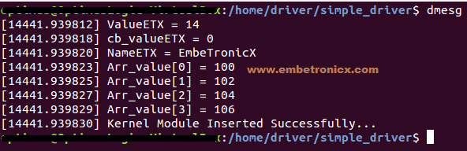

- [Introduction to Linux Device Drivers](#introduction-to-linux-device-drivers)
  - [Linux Architecture](#linux-architecture)
    - [Kernel Space](#kernel-space)
    - [User Space](#user-space)
  - [Linux Kernel Modules](#linux-kernel-modules)
    - [1. Linux Device Drivers](#1-linux-device-drivers)
    - [2. Filesystem Drivers](#2-filesystem-drivers)
    - [3. System Calls](#3-system-calls)
  - [Advantages of Loadable Kernel Modules (LKMs) – Simple Explanation](#advantages-of-loadable-kernel-modules-lkms--simple-explanation)
    - [1. No need to rebuild the whole kernel:](#1-no-need-to-rebuild-the-whole-kernel)
    - [2. Flexible and easy to use:](#2-flexible-and-easy-to-use)
    - [3. Saves memory:](#3-saves-memory)
    - [What is a Device Driver?](#what-is-a-device-driver)
  - [Differences Between Kernel Modules and User Programs (Simple Explanation)](#differences-between-kernel-modules-and-user-programs-simple-explanation)
  - [Difference Between Kernel Drivers and Kernel Modules (Simple Explanation)](#difference-between-kernel-drivers-and-kernel-modules-simple-explanation)
  - [📚 Types of Device Drivers](#-types-of-device-drivers)
- [First Device Driver](#first-device-driver)
  - [Module Information (Simple and Brief)](#module-information-simple-and-brief)
    - [**1. License**](#1-license)
    - [**2. Author**](#2-author)
    - [**3. Module Description**](#3-module-description)
    - [**4. Module Version**](#4-module-version)
    - [Summary](#summary)
  - [Init function](#init-function)
  - [Exit function](#exit-function)
  - [Printk()](#printk)
  - [First Linux Device Driver – Simple Linux Device Driver](#first-linux-device-driver--simple-linux-device-driver)
    - [Compilinf out driver](#compilinf-out-driver)
    - [Step to load, verify and unload module](#step-to-load-verify-and-unload-module)
- [Passing Arguments to Linux Device Driver](#passing-arguments-to-linux-device-driver)
  - [Module Parameters Macros](#module-parameters-macros)
  - [# module\_param() Macro in Linux Kernel](#-module_param-macro-in-linux-kernel)
    - [Syntax:](#syntax)
    - [Example:](#example)
    - [Supported Types:](#supported-types)
  - [`module_param_array()`](#module_param_array)
  - [`module_param_cb()`](#module_param_cb)
    - [Loading the Driver](#loading-the-driver)
- [Major Number and Minor Number](#major-number-and-minor-number)
  - [Major Number](#major-number)
  - [Minor Number](#minor-number)
  - [Allocating Major and Minor Number](#allocating-major-and-minor-number)
    - [1. Statically allocation](#1-statically-allocation)
    - [2. Dynamically Allocation](#2-dynamically-allocation)
    - [Difference between static and dynamic method](#difference-between-static-and-dynamic-method)
  - [Unregister the Major and Minor Number](#unregister-the-major-and-minor-number)
  - [Static allocation example code](#static-allocation-example-code)
  - [Dynamic allocation example code](#dynamic-allocation-example-code)
- [Device File Creation for Character Drivers](#device-file-creation-for-character-drivers)
  - [Device Files](#device-files)
    - [Why Device Files Are Useful](#why-device-files-are-useful)
    - [Examples of Device Files](#examples-of-device-files)
    - [Listing Device Files](#listing-device-files)
  - [Creating Device File](#creating-device-file)
    - [1. Manually](#1-manually)
      - [**Setting Permissions Later**](#setting-permissions-later)
      - [**Advantages of Manual Creation**](#advantages-of-manual-creation)
      - [**Programming Note**](#programming-note)
    - [Automatically Create](#automatically-create)
      - [What udev does in your driver](#what-udev-does-in-your-driver)
      - [Where udev is in Linux](#where-udev-is-in-linux)
- [Cdev structure and File Operations](#cdev-structure-and-file-operations)
  - [What is file\_operations?](#what-is-file_operations)
    - [Important fields](#important-fields)
    - [Example](#example-1)
    - [Key points](#key-points)
  - [Why cdev structure is needed](#why-cdev-structure-is-needed)
  - [Structure of `cdev`](#structure-of-cdev)
  - [Allocating and initializing a cdev](#allocating-and-initializing-a-cdev)
    - [Allocating `cdev struct`](#allocating-cdev-struct)
      - [Option 1: Runtime allocation](#option-1-runtime-allocation)
      - [Option 2: Embedded allocation](#option-2-embedded-allocation)
  - [Adding the cdev to the kernel](#adding-the-cdev-to-the-kernel)
  - [Removing a cdev](#removing-a-cdev)
  - [Example code](#example-code)
- [Real Device Driver program](#real-device-driver-program)
  - [Kernel Memory \& User-Kernel Data Transfer Functions](#kernel-memory--user-kernel-data-transfer-functions)
  - [All Important `kmalloc()` GFP Flags Explained](#all-important-kmalloc-gfp-flags-explained)
  - [Kernel space code](#kernel-space-code)
  - [User space code](#user-space-code)
    - [output](#output)
- [User-Kernel Communication](#user-kernel-communication)
  - [Netlink Sockets](#netlink-sockets)
    - [What is a Netlink Driver?](#what-is-a-netlink-driver)
    - [Features of a Netlink Driver](#features-of-a-netlink-driver)
    - [Why a Netlink Driver is Needed](#why-a-netlink-driver-is-needed)
    - [Comparison table with `ioctl`, `Character Device Driver` and `Netlink`](#comparison-table-with-ioctl-character-device-driver-and-netlink)
    - [✅ Netlink Function Reference Table](#-netlink-function-reference-table)
    - [✅ Netlink User ↔ Kernel Communication Table](#-netlink-user--kernel-communication-table)
    - [Kernel Module: CAN Error Notifications via Netlink](#kernel-module-can-error-notifications-via-netlink)
    - [User-Space Client: Dual-Channel Epoll](#user-space-client-dual-channel-epoll)
  - [🔑 ioctl() — Input/Output Control](#-ioctl--inputoutput-control)
    - [Some Real-time Applications of IOCTL are:](#some-real-time-applications-of-ioctl-are)
    - [Steps Involved in IOCTL](#steps-involved-in-ioctl)
    - [⚙️ How ioctl works:](#️-how-ioctl-works)
    - [🧪 Example: Send two integers from user → kernel → return their sum](#-example-send-two-integers-from-user--kernel--return-their-sum)
      - [🔁 Flow:](#-flow)
      - [📂 Kernel Module — `ioctl_example.c`](#-kernel-module--ioctl_examplec)
      - [User-Space Program — user\_ioctl.c](#user-space-program--user_ioctlc)
      - [🔧 Step 1: Compile the Kernel Module](#-step-1-compile-the-kernel-module)
      - [📥 Step 2: Insert the Kernel Module](#-step-2-insert-the-kernel-module)
      - [📝 Step 3: Check the Device Node](#-step-3-check-the-device-node)
      - [🧑‍💻 Step 4: Compile the User Program](#-step-4-compile-the-user-program)
      - [▶️ Step 5: Run the User Program](#️-step-5-run-the-user-program)
      - [🧹 Step 6: Cleanup](#-step-6-cleanup)
    - [Important : ADSD3500 (Analog Devices depth camera) This is latest Qualcomm sensor](#important--adsd3500-analog-devices-depth-camera-this-is-latest-qualcomm-sensor)
      - [📦 User-Space Access Example](#-user-space-access-example)
    - [Summury](#summury)
  - [Simple `sysfs` Example for User-Kernel Communication](#simple-sysfs-example-for-user-kernel-communication)
    - [What is `sysfs`?](#what-is-sysfs)
    - [Kernel Objects](#kernel-objects)
    - [SysFS in Linux Device Driver](#sysfs-in-linux-device-driver)
      - [1. Create a directory in /sys](#1-create-a-directory-in-sys)
      - [2. Create Sysfs file](#2-create-sysfs-file)
    - [Sysfs Example Driver Code](#sysfs-example-driver-code)
    - [How to Load and Test the Module](#how-to-load-and-test-the-module)
      - [1. Makefile](#1-makefile)
      - [2. Building and testing driver](#2-building-and-testing-driver)
- [Waitqueue in Linux](#waitqueue-in-linux)
  - [Initializing Waitqueue](#initializing-waitqueue)
  - [Queuing](#queuing)
  - [Waking Up Queued Task](#waking-up-queued-task)
  - [Waitqueue created by Static Method](#waitqueue-created-by-static-method)
  - [Waitqueue created by Dynamic Method](#waitqueue-created-by-dynamic-method)
- [Interrupts in Linux kernel](#interrupts-in-linux-kernel)
    - [Polling vs Interrupts](#polling-vs-interrupts)
  - [What will happen when the interrupt comes?](#what-will-happen-when-the-interrupt-comes)
  - [Interrupts and Exceptions](#interrupts-and-exceptions)
  - [Interrupt Handler (ISR) – Simple Definition](#interrupt-handler-isr--simple-definition)
  - [Process Context and Interrupt Context](#process-context-and-interrupt-context)
    - [🟢 Process Context:](#-process-context)
    - [🔴 Interrupt Context:](#-interrupt-context)
    - [⚠️ Why Long Interrupt Handlers Are a Problem:](#️-why-long-interrupt-handlers-are-a-problem)
    - [🛠️ Solution: Split ISR into Two Parts](#️-solution-split-isr-into-two-parts)
    - [🔼 Top Half – The Interrupt Handler](#-top-half--the-interrupt-handler)
      - [✅ What it is:](#-what-it-is)
      - [⚡ What it does:](#-what-it-does)
      - [❌ Limitations:](#-limitations)
    - [🔽 Bottom Half – Deferred Work](#-bottom-half--deferred-work)
      - [✅ What it is:](#-what-it-is-1)
      - [🛠 What it does:](#-what-it-does-1)
      - [✅ Advantages:](#-advantages)
    - [💡 Real-Life Example: Network Card](#-real-life-example-network-card)
- [Interrupt Example Program in Linux Kernel](#interrupt-example-program-in-linux-kernel)
  - [Interrupt-Related Functions with Detailed Arguments](#interrupt-related-functions-with-detailed-arguments)
  - [Common Flags Used with request\_irq() (Explained Simply)](#common-flags-used-with-request_irq-explained-simply)
  - [Example](#example-2)
    - [Problem in Linux kernel \[Solution\]](#problem-in-linux-kernel-solution)
    - [Modify and Build the Linux Kernel](#modify-and-build-the-linux-kernel)
    - [Install the Modified kernel](#install-the-modified-kernel)
    - [Simplified Comparison Table: Workqueue vs Threaded IRQ vs SoftIRQ vs Tasklet](#simplified-comparison-table-workqueue-vs-threaded-irq-vs-softirq-vs-tasklet)
    - [Workqueue VS Threaded IRQ](#workqueue-vs-threaded-irq)
- [Workqueue (Static Method)](#workqueue-static-method)
    - [🔧 What is a Workqueue?](#-what-is-a-workqueue)
    - [🧠 Why do we need Workqueues?](#-why-do-we-need-workqueues)
    - [Workqueues run in process context, not interrupt context — so they can sleep.](#workqueues-run-in-process-context-not-interrupt-context--so-they-can-sleep)
    - [✌️ Two ways to use Workqueues:](#️-two-ways-to-use-workqueues)
    - [✅ When to use what?](#-when-to-use-what)
    - [🛠️ How Workqueues work:](#️-how-workqueues-work)
    - [Linux Workqueue API Summary Table (with Return Types)](#linux-workqueue-api-summary-table-with-return-types)
    - [Example program](#example-program)
      - [MakeFile](#makefile)
      - [Building and Testing Driver](#building-and-testing-driver)
- [Workqueue (Dynamic Method)](#workqueue-dynamic-method)
  - [1. Initialize Work using Dynamic Method](#1-initialize-work-using-dynamic-method)
  - [2. Schedule Work to the Workqueue](#2-schedule-work-to-the-workqueue)
  - [3. Delete Work from Workqueue](#3-delete-work-from-workqueue)
  - [4. Cancel Work from Workqueue](#4-cancel-work-from-workqueue)
    - [5. Check Workqueue Status](#5-check-workqueue-status)
  - [Program](#program)
  - [MakeFile](#makefile-1)
  - [Building and Testing Driver](#building-and-testing-driver-1)
- [Own Workqueue](#own-workqueue)
  - [🧩 Linux Kernel Workqueue – Step-by-Step Table](#-linux-kernel-workqueue--step-by-step-table)
  - [Example program](#example-program-1)
    - [make file](#make-file)
    - [Building and Testing Driver](#building-and-testing-driver-2)
  - [📌 Summary of Macros \& Functions](#-summary-of-macros--functions)
- [Threaded IRQs](#threaded-irqs)
    - [Why Threaded IRQ?](#why-threaded-irq)
    - [✅ What Threaded IRQ Does](#-what-threaded-irq-does)
    - [Threaded IRQ API](#threaded-irq-api)
    - [Example code](#example-code-1)
    - [Enaple Source code](#enaple-source-code)
  - [https://embetronicx.com/tutorials/linux/device-drivers/threaded-irq-in-linux-kernel/](#httpsembetronicxcomtutorialslinuxdevice-driversthreaded-irq-in-linux-kernel)
- [Static Tasklet](#static-tasklet)
  - [What is a Tasklet in Linux?](#what-is-a-tasklet-in-linux)
  - [⚙️ How Tasklets Work](#️-how-tasklets-work)
    - [🔒 Why It’s Safe](#-why-its-safe)
  - [❌ Limitations](#-limitations-1)
  - [🔁 Better Option: Workqueues](#-better-option-workqueues)
  - [Important Points About Tasklets](#important-points-about-tasklets)
  - [Tasklet Structure](#tasklet-structure)
    - [next](#next)
    - [count](#count)
    - [func](#func)
    - [data](#data)
    - [Tasklet Macros and Functions Summary](#tasklet-macros-and-functions-summary)
  - [Tasklet in Linux – Programming](#tasklet-in-linux--programming)
      - [Output](#output-1)
- [Dynamic Tasklet](#dynamic-tasklet)
  - [Dynamically Creation of Tasklet](#dynamically-creation-of-tasklet)
  - [Example](#example-3)
    - [Dynamic Tasklets in Linux Programming](#dynamic-tasklets-in-linux-programming)
    - [Output](#output-2)
- [Softirqs](#softirqs)
    - [Why Edit the Linux Kernel to Use Softirq?](#why-edit-the-linux-kernel-to-use-softirq)
    - [Step-by-Step: How to Add Your Own Softirq](#step-by-step-how-to-add-your-own-softirq)
      - [1. Add a New Softirq Entry in the Kernel](#1-add-a-new-softirq-entry-in-the-kernel)
      - [2. Write the Softirq Handler Function](#2-write-the-softirq-handler-function)
      - [3. Register Your Softirq Handler](#3-register-your-softirq-handler)
      - [4. Trigger (Raise) the Softirq from Your Code (like ISR)](#4-trigger-raise-the-softirq-from-your-code-like-isr)
      - [5. Export Required Kernel APIs](#5-export-required-kernel-apis)
      - [6. Recompile and Boot into Your Custom Kernel](#6-recompile-and-boot-into-your-custom-kernel)
      - [Summary](#summary-1)
    - [When does your softirq run](#when-does-your-softirq-run)
    - [What to Know About Softirqs (Simplified)](#what-to-know-about-softirqs-simplified)
- [Signal](#signal)
    - [Sending Signal from Linux Device Driver to User Space](#sending-signal-from-linux-device-driver-to-user-space)
    - [1. Decide the signal that you want to send](#1-decide-the-signal-that-you-want-to-send)
    - [2. Register the user space application with the driver](#2-register-the-user-space-application-with-the-driver)
    - [3. Send signals to user space on event](#3-send-signals-to-user-space-on-event)
    - [4. Unregister the user space application when done](#4-unregister-the-user-space-application-when-done)
    - [Full Example](#full-example)
    - [Building Driver and Applicatio](#building-driver-and-applicatio)
    - [Execution (Output)](#execution-output)
- [Kernel Thread](#kernel-thread)
    - [Overview](#overview)
    - [Thread Management Includes:](#thread-management-includes)
    - [🧵 Types of Threads](#-types-of-threads)
      - [1. User-Level Threads (ULT)](#1-user-level-threads-ult)
      - [2. Kernel-Level Threads (KLT)](#2-kernel-level-threads-klt)
    - [Kernel Thread Programming](#kernel-thread-programming)
    - [Thread function](#thread-function)
    - [Creating and Starting Kernel Thread](#creating-and-starting-kernel-thread)
    - [Stop Kernel Thread](#stop-kernel-thread)
    - [Example Source code](#example-source-code)
- [Mutex](#mutex)
    - [What is a Mutex (Mutual Exclusion Lock)?](#what-is-a-mutex-mutual-exclusion-lock)
    - [Explanation of `struct mutex` Fields](#explanation-of-struct-mutex-fields)
      - [🔸 `atomic_t count`](#-atomic_t-count)
      - [🔸 `spinlock_t wait_lock`](#-spinlock_t-wait_lock)
      - [🔸 `struct list_head wait_list`](#-struct-list_head-wait_list)
    - [Linux Kernel Mutex Summary Table](#linux-kernel-mutex-summary-table)
    - [Comparison: `mutex_lock()` vs `mutex_trylock()` vs `mutex_lock_interruptible()`](#comparison-mutex_lock-vs-mutex_trylock-vs-mutex_lock_interruptible)
    - [Example Source Code](#example-source-code-1)
- [SpinLock](#spinlock)
    - [✅ Mutex (Mutual Exclusion Lock)](#-mutex-mutual-exclusion-lock)
    - [🔁 Spinlock](#-spinlock)
    - [Spinlock Initialization](#spinlock-initialization)
      - [1. Static Initialization](#1-static-initialization)
      - [2. Dynamic Initialization](#2-dynamic-initialization)
    - [How to Use Spinlocks (Based on Context)](#how-to-use-spinlocks-based-on-context)
      - [Approach 1: Locking between Kernel Threads (User Context)](#approach-1-locking-between-kernel-threads-user-context)
      - [Approach 2: Locking between Bottom Halves](#approach-2-locking-between-bottom-halves)
      - [Approach 3: Locking between Kernel Thread \& Bottom Half](#approach-3-locking-between-kernel-thread--bottom-half)
      - [Approach 4: Locking between ISR (Hard IRQ) \& Bottom Half](#approach-4-locking-between-isr-hard-irq--bottom-half)
      - [Approach 5: Safer Alternative with IRQ Save/Restore](#approach-5-safer-alternative-with-irq-saverestore)
      - [Approach 6: Locking between Two IRQs (Hard IRQs)](#approach-6-locking-between-two-irqs-hard-irqs)
    - [Summary table](#summary-table)
    - [Driver Source Code](#driver-source-code)
- [Read Write Spinlock](#read-write-spinlock)
    - [🧵 Spinlock vs Read-Write Spinlock Explained](#-spinlock-vs-read-write-spinlock-explained)
    - [🔒 What is a Spinlock?](#-what-is-a-spinlock)
    - [🔒📖 What is a Read-Write Spinlock?](#-what-is-a-read-write-spinlock)
    - [🧠 Why is a Read-Write Spinlock Needed?](#-why-is-a-read-write-spinlock-needed)
      - [📌 Case 1: Using **Spinlock**](#-case-1-using-spinlock)
      - [📌 Case 2: Using **Read-Write Spinlock**](#-case-2-using-read-write-spinlock)
    - [⚙️ How Read-Write Spinlock Works](#️-how-read-write-spinlock-works)
    - [📌 Methods of Initialization](#-methods-of-initialization)
      - [✅ 1. Static Initialization](#-1-static-initialization)
      - [2. Dynamic Initialization](#2-dynamic-initialization-1)
      - [Choosing Between Static and Dynamic](#choosing-between-static-and-dynamic)
    - [Approach 1: Locking Between User Context (Kernel Threads)](#approach-1-locking-between-user-context-kernel-threads)
      - [📖 Read Lock](#-read-lock)
      - [Write Lock](#write-lock)
      - [Example](#example-4)
    - [Approach 2: Locking Between Bottom Halves](#approach-2-locking-between-bottom-halves-1)
    - [Approach 3: Locking Between User Context (Kernel threads) and Bottom Halves](#approach-3-locking-between-user-context-kernel-threads-and-bottom-halves)
      - [Read Lock](#read-lock)
      - [Write lock](#write-lock-1)
      - [Example](#example-5)
    - [Approach 4: Locking Between Hard IRQ and Bottom Halves](#approach-4-locking-between-hard-irq-and-bottom-halves)
      - [Read Lock](#read-lock-1)
      - [Write lock](#write-lock-2)
      - [Example](#example-6)
    - [Approach 5: Alternative to Approach 4 (Using `irqsave`/`irqrestore`)](#approach-5-alternative-to-approach-4-using-irqsaveirqrestore)
      - [Read Lock](#read-lock-2)
      - [Write Lock](#write-lock-3)
      - [Approach 6: Locking Between Two Hard IRQs](#approach-6-locking-between-two-hard-irqs)
    - [Summary Table](#summary-table-1)
    - [Example program](#example-program-2)
- [Atomic variable](#atomic-variable)
    - [Problem: Incrementing a shared variable by two threads without synchronization](#problem-incrementing-a-shared-variable-by-two-threads-without-synchronization)
      - [How to fix this? Using synchronization (locks):](#how-to-fix-this-using-synchronization-locks)
    - [Alternative: Atomic operations](#alternative-atomic-operations)
    - [atomic variable defination.](#atomic-variable-defination)
    - [Types of atomic variables](#types-of-atomic-variables)
    - [1. Atomic variables that operate on Integers](#1-atomic-variables-that-operate-on-integers)
    - [2. Atomic Bitwise Operations](#2-atomic-bitwise-operations)
      - [Purpose:](#purpose)
      - [Note:](#note)
      - [Where defined:](#where-defined)
    - [Example program](#example-program-3)
- [seqlock](#seqlock)
    - [🧠 Understanding Seqlock (Sequence Lock) in Linux](#-understanding-seqlock-sequence-lock-in-linux)
    - [🔁 The Sequence Number](#-the-sequence-number)
    - [✍️ Writer's Workflow](#️-writers-workflow)
    - [📖 Reader's Workflow](#-readers-workflow)
    - [💡 Key Characteristics](#-key-characteristics)
    - [🟡 When to Use Seqlock?](#-when-to-use-seqlock)
  - [EXPORT\_SYMBOL](#export_symbol)
    - [Introduction](#introduction)
    - [History](#history)
    - [What is `EXPORT_SYMBOL()`?](#what-is-export_symbol)
      - [Why Use It?](#why-use-it)
    - [Key Points](#key-points-1)
    - [Example](#example-7)
    - [How to Use EXPORT\_SYMBOL in Linux Kernel Modules](#how-to-use-export_symbol-in-linux-kernel-modules)
      - [Steps to Use `EXPORT_SYMBOL`](#steps-to-use-export_symbol)
      - [1. Declare and Define the Symbol](#1-declare-and-define-the-symbol)
      - [2. Use the Exported Symbol in Another Module](#2-use-the-exported-symbol-in-another-module)
      - [3. Load the Modules in the Correct Order](#3-load-the-modules-in-the-correct-order)
      - [Limitations](#limitations)
    - [Exmple code](#exmple-code)
      - [Driver 1 – The Exporter](#driver-1--the-exporter)
      - [✅ Driver 2 – The User](#-driver-2--the-user)
      - [Important Points](#important-points)
      - [driver1.c](#driver1c)
      - [Compiling and Testing Driver](#compiling-and-testing-driver)
- [Kernel Timer](#kernel-timer)
  - [Timer](#timer)
    - [Introduction](#introduction-1)
  - [Timer in Linux Kernel](#timer-in-linux-kernel)
  - [Uses of Kernel Timers](#uses-of-kernel-timers)
  - [Linux Kernel Timer API](#linux-kernel-timer-api)
    - [Timer Initialization / Setup](#timer-initialization--setup)
    - [Starting / Modifying Timers](#starting--modifying-timers)
    - [Stopping Timers](#stopping-timers)
    - [Timer Status Check](#timer-status-check)
  - [Device Driver Source Code](#device-driver-source-code)
  - [Points to remember](#points-to-remember)
    - [What you MUST NOT do in the callback](#what-you-must-not-do-in-the-callback)
- [High-Resolution Timer (HRT)](#high-resolution-timer-hrt)
  - [🕒 1. Normal Kernel Timer (Low-Resolution Timer)](#-1-normal-kernel-timer-low-resolution-timer)
    - [✔ How it works](#-how-it-works)
    - [✔ Data structure used](#-data-structure-used)
  - [⏱️ 2. High-Resolution Timer (HRT / hrtimer)](#️-2-high-resolution-timer-hrt--hrtimer)
    - [✔ What makes HRT different?](#-what-makes-hrt-different)
    - [✔ Why so accurate?](#-why-so-accurate)
  - [Why isn’t HRT merged into normal timers?](#why-isnt-hrt-merged-into-normal-timers)
  - [✔ When were high-resolution timers introduced?](#-when-were-high-resolution-timers-introduced)
  - [How to check if your system supports HRT](#how-to-check-if-your-system-supports-hrt)
    - [1. Look inside `/boot/config-*`](#1-look-inside-bootconfig-)
    - [2. Check `/proc/timer_list`](#2-check-proctimer_list)
    - [3. Use `clock_getres()` in a C program](#3-use-clock_getres-in-a-c-program)
  - [Who uses High-Resolution Timers?](#who-uses-high-resolution-timers)
    - [✔ In user-space](#-in-user-space)
    - [✔ In the kernel](#-in-the-kernel)
  - [Summary table](#summary-table-2)
  - [High-Resolution Timer (HRTIMER) API](#high-resolution-timer-hrtimer-api)
  - [Example Code](#example-code-2)
- [GPIO Linux Device Driver](#gpio-linux-device-driver)
  - [Linux Kernel GPIO APIs Summary Table](#linux-kernel-gpio-apis-summary-table)
  - [Makefile](#makefile-2)
  - [Testing the Device Driver](#testing-the-device-driver)
- [I2C Linux Device Driver](#i2c-linux-device-driver)
  - [I2C Driver in Linux Kernel](#i2c-driver-in-linux-kernel)
  - [Example code for oled](#example-code-for-oled)
- [Linux SPI Subsystem](#linux-spi-subsystem)
  - [1. SPI Subsystem Architecture (High Level)](#1-spi-subsystem-architecture-high-level)
  - [SPI Core (The Manager)](#spi-core-the-manager)
    - [SPI Core Provides Simple APIs](#spi-core-provides-simple-apis)
  - [SPI Controller Driver (Hardware-Specific)](#spi-controller-driver-hardware-specific)
    - [What is it?](#what-is-it)
    - [Who writes it?](#who-writes-it)
    - [What it does:](#what-it-does)
    - [Example:](#example-8)
  - [SPI Protocol Driver (Device Driver)](#spi-protocol-driver-device-driver)
  - [my\_spi\_driver.c](#my_spi_driverc)
  - [DEVICE TREE ENTRY (MANDATORY)](#device-tree-entry-mandatory)
    - [dmesg](#dmesg)
    - [debug whether spi device created or not](#debug-whether-spi-device-created-or-not)
    - [Read SPI Data](#read-spi-data)
    - [Kernel log](#kernel-log)
- [This is Old](#this-is-old)
  - [Module 8: Interrupt Handling](#module-8-interrupt-handling)
    - [🧠 What is an Interrupt Handler?](#-what-is-an-interrupt-handler)
    - [🔀 Top Half and Bottom Half](#-top-half-and-bottom-half)
    - [🧱 keyboard\_irq\_example.c — Print Message on Keypress](#-keyboard_irq_examplec--print-message-on-keypress)
    - [What is a Tasklet in Device Drivers? (Simple Explanation)](#what-is-a-tasklet-in-device-drivers-simple-explanation)
      - [💡 Why use Tasklets?](#-why-use-tasklets)
      - [📌 Key Features of Tasklets:](#-key-features-of-tasklets)
      - [Simple Example of a Tasklet in Linux Kernel Module](#simple-example-of-a-tasklet-in-linux-kernel-module)
    - [Kernel-Level Thread \& Spinlock](#kernel-level-thread--spinlock)
      - [What is a Kernel-Level Thread?](#what-is-a-kernel-level-thread)
      - [Why don't we need full threads for tasklets and interrupts?](#why-dont-we-need-full-threads-for-tasklets-and-interrupts)
      - [🔧 What are interrupts?](#-what-are-interrupts)
      - [💡 Problem:](#-problem)
      - [✅ Solution: Use Tasklets (Bottom Half)](#-solution-use-tasklets-bottom-half)
      - [⚙️ Why not a thread?](#️-why-not-a-thread)
    - [🧵 2. What is a Spinlock?](#-2-what-is-a-spinlock)
      - [🔐 A spinlock is a simple locking mechanism used in the kernel.](#-a-spinlock-is-a-simple-locking-mechanism-used-in-the-kernel)
    - [Practical Example: Two Kernel Threads Using Spinlock](#practical-example-two-kernel-threads-using-spinlock)
      - [💡 Goal:](#-goal)
      - [🧠 What You’ll Learn:](#-what-youll-learn)
      - [Summary of Key Concepts:](#summary-of-key-concepts)
      - [Output (example from dmesg):](#output-example-from-dmesg)
  - [Module 9: Synchronization Techniques](#module-9-synchronization-techniques)
    - [1. 🌀 Spinlocks](#1--spinlocks)
      - [Example:](#example-9)
    - [2. 🧱 Semaphores](#2--semaphores)
      - [Example:](#example-10)
    - [3. 🔒 Mutexes](#3--mutexes)
      - [Example:](#example-11)
    - [4. ⚛️ Atomic Variables](#4-️-atomic-variables)
      - [Example:](#example-12)
    - [5. 💤 Wait Queues](#5--wait-queues)
    - [Summary Table](#summary-table-3)
  - [Module 10: Timers and Delays](#module-10-timers-and-delays)
    - [🔹 1. Timer](#-1-timer)
    - [🔹 2. Delays](#-2-delays)
  - [| `ssleep()`               | Sleep for seconds (used in testing, not drivers) |](#-ssleep----------------sleep-for-seconds-used-in-testing-not-drivers-)
    - [🧭 Sleep vs. Delay in Device Drivers](#-sleep-vs-delay-in-device-drivers)
    - [✅ Example: Timer and Delay in a Character Device Driver](#-example-timer-and-delay-in-a-character-device-driver)
    - [🔍 Explanation Summary](#-explanation-summary)
  - [Module 11: Memory Management in Kernel](#module-11-memory-management-in-kernel)
    - [What is Memory Management in the Kernel?](#what-is-memory-management-in-the-kernel)
      - [Common Kernel Memory Allocation APIs](#common-kernel-memory-allocation-apis)
    - [Example Code: Memory Allocation with kmalloc() and kfree()](#example-code-memory-allocation-with-kmalloc-and-kfree)
    - [🧠 When to Use What](#-when-to-use-what-1)
  - [Module 12: Block Device Drivers (Optional)](#module-12-block-device-drivers-optional)
  - [Module 13: Network Device Drivers (Optional)](#module-13-network-device-drivers-optional)
  - [Module 14: Power Management and PM API](#module-14-power-management-and-pm-api)
    - [🧩 Types of Power Management](#-types-of-power-management)
    - [🔧 Linux PM APIs](#-linux-pm-apis)
    - [Example: Platform Driver with PM Support](#example-platform-driver-with-pm-support)
  - [Module 15: Device Tree Basics (for Embedded)](#module-15-device-tree-basics-for-embedded)
    - [🧠 What Is a Device Tree?](#-what-is-a-device-tree)
    - [🤔 Why Do We Need Device Tree?](#-why-do-we-need-device-tree)
    - [🗂️ Device Tree Files](#️-device-tree-files)
    - [🧱 Device Tree Structure](#-device-tree-structure)
      - [🧠 Key Terms](#-key-terms)
    - [✅ Real Example: Describing a GPIO LED](#-real-example-describing-a-gpio-led)
    - [🛠️ Example: Describing a Custom UART Peripheral](#️-example-describing-a-custom-uart-peripheral)
  - [Module 16: Debugging Techniques](#module-16-debugging-techniques)
    - [🛠️ 1. Debugging Techniques in Linux Device Drivers](#️-1-debugging-techniques-in-linux-device-drivers)
      - [Why Kernel Debugging is Hard](#why-kernel-debugging-is-hard)
    - [Key Tools \& Techniques](#key-tools--techniques)
    - [Sample: `printk()` with log level](#sample-printk-with-log-level)
    - [📟 dmesg – Kernel Message Log](#-dmesg--kernel-message-log)
    - [3. 🔁 Dynamic Debugging](#3--dynamic-debugging)
    - [4. 🧩 Using /proc and /sys for Status](#4--using-proc-and-sys-for-status)
    - [5. 🧮 debugfs – Expose Internal Data](#5--debugfs--expose-internal-data)
    - [6. ⚠️ WARN\_ON() and BUG\_ON()](#6-️-warn_on-and-bug_on)
    - [7. 📡 ftrace – Kernel Function Tracing](#7--ftrace--kernel-function-tracing)
    - [8. 🐞 kgdb – Kernel GDB Debugging (Advanced)](#8--kgdb--kernel-gdb-debugging-advanced)
    - [✅ Best Practices](#-best-practices)
  - [Module 17: Testing and Automation](#module-17-testing-and-automation)
    - [🧪 Testing and Automation for Device Drivers](#-testing-and-automation-for-device-drivers)
    - [🎯 Goals of Driver Testing](#-goals-of-driver-testing)
    - [🧰 Types of Driver Testing](#-types-of-driver-testing)
      - [1. **Unit Testing**](#1-unit-testing)
      - [2. **Integration Testing**](#2-integration-testing)
      - [3. **Functional Testing**](#3-functional-testing)
      - [4. **Stress Testing**](#4-stress-testing)
      - [5. **Performance Testing**](#5-performance-testing)
    - [6. **Security Testing**](#6-security-testing)
    - [🧪 Driver Testing Tools](#-driver-testing-tools)
      - [Windows](#windows)
      - [Linux](#linux)
    - [🔁 Automation Strategies](#-automation-strategies)
      - [CI/CD Integration](#cicd-integration)
      - [Virtualized Environments](#virtualized-environments)
      - [Test Scripts](#test-scripts)
      - [Logging \& Reporting](#logging--reporting)
    - [🔍 Sample Linux Test Script](#-sample-linux-test-script)
  - [Module 18: Driver Deployment \& Packaging](#module-18-driver-deployment--packaging)
    - [Driver Deployment \& Packaging](#driver-deployment--packaging)
    - [📦 What is Driver Packaging?](#-what-is-driver-packaging)
    - [Components of a Driver Package](#components-of-a-driver-package)
    - [🚀 Driver Deployment](#-driver-deployment)
      - [Common Deployment Scenarios](#common-deployment-scenarios)
    - [📂 Packaging Tools (Platform-Specific)](#-packaging-tools-platform-specific)
      - [Windows](#windows-1)
      - [Linux](#linux-1)
    - [🔐 Signing Drivers](#-signing-drivers)
    - [✅ Best Practices](#-best-practices-1)
    - [🛠️ Example: Linux Driver Packaging with DKMS](#️-example-linux-driver-packaging-with-dkms)
  - [Module 19: Capstone Project](#module-19-capstone-project)
    - [🧠 What Is ADS1115?](#-what-is-ads1115)
    - [✅ Key Takeaways (in comment form)](#-key-takeaways-in-comment-form)
    - [🧪 Deployment Steps](#-deployment-steps)
    - [Use space program](#use-space-program)
      - [dmesg output](#dmesg-output)
    - [Sound card program (tda7850)](#sound-card-program-tda7850)
    - [📁 2. Device Tree Snippet (.dts or .dtsi)](#-2-device-tree-snippet-dts-or-dtsi)
    - [🧪 3. How to Compile \& Use the Module](#-3-how-to-compile--use-the-module)
    - [📦 4. DTS Overlay for Raspberry Pi (tda7850-overlay.dts)](#-4-dts-overlay-for-raspberry-pi-tda7850-overlaydts)
    - [🧪 test\_amp.sh — User-Space Control Script](#-test_ampsh--user-space-control-script)
  - [Writing a PCI Driver: Detailed Step-by-Step Guide](#writing-a-pci-driver-detailed-step-by-step-guide)
    - [Step 1: Identify the PCI device](#step-1-identify-the-pci-device)
      - [What is it?](#what-is-it-1)
      - [Why do you need it?](#why-do-you-need-it)
      - [How do you do it?](#how-do-you-do-it)
    - [Step 2: Register the PCI driver](#step-2-register-the-pci-driver)
      - [What is it?](#what-is-it-2)
      - [Why do you do it?](#why-do-you-do-it)
    - [Step 3: Probe function — Initialize the device](#step-3-probe-function--initialize-the-device)
      - [What is it?](#what-is-it-3)
      - [What happens inside the probe function?](#what-happens-inside-the-probe-function)
      - [🧠 In short:](#-in-short)
      - [Example](#example-13)
    - [Step 4: Cleanup in remove function](#step-4-cleanup-in-remove-function)
    - [Example Code with makefile and debug Steps](#example-code-with-makefile-and-debug-steps)
      - [my\_pci\_driver.c](#my_pci_driverc)
      - [Makefile (with debug symbols)](#makefile-with-debug-symbols)
      - [How to Compile and Test](#how-to-compile-and-test)
    - [🚨 Replace with Your Real PCI Device](#-replace-with-your-real-pci-device)
    - [Summary of Key Concepts](#summary-of-key-concepts-1)
  - [What is the role of platform\_driver and platform\_device?](#what-is-the-role-of-platform_driver-and-platform_device)
- [MCP25XXd IC , CAN-FD IC](#mcp25xxd-ic--can-fd-ic)
  - [1. General System Architecture (High-Level View)](#1-general-system-architecture-high-level-view)
  - [2. TX Path (Transmit Flow – Detailed Interview View)](#2-tx-path-transmit-flow--detailed-interview-view)
  - [3. RX Path (Receive Flow – Detailed Interview View)](#3-rx-path-receive-flow--detailed-interview-view)


# Introduction to Linux Device Drivers
## Linux Architecture
- Linux is primarily divided into **User Space** & **Kernel Space**. 
- These two components interact through a System Call Interface – which is a predefined and matured interface to Linux Kernel for Userspace applications. The below image will give you a basic understanding.

Note: Image from : https://embetronicx.com/tutorials/linux/device-drivers/linux-device-driver-part-1-introduction/


### Kernel Space
Kernel space is where the kernel (i.e. the core of the operating system) executes (i.e. runs) and provides its services.

### User Space
User Space is where the user applications are executed.

## Linux Kernel Modules

Kernel modules are pieces of code that can be loaded and unloaded into the kernel upon demand. They extend the functionality of the kernel without the need to reboot the system.

Custom codes can be added to Linux kernels via two methods.

  - The basic way is to add the code to the kernel source tree and recompile the kernel.
  - A more efficient way to do this is by adding code to the kernel while it is running. This process is called loading the module, where the module refers to the code that we want to add to the kernel.

Since we are loading these codes at runtime, and they are not part of the official Linux kernel, these are called **loadable kernel modules (LKM)**, which is different from the “base kernel”. 
The **base kernel** is located in the */boot* directory and is always loaded when we boot our machine, whereas LKMs are loaded after the base kernel is already loaded.


Nonetheless, this LKM is very much part of our kernel, and they communicate with the base kernel to complete their functions.

Loadable kernel modules serve various purposes, but the most common applications are-

- Device drivers

- Filesystem drivers

- System calls

### 1. Linux Device Drivers
   - A device driver is designed for a specific piece of hardware. 
   - The kernel uses it to communicate with that piece of hardware without having to know any details of how the hardware works.

### 2. Filesystem Drivers
   - A filesystem driver is like a **translator** that helps the computer understand how files and folders are stored on a disk or network.

   - Different systems store data in different ways, so the computer needs the right driver (translator) to read each type, like ext2, MS-DOS/FAT, or NFS. 
  
### 3. System Calls
   - Userspace programs use system calls to get services from the kernel. 
   - For example, there are system calls to read a file, create a new process, and shut down the system. 
   - Most system calls are integral to the system and very standard, so are always built into the base kernel (no LKM option).

   - But you can also create your own system call or even replace an existing one by loading it as a loadable kernel module (LKM).  

## Advantages of Loadable Kernel Modules (LKMs) – Simple Explanation

### 1. No need to rebuild the whole kernel:
When you add new hardware or features, you don’t have to rebuild the entire operating system kernel. You can just add a module. This saves time and reduces mistakes.

### 2. Flexible and easy to use:
LKMs can be loaded or removed with simple commands whenever needed.

### 3. Saves memory:
Since modules are loaded only when required, they don’t take up memory all the time. 

### What is a Device Driver?
A device driver is a program that lets the Linux kernel communicate with hardware devices (like USB drives, keyboards, or virtual devices). It acts as a translator between hardware and software.


## Differences Between Kernel Modules and User Programs (Simple Explanation)

1. **Where They Run**
   - **Kernel modules** run in **kernel space** (the core of the OS).
   - **User programs** run in **userspace** (a safe, restricted area).
   - Kernel space is protected so user programs cannot damage the system.

2. **Privileges**
   - Kernel modules have **higher privileges** and can access hardware directly.
   - User programs have **limited privileges** for safety.

3. **How They Run**
   - User programs run **sequentially** from start to finish.
   - Kernel modules do **not run like normal programs**. They register themselves and **respond only when needed**.

4. **Header Files**
   - Kernel modules use **special kernel header files**.
   - User programs use **standard C header files**.

## Difference Between Kernel Drivers and Kernel Modules (Simple Explanation)

- **Kernel Module**
  - A kernel module is a **piece of code** that can be **added to the kernel while the system is running**.
  - You load it using commands like `insmod` or `modprobe`.
  - It is basically **plug-in code** for the kernel.

- **Kernel Driver**
  - A driver is code inside the kernel that **controls or communicates with hardware**.
  - Every hardware device (keyboard, mouse, network card, etc.) has a driver.
  - A driver *can be* a kernel module, but not all kernel modules are drivers.

**Simple idea:**  
A **kernel module** is something you can load into the kernel.  
A **driver** is something that controls hardware — and it is often delivered as a module.

 ## 📚 Types of Device Drivers
 | Type        | Example Hardware     | Key Feature                      |
 | ----------- | -------------------- | -------------------------------- |
 | Character   | Serial port, sensor  | Byte-wise data access            |
 | Block       | Hard disk, SD card   | Block I/O, supports file systems |
 | Network     | Ethernet, Wi-Fi      | Packet transmission              |
 | Platform    | On-chip peripherals  | Embedded systems                 |
 | USB         | Flash drives, webcam | Plug-and-play support            |
 | PCI         | GPU, sound card      | Auto-detect hardware             |
 | Virtual     | Loopback, RAM disk   | Simulated devices                |
 | File System | ext4, FAT            | File access logic                |
 | Graphics    | Display, GPU         | Rendering & display              |
 | Sound       | Speakers, mic        | Audio I/O                        |

# First Device Driver

## Module Information (Simple and Brief)

Linux kernel modules can include extra information using macros from `linux/module.h`.  
These details help tools like `modinfo` show useful info about the module.

---

### **1. License**
- Shows what license the module uses (e.g., GPL).
- GPL means the code is **free to use, modify, and share** (free as in freedom, not cost).
- Common license options:
  - `"GPL"`   [GNU Public License]
  - `"GPL v2"`
  - `"Dual BSD/GPL"`
  - `"Dual MIT/GPL"`
  - `"Proprietary"` (not free)

**Example:**
```c
MODULE_LICENSE("GPL");
```
### **2. Author**

- Shows who wrote the module.

- Helps users know the creator.

```c
MODULE_AUTHOR("Your Name <email>");
```

### **3. Module Description**

```c
MODULE_DESCRIPTION("A sample driver");
```

### **4. Module Version**

```c
MODULE_VERSION("1.0");
```

### Summary

These fields help users and tools understand:

- Who wrote the module

- What it does

- Which license it uses

- What version it is

All added using simple macros in the source code.

## Init function
- This is the function that will execute first when the Linux device driver is loaded into the kernel. 
- For example, when we load the driver using `insmod`, this function will execute. Please see below to know the syntax of this function.
- This function should register itself by using `module_init()` macro.
```c
static int __init hello_world_init(void) /* Constructor */
{
    return 0;
}
module_init(hello_world_init);
```
## Exit function
- This is the function that will execute last when the Linux device driver is unloaded from the kernel. 
- For example, when we unload the driver using `rmmod`, this function will execute.
- This function should register itself by using` module_exit()` macro. 
- Please see below to know the syntax of this function.

```c
void __exit hello_world_exit(void)
{

}
module_exit(hello_world_exit);
```
## Printk()

- In C programming how we will print the values or whatever? Correct. Using `printf()` function.
- `printf()` is a user-space function. So we cant use this here. So, they have created another function for the kernel which is `printk()`


- One of the differences is that `printk` lets you classify messages according to their severity by associating different log levels, or priorities, with the messages. 
- You usually indicate the log level with a macro. 
- I will explain about the macros now. There are several macros used for printk.

1. `KERN_EMERG`:

- Used for emergency messages, usually those that precede a crash.

2. `KERN_ALERT`:

- A situation requiring immediate action.

3. `KERN_CRIT`:

- Critical conditions are often related to serious hardware or software failures.

4. `KERN_ERR`:

- Used to report error conditions; device drivers often use KERN_ERR to report hardware difficulties.

5. `KERN_WARNING`:

- Warnings about problematic situations that do not, in themselves, create serious problems with the system.

6. `KERN_NOTICE`:

- Situations that are normal, but still worthy of note. A number of security-related conditions are reported at this level.

7. `KERN_INFO`:

- Informational messages. Many drivers print information about the hardware they find at startup time at this level.

8. `KERN_DEBUG`:
- Used for debugging messages.

Example
```c
printk(KERN_INFO "Welcome To EmbeTronicX");
```

**Note** : In the newer Linux kernels, you can use the APIs below instead of this printk.

- `pr_info` – Print an *info-level* message. (ex. **pr_info("test info message\n")**).
- `pr_cont` – Continues a previous log message in the same line.
- `pr_debug` – Print a *debug-level* message conditionally.
- `pr_err` – Print an *error-level* message. (ex. **pr_err(“test error message\n”)**).
- `pr_warn` – Print a *warning-level* message.

## First Linux Device Driver – Simple Linux Device Driver

```c
#include<linux/kernel.h>
#include<linux/init.h>
#include<linux/module.h>
 
/*
** Module Init function
*/
static int __init hello_world_init(void)
{
    printk(KERN_INFO "Welcome to EmbeTronicX\n");
    printk(KERN_INFO "This is the Simple Module\n");
    printk(KERN_INFO "Kernel Module Inserted Successfully...\n");
    return 0;
}

/*
** Module Exit function
*/
static void __exit hello_world_exit(void)
{
    printk(KERN_INFO "Kernel Module Removed Successfully...\n");
}
 
module_init(hello_world_init);
module_exit(hello_world_exit);
 
MODULE_LICENSE("GPL");
MODULE_AUTHOR("EmbeTronicX <embetronicx@gmail.com>");
MODULE_DESCRIPTION("A simple hello world driver");
MODULE_VERSION("2:1.0");
```

### Compilinf out driver

```makefile
obj-m += hello_world.o
 
ifdef ARCH
  #You can update your Beaglebone path here.
  KDIR = /home/embetronicx/BBG/tmp/lib/modules/5.10.65/build
else
  KDIR = /lib/modules/$(shell uname -r)/build
endif
 
all:
  make -C $(KDIR)  M=$(shell pwd) modules
 
clean:
  make -C $(KDIR)  M=$(shell pwd) clean
```


### Step to load, verify and unload module

- **Load module**
```bash
sudo insmod hello_world_module.ko
```
- **Listing the Modules**
```bash
lsmod
```
- In order to see loaded module is succcessfully present or not
  
- **Unloading**
```bash
sudo rmmod hello_world_module.ko 

# or

sudo rmmod hello_world_module
```  

# Passing Arguments to Linux Device Driver 

- We can pass the arguments to any other functions in the same program. 
- But Is it possible to pass any arguments to any program? I think Probably yes. Right? 
- Well, we can. In C Programming we can pass the arguments to the program. For that, we need to add `argc` and `argv` in the `main` function definition. 
- I hope everyone knows that. Now come to our topic. 
- Is it possible to pass the argument to the Linux Device Driver? Fine. In this tutorial, we are going to see that topic.

## Module Parameters Macros

- **module_param()**
- **module_param_array()**
- **module_param_cb()**

- All Module Parameter defined in **`linux/moduleparam.h`**.

Before discussing these macros we have to know about the permissions of the variable.
There are several types of permissions:

- `S_IWUSR`
- `S_IRUSR`
- `S_IXUSR`
- `S_IRGRP`
- `S_IWGRP`
- `S_IXGRP`

> In this `S_I` is a common header.**R = read** ,**W =write** ,**X= Execute**.
**USR =use**r ,**GRP =Group**
Using OR `‘|’` (or operation) we can set multiple permissions at a time.


## # module_param() Macro in Linux Kernel

The `module_param()` macro is used to declare parameters for a kernel module. These parameters can be set or accessed by the user through the `/sys/module` directory. It allows for the initialization of variables that can be configured at runtime.

### Syntax:
```c
module_param(name, type, perm);
```
- **name**: The name of the variable you want to expose.

- **type**: The type of the variable (e.g., int, bool, charp).

- **perm**: A permission mask that defines the access rights for the sysfs entry (e.g., read/write permissions).

### Example:
```c
module_param(valueETX, int, S_IWUSR|S_IRUSR);
```

**This will create a sysfs entry:**
```bash
/sys/module/hello_world_module/parameters/valueETX
```
### Supported Types:

**bool**: A boolean value (`true` or `false`), represented as an `int`.

**invbool**: Inverted boolean (true becomes `false` and vice versa).

**charp**: A pointer to a string (`character array`). Memory is dynamically allocated for user input.

**int**, **long**, **short**, **uint**, **ulong**, **ushort**: Various integer types, with u versions for unsigned integers.

## `module_param_array()`


- This macro is used to send the `array as an argument` to the Linux device driver. 
- Array parameters, where the values are supplied as a `comma-separated list`, are also supported by the module loader. 
- To declare an array parameter, use:

| Argument  | Meaning                                                                                      | Details                                                                                                     |
| --------- | -------------------------------------------------------------------------------------------- | ----------------------------------------------------------------------------------------------------------- |
| **name**  | Array variable name                                                                          | The name of the array you want to expose as a module parameter. Must be a global variable.                  |
| **type**  | Data type of each element                                                                    | Must be one of the supported kernel parameter types: `int`, `long`, `short`, `uint`, `ulong`, `charp`, etc. |
| **count** | Pointer to variable that receives the number of elements written, This is output from kernel | Type: `int *`. If you pass `NULL`, the kernel ignores this.                                                 |
| **perm**  | File permissions (mode bits) for `/sys/module/<mod>/parameters/<name>`                       | Same permission macros used in `chmod`: `S_IRUGO`, `S_IWUSR`, etc.                                          |


```c
module_param_array(name,type,num,perm);
```
where
- **name** is the name of your array (and of the parameter),

- **type** is the type of the array elements,

- **num** is an integer variable (optional) otherwise `NULL`,

- **perm** is the usual permissions value.

## `module_param_cb()`

- This macro is used to `register the callback`. 
- Whenever the argument (parameter) got changed, this `callback function` will be called. 
- I think you don’t understand. Let me explain it properly.

I have created one parameter by using **module_param().**

```c
module_param(valueETX, int, S_IWUSR|S_IRUSR);
```

- This will create a sysfs entry.
```bash
/sys/module/hello_world_module/parameters/valueETX
```

- You can change the value of valueETX from the command line by

```bash
sudo su
echo 1 > /sys/module/hello_world_module/parameters/valueETX
```

This will update the **valueETX** variable. But there is no way to notify your module that **“valueETX”** has changed.

This will update the valueETX variable. But there is no way to notify your module that “valueETX” has changed.


By using this **`module_param_cb()`** macro, we can get a notification.

**`module_param_cb(name, ops, arg, perm)`:**
| Parameter | Description                                                  |
| --------- | ------------------------------------------------------------ |
| **name**  | Name of the parameter exposed in sysfs.                      |
| **ops**   | Pointer to callbacks for custom get/set behavior.            |
| **arg**   | Pointer passed to callback functions (usually the variable). |
| **perm**  | Sysfs permissions (e.g., `0644`).                            |


If you want to get a notification whenever the value got to change, we need to register our handler function to its file operation structure first.

```c
struct kernel_param_ops 
{
 int (*set)(const char *val, const struct kernel_param *kp);
 int (*get)(char *buffer, const struct kernel_param *kp);
 void (*free)(void *arg);
};
```
```c
#include<linux/kernel.h>
#include<linux/init.h>
#include<linux/module.h>
#include<linux/moduleparam.h>
 
int valueETX, arr_valueETX[4];
char *nameETX;
int cb_valueETX = 0;
 
module_param(valueETX, int, S_IRUSR|S_IWUSR);                      //integer value
module_param(nameETX, charp, S_IRUSR|S_IWUSR);                     //String
module_param_array(arr_valueETX, int, NULL, S_IRUSR|S_IWUSR);      //Array of integers
 
/*----------------------Module_param_cb()--------------------------------*/
int notify_param(const char *val, const struct kernel_param *kp)
{
        int res = param_set_int(val, kp); // kp
        if(res==0) {
                printk(KERN_INFO "Call back function called...\n");
                printk(KERN_INFO "New value of cb_valueETX = %d\n", cb_valueETX);
                return 0;
        }
        return -1;
}
 
const struct kernel_param_ops my_param_ops = 
{
        .set = &notify_param, // Use our setter ...
        .get = &param_get_int, // .. and standard getter
};
 
module_param_cb(cb_valueETX, &my_param_ops, &cb_valueETX, S_IRUGO|S_IWUSR );
/*-------------------------------------------------------------------------*/

/*
** Module init function 
*/
static int __init hello_world_init(void)
{
        int i;
        printk(KERN_INFO "ValueETX = %d  \n", valueETX);
        printk(KERN_INFO "cb_valueETX = %d  \n", cb_valueETX);
        printk(KERN_INFO "NameETX = %s \n", nameETX);
        for (i = 0; i < (sizeof arr_valueETX / sizeof (int)); i++) {
                printk(KERN_INFO "Arr_value[%d] = %d\n", i, arr_valueETX[i]);
        }
        printk(KERN_INFO "Kernel Module Inserted Successfully...\n");
    return 0;
}

/*
** Module Exit function
*/
static void __exit hello_world_exit(void)
{
    printk(KERN_INFO "Kernel Module Removed Successfully...\n");
}
 
module_init(hello_world_init);
module_exit(hello_world_exit);
 
MODULE_LICENSE("GPL");
MODULE_AUTHOR("EmbeTronicX <embetronicx@gmail.com>");
MODULE_DESCRIPTION("A simple hello world driver");
MODULE_VERSION("1.0");
```

### Loading the Driver
```bash
sudo insmod hello_world_module.ko valueETX=14 nameETX="EmbeTronicX" arr_valueETX=100,102,104,106
```




we can seen the loading value of variable at init in `dmesg`

- Now I’m going to check **module_param_cb()** is whether calling that handler function or not. 
- For that, I need to change the variable in `sysfs`. You can write that variable in two ways.

```bash
sudo sh -c "echo 13 > /sys/module/hello_world_module/parameters/cb_valueETX"

# OR

sudo su.
echo 13 > /sys/module/hello_world_module/parameters/cb_valueETX
```
# Major Number and Minor Number
## Major Number
- This tells the system which driver is responsible for the device. 
- For example, the major number for all hard drives could be the same because they use the same type of driver.

## Minor Number
- This tells the system which specific device it is. For example, if you have two hard drives, they might have the same major number (because they both use the same driver) but different minor numbers (to distinguish between the two hard drives).


## Allocating Major and Minor Number
We can allocate the major and minor numbers in two ways.

1. Statically allocation
2. Dynamically Allocation


### 1. Statically allocation

- If you want to set a particular major number for your driver, you can use this method. 
- This method will allocate that major number if it is available. Otherwise, it won’t.

```c
int register_chrdev_region(dev_t first, unsigned int count, char *name);
```

> The `dev_t` type (defined in `<linux/types.h>`) is used to hold device numbers—both the **major** and **minor** parts. 
> `dev_t` is a `32-bit` quantity with `12 bits` set aside for the **major** number and `20` for the **minor** number.
> If you want to create the `dev_t` structure variable for your **major** and **minor** number, please use the below function.
```c
MKDEV(int major, int minor);
```
> If you want to get your **major** number and **minor** number from `dev_t`, use the below method.
```c
MAJOR(dev_t dev);
MINOR(dev_t dev);
```

| **Parameter**    | **Description**                                                                                                                                 |
| ---------------- | ----------------------------------------------------------------------------------------------------------------------------------------------- |
| **first**        | The **starting device number** of the range you want to allocate. This is the first device number that will be used in the allocation.          |
| **count**        | The **number of contiguous device numbers** you want to request. This defines how many device numbers will be allocated starting from `first`.  |
| **name**         | The **name of the device** that will be associated with the allocated range. It will show up in `/proc/devices` and `sysfs` for identification. |
| **Return Value** | - **0** if the allocation is successful.                                                                                                        |
|                  | - **Negative error code** if the allocation fails (e.g., if the requested range is unavailable).                                                |


### 2. Dynamically Allocation
- If we don’t want the fixed major and minor numbers please use this method. 
- This method will allocate the major number dynamically to your driver which is available.

```c
int alloc_chrdev_region(dev_t *dev, unsigned int firstminor, unsigned int count, char *name);
```

| Parameter    | Direction | Type           | Description                                                                    |
| ------------ | --------- | -------------- | ------------------------------------------------------------------------------ |
| `dev`        | Output    | `dev_t *`      | Pointer that receives the first allocated device number (major + first minor). |
| `firstminor` | Input     | `unsigned int` | The first minor number in the range (commonly `0`).                            |
| `count`      | Input     | `unsigned int` | Number of contiguous device numbers to allocate.                               |
| `name`       | Input     | `char *`       | Name of the device; appears in `/proc/devices` and sysfs.                      |

### Difference between static and dynamic method

- **Static allocation** is useful only when you already know the **major number** you want to use.
- With the **static method**, you request a **specific major/minor number range**, and the kernel either grants it or denies it.
- With the **dynamic method**, you tell the kernel **how many device numbers you need**, and it picks an **available major number** for you.
- **Dynamic allocation is preferred** because it helps avoid **conflicts** with other device drivers.
- The drawback of dynamic allocation is that you **cannot create device nodes in advance**, since the major number is unknown until the driver loads.
- After the driver loads, you can read the **assigned major number** from `/proc/devices`, so this is usually not a problem.
- 
## Unregister the Major and Minor Number

- Regardless of how you allocate your device numbers, you should free them when they are no longer in use. 
- Device numbers are freed with:

```c
void unregister_chrdev_region(dev_t first, unsigned int count);
```
The usual place to call `unregister_chrdev_region` would be in your module’s cleanup function (`Exit` Function).

## Static allocation example code

```c
/*******************************************************
 * Program: Simple Linux Char Driver
 * Description:
 *   Demonstrates static allocation of major/minor numbers
 *   for a character device in the Linux kernel.
 *******************************************************/

#include <linux/kernel.h>   // printk(), kernel logging macros
#include <linux/init.h>      // __init and __exit macros for module lifecycle
#include <linux/module.h>    // Core module loading/unloading functionality
#include <linux/fs.h>        // dev_t type, MKDEV(), MAJOR(), MINOR(), register/unregister

// Creating the dev with our custom major and minor number
dev_t dev = MKDEV(235, 0);

/**
 * hello_world_init - Module initialization function
 */
static int __init hello_world_init(void)
{
    int ret;
    ret = register_chrdev_region(dev, 1, "Embetronicx_Dev");
    if(ret < 0) {
        pr_err("Failed to register!");
        return ret;
    }
    printk(KERN_INFO "Major = %d Minor = %d \n", MAJOR(dev), MINOR(dev));
    printk(KERN_INFO "Kernel Module Inserted Successfully...\n");
    return 0;
}

/**
 * hello_world_exit - Module cleanup function
 */
static void __exit hello_world_exit(void)
{
    unregister_chrdev_region(dev, 1);
    printk(KERN_INFO "Kernel Module Removed Successfully...\n");
}

module_init(hello_world_init);
module_exit(hello_world_exit);

MODULE_LICENSE("GPL");
MODULE_AUTHOR("EmbeTronicX <embetronicx@gmail.com>");
MODULE_DESCRIPTION("Simple linux driver (Statically allocating the Major and Minor number)");
MODULE_VERSION("1.0");

```

## Dynamic allocation example code

```c
#include <linux/kernel.h>    // For printk(), KERN_INFO, and basic kernel utilities
#include <linux/init.h>       // For __init and __exit macros used in module init/exit functions
#include <linux/module.h>     // For module loading, unloading, MODULE_* macros
#include <linux/kdev_t.h>     // For dev_t type, MKDEV, MAJOR, MINOR macros
#include <linux/fs.h>         // For alloc_chrdev_region(), unregister_chrdev_region()

dev_t dev = 0;

/*
** Module Init function
*/
static int __init hello_world_init(void)
{
        /* Allocating Major number dynamically */
        if((alloc_chrdev_region(&dev, 0, 1, "Embetronicx_Dev")) < 0){
                printk(KERN_INFO "Cannot allocate major number for device 1\n");
                return -1;
        }
        printk(KERN_INFO "Major = %d Minor = %d \n", MAJOR(dev), MINOR(dev));
        printk(KERN_INFO "Kernel Module Inserted Successfully...\n");
        
        return 0;
}

/*
** Module exit function
*/
static void __exit hello_world_exit(void)
{
        unregister_chrdev_region(dev, 1);
        printk(KERN_INFO "Kernel Module Removed Successfully...\n");
}

module_init(hello_world_init);
module_exit(hello_world_exit);

MODULE_LICENSE("GPL");
MODULE_AUTHOR("EmbeTronicX <embetronicx@gmail.com>");
MODULE_DESCRIPTION("Simple linux driver (Dynamically allocating the Major and Minor number)");
MODULE_VERSION("1.1");

```
# Device File Creation for Character Drivers
- In our last tutorial, we have seen how to assign a major and minor number. 
- But if you see, it will create a major and minor number. 
- However, I did not create any device files under `/dev/` directory. 
- The device file is important to communicate with the hardware. 
- Let’s start our tutorial.

## Device Files

- Device files are **special files** that let programs communicate with hardware.
- They **look like normal files**, but they are not real stored files.
- You can **read**, **write**, or **mmap()** to them just like regular files.
- When a device file is accessed, the **kernel passes the request to a device driver**, which then interacts with the hardware.

---

### Why Device Files Are Useful
- They allow applications to use hardware **without knowing how the device actually works**.
- All device files are stored inside the **`/dev`** directory.
- They provide a simple and unified way to access system hardware.

---

### Examples of Device Files
- `/dev/ttyS0` → First serial port (like COM1 in Windows)
- `/dev/hda2` → Second partition on the first IDE hard drive
- `/dev/null` → A special device that **discards all data written to it**

Some files in `/dev` do **not** represent real hardware—they are pseudo-devices.

### Listing Device Files

Using `ls -l /dev/`, you might see:

```bash
crw--w---- 1 root tty 4, 0 ... tty0
brw-rw---- 1 root disk 1, 0 ... ram0
```


---

Understanding the Output:
- The **first character** indicates the type of device:
  - `c` → **Character device**
  - `b` → **Block device**

- The **two numbers** (e.g., `4, 0`) replace the normal file size:
  - **Major number** → Identifies the device driver `4` for `tty` and `1` for `disk`
  - **Minor number** → Identifies a specific device handled by that driver

---
## Creating Device File

1. manually
2. Automatically

### 1. Manually

```
mknod -m <permissions> <name> <device type> <major> <minor>
```
`mknod` : command used to create special files like device files (`charactor`, `block` device and `fifo` pipe file
`-m `: we can create file with permissoin
`device_tyep` : `c` - charactor device, `b` - block device, `p` - pipe 

```c
sudo mknod -m 666 /dev/etx_device c 246 0
```

This creates:
- A device file named **etx_device** inside `/dev`
- A **character device** (`c`)
- With **major number 246**
- And **minor number 0**
- With **permissions 666**

---

#### **Setting Permissions Later**
If you didn't use `-m`, you can set permissions after creation:

#### **Advantages of Manual Creation**
- Anyone can create the device file using this method.
- You can create the device file **before loading the driver**.
- Useful for testing drivers or debugging.

---

#### **Programming Note**
- This method is often used when writing or testing Linux drivers.  
- You can manually create the device file for your driver instead of letting the kernel create it automatically.


### Automatically Create
udev is a userspace daemon/service that runs in the background on all modern Linux systems.
`udev` is the **userspace device manager**  `daemon/service` that runs in the background on all modern Linux systems , and it plays a critical role in automatically creating your device file (`/dev/etx_device`).
Without `udev`, your driver would NOT automatically get a device node.

#### What udev does in your driver

When your driver calls:
```c
dev_class = class_create(THIS_MODULE, "etx_class");
device_create(dev_class, NULL, dev, NULL, "etx_device");
```
The kernel sends a uevent (kernel → userspace) saying:

“A new device named etx_device with major/minor numbers X:Y has appeared.”

`udev` receives this event and then:

udev receives this event and then:
```c
/dev/etx_device
```
This is the only reason the device file appears without using mknod.


#### Where udev is in Linux
| Location / Item                    | What It Is                                  | What It Does                                                             | Why It Exists                                                       |
| ---------------------------------- | ------------------------------------------- | ------------------------------------------------------------------------ | ------------------------------------------------------------------- |
| **/usr/lib/systemd/systemd-udevd** | The **udev daemon binary** (actual program) | Listens to kernel events and creates/removes device nodes in `/dev`      | This is the **core engine** that processes device events            |
| **systemd-udevd.service**          | A **systemd service unit**                  | Starts and manages the udev daemon                                       | Lets systemd automatically start udev at boot and restart if needed |
| **/usr/lib/udev/rules.d/**         | System-provided **udev rules directory**    | Contains rules shipped by distro (USB rules, network rules, sound rules) | Keeps OS vendor rules separate from user rules                      |
| **/etc/udev/rules.d/**             | **User-defined udev rules directory**       | Your custom rules (naming, permissions, symlinks) go here                | Allows user/device developers to override system rules              |
| **/etc/udev/udev.conf**            | Main **udev configuration file**            | Controls logging level, runtime directory, and general behavior          | Central configuration for the udev daemon                           |
| **/run/udev/**                     | Runtime data directory                      | Stores temporary udev info: event queues, device metadata                | Needed for udev to operate; recreated every boot                    |
| **/sys/devices/**                  | Kernel device tree (sysfs)                  | Kernel places entries here for every device added/removed                | udev watches this for changes and reacts to hardware events         |
| **/dev/**                          | Device node directory (managed by udev)     | udev creates files like `/dev/etx_device` here                           | This is what user applications interact with (open/read/write)      |
| **udevadm** tool                   | Command-line tool                           | Lets you trigger, monitor, debug udev events                             | Used for testing and rule debugging                                 |


```c
/***************************************************************************//**
*  \file       driver.c
*
*  \details    Simple Linux driver (Automatically Creating a Device file)
*
*******************************************************************************/

#include <linux/kernel.h>     // For pr_info(), pr_err()
#include <linux/init.h>       // For module_init(), module_exit()
#include <linux/module.h>     // For module macros
#include <linux/fs.h>         // For alloc_chrdev_region(), unregister_chrdev_region()
#include <linux/device.h>     // For class_create(), device_create()

/*
 * dev will store:
 *  - Major number
 *  - Minor number
 *
 * The kernel fills this when alloc_chrdev_region() is called.
 */
dev_t dev = 0;

/*
 * This pointer represents the /sys/class/etx_class directory created by class_create().
 */
static struct class *dev_class;

/*
** Module init function
*/
static int __init hello_world_init(void)
{
        /*
         * Allocate a device number dynamically.
         * This creates a MAJOR number and reserves MINOR 0.
         *
         * What is created:
         *   - A device number internally in the kernel.
         *   - NOT a device file yet.
         *
         * Importance:
         *   - Without this, you cannot create a device or register a driver.
         */
        if ((alloc_chrdev_region(&dev, 0, 1, "etx_Dev")) < 0) {
                pr_err("Cannot allocate major number for device\n");
                return -1;
        }

        /*
         * Print the allocated Major and Minor number.
         * This is helpful for debugging.
         */
        pr_info("Major = %d Minor = %d \n", MAJOR(dev), MINOR(dev));

        /*
         * Create a device CLASS.
         *
         * What is created:
         *   - Directory: /sys/class/etx_class
         *
         * Importance:
         *   - Udev listens to events from this class.
         *   - Required for auto-creation of /dev/etx_device.
         */
        dev_class = class_create(THIS_MODULE, "etx_class");
        if (IS_ERR(dev_class)) {
            pr_err("Cannot create the struct class for device\n");
            goto r_class;
        }

        /*
         * Create a device inside the class.
         *
         * What is created:
         *   - /sys/class/etx_class/etx_device
         *   - /sys/devices/.../etx_device
         *
         * AND MOST IMPORTANT:
         *   - UDEV automatically creates /dev/etx_device
         *     based on this event.
         *
         * This is the step where the actual device node is made.
         */
        if (IS_ERR(device_create(dev_class, NULL, dev, NULL, "etx_device"))) {
            pr_err("Cannot create the Device\n");
            goto r_device;
        }

        pr_info("Kernel Module Inserted Successfully...\n");
        return 0;

r_device:
        class_destroy(dev_class);       // Remove /sys/class/etx_class
r_class:
        unregister_chrdev_region(dev, 1);   // Free Major/Minor number
        return -1;
}

/*
** Module exit function
*/
static void __exit hello_world_exit(void)
{
        /*
         * Removes:
         *   - /dev/etx_device
         *   - /sys/class/etx_class/etx_device
         */
        device_destroy(dev_class, dev);

        /*
         * Removes:
         *   - /sys/class/etx_class
         */
        class_destroy(dev_class);

        /*
         * Frees:
         *   - Major/Minor number
         */
        unregister_chrdev_region(dev, 1);

        pr_info("Kernel Module Removed Successfully...\n");
}

/*
 * Register init and exit functions.
 */
module_init(hello_world_init);
module_exit(hello_world_exit);

/*
 * Module metadata
 */
MODULE_LICENSE("GPL");
MODULE_AUTHOR("EmbeTronicX <embetronicx@gmail.com>");
MODULE_DESCRIPTION("Simple linux driver (Automatically Creating a Device file)");
MODULE_VERSION("1.2");
```


# Cdev structure and File Operations

## What is file_operations?

- `struct file_operations `(`fops`) is a collection of function pointers in a Linux char driver.

- It tells the kernel **which functions to call** when a user program does operations like `open`, `read`, `write`, or `close` on your device.

- Each field points to your driver’s implementation of a system call, or is left `NULL` if not supported.

**Connection:**
```bash
User program → /dev/device → inode → cdev → file_operations → driver functions
```

### Important fields
| Field            | Purpose                             | Notes                                                            |
| ---------------- | ----------------------------------- | ---------------------------------------------------------------- |
| `owner`          | Pointer to module owning the driver | Usually `THIS_MODULE`; prevents unloading while device is in use |
| `open`           | Called when device file is opened   | Can be `NULL`; driver won’t get notified if omitted              |
| `release`        | Called when file is closed          | Can be `NULL`                                                    |
| `read`           | Called when user reads from device  | Return number of bytes read; `NULL` → `-EINVAL`                  |
| `write`          | Called when user writes to device   | Return number of bytes written; `NULL` → `-EINVAL`               |
| `unlocked_ioctl` | Handles device-specific commands    | `NULL` → ioctl returns `-ENOTTY`                                 |

### Example
```c
static struct file_operations fops = {
    .owner   = THIS_MODULE,
    .read    = etx_read,
    .write   = etx_write,
    .open    = etx_open,
    .release = etx_release,
};
```
### Key points

- **Mandatory for char drivers:** Without `fops`, kernel doesn’t know how to interact with your device.

- **Owner field prevents crashes:** Ensures module isn’t removed while in use.

- **NULL fields:** Unsupported operations return errors automatically.

- **Works together with cdev:** `cdev->ops` = `&fops`; links your driver to the kernel device table.

## Why cdev structure is needed

- Linux uses two main structures for files:

    - `inode` → represents a file in the filesystem (one `inode` per file)

    - `file` → represents an open `file descriptor` (many files can point to one inode)

- `struct cdev` is used inside the kernel to **represent character devices**.

- The `inode` of a char device contains a pointer to the `cdev` structure.

- This allows the kernel to know which driver handles operations like `open`, `read`, `write`, etc.

**Summary**: `cdev` connects a device file (`inode`) to your driver functions.

## Structure of `cdev`

```c
struct cdev { 
    struct kobject kobj; 
    struct module *owner; 
    const struct file_operations *ops; 
    struct list_head list; 
    dev_t dev; 
    unsigned int count; 
};

```
| Field   | What it means                | Why it is important                                        |
| ------- | ---------------------------- | ---------------------------------------------------------- |
| `kobj`  | Kernel object                | Used for sysfs entries                                     |
| `owner` | Module owning the device     | Prevents module from being unloaded while device is in use |
| `ops`   | Pointer to `file_operations` | Driver functions (open, read, write, ioctl…)               |
| `list`  | Linked list node             | Kernel maintains all cdevs in a list                       |
| `dev`   | Major/minor number           | Identifies the device                                      |
| `count` | Number of minor numbers      | Usually 1; more if device has multiple minor numbers       |

## Allocating and initializing a cdev

### Allocating `cdev struct`
#### Option 1: Runtime allocation
```c
struct cdev *my_cdev = cdev_alloc();
my_cdev->ops = &my_fops;
my_cdev->owner = THIS_MODULE;
```
- `cdev_alloc()` → Allocates memory for a cdev in the kernel.

- `my_cdev->ops` → Links your driver’s function callbacks.

- `my_cdev->owner` → Ensures module reference counting.

#### Option 2: Embedded allocation
```c
struct my_device {
    struct cdev cdev;
    int data;
};

cdev_init(&my_device->cdev, &my_fops);
my_device->cdev.owner = THIS_MODULE;
```
- `cdev_init()` → Initializes the kernel bookkeeping fields of an embedded cdev.

- `owner` and `ops` are set manually.

## Adding the cdev to the kernel
```c
cdev_add(&my_device->cdev, dev, 1);
```

- `dev` → Major/minor number (device number)

- `1` → Number of minor numbers to associate with this device


**What happens:**

- Kernel registers the `cdev` in its internal table.

- Now, when a user opens `/dev/<device>`, the kernel knows which driver to call.

- All functions in file_operations (`open`, `read`, `write…`) are ready to be called.

**If you skip this step:**

The device file exists, but your driver won’t handle it. `Open`/`read`/`write` will fail with `ENODEV`.


## Removing a cdev

```c
cdev_del(&my_device->cdev);
```

**What happens:**

- Removes the device from the kernel’s `cdev` table.

- After this, the device is no longer accessible.

- Important: Do not access the cdev after `cdev_del()`.


## Example code 

| Function                                                                                                    | Arguments                                                                                                                                                     | Purpose of Arguments                                    | Where It’s Used / Stored         | Without / Misuse                                                                                |
| ----------------------------------------------------------------------------------------------------------- | ------------------------------------------------------------------------------------------------------------------------------------------------------------- | ------------------------------------------------------- | -------------------------------- | ----------------------------------------------------------------------------------------------- |
| `alloc_chrdev_region(dev_t *dev, unsigned baseminor, unsigned count, const char *name)`                     | `dev` → pointer to store device number<br>`baseminor` → first minor number<br>`count` → number of consecutive devices<br>`name` → device name                 | Allocates major+minor number for device                 | Kernel device number registry    | Without it: driver cannot be accessed from `/dev`                                               |
| `cdev_init(struct cdev *cdev, struct file_operations *fops)`                                                | `cdev` → pointer to cdev structure<br>`fops` → pointer to file_operations                                                                                     | Initializes cdev structure and links file operations    | Kernel memory                    | Without it: kernel cannot call driver functions on open/read/write                              |
| `cdev_add(struct cdev *cdev, dev_t dev, unsigned count)`                                                    | `cdev` → pointer to initialized cdev<br>`dev` → device number (major+minor)<br>`count` → number of consecutive minor numbers                                  | Adds cdev to kernel cdev list                           | Kernel cdev table                | Without it: device number exists but driver functions are not linked → device is non-functional |
| `class_create(struct module *owner, const char *name)`                                                      | `owner` → module pointer (`THIS_MODULE`)<br>`name` → class name                                                                                               | Creates sysfs class                                     | `/sys/class`                     | Without it: udev cannot auto-create `/dev` node, manual creation needed                         |
| `device_create(struct class *class, struct device *parent, dev_t dev, void *drvdata, const char *fmt, ...)` | `class` → class pointer<br>`parent` → parent device (NULL if none)<br>`dev` → device number<br>`drvdata` → driver data (optional)<br>`fmt` → device file name | Creates device file in `/dev` and registers it in sysfs | `/dev` and `/sys/class`          | Without it: no `/dev` file → user cannot access device                                          |
| `device_destroy(struct class *class, dev_t dev)`                                                            | `class` → class pointer<br>`dev` → device number                                                                                                              | Removes `/dev` device file and sysfs entry              | `/dev` and `/sys/class`          | Without it: dangling device file remains in `/dev`                                              |
| `class_destroy(struct class *class)`                                                                        | `class` → class pointer                                                                                                                                       | Removes sysfs class                                     | `/sys/class`                     | Without it: class remains in sysfs, may cause conflicts                                         |
| `cdev_del(struct cdev *cdev)`                                                                               | `cdev` → pointer to cdev structure                                                                                                                            | Removes cdev from kernel                                | Kernel memory                    | Without it: kernel may access freed memory → crash                                              |
| `unregister_chrdev_region(dev_t dev, unsigned count)`                                                       | `dev` → first device number<br>`count` → number of consecutive minors                                                                                         | Frees allocated major/minor numbers                     | Kernel device number registry    | Without it: numbers remain reserved → conflicts with other drivers                              |
| `open(struct inode *inode, struct file *file)`                                                              | `inode` → pointer to inode structure of device file<br>`file` → pointer to file structure                                                                     | Called on device open                                   | Kernel memory                    | Without it: open() still works, but driver cannot track usage                                   |
| `release(struct inode *inode, struct file *file)`                                                           | Same as `open`                                                                                                                                                | Called on device close                                  | Kernel memory                    | Without it: kernel cannot perform cleanup on close                                              |
| `read(struct file *file, char __user *buf, size_t len, loff_t *off)`                                        | `file` → file pointer<br>`buf` → userspace buffer<br>`len` → number of bytes<br>`off` → file offset                                                           | Reads data from driver to userspace                     | Kernel memory → userspace buffer | Without it: read() returns -EINVAL                                                              |
| `write(struct file *file, const char __user *buf, size_t len, loff_t *off)`                                 | Same as read, but `buf` contains data from userspace                                                                                                          | Writes data from userspace to driver                    | Userspace → kernel memory        | Without it: write() returns -EINVAL                                                             |


```c
#include <linux/kernel.h>
#include <linux/init.h>
#include <linux/module.h>
#include <linux/fs.h>          // file_operations, alloc_chrdev_region
#include <linux/err.h>         // IS_ERR macro
#include <linux/cdev.h>        // cdev structure
#include <linux/device.h>      // class_create, device_create

dev_t dev = 0;                 // Device number (major + minor), stored in kernel
static struct class *dev_class; // Pointer to kernel class (/sys/class)
static struct cdev etx_cdev;    // Character device structure in kernel memory

// Function prototypes
static int      __init etx_driver_init(void);
static void     __exit etx_driver_exit(void);
static int      etx_open(struct inode *inode, struct file *file);
static int      etx_release(struct inode *inode, struct file *file);
static ssize_t  etx_read(struct file *filp, char __user *buf, size_t len, loff_t * off);
static ssize_t  etx_write(struct file *filp, const char __user *buf, size_t len, loff_t * off);

// File operations structure: links system calls to driver functions
static struct file_operations fops =
{
    .owner      = THIS_MODULE, // Prevent module unloading while in use
    .read       = etx_read,    // Called on read()
    .write      = etx_write,   // Called on write()
    .open       = etx_open,    // Called on open()
    .release    = etx_release, // Called on close()
};

// Open function
static int etx_open(struct inode *inode, struct file *file)
{
        pr_info("Driver Open Function Called...!!!\n");
        // No new object is created here
        // Without this: device can be opened, but driver is unaware
        return 0;
}

// Release/close function
static int etx_release(struct inode *inode, struct file *file)
{
        pr_info("Driver Release Function Called...!!!\n");
        // No new object is created here
        // Without this: driver cannot perform cleanup on close
        return 0;
}

// Read function
static ssize_t etx_read(struct file *filp, char __user *buf, size_t len, loff_t *off)
{
        pr_info("Driver Read Function Called...!!!\n");
        // Kernel calls this when user-space reads /dev/etx_device
        // Without this: read() returns -EINVAL
        return 0; // Nothing returned
}

// Write function
static ssize_t etx_write(struct file *filp, const char __user *buf, size_t len, loff_t *off)
{
        pr_info("Driver Write Function Called...!!!\n");
        // Kernel calls this when user-space writes to /dev/etx_device
        // Without this: write() returns -EINVAL
        return len; // Pretend all bytes are written
}

// Module initialization
static int __init etx_driver_init(void)
{
        /* Step 1: Allocate Major/Minor number */
        if((alloc_chrdev_region(&dev, 0, 1, "etx_Dev")) <0){
                pr_err("Cannot allocate major number\n");
                return -1;
        }
        // Kernel creates: Major+Minor number in device number registry
        // Location: kernel memory (/proc/devices shows it)
        // Purpose: kernel knows device number for this driver
        // Without this: driver cannot be accessed from user-space
        pr_info("Major = %d Minor = %d \n", MAJOR(dev), MINOR(dev));

        /* Step 2: Initialize cdev */
        cdev_init(&etx_cdev, &fops);
        etx_cdev.owner = THIS_MODULE;
        // Kernel creates: cdev structure in kernel memory
        // Location: kernel heap
        // Purpose: links device number to file_operations
        // Without this: kernel cannot call driver functions on device access

        /* Step 3: Add cdev to kernel */
        if((cdev_add(&etx_cdev, dev, 1)) < 0){
            pr_err("Cannot add cdev to the system\n");
            goto r_class;
        }
        // Kernel creates: entry in internal cdev list
        // Device becomes live, can respond to open/read/write
        // Without this: device number exists but kernel cannot call functions

        /* Step 4: Create class in /sys/class */
        if(IS_ERR(dev_class = class_create(THIS_MODULE, "etx_class"))){
            pr_err("Cannot create class\n");
            goto r_class;
        }
        // Kernel creates: /sys/class/etx_class
        // Location: sysfs (virtual filesystem)
        // Purpose: udev uses it to auto-create /dev node
        // Without this: /dev node must be created manually

        /* Step 5: Create device file in /dev */
        if(IS_ERR(device_create(dev_class, NULL, dev, NULL, "etx_device"))){
            pr_err("Cannot create device\n");
            goto r_device;
        }
        // Kernel creates: /dev/etx_device file
        // Location: /dev (userspace)
        // Purpose: allows user programs to open/read/write device
        // Without this: user cannot access device without manual mknod

        pr_info("Device Driver Inserted Successfully!\n");
        return 0;

r_device:
        class_destroy(dev_class);       // cleanup class if device creation fails
r_class:
        unregister_chrdev_region(dev, 1); // free major/minor numbers
        return -1;
}

// Module exit
static void __exit etx_driver_exit(void)
{
        device_destroy(dev_class, dev); // remove /dev/etx_device
        // Kernel removes: device node in /dev
        // Without this: device file remains dangling in /dev

        class_destroy(dev_class);       // remove sysfs class
        // Kernel removes: /sys/class/etx_class
        // Without this: sysfs class remains

        cdev_del(&etx_cdev);            // remove cdev structure
        // Kernel removes: cdev from internal list
        // Without this: kernel still points to freed memory → crash

        unregister_chrdev_region(dev, 1);// free major/minor numbers
        // Kernel removes: device number from registry
        // Without this: numbers remain reserved → conflict with other drivers

        pr_info("Device Driver Removed Successfully!\n");
}

module_init(etx_driver_init);
module_exit(etx_driver_exit);

MODULE_LICENSE("GPL");
MODULE_AUTHOR("EmbeTronicX <embetronicx@gmail.com>");
MODULE_DESCRIPTION("Simple Linux device driver (File Operations)");
MODULE_VERSION("1.3");
```
# Real Device Driver program
## Kernel Memory & User-Kernel Data Transfer Functions 

| **Function**                    | **What It Does**                                             | **Arguments**                                                                     | **Returns**                                      | **Where It Works (Kernel/User?)** | **Why Needed in Drivers**                                  | **What Happens If Missing / Misused**                            |
| ------------------------------- | ------------------------------------------------------------ | --------------------------------------------------------------------------------- | ------------------------------------------------ | --------------------------------- | ---------------------------------------------------------- | ---------------------------------------------------------------- |
| **kmalloc(size, flags)**        | Allocates memory in **kernel space** (physically contiguous) | `size` → bytes to allocate<br>`flags` → behavior (ex: `GFP_KERNEL`, `GFP_ATOMIC`) | Pointer to allocated memory (or NULL on failure) | Kernel Space                      | To store driver buffers, internal data, read/write buffers | Kernel crash, memory corruption, NULL-pointer dereference        |
| **kfree(ptr)**                  | Frees memory allocated using kmalloc()                       | `ptr` → pointer returned by kmalloc()                                             | No return value                                  | Kernel Space                      | Avoid memory leaks, free kernel buffers                    | Memory leak if not used; crash if wrong pointer passed           |
| **copy_from_user(to, from, n)** | Copies **from userspace → kernel space**                     | `to` → kernel buffer<br>`from` → userspace pointer<br>`n` → bytes                 | Number of bytes **not copied** (0 = success)     | Moves data from User → Kernel     | Used in **write()** to read user data                      | Using wrong pointer causes segmentation fault or security issues |
| **copy_to_user(to, from, n)**   | Copies **from kernel space → userspace**                     | `to` → user buffer<br>`from` → kernel buffer<br>`n` → bytes                       | Number of bytes **not copied** (0 = success)     | Moves data from Kernel → User     | Used in **read()** to send data to user                    | Can cause crashes, corrupted data, kernel panic                  |

## All Important `kmalloc()` GFP Flags Explained
| GFP Flag (**`GET Free Page`**) | Meaning                                             | Can Sleep? | When to Use                                    | Example Situation                                   |
| ------------------------------ | --------------------------------------------------- | ---------- | ---------------------------------------------- | --------------------------------------------------- |
| **GFP_KERNEL**                 | Normal kernel memory allocation                     | ✅ Yes      | Default choice for most kmalloc calls          | In read(), write(), open(), init — NOT in interrupt |
| **GFP_ATOMIC**                 | Allocation that **must not sleep**                  | ❌ No       | IRQ handlers, spinlocks, atomic context        | Inside interrupt handler                            |
| **GFP_USER**                   | Allocate memory on behalf of userspace              | ✅ Yes      | When allocating memory that userspace will map | For mmap() buffers                                  |
| **GFP_HIGHUSER**               | Memory from high memory zone                        | ✅ Yes      | For large buffers, lower memory pressure       | Large DMA-unrelated buffers                         |
| **GFP_NOWAIT**                 | Like ATOMIC but even stricter: NO waiting, NO sleep | ❌ No       | When allocation must return immediately        | Time-critical fast paths                            |
| **GFP_NOIO**                   | Cannot start I/O (safe during disk ops)             | ❌ No I/O   | Block layer, filesystem code                   | When inside filesystem write path                   |
| **GFP_NOFS**                   | Cannot call filesystem code                         | ❌ No FS    | Prevent recursion into filesystem              | Avoid deadlock in VFS layer                         |
| **GFP_DMA**                    | Allocates memory suitable for legacy DMA (<16MB)    | Maybe      | Old hardware requiring DMA-safe memory         | ISA DMA devices                                     |


## Kernel space code
```c
/***************************************************************************//**
*  \file       driver.c
*
*  \details    Simple Linux device driver (Real Linux Device Driver)
*
*  \author     EmbeTronicX
*
*  \Tested with Linux raspberrypi 5.10.27-v7l-embetronicx-custom+
*
*******************************************************************************/
#include <linux/kernel.h>
#include <linux/init.h>
#include <linux/module.h>
#include <linux/kdev_t.h>
#include <linux/fs.h>
#include <linux/cdev.h>
#include <linux/device.h>
#include<linux/slab.h>                 //kmalloc()
#include<linux/uaccess.h>              //copy_to/from_user()
#include <linux/err.h>
 

#define mem_size        1024           //Memory Size
 
dev_t dev = 0;
static struct class *dev_class;
static struct cdev etx_cdev;
uint8_t *kernel_buffer;

/*
** Function Prototypes
*/
static int      __init etx_driver_init(void);
static void     __exit etx_driver_exit(void);
static int      etx_open(struct inode *inode, struct file *file);
static int      etx_release(struct inode *inode, struct file *file);
static ssize_t  etx_read(struct file *filp, char __user *buf, size_t len,loff_t * off);
static ssize_t  etx_write(struct file *filp, const char *buf, size_t len, loff_t * off);


/*
** File Operations structure
*/
static struct file_operations fops =
{
        .owner          = THIS_MODULE,
        .read           = etx_read,
        .write          = etx_write,
        .open           = etx_open,
        .release        = etx_release,
};
 
/*
** This function will be called when we open the Device file
*/
static int etx_open(struct inode *inode, struct file *file)
{
        pr_info("Device File Opened...!!!\n");
        return 0;
}

/*
** This function will be called when we close the Device file
*/
static int etx_release(struct inode *inode, struct file *file)
{
        pr_info("Device File Closed...!!!\n");
        return 0;
}

/*
** This function will be called when we read the Device file
*/
static ssize_t etx_read(struct file *filp, char __user *buf, size_t len, loff_t *off)
{
        //Copy the data from the kernel space to the user-space
        if( copy_to_user(buf, kernel_buffer, mem_size) )
        {
                pr_err("Data Read : Err!\n");
        }
        pr_info("Data Read : Done!\n");
        return mem_size;
}

/*
** This function will be called when we write the Device file
*/
static ssize_t etx_write(struct file *filp, const char __user *buf, size_t len, loff_t *off)
{
        //Copy the data to kernel space from the user-space
        if( copy_from_user(kernel_buffer, buf, len) )
        {
                pr_err("Data Write : Err!\n");
        }
        pr_info("Data Write : Done!\n");
        return len;
}

/*
** Module Init function
*/
static int __init etx_driver_init(void)
{
        /*Allocating Major number*/
        if((alloc_chrdev_region(&dev, 0, 1, "etx_Dev")) <0){
                pr_info("Cannot allocate major number\n");
                return -1;
        }
        pr_info("Major = %d Minor = %d \n",MAJOR(dev), MINOR(dev));
 
        /*Creating cdev structure*/
        cdev_init(&etx_cdev,&fops);
 
        /*Adding character device to the system*/
        if((cdev_add(&etx_cdev,dev,1)) < 0){
            pr_info("Cannot add the device to the system\n");
            goto r_class;
        }
 
        /*Creating struct class*/
        if(IS_ERR(dev_class = class_create(THIS_MODULE,"etx_class"))){
            pr_info("Cannot create the struct class\n");
            goto r_class;
        }
 
        /*Creating device*/
        if(IS_ERR(device_create(dev_class,NULL,dev,NULL,"etx_device"))){
            pr_info("Cannot create the Device 1\n");
            goto r_device;
        }
        
        /*Creating Physical memory*/
        if((kernel_buffer = kmalloc(mem_size , GFP_KERNEL)) == 0){
            pr_info("Cannot allocate memory in kernel\n");
            goto r_device;
        }
        
        strcpy(kernel_buffer, "Hello_World");
        
        pr_info("Device Driver Insert...Done!!!\n");
        return 0;
 
r_device:
        class_destroy(dev_class);
r_class:
        unregister_chrdev_region(dev,1);
        return -1;
}

/*
** Module exit function
*/
static void __exit etx_driver_exit(void)
{
  kfree(kernel_buffer);
        device_destroy(dev_class,dev);
        class_destroy(dev_class);
        cdev_del(&etx_cdev);
        unregister_chrdev_region(dev, 1);
        pr_info("Device Driver Remove...Done!!!\n");
}
 
module_init(etx_driver_init);
module_exit(etx_driver_exit);
 
MODULE_LICENSE("GPL");
MODULE_AUTHOR("EmbeTronicX <embetronicx@gmail.com>");
MODULE_DESCRIPTION("Simple Linux device driver (Real Linux Device Driver)");
MODULE_VERSION("1.4");
```

## User space code
```c
/***************************************************************************//**
*  \file       test_app.c
*
*  \details    Userspace application to test the Device driver
*
*  \author     EmbeTronicX
*
*  \Tested with Linux raspberrypi 5.10.27-v7l-embetronicx-custom+
*
*******************************************************************************/
#include <stdio.h>
#include <stdlib.h>
#include <string.h>
#include <sys/types.h>
#include <sys/stat.h>
#include <fcntl.h>
#include <unistd.h>

int8_t write_buf[1024];
int8_t read_buf[1024];

int main()
{
        int fd;
        char option;
        printf("*********************************\n");
        printf("*******WWW.EmbeTronicX.com*******\n");

        fd = open("/dev/etx_device", O_RDWR);
        if(fd < 0) {
                printf("Cannot open device file...\n");
                return 0;
        }

        while(1) {
                printf("****Please Enter the Option******\n");
                printf("        1. Write               \n");
                printf("        2. Read                 \n");
                printf("        3. Exit                 \n");
                printf("*********************************\n");
                scanf(" %c", &option);
                printf("Your Option = %c\n", option);
                
                switch(option) {
                        case '1':
                                printf("Enter the string to write into driver :");
                                scanf("  %[^\t\n]s", write_buf);
                                printf("Data Writing ...");
                                write(fd, write_buf, strlen(write_buf)+1);
                                printf("Done!\n");
                                break;
                        case '2':
                                printf("Data Reading ...");
                                read(fd, read_buf, 1024);
                                printf("Done!\n\n");
                                printf("Data = %s\n\n", read_buf);
                                break;
                        case '3':
                                close(fd);
                                exit(1);
                                break;
                        default:
                                printf("Enter Valid option = %c\n",option);
                                break;
                }
        }
        close(fd);
}
```
### output

```bash

*********************************
*******WWW.EmbeTronicX.com*******
****Please Enter the Option******
1. Write
2. Read
3. Exit
*********************************
## Select option 1 to write data to the driver and write the string ( In this case I’m going to write “embetronicx” to the driver.
1
Your Option = 1
Enter the string to write into driver :embetronicx
Data Writing ...Done!
****Please Enter the Option******
1. Write
2. Read
3. Exit
*********************************
That “embetronicx” string got passed to the driver. And driver stored that string in the kernel space. That kernel space was allocated by kmalloc.
Now select option 2 to read the data from the device driver.
2
Your Option = 2
Data Reading ...Done!
Data = embetronicx
See now, we got that string “embetronicx“.
```

# User-Kernel Communication


There are many ways to Communicate between the Userspace and Kernel Space, they are:
- `IOCTL` -
- `Procfs` -
- `Sysfs` - 
- `Configfs`
- `Debugfs`
- `Sysctl`
- `UDP Sockets`
- `Netlink Sockets` - 

## Netlink Sockets


### What is a Netlink Driver?
Netlink is a **socket-based communication protocol** between user space and kernel space in Linux. Unlike standard TCP/UDP sockets, Netlink is designed specifically for kernel-user communication, often used by:

  - Networking stack (route, firewall)

  - Process information

  - Device drivers

Key idea:
  - Kernel and user communicate via `Netlink sockets.`

  - Messages are passed as struct `sk_buff` in kernel, and `struct msghdr / nlmsghdr` in user space.

### Features of a Netlink Driver

| Feature                          | Description                                                                |
| -------------------------------- | -------------------------------------------------------------------------- |
| **Bi-directional communication** | User can send commands to the kernel, and kernel can reply asynchronously. |
| **No /dev file needed**          | Unlike character devices, **communication is socket-based**.               |
| **Supports multiple protocols**  | `NETLINK_USER` (custom), `NETLINK_ROUTE`, `NETLINK_GENERIC`, etc.          |
| **Callback mechanism**           | Kernel registers a function to handle messages automatically.              |
| **Message queuing**              | Kernel can queue messages per `PID` for delivery.                          |
| **Payload flexibility**          | Messages can carry arbitrary data structures.                              |
| **Thread safety**                | Handled by kernel socket infrastructure.                                   |

### Why a Netlink Driver is Needed

1. User-Kernel Communication Without Device Nodes

    - Traditional kernel drivers (e.g., character drivers) require creating a /dev device file.

    - Netlink allows direct communication via sockets, so no device file is required.

    - This is cleaner for drivers that don’t interact with physical hardware, like network configuration, system stats, or process info.

2. Asynchronous Communication

    - Netlink supports callbacks in kernel space, so the kernel can notify user space without polling.

        - This is important for events like:

            - Network interface changes

            - Routing table updates

            - Kernel notifications

3. Multi-Process Support

   - Multiple user processes can communicate with the kernel simultaneously.

   - Netlink manages message queues per PID, automatically routing responses to the correct user process.

4. Structured Messaging

   - Netlink messages are sent in `nlmsghdr` + `payload` format.

    - You can send complex data structures, unlike traditional `write()/read()` which are byte streams.

5. Integration with Networking Subsystem

    - Many Linux networking tools (like `iproute2`) already use Netlink.

    - Writing a Netlink driver allows seamless integration with existing tools.

### Comparison table with `ioctl`, `Character Device Driver` and `Netlink`

| Feature                        | Character Device Driver                                           | `ioctl`                                               | Netlink Driver                                        |
| ------------------------------ | ----------------------------------------------------------------- | ----------------------------------------------------- | ----------------------------------------------------- |
| **Device Node Requirement**    | Requires creation of a `/dev` device file using `mknod` or `udev` | Requires a file descriptor (usually `/dev` or socket) | No device file required                               |
| **User–Kernel Communication**  | Via file operations (`open`, `read`, `write`)                     | Via `ioctl(fd, cmd, arg)`                             | Via sockets (`AF_NETLINK`)                            |
| **Use Case**                   | Hardware devices or hardware-like interfaces                      | Device control and configuration                      | Kernel information, configuration, and notifications  |
| **Physical Hardware Needed**   | Usually yes                                                       | Usually yes (device-specific)                         | No                                                    |
| **Cleanliness of Design**      | Less clean for non-hardware logic                                 | Becomes messy as commands grow                        | Cleaner and more logical for control/config tasks     |
| **Asynchronous Communication** | Limited; requires polling, `select/poll`, or signals              | Not supported natively                                | Native support; kernel can notify user space directly |
| **Event Notification**         | Difficult to implement efficiently                                | Not supported                                         | Designed for kernel event delivery                    |
| **Multi-Process Support**      | Manual handling required (locking, per-file data)                 | Manual handling required                              | Built-in PID-based message routing                    |
| **Message Handling**           | Byte stream (no structure)                                        | Command + argument (limited structure)                | Structured messages (`nlmsghdr + payload`)            |
| **Complex Data Support**       | Hard to parse complex structures                                  | Limited and error-prone                               | Easy to send structured data                          |
| **Message Boundary Handling**  | Must be implemented manually                                      | One command per call                                  | Built-in message boundaries                           |
| **Networking Integration**     | No direct integration                                             | Limited (legacy networking ioctls)                    | Fully integrated with Linux networking stack          |
| **Existing Tool Support**      | Custom user tools needed                                          | Legacy tools                                          | Works with `iproute2`, `ss`, `tc`, etc.               |
| **Scalability**                | Harder to scale for many clients                                  | Poor scalability                                      | Naturally scalable                                    |
| **Best Fit For**               | Device I/O, legacy interfaces                                     | Simple device control                                 | Network config, stats, kernel notifications           |


### ✅ Netlink Function Reference Table

| Function                 | Example                                                                                                                                | Arguments                                                                                     | Return Type             | Description                                                                                     |
| ------------------------ | -------------------------------------------------------------------------------------------------------------------------------------- | --------------------------------------------------------------------------------------------- | ----------------------- | ----------------------------------------------------------------------------------------------- |
| `socket`                 | `int sock_fd = socket(AF_NETLINK, SOCK_RAW, NETLINK_USER); if(sock_fd < 0) perror("socket"); `                                         | `int domain, int type, int protocol`<br>Example: `socket(AF_NETLINK, SOCK_RAW, NETLINK_USER)` | `int` (file descriptor) | Creates a user-space Netlink socket. Returns fd on success, `-1` on error.                      |
| `bind`                   | `struct sockaddr_nl addr; addr.nl_family = AF_NETLINK; addr.nl_pid = getpid(); bind(sock_fd, (struct sockaddr*)&addr, sizeof(addr)); ` | `int sockfd, const struct sockaddr *addr, socklen_t addrlen`                                  | `int`                   | Binds the socket to a PID (nl_pid). Returns 0 on success, -1 on error.                          |
| `sendmsg`                | `sendmsg(sock_fd, &msg, 0); `                                                                                                          | `int sockfd, const struct msghdr *msg, int flags`                                             | `ssize_t`               | Sends a message from user space to kernel via the Netlink socket. Returns number of bytes sent. |
| `recvmsg`                | `recvmsg(sock_fd, &msg, 0); printf("%s\n", NLMSG_DATA(nlh)); `                                                                         | `int sockfd, struct msghdr *msg, int flags`                                                   | `ssize_t`               | Receives a message from kernel. Returns number of bytes received.                               |
| `malloc`                 | `struct nlmsghdr *nlh = malloc(NLMSG_SPACE(256)); `                                                                                    | `size_t size`                                                                                 | `void*`                 | Allocates memory in user space for Netlink message buffers.                                     |
| `nlmsg_new`              | `skb_out = nlmsg_new(payload_size, GFP_KERNEL); `                                                                                      | `size_t payload, gfp_t flags`                                                                 | `struct sk_buff*`       | Allocates a new kernel `skb` buffer for the Netlink message payload.                            |
| `nlmsg_put`              | `nlh = nlmsg_put(skb_out, 0, 0, NLMSG_DONE, payload_size, 0); `                                                                        | `struct sk_buff *skb, u32 pid, u32 seq, int type, int payload, int flags`                     | `struct nlmsghdr*`      | Fills the Netlink header in a kernel `skb` for a message to be sent to user space.              |
| `nlmsg_data`             | `char *data = NLMSG_DATA(nlh); `                                                                                                       | `struct nlmsghdr *nlh`                                                                        | `void*`                 | Returns pointer to the payload data in a Netlink message.                                       |
| `netlink_kernel_create`  | `nl_sk = netlink_kernel_create(&init_net, NETLINK_USER, &cfg); `                                                                       | `struct net *net, int unit, struct netlink_kernel_cfg *cfg`                                   | `struct sock*`          | Creates a kernel-side Netlink socket with callback configuration.                               |
| `nlmsg_unicast`          | `nlmsg_unicast(nl_sk, skb_out, pid); `                                                                                                 | `struct sock *sk, struct sk_buff *skb, u32 pid`                                               | `int`                   | Sends a kernel message (skb) to a specific user-space PID. Returns 0 on success, <0 on error.   |
| `netlink_kernel_release` | `netlink_kernel_release(nl_sk); `                                                                                                      | `struct sock *sk`                                                                             | `void`                  | Cleans up and frees kernel Netlink socket resources.                                            |
| `close`                  | `close(sock_fd); `                                                                                                                     | `int fd`                                                                                      | `int`                   | Closes the user-space socket. Returns 0 on success, -1 on error.                                |


--------

### ✅ Netlink User ↔ Kernel Communication Table
| Step                              | User Space                                                                                                                             | Kernel Space                                                                                                                                                                                           |
| --------------------------------- | -------------------------------------------------------------------------------------------------------------------------------------- | ------------------------------------------------------------------------------------------------------------------------------------------------------------------------------------------------------ |
| **1. Create Socket**              | `socket(AF_NETLINK, SOCK_RAW, NETLINK_USER)`<br>• Creates user socket<br>• Returns file descriptor (fd)<br>• No device file is created | `nl_sk = netlink_kernel_create(&init_net, NETLINK_USER, &cfg)`<br>• Kernel allocates `struct sock`<br>• Sets `cfg.input = netlink_recv_msg` callback<br>• No `/dev` file created                       |
| **2. Bind PID**                   | `bind(sock_fd, &addr, sizeof(addr))`<br>`addr.nl_pid = getpid()`<br>• Assigns user PID<br>• Used for routing replies                   | • Kernel waits on `nl_sk`<br>• Callback triggered when message arrives<br>• No memory allocated yet                                                                                                    |
| **3. Prepare Message**            | `nlh = malloc(NLMSG_SPACE(len))`<br>`strcpy(NLMSG_DATA(nlh), "Hello Kernel")`<br>• Allocates user heap buffer<br>• Fills payload       | `netlink_recv_msg(struct sk_buff *skb)`<br>• `skb` allocated by kernel<br>• `skb->data` contains nlmsghdr + payload<br>• Extract `nlmsg_data(nlh)`<br>• Read user PID (`nlh->nlmsg_pid`)               |
| **4. Send Message to Kernel**     | `sendmsg(sock_fd, &msg, 0)`<br>• Copies message from user → kernel<br>• Kernel allocates `skb` internally                              | • Parses message content<br>• Can trigger device/driver actions                                                                                                                                        |
| **5. Kernel Prepares Reply**      | (none)                                                                                                                                 | `skb_out = nlmsg_new(size, GFP_KERNEL)`<br>`nlh = nlmsg_put(skb_out, ...)`<br>`strcpy(nlmsg_data(nlh), "Hello from Kernel")`<br>• Memory: `skb_out` allocated in kernel<br>• Contains header + payload |
| **6. Send Reply / Receive Reply** | `recvmsg(sock_fd, &msg, 0)`<br>`printf("%s", NLMSG_DATA(nlh))`<br>• Blocks until reply arrives<br>• Prints "Hello from Kernel"         | `nlmsg_unicast(nl_sk, skb_out, user_pid)`<br>• Copies `skb` → user buffer<br>• `skb` queued in user receive queue                                                                                      |
| **7. Close Socket / Cleanup**     | `close(sock_fd)`<br>• User ends session<br>• Frees user memory and fd                                                                  | `netlink_kernel_release(nl_sk)`<br>• Frees `nl_sk` and `skb` memory<br>• Cleans up kernel socket queues                                                                                                |

### Kernel Module: CAN Error Notifications via Netlink
`can_netlink_notify.c`
```c
#include <linux/module.h>
#include <linux/kernel.h>
#include <linux/netdevice.h>   // net_device, notifier
#include <linux/netlink.h>     // Netlink kernel API
#include <linux/skbuff.h>      // sk_buff for Netlink messages
#include <net/sock.h>          // struct sock
#include <linux/mutex.h>       // mutex for thread-safe access
#include <linux/string.h>      // strcpy for message copying

#define NETLINK_USER 31        // Custom Netlink protocol number (16-31 safe)
#define MAX_USERS 16           // Max user-space apps allowed to register
#define MAX_MSG_LEN 128        // Max length of notification message

/* ----------------- Data Structures ----------------- */

/* Array to store registered user-space PIDs */
static pid_t user_pids[MAX_USERS];
static int user_count = 0;

/* Mutex to protect access to user_pids array */
static DEFINE_MUTEX(user_lock);

/* Netlink socket pointer */
static struct sock *nl_sk = NULL;

/* ----------------- User Registration ----------------- */

/* Add a user PID to the registration list if not already present */
static void register_user(pid_t pid)
{
    int i;
    mutex_lock(&user_lock); // lock while modifying array

    /* Check if already registered */
    for (i = 0; i < user_count; i++) {
        if (user_pids[i] == pid) {
            mutex_unlock(&user_lock);
            return; // PID already registered
        }
    }

    /* Add PID if space available */
    if (user_count < MAX_USERS) {
        user_pids[user_count++] = pid;
        printk(KERN_INFO "User PID %d registered for CAN notifications\n", pid);
    }

    mutex_unlock(&user_lock);
}

/* ----------------- Broadcast Notifications ----------------- */

/* Send a message to all registered user-space processes */
static void broadcast_msg(const char *msg)
{
    int i;
    struct sk_buff *skb_out;
    struct nlmsghdr *nlh;

    mutex_lock(&user_lock); // protect access to user_pids

    for (i = 0; i < user_count; i++) {
        /* Allocate skb for Netlink message */
        skb_out = nlmsg_new(strlen(msg) + 1, GFP_KERNEL);
        if (!skb_out) {
            printk(KERN_ERR "Failed to allocate skb for Netlink\n");
            continue;
        }

        /* Setup Netlink message header */
        nlh = nlmsg_put(skb_out, 0, 0, NLMSG_DONE, strlen(msg) + 1, 0);
        strcpy(nlmsg_data(nlh), msg); // copy message content

        /* Send the message to the user PID */
        if (nlmsg_unicast(nl_sk, skb_out, user_pids[i]) < 0) {
            printk(KERN_INFO "Failed to send msg to PID %d\n", user_pids[i]);
        }
    }

    mutex_unlock(&user_lock);
}

/* ----------------- Netdevice Notifier ----------------- */

/* Callback called by Linux whenever any network device changes state */
static int can_dev_event(struct notifier_block *nb, unsigned long event, void *ptr)
{
    struct net_device *dev = netdev_notifier_info_to_dev(ptr);
    if (!dev) return NOTIFY_DONE;

    /* Only monitor CAN0 interface */
    if (strcmp(dev->name, "can0") != 0) return NOTIFY_DONE;

    switch (event) {
        case NETDEV_UP:   // Interface brought UP
            printk(KERN_INFO "CAN0 is UP\n");
            broadcast_msg("CAN0 UP");
            break;
        case NETDEV_DOWN: // Interface brought DOWN (bus-off or error)
            printk(KERN_INFO "CAN0 is DOWN / bus-off");
            broadcast_msg("CAN0 DOWN"); // notify all registered users
            break;
        default:
            break; // ignore other events
    }
    return NOTIFY_DONE;
}

/* Notifier block for registering the callback with kernel */
static struct notifier_block can_nb = {
    .notifier_call = can_dev_event,
};

/* ----------------- Netlink Receive Callback ----------------- */

/* This function is called when user-space sends a message (PID registration) */
static void nl_recv_msg(struct sk_buff *skb)
{
    struct nlmsghdr *nlh;
    pid_t pid;

    nlh = (struct nlmsghdr *)skb->data;
    pid = nlh->nlmsg_pid; // PID of sending user-space process

    printk(KERN_INFO "Received registration from user PID %d\n", pid);
    register_user(pid); // add PID to list
}

/* ----------------- Module Initialization ----------------- */
static int __init can_netlink_init(void)
{
    struct netlink_kernel_cfg cfg = {
        .input = nl_recv_msg, // function to call on message from user-space
    };

    /* Create Netlink socket */
    nl_sk = netlink_kernel_create(&init_net, NETLINK_USER, &cfg);
    if (!nl_sk) {
        printk(KERN_ALERT "Error creating Netlink socket\n");
        return -10;
    }

    /* Register CAN interface notifier */
    register_netdevice_notifier(&can_nb);

    printk(KERN_INFO "CAN Netlink notification module loaded\n");
    return 0;
}

/* ----------------- Module Exit ----------------- */
static void __exit can_netlink_exit(void)
{
    unregister_netdevice_notifier(&can_nb); // cleanup notifier
    netlink_kernel_release(nl_sk);          // cleanup Netlink socket
    printk(KERN_INFO "CAN Netlink notification module unloaded\n");
}

module_init(can_netlink_init);
module_exit(can_netlink_exit);

MODULE_LICENSE("GPL");
MODULE_AUTHOR("Example");
MODULE_DESCRIPTION("CAN error notifications to user-space via Netlink");

```

### User-Space Client: Dual-Channel Epoll
`can_user_dual.c`
```c
#include <stdio.h>
#include <stdlib.h>
#include <unistd.h>
#include <string.h>
#include <errno.h>
#include <sys/socket.h>
#include <sys/epoll.h>
#include <linux/netlink.h>
#include <linux/can.h>
#include <linux/can/raw.h>
#include <net/if.h>
#include <sys/ioctl.h>

#define NETLINK_USER 31
#define MAX_PAYLOAD 1024
#define MAX_EVENTS 5

int main()
{
    int can_sock, nl_sock, epoll_fd;
    struct sockaddr_can can_addr;
    struct ifreq ifr;

    /* ----------------- 1️⃣ Setup CAN socket for normal CAN frames ----------------- */
    can_sock = socket(PF_CAN, SOCK_RAW, CAN_RAW);
    if (can_sock < 0) { perror("CAN socket"); return -1; }

    /* Get interface index for can0 */
    strcpy(ifr.ifr_name, "can0");
    ioctl(can_sock, SIOCGIFINDEX, &ifr);

    /* Bind CAN socket to interface */
    can_addr.can_family = AF_CAN;
    can_addr.can_ifindex = ifr.ifr_ifindex;

    if (bind(can_sock, (struct sockaddr *)&can_addr, sizeof(can_addr)) < 0) {
        perror("CAN bind");
        close(can_sock);
        return -1;
    }

    /* ----------------- 2️⃣ Setup Netlink socket for error notifications ----------------- */
    struct sockaddr_nl src_addr, dest_addr;
    struct nlmsghdr *nlh;
    struct iovec iov;
    struct msghdr msg;

    nl_sock = socket(AF_NETLINK, SOCK_RAW, NETLINK_USER);
    if (nl_sock < 0) { perror("Netlink socket"); return -1; }

    /* Bind Netlink socket to current process PID */
    memset(&src_addr, 0, sizeof(src_addr));
    src_addr.nl_family = AF_NETLINK;
    src_addr.nl_pid = getpid();
    bind(nl_sock, (struct sockaddr *)&src_addr, sizeof(src_addr));

    /* Prepare Netlink registration message */
    memset(&dest_addr, 0, sizeof(dest_addr));
    dest_addr.nl_family = AF_NETLINK;

    nlh = (struct nlmsghdr *)malloc(NLMSG_SPACE(MAX_PAYLOAD));
    memset(nlh, 0, NLMSG_SPACE(MAX_PAYLOAD));
    nlh->nlmsg_len = NLMSG_SPACE(0); // no payload required
    nlh->nlmsg_pid = getpid();
    nlh->nlmsg_flags = 0;

    iov.iov_base = (void *)nlh;
    iov.iov_len = nlh->nlmsg_len;

    memset(&msg, 0, sizeof(msg));
    msg.msg_name = (void *)&dest_addr;
    msg.msg_namelen = sizeof(dest_addr);
    msg.msg_iov = &iov;
    msg.msg_iovlen = 1;

    /* Send registration to kernel module */
    sendmsg(nl_sock, &msg, 0);
    printf("Registered with kernel for CAN error notifications\n");

    /* ----------------- 3️⃣ Setup epoll for monitoring both sockets ----------------- */
    epoll_fd = epoll_create1(0);
    if (epoll_fd < 0) { perror("epoll_create1"); return -1; }

    struct epoll_event ev, events[MAX_EVENTS];

    /* Add CAN socket to epoll */
    ev.events = EPOLLIN;
    ev.data.fd = can_sock;
    epoll_ctl(epoll_fd, EPOLL_CTL_ADD, can_sock, &ev);

    /* Add Netlink socket to epoll */
    ev.data.fd = nl_sock;
    epoll_ctl(epoll_fd, EPOLL_CTL_ADD, nl_sock, &ev);

    printf("Monitoring CAN data and error events...\n");

    /* ----------------- 4️⃣ Event loop ----------------- */
    while (1) {
        int nfds = epoll_wait(epoll_fd, events, MAX_EVENTS, -1);
        if (nfds < 0) {
            if (errno == EINTR) continue; // interrupted by signal
            perror("epoll_wait"); break;
        }

        for (int i = 0; i < nfds; i++) {
            /* Normal CAN data received */
            if (events[i].data.fd == can_sock) {
                struct can_frame frame;
                int n = read(can_sock, &frame, sizeof(frame));
                if (n > 0) {
                    printf("CAN DATA: ID=0x%X DLC=%d Data=", frame.can_id, frame.can_dlc);
                    for (int j = 0; j < frame.can_dlc; j++) printf("%02X ", frame.data[j]);
                    printf("\n");
                }
            } 
            /* Error notification received via Netlink */
            else if (events[i].data.fd == nl_sock) {
                char buf[128];
                int n = recv(nl_sock, buf, sizeof(buf), 0);
                if (n > 0) {
                    buf[n] = '\0';
                    printf("CAN ERROR EVENT: %s\n", buf);
                }
            }
        }
    }

    /* Cleanup */
    close(can_sock);
    close(nl_sock);
    free(nlh);
    return 0;
}

```

## 🔑 ioctl() — Input/Output Control

`IOCTL` is referred to as **Input and Output Control**, which is used to talk to device drivers. This system call is available in most driver categories. The major use of this is in case of handling some specific operations of a device for which the kernel does not have a system call by default.

### Some Real-time Applications of IOCTL are:
- Ejecting the media from a “cd” drive
- Changing the Baud Rate of the Serial port
- Adjusting the Volume
- Reading or Writing device registers

We already have the write and read function in our device driver. But it is not enough for all cases.
### Steps Involved in IOCTL
### ⚙️ How ioctl works:

- Create IOCTL command in the driver
- Write the IOCTL function in the driver
- Create IOCTL command in a Userspace application
- Use the IOCTL system call in a Userspace


| **Step**                                  | **Area**  | **Concept / Description**            | **Details / Examples**                                                                                                                                                                                                                                                                         |
| ----------------------------------------- | --------- | ------------------------------------ | ---------------------------------------------------------------------------------------------------------------------------------------------------------------------------------------------------------------------------------------------------------------------------------------------- |
| **1. Define IOCTL Command in Driver**     | Driver    | IOCTL macro format                   | `#define <ioctl_name> _IOX(<magic>, <cmd>, <type>)`                                                                                                                                                                                                                                            |
|                                           | Driver    | IOCTL macro types                    | **_IO** – no parameters<br>**_IOW** – write from userspace → kernel (`copy_from_user`)<br>**_IOR** – read from kernel → userspace (`copy_to_user`)<br>**_IOWR** – both read & write                                                                                                            |
|                                           | Driver    | Magic Number                         | Unique char/number identifying IOCTL group (e.g., `'a'`) <br> Some times the major number for the device is used here.                                                                                                                                                                         |
|                                           | Driver    | Command Number                       | Distinguishes IOCTL commands (e.g., `'a'`, `'b'`)                                                                                                                                                                                                                                              |
|                                           | Driver    | Data Type                            | Type of data passed to IOCTL (e.g., `int32_t*`)                                                                                                                                                                                                                                                |
|                                           | Driver    | Required header                      | `#include <linux/ioctl.h>`                                                                                                                                                                                                                                                                     |
|                                           | Driver    | Example definition                   | `#define WR_VALUE _IOW('a','a',int32_t*)` <br> `#define RD_VALUE _IOR('a','b',int32_t*)`                                                                                                                                                                                                       |
| **2. Implement IOCTL Function in Driver** | Driver    | IOCTL function prototype             | `int ioctl(struct inode *inode, struct file *file, unsigned int cmd, unsigned long arg);`                                                                                                                                                                                                      |
|                                           | Driver    | `inode` meaning                      | File's inode structure                                                                                                                                                                                                                                                                         |
|                                           | Driver    | `file` meaning                       | File pointer passed by userspace                                                                                                                                                                                                                                                               |
|                                           | Driver    | `cmd` meaning                        | IOCTL command code (`WR_VALUE`, `RD_VALUE`)                                                                                                                                                                                                                                                    |
|                                           | Driver    | `arg` meaning                        | Data pointer from userspace                                                                                                                                                                                                                                                                    |
|                                           | Driver    | Implement switch-case for IOCTLs     | Use `switch(cmd)` to handle IOCTL operations                                                                                                                                                                                                                                                   |
|                                           | Driver    | Copying data (write operation)       | `copy_from_user(&value, (int32_t*)arg, sizeof(value));`                                                                                                                                                                                                                                        |
|                                           | Driver    | Copying data (read operation)        | `copy_to_user((int32_t*)arg, &value, sizeof(value));`                                                                                                                                                                                                                                          |
|                                           | Driver    | Kernel print messages                | `pr_info()` and `pr_err()`                                                                                                                                                                                                                                                                     |
|                                           | Driver    | IOCTL function example               | `static long etx_ioctl(struct file *file, unsigned int cmd, unsigned long arg) {`<br>` switch(cmd) {`<br>    `    case WR_VALUE: copy_from_user(...); break;`<br>    `    case RD_VALUE: copy_to_user(...); break;`<br>    `  default: pr_info("Default\n");`<br> ` }`<br>  `return 0;`<br>`}` |
| **3. Register IOCTL in file_operations**  | Driver    | Bind IOCTL to fops                   | `.unlocked_ioctl = etx_ioctl`                                                                                                                                                                                                                                                                  |
|                                           | Driver    | Example `file_operations`            | `static struct file_operations fops = {`<br>`  .owner = THIS_MODULE,`<br>`  .read = etx_read,`<br>`  .write = etx_write,`<br>`  .open = etx_open,`<br>`  .unlocked_ioctl = etx_ioctl,`<br>`  .release = etx_release,`<br>`};`                                                                  |
| **4. Define IOCTL in Userspace**          | Userspace | Use same IOCTL definitions as driver | `#define WR_VALUE _IOW('a','a',int32_t*)`<br>`#define RD_VALUE _IOR('a','b',int32_t*)`                                                                                                                                                                                                         |
|                                           | Userspace | Required header                      | `#include <sys/ioctl.h>`                                                                                                                                                                                                                                                                       |
| **5. Use ioctl() in Userspace**           | Userspace | System call prototype                | `long ioctl(int fd, unsigned long request, ...);`                                                                                                                                                                                                                                              |
|                                           | Userspace | `fd` meaning                         | File descriptor for device (`open("/dev/...")`)                                                                                                                                                                                                                                                |
|                                           | Userspace | `request` meaning                    | IOCTL command (`WR_VALUE`, `RD_VALUE`)                                                                                                                                                                                                                                                         |
|                                           | Userspace | `arguments` meaning                  | Pointer to variable                                                                                                                                                                                                                                                                            |
|                                           | Userspace | Example call                         | `ioctl(fd, WR_VALUE, &value);`<br>`ioctl(fd, RD_VALUE, &value);`                                                                                                                                                                                                                               |


---

### 🧪 Example: Send two integers from user → kernel → return their sum

#### 🔁 Flow:
- User sends two integers via ioctl
- Kernel calculates the sum
- User fetches the result via another ioctl

---

#### 📂 Kernel Module — `ioctl_example.c`

```c
/*
 * Required kernel headers
 */
#include <linux/module.h>     // Core header for loading LKMs into the kernel
#include <linux/fs.h>         // File operations structure
#include <linux/uaccess.h>    // copy_to_user, copy_from_user
#include <linux/cdev.h>       // Character device structure
#include <linux/device.h>     // Device class support

/*
 * Device and class names (appear in /dev and /sys/class)
 */
#define DEVICE_NAME "ioctl_dev"
#define CLASS_NAME  "ioctl_class"

/*
 * ioctl command base number
 * This should be a unique magic number to avoid conflicts
 */
#define MY_IOCTL_BASE 0xF0

/*
 * ioctl command definition
 *
 * _IOWR means:
 *  I  : ioctl
 *  O  : write (kernel writes data to user)
 *  W  : read  (kernel reads data from user)
 *  R  : read/write both ways
 *
 * Arguments:
 *  MY_IOCTL_BASE  -> magic number
 *  1              -> command number
 *  struct my_ioctl_packet -> data structure passed
 */
#define IOCTL_PROCESS_DATA _IOWR(MY_IOCTL_BASE, 1, struct my_ioctl_packet)

/*
 * Input structure (data coming FROM user space)
 */
struct my_data {
    int a;   // first integer
    int b;   // second integer
};

/*
 * Output structure (data going TO user space)
 */
struct my_result {
    int sum; // result calculated in kernel
};

/*
 * Combined structure for ioctl
 *
 * This is recommended because ioctl uses
 * a single pointer argument.
 */
struct my_ioctl_packet {
    struct my_data input;     // user-provided input
    struct my_result output;  // kernel-generated output
};

/*
 * Device-related global variables
 */
static dev_t dev_number;        // Holds major/minor number
static struct cdev my_cdev;     // Character device structure
static struct class *my_class;  // Device class

/*
 * ioctl handler function
 *
 * Parameters:
 *  file : file pointer (not used here)
 *  cmd  : ioctl command number
 *  arg  : user-space pointer to data
 */
static long my_ioctl(struct file *file, unsigned int cmd, unsigned long arg)
{
    struct my_ioctl_packet packet; // Kernel-side copy of user data

    switch (cmd) {

    case IOCTL_PROCESS_DATA:

        /*
         * Copy data FROM user space TO kernel space
         * arg is a user pointer, so we must use copy_from_user
         */
        if (copy_from_user(&packet,
                           (void __user *)arg,
                           sizeof(packet)))
            return -EFAULT; // Bad memory access

        /*
         * Kernel processing logic
         * Add the two numbers provided by user
         */
        packet.output.sum = packet.input.a + packet.input.b;

        /*
         * Print kernel log message
         * Visible using: dmesg
         */
        pr_info("ioctl_dev: a=%d b=%d sum=%d\n",
                packet.input.a,
                packet.input.b,
                packet.output.sum);

        /*
         * Copy modified structure BACK to user space
         */
        if (copy_to_user((void __user *)arg,
                         &packet,
                         sizeof(packet)))
            return -EFAULT;

        break;

    default:
        /*
         * Unknown ioctl command
         */
        return -EINVAL;
    }

    return 0;
}

/*
 * File operations structure
 *
 * Tells the kernel which functions to call
 * for device operations
 */
static struct file_operations fops = {
    .owner = THIS_MODULE,
    .unlocked_ioctl = my_ioctl, // ioctl handler
};

/*
 * Module initialization function
 *
 * Runs when module is loaded using insmod
 */
static int __init ioctl_init(void)
{
    int ret;

    /*
     * Allocate a major/minor device number dynamically
     */
    ret = alloc_chrdev_region(&dev_number, 0, 1, DEVICE_NAME);
    if (ret)
        return ret;

    /*
     * Initialize character device structure
     */
    cdev_init(&my_cdev, &fops);

    /*
     * Register character device with kernel
     */
    cdev_add(&my_cdev, dev_number, 1);

    /*
     * Create device class (appears in /sys/class)
     */
    my_class = class_create(THIS_MODULE, CLASS_NAME);
    if (IS_ERR(my_class)) {
        cdev_del(&my_cdev);
        unregister_chrdev_region(dev_number, 1);
        return PTR_ERR(my_class);
    }

    /*
     * Create device file in /dev/ioctl_dev
     */
    device_create(my_class, NULL, dev_number, NULL, DEVICE_NAME);

    pr_info("ioctl_dev: module loaded\n");
    return 0;
}

/*
 * Module cleanup function
 *
 * Runs when module is removed using rmmod
 */
static void __exit ioctl_exit(void)
{
    /*
     * Remove device file
     */
    device_destroy(my_class, dev_number);

    /*
     * Destroy device class
     */
    class_destroy(my_class);

    /*
     * Remove character device
     */
    cdev_del(&my_cdev);

    /*
     * Free allocated device numbers
     */
    unregister_chrdev_region(dev_number, 1);

    pr_info("ioctl_dev: module unloaded\n");
}

/*
 * Register init and exit functions
 */
module_init(ioctl_init);
module_exit(ioctl_exit);

/*
 * Module metadata
 */
MODULE_LICENSE("GPL");
MODULE_AUTHOR("Your Name");
MODULE_DESCRIPTION("ioctl structure-based communication example");

```
#### User-Space Program — user_ioctl.c
```c
#include <stdio.h>
#include <stdlib.h>
#include <fcntl.h>
#include <unistd.h>
#include <sys/ioctl.h>

#define DEVICE_PATH "/dev/ioctl_dev"

#define MY_IOCTL_BASE 0xF0
#define IOCTL_PROCESS_DATA _IOWR(MY_IOCTL_BASE, 1, struct my_ioctl_packet)

/* Same structures as kernel */
struct my_data {
    int a;
    int b;
};

struct my_result {
    int sum;
};

struct my_ioctl_packet {
    struct my_data input;
    struct my_result output;
};

int main(void)
{
    int fd;
    struct my_ioctl_packet packet;

    packet.input.a = 10;
    packet.input.b = 25;

    fd = open(DEVICE_PATH, O_RDWR);
    if (fd < 0) {
        perror("open");
        return EXIT_FAILURE;
    }

    /* Single ioctl call */
    if (ioctl(fd, IOCTL_PROCESS_DATA, &packet) < 0) {
        perror("ioctl");
        close(fd);
        return EXIT_FAILURE;
    }

    printf("Sum from kernel: %d\n", packet.output.sum);

    close(fd);
    return EXIT_SUCCESS;
}

```
**Makefile (for building the kernel module)**
```makefile
obj-m += ioctl_example.o

all:
	make -C /lib/modules/$(shell uname -r)/build M=$(PWD) modules

clean:
	make -C /lib/modules/$(shell uname -r)/build M=$(PWD) clean
```
###🧪 How to Build and Run
#### 🔧 Step 1: Compile the Kernel Module
```bash
make
```
#### 📥 Step 2: Insert the Kernel Module
```bash
sudo insmod ioctl_example.ko

//[12345.678901] ioctl_dev: Module loaded
```
#### 📝 Step 3: Check the Device Node
```bash
ls /dev/ioctl_dev
// crw------- 1 root root 240, 0 Jul 22 14:33 /dev/ioctl_dev
```
If missing, create manually:

```bash
sudo mknod /dev/ioctl_dev c <major> 0
```
Or use dmesg to see auto-creation logs.
#### 🧑‍💻 Step 4: Compile the User Program
```bash
gcc user_ioctl.c -o user_ioctl
```
#### ▶️ Step 5: Run the User Program
```bash

./user_ioctl
// Received sum from kernel: 35
```
#### 🧹 Step 6: Cleanup
```bash
dmesg | tail
// ioctl_dev: a=10, b=25, result=35
// ioctl_dev: Sent result 35 to user
sudo rmmod ioctl_example
make clean
// from dmesg : ioctl_dev: Module unloaded
```

### Important : ADSD3500 (Analog Devices depth camera) This is latest Qualcomm sensor
- Device: ADSD3500 (Analog Devices depth camera)
- Interface: I2C
- Platform Independent: Driver should work across multiple Linux platforms (e.g., x86, ARM).
- Custom IOCTL: Support custom control commands via ioctl() system call.

| Command                        | Function                                     |
| ------------------------------ | -------------------------------------------- |
| `READ_REG`                     | Read a register via I2C                      |
| `WRITE_REG`                    | Write a register via I2C                     |
| `SET_MODE`                     | Change camera mode (e.g. streaming, standby) |
| `GET_STATUS`                   | Get sensor state or error flags              |
| `START_STREAM` / `STOP_STREAM` | Begin or end data streaming                  |

1. Define IOCTL Commands
Create a header with your custom ioctl command definitions using _IOW, _IOR, or _IOWR macros.

```c
#ifndef __ADSD3500_IOCTL_H__
#define __ADSD3500_IOCTL_H__

#include <linux/ioctl.h>

#define ADSD3500_IOCTL_MAGIC 'A'

struct adsd3500_i2c_reg {
    __u16 reg_addr;
    __u8  value;
};

#define ADSD3500_IOCTL_READ_REG   _IOWR(ADSD3500_IOCTL_MAGIC, 1, struct adsd3500_i2c_reg)
#define ADSD3500_IOCTL_WRITE_REG  _IOW(ADSD3500_IOCTL_MAGIC, 2, struct adsd3500_i2c_reg)
#define ADSD3500_IOCTL_SET_MODE   _IOW(ADSD3500_IOCTL_MAGIC, 3, int)

#endif
```

2. Driver Skeleton (Platform-Independent Linux Kernel Module)

```c
#include <linux/module.h>
#include <linux/kernel.h>
#include <linux/fs.h>
#include <linux/uaccess.h>
#include <linux/i2c.h>
#include <linux/cdev.h>
#include <linux/device.h>
#include <linux/init.h>
#include "adsd3500_ioctl.h"  // Contains ioctl macros and struct

#define DEVICE_NAME "adsd3500"
#define CLASS_NAME  "adsd"

static struct i2c_client *adsd3500_client;
static struct class* adsd3500_class = NULL;
static struct cdev adsd3500_cdev;
static dev_t dev_num;

struct adsd3500_i2c_reg {
    __u16 reg_addr;
    __u8  value;
};

static int adsd3500_i2c_read(__u16 reg, __u8 *val) {
    struct i2c_msg msgs[2];
    u8 buf[2] = { reg >> 8, reg & 0xFF };

    msgs[0].addr = adsd3500_client->addr;
    msgs[0].flags = 0;
    msgs[0].len = 2;
    msgs[0].buf = buf;

    msgs[1].addr = adsd3500_client->addr;
    msgs[1].flags = I2C_M_RD;
    msgs[1].len = 1;
    msgs[1].buf = val;

    return i2c_transfer(adsd3500_client->adapter, msgs, 2) == 2 ? 0 : -EIO;
}

static int adsd3500_i2c_write(__u16 reg, __u8 val) {
    u8 buf[3] = { reg >> 8, reg & 0xFF, val };
    return i2c_master_send(adsd3500_client, buf, 3) == 3 ? 0 : -EIO;
}

static long adsd3500_ioctl(struct file *file, unsigned int cmd, unsigned long arg) {
    struct adsd3500_i2c_reg reg;
    int ret = 0;

    switch (cmd) {
        case ADSD3500_IOCTL_READ_REG:
            if (copy_from_user(&reg, (void __user *)arg, sizeof(reg)))
                return -EFAULT;
            ret = adsd3500_i2c_read(reg.reg_addr, &reg.value);
            if (ret) return ret;
            if (copy_to_user((void __user *)arg, &reg, sizeof(reg)))
                return -EFAULT;
            break;

        case ADSD3500_IOCTL_WRITE_REG:
            if (copy_from_user(&reg, (void __user *)arg, sizeof(reg)))
                return -EFAULT;
            ret = adsd3500_i2c_write(reg.reg_addr, reg.value);
            if (ret) return ret;
            break;

        case ADSD3500_IOCTL_SET_MODE:
            {
                int mode;
                if (copy_from_user(&mode, (void __user *)arg, sizeof(mode)))
                    return -EFAULT;
                // Mode setting logic (example values)
                if (mode == 0) // standby
                    ret = adsd3500_i2c_write(0x3000, 0x00);
                else if (mode == 1) // streaming
                    ret = adsd3500_i2c_write(0x3000, 0x01);
                else
                    return -EINVAL;
                if (ret) return ret;
            }
            break;

        default:
            return -EINVAL;
    }
    return 0;
}

static const struct file_operations adsd3500_fops = {
    .owner = THIS_MODULE,
    .unlocked_ioctl = adsd3500_ioctl,
};

static int adsd3500_probe(struct i2c_client *client, const struct i2c_device_id *id) {
    int ret;

    adsd3500_client = client;

    ret = alloc_chrdev_region(&dev_num, 0, 1, DEVICE_NAME);
    if (ret) return ret;

    cdev_init(&adsd3500_cdev, &adsd3500_fops);
    ret = cdev_add(&adsd3500_cdev, dev_num, 1);
    if (ret) return ret;

    adsd3500_class = class_create(THIS_MODULE, CLASS_NAME);
    if (IS_ERR(adsd3500_class)) return PTR_ERR(adsd3500_class);

    device_create(adsd3500_class, NULL, dev_num, NULL, DEVICE_NAME);
    return 0;
}

static int adsd3500_remove(struct i2c_client *client) {
    device_destroy(adsd3500_class, dev_num);
    class_destroy(adsd3500_class);
    cdev_del(&adsd3500_cdev);
    unregister_chrdev_region(dev_num, 1);
    return 0;
}

static const struct i2c_device_id adsd3500_id[] = {
    { "adsd3500", 0 },
    { }
};
MODULE_DEVICE_TABLE(i2c, adsd3500_id);

static struct i2c_driver adsd3500_driver = {
    .driver = {
        .name = "adsd3500",
    },
    .probe = adsd3500_probe,
    .remove = adsd3500_remove,
    .id_table = adsd3500_id,
};

module_i2c_driver(adsd3500_driver);

MODULE_AUTHOR("Your Name");
MODULE_LICENSE("GPL");
MODULE_DESCRIPTION("Custom IOCTL camera driver for ADSD3500");


```

#### 📦 User-Space Access Example

```c
// user_app.c
#include <stdio.h>
#include <fcntl.h>
#include <unistd.h>
#include <sys/ioctl.h>
#include <stdint.h>
#include <string.h>
#include <errno.h>
#include "adsd3500_ioctl.h"

int main()
{
    int fd;
    struct adsd3500_i2c_reg reg;
    int mode;
    int ret;

    // Open the device file for the ADSD3500 camera driver
    fd = open("/dev/adsd3500", O_RDWR);
    if (fd < 0) {
        perror("Failed to open /dev/adsd3500");
        return 1;
    }

    // --- Test 1: Write to a sensor register ---
    // We want to write the value 0xAB to register address 0x0100.
    reg.reg_addr = 0x0100;
    reg.value = 0xAB;
    ret = ioctl(fd, ADSD3500_IOCTL_WRITE_REG, &reg);
    if (ret < 0) {
        perror("IOCTL WRITE_REG failed");
        goto close_dev;
    }
    printf("Wrote 0x%02X to register 0x%04X\n", reg.value, reg.reg_addr);

    // --- Test 2: Read back from the same register ---
    // Clear the 'value' field before reading
    reg.reg_addr = 0x0100;
    memset(&reg.value, 0, sizeof(reg.value));
    ret = ioctl(fd, ADSD3500_IOCTL_READ_REG, &reg);
    if (ret < 0) {
        perror("IOCTL READ_REG failed");
        goto close_dev;
    }
    // Print the value read from the register
    printf("Read from register 0x%04X: 0x%02X\n", reg.reg_addr, reg.value);

    // --- Test 3: Set the camera mode to streaming ---
    // Mode '1' means start streaming according to our driver implementation
    mode = 1;
    ret = ioctl(fd, ADSD3500_IOCTL_SET_MODE, &mode);
    if (ret < 0) {
        perror("IOCTL SET_MODE failed");
        goto close_dev;
    }
    printf("Set mode to streaming (mode=%d)\n", mode);

close_dev:
    // Close the device file descriptor before exiting
    close(fd);
    return 0;
}
```

Step-by-Step Setup

1. Enable I2C on Raspberry Pi

On your Raspberry Pi:

```bash
sudo raspi-config
```

Go to Interface Options > I2C > Enable.

Reboot:

```bash
sudo reboot
```

2. Physically Connect ADSD3500 to Pi's I2C

Pi Pin	Function	ADSD3500
Pin 3	I2C SDA	SDA
Pin 5	I2C SCL	SCL
Pin 6	GND	GND
Pin 1	3.3V / 5V	VCC

Use level shifters if your camera is not 3.3V-tolerant.

Verify the connection:

```bash
sudo i2cdetect -y 1
```

You should see a non-empty address (e.g., 0x3c) representing the camera.

1. Create Device Tree Overlay (Optional, but clean)

Create a file like adsd3500-overlay.dts:

```dts
/dts-v1/;
/plugin/;

/ {
    compatible = "brcm,bcm2835";

    fragment@0 {
        target = <&i2c1>;
        __overlay__ {
            #address-cells = <1>;
            #size-cells = <0>;

            adsd3500@3c {
                compatible = "adi,adsd3500";
                reg = <0x3c>;
            };
        };
    };
};
```

Then compile and install:

```bash
dtc -@ -I dts -O dtb -o adsd3500.dtbo adsd3500-overlay.dts
sudo cp adsd3500.dtbo /boot/overlays/
```

Edit /boot/config.txt and add:

```ini
dtoverlay=adsd3500
```

Reboot.

4. Cross-Compile or Native Compile Driver
Option A: Native Build (on Pi)

Install headers and tools:

```bash
sudo apt install raspberrypi-kernel-headers build-essential
```

Create your Makefile:
```make

obj-m += adsd3500_driver.o

all:
	make -C /lib/modules/$(shell uname -r)/build M=$(PWD) modules

clean:
	make -C /lib/modules/$(shell uname -r)/build M=$(PWD) clean
```

Place adsd3500_driver.c and adsd3500_ioctl.h in the same folder. Then:

```bash
make
sudo insmod adsd3500_driver.ko
```

Check dmesg:

```bash
dmesg | tail
```

If you see something like:

```bash
ADSD3500: Driver initialized
```

...it’s working.

5. Create the /dev/adsd3500 Node Manually (if needed)

Check dmesg for the major number:

```bash
dmesg | grep adsd3500
```

If your driver uses dynamic major:

```bash
sudo mknod /dev/adsd3500 c <major_number> 0
sudo chmod 666 /dev/adsd3500
```

6. Run the User-Space App

```bash
gcc user_app.c -o test_adsd
./test_adsd
```

Expected output:

```bash
Read data: 0xAB
Wrote data to 0x0100
```

### Summury
| Method       | Use for                      | Bi-directional | Structured Data  |
| ------------ | ---------------------------- | -------------- | ---------------- |
| `read/write` | Simple byte streams          | Yes            | ✖️ (unstructured) |
| `ioctl`      | Commands + structured data   | Yes            | ✅                |
| `procfs`     | Text-based interaction       | Limited        | ⚠️ Mostly read    |
| `sysfs`      | Structured attribute files   | Yes            | ✅                |
| `debugfs`    | Development-time diagnostics | Yes            | ✅ (not for prod) |

## Simple `sysfs` Example for User-Kernel Communication

---

### What is `sysfs`?

- The files in `Sysfs` contain information about devices and drivers. 
- Some files in `Sysfs` are even writable, for configuration and control of devices attached to the system. 
- `Sysfs` is always mounted on `/sys`.

- `Sysfs` is the commonly used method to **export system information from the kernel space to the user space for specific devices**.

Before getting into the sysfs we should know about the Kernel Objects.

When you look under /sys, you'll see directories like:

```pgsql
/sys/
 ├── block/        ← block devices (like /dev/sda)
 ├── bus/          ← bus systems like PCI, USB
 ├── class/        ← device classes (net, input, etc.)
 ├── devices/      ← all physical devices
 ├── firmware/     ← firmware-related files
 ├── fs/           ← file system information
 ├── kernel/       ← kernel tunables
 └── module/       ← loaded kernel modules
```

### Kernel Objects

- The heart of the `sysfs` model is the `kernel object`
- `Kobject` is the glue that binds the `sysfs` and the `kernel`, which is represented by `struct kobject` and defined in <linux/kobject.h>. 
- A `struct kobject` represents a kernel object, maybe a device or so, such as the things that show up as a directory in the sysfs filesystem.
  
```c
#define KOBJ_NAME_LEN 20  // Maximum length of the kobject name

struct kobject {
    char *k_name;             // Pointer to the name string (optional, can point to 'name' array)
    char name[KOBJ_NAME_LEN]; // Fixed-size array to store the name of the kobject

    struct kref kref;         // Reference count to manage the lifetime of the kobject

    struct list_head entry;   // Linked list node to link this kobject with others in the same list

    struct kobject *parent;   // Pointer to the parent kobject (for hierarchical organization)

    struct kset *kset;        // Pointer to the kset this kobject belongs to (group of related kobjects)

    struct kobj_type *ktype;  // Pointer to the kobj_type that defines operations and attributes for this kobject

    struct dentry *dentry;    // Directory entry in the VFS (Virtual Filesystem) representing this kobject in sysfs
};
```
### SysFS in Linux Device Driver

There are several steps to creating and using `sysfs`.
1. Create a directory in `/sys`
2. Create `Sysfs` file


#### 1. Create a directory in /sys

- We can use this function `kobject_create_and_add` to create a directory
  
```c
struct kobject * kobject_create_and_add ( const char * name, struct kobject * parent)


#define KOBJ_NAME_LEN 20  // Maximum length of the kobject name

struct kobject {
    char *k_name;             // Pointer to the name string (optional, can point to 'name' array)
    char name[KOBJ_NAME_LEN]; // Fixed-size array to store the name of the kobject

    struct kref kref;         // Reference count to manage the lifetime of the kobject

    struct list_head entry;   // Linked list node to link this kobject with others in the same list

    struct kobject *parent;   // Pointer to the parent kobject (for hierarchical organization)

    struct kset *kset;        // Pointer to the kset this kobject belongs to (group of related kobjects)

    struct kobj_type *ktype;  // Pointer to the kobj_type that defines operations and attributes for this kobject

    struct dentry *dentry;    // Directory entry in the VFS (Virtual Filesystem) representing this kobject in sysfs
};

```

- If you pass `kernel_kobj` to the second argument, it will create the directory under `/sys/kernel/`. 
- If you pass `firmware_kobj` to the second argument, it will create the directory under `/sys/firmware/`.
- If you pass `fs_kobj` to the second argument, it will create the directory under `/sys/fs/`. 
- If you pass `NULL` to the second argument, it will create the directory under /sys/.
`
- This function **creates a `kobject` structure dynamically and registers it with `sysfs`**. 
- If the **`kobject` was not able to be created, `NULL` will be returned**.

Example

```c
struct kobject *kobj_ref;

/*Creating a directory in /sys/kernel/ */
kobj_ref = kobject_create_and_add("etx_sysfs",kernel_kobj); //sys/kernel/etx_sysfs

/*Freeing Kobj*/
kobject_put(kobj_ref);
```

#### 2. Create Sysfs file

- Using the above function we will create a directory in `/sys`. 
- Now we need to create a `sysfs` file, which is used to interact user space with kernel space through `sysfs`. 
- So we can create the `sysfs` file using `sysfs attributes`.

- **`Attributes`** are represented as regular files in `sysfs` with one value per file. 
- There are loads of helper functions that can be used to create the `kobject attributes`. 
- They can be found in the header file `sysfs.h`

- **Create attribute:**

    ```c
    struct kobj_attribute {
    struct attribute attr;
    ssize_t (*show)(struct kobject *kobj, struct kobj_attribute *attr, char *buf);
    ssize_t (*store)(struct kobject *kobj, struct kobj_attribute *attr, const char *buf, size_t count);
    };
    ```
    Where
    - `attr` – the attribute representing the file to be created,
    - `show` – the pointer to the function that will be called when the file is read in sysfs,
    - `store` – the pointer to the function which will be called when the file is written in sysfs.

    - We can create an attribute using `__ATTR macro`.

        ```c
        __ATTR(name, permission, show_ptr, store_ptr);
        ```

    - The **store function** will be called whenever we are writing something to the `sysfs` attribute.   
    - The **show function** will be called whenever we are reading the `sysfs` attribute. 

- **Create sysfs file:**

    - To create a single file attribute we are going to use ‘sysfs_create_file’.

        ```c
        int sysfs_create_file ( struct kobject *  kobj, const struct attribute * attr);
        ```

        - Where,
            - `kobj` – object we’re creating for.
            - `attr` – attribute descriptor

    - One can use another function `sysfs_create_group` to create a group of attributes.
        ```c
        int sysfs_create_file ( struct kobject *  kobj, const struct attribute * attr);
        ```
        - Where,
            - kobj – object we’re creating for.
            - attr – attribute descriptor.

    - Once you have done with the `sysfs` file, you should delete this file using `sysfs_remove_file`
    
        ```c
        void sysfs_remove_file ( struct kobject *  kobj, const struct attribute * attr);
        ```
    Example;

    ```c
        struct kobj_attribute etx_attr = __ATTR(etx_value, 0660, sysfs_show, sysfs_store);

        static ssize_t sysfs_show(struct kobject *kobj, 
                        struct kobj_attribute *attr, char *buf)
        {
            return sprintf(buf, "%d", etx_value);
        }

        static ssize_t sysfs_store(struct kobject *kobj, 
                        struct kobj_attribute *attr,const char *buf, size_t count)
        {
                sscanf(buf,"%d",&etx_value);
                return count;
        }

        //This Function will be called from Init function
        /*Creating a directory in /sys/kernel/ */
        kobj_ref = kobject_create_and_add("etx_sysfs",kernel_kobj);
        
        /*Creating sysfs file for etx_value*/
        if(sysfs_create_file(kobj_ref,&etx_attr.attr)){
            printk(KERN_INFO"Cannot create sysfs file......\n");
            goto r_sysfs;
        }
        //This should be called from exit function
        kobject_put(kobj_ref); 
        sysfs_remove_file(kernel_kobj, &etx_attr.attr);
    ```

### Sysfs Example Driver Code

```c
/***************************************************************************//**
*  \file       driver.c
*
*  \details    Simple Linux device driver (sysfs)
*
*  \author     EmbeTronicX
*
*  \source     https://embetronicx.com/tutorials/linux/device-drivers/sysfs-in-linux-kernel/
*
*  \Tested with Linux raspberrypi 5.10.27-v7l-embetronicx-custom+
*   
*******************************************************************************/
#include <linux/kernel.h>
#include <linux/init.h>
#include <linux/module.h>
#include <linux/kdev_t.h>
#include <linux/fs.h>
#include <linux/cdev.h>
#include <linux/device.h>
#include<linux/slab.h>                 //kmalloc()
#include<linux/uaccess.h>              //copy_to/from_user()
#include<linux/sysfs.h> 
#include<linux/kobject.h> 
 #include <linux/err.h>
 
volatile int etx_value = 0;
 
 
dev_t dev = 0;
static struct class *dev_class;
static struct cdev etx_cdev;
struct kobject *kobj_ref;

/*
** Function Prototypes
*/
static int      __init etx_driver_init(void);
static void     __exit etx_driver_exit(void);
 
/*************** Driver functions **********************/
static int      etx_open(struct inode *inode, struct file *file);
static int      etx_release(struct inode *inode, struct file *file);
static ssize_t  etx_read(struct file *filp, 
                        char __user *buf, size_t len,loff_t * off);
static ssize_t  etx_write(struct file *filp, 
                        const char *buf, size_t len, loff_t * off);
 
/*************** Sysfs functions **********************/
static ssize_t  sysfs_show(struct kobject *kobj, 
                        struct kobj_attribute *attr, char*buf);
static ssize_t  sysfs_store(struct kobject *kobj,  
                        struct kobj_attribute *attr,const char *buf, size_t count);

struct kobj_attribute etx_attr = __ATTR(etx_value, 0660, sysfs_show, sysfs_store);

/*
** File operation sturcture
*/
static struct file_operations fops =
{
        .owner          = THIS_MODULE,
        .read           = etx_read,
        .write          = etx_write,
        .open           = etx_open,
        .release        = etx_release,
};

/*
** This function will be called when we read the sysfs file
*/
static ssize_t sysfs_show(struct kobject *kobj, 
                struct kobj_attribute *attr, char *buf)
{
        pr_info("Sysfs - Read!!!\n");
        return sprintf(buf, "%d", etx_value);
}

/*
** This function will be called when we write the sysfsfs file
*/
static ssize_t sysfs_store(struct kobject *kobj, 
                struct kobj_attribute *attr,const char *buf, size_t count)
{
        pr_info("Sysfs - Write!!!\n");
        sscanf(buf,"%d",&etx_value);
        return count;
}

/*
** This function will be called when we open the Device file
*/ 
static int etx_open(struct inode *inode, struct file *file)
{
        pr_info("Device File Opened...!!!\n");
        return 0;
}

/*
** This function will be called when we close the Device file
*/ 
static int etx_release(struct inode *inode, struct file *file)
{
        pr_info("Device File Closed...!!!\n");
        return 0;
}
 
/*
** This function will be called when we read the Device file
*/
static ssize_t etx_read(struct file *filp, 
                char __user *buf, size_t len, loff_t *off)
{
        pr_info("Read function\n");
        return 0;
}

/*
** This function will be called when we write the Device file
*/
static ssize_t etx_write(struct file *filp, 
                const char __user *buf, size_t len, loff_t *off)
{
        pr_info("Write Function\n");
        return len;
}
 
/*
** Module Init function
*/
static int __init etx_driver_init(void)
{
        /*Allocating Major number*/
        if((alloc_chrdev_region(&dev, 0, 1, "etx_Dev")) <0){
                pr_info("Cannot allocate major number\n");
                return -1;
        }
        pr_info("Major = %d Minor = %d \n",MAJOR(dev), MINOR(dev));
 
        /*Creating cdev structure*/
        cdev_init(&etx_cdev,&fops);
 
        /*Adding character device to the system*/
        if((cdev_add(&etx_cdev,dev,1)) < 0){
            pr_info("Cannot add the device to the system\n");
            goto r_class;
        }
 
        /*Creating struct class*/
        if(IS_ERR(dev_class = class_create(THIS_MODULE,"etx_class"))){
            pr_info("Cannot create the struct class\n");
            goto r_class;
        }
 
        /*Creating device*/
        if(IS_ERR(device_create(dev_class,NULL,dev,NULL,"etx_device"))){
            pr_info("Cannot create the Device 1\n");
            goto r_device;
        }
 
        /*Creating a directory in /sys/kernel/ */
        kobj_ref = kobject_create_and_add("etx_sysfs",kernel_kobj);
 
        /*Creating sysfs file for etx_value*/
        if(sysfs_create_file(kobj_ref,&etx_attr.attr)){
                pr_err("Cannot create sysfs file......\n");
                goto r_sysfs;
    }
        pr_info("Device Driver Insert...Done!!!\n");
        return 0;
 
r_sysfs:
        kobject_put(kobj_ref); 
        sysfs_remove_file(kernel_kobj, &etx_attr.attr);
 
r_device:
        class_destroy(dev_class);
r_class:
        unregister_chrdev_region(dev,1);
        cdev_del(&etx_cdev);
        return -1;
}

/*
** Module exit function
*/
static void __exit etx_driver_exit(void)
{
        kobject_put(kobj_ref); 
        sysfs_remove_file(kernel_kobj, &etx_attr.attr);
        device_destroy(dev_class,dev);
        class_destroy(dev_class);
        cdev_del(&etx_cdev);
        unregister_chrdev_region(dev, 1);
        pr_info("Device Driver Remove...Done!!!\n");
}
 
module_init(etx_driver_init);
module_exit(etx_driver_exit);
 
MODULE_LICENSE("GPL");
MODULE_AUTHOR("EmbeTronicX <embetronicx@gmail.com>");
MODULE_DESCRIPTION("Simple Linux device driver (sysfs)");
MODULE_VERSION("1.8");
```


### How to Load and Test the Module
#### 1. Makefile

```makefile
obj-m += driver.o
 
KDIR = /lib/modules/$(shell uname -r)/build
all:
    make -C $(KDIR)  M=$(shell pwd) modules
 
clean:
    make -C $(KDIR)  M=$(shell pwd) clean
```

#### 2. Building and testing driver

- Build the driver by using Makefile (`sudo make`)
- Load the driver using `sudo insmod driver.ko`
- Check the directory in `/sys/kernel/ using ls -l /sys/kernel`
- Now check the sysfs file in etx_sysfs using `ls -l /sys/kernel/etx_sysfs`
- Our sysfs file is also there. Now go under root permission using `sudo su`.
- Now read that file using `cat /sys/kernel/etx_sysfs/etx_value`

# Waitqueue in Linux

- When you write a Linux Driver Module or Kernel Program, Some processes should wait or sleep for some event. 
- There are several ways of handling sleeping and waking up in Linux, each suited to different needs. Waitqueue is also one of the methods to handle that case.

- Whenever a process must wait for an event (such as the arrival of data or the termination of a process), it should go to sleep. Sleeping causes the process to suspend execution, freeing the processor for other uses

- After some time, the process will be woken up and will continue with its job when the event which we are waiting for has arrived.

- Linux `Waitqueue` is a mechanism provided in the kernel to implement the wait. 
- As the name itself suggests, **`waitqueue` is the list of processes waiting for an event**.


> In other words, A wait queue is used to wait for someone to wake you up when a certain condition is true. 
> They must be used carefully to ensure there is no race condition.

There are **3 important steps in Waitqueue**.

1. [Initializing Waitqueue](#initializing-waitqueue)  
2. [Queuing (Put the Task to sleep until the event comes)](#queuing)  
3. [Waking Up Queued Task](#waking-up-queued-task)

## Initializing Waitqueue

- Use this Header file for Waitqueue (`#include <linux/wait.h>`). 
  
There are two ways to initialize the waitqueue.

1. Static method
2. Dynamic method
You can use any one of the methods.

1. Static method

    ```c
    DECLARE_WAIT_QUEUE_HEAD(wq);
    ```
    - `wq` is the name of the queue on which task will be put to sleep.

2. Dynamic method
    
    ```C
    wait_queue_head_t wq;
    init_waitqueue_head (&wq);
    ```
- You can create a waitqueue using any one of the above methods. 
- Other operations are common for both static and dynamic method except the way we create the waitqueue.


## Queuing

- Once the wait queue is declared and initialized, a process may use it to go to sleep. 
- There are several macros are available for different uses. 
  
  We will see each one by one.

| #   | Macro                                                      | Description                                                                                                                              |
| --- | ---------------------------------------------------------- | ---------------------------------------------------------------------------------------------------------------------------------------- |
| 1   | `wait_event(wq, condition)`                                | Puts the process to sleep until the condition becomes true. Non-interruptible sleep.                                                     |
| 2   | `wait_event_timeout(wq, condition, timeout)`               | Sleeps until the condition becomes true or timeout (in jiffies) expires. Returns remaining time or 0.                                    |
| 3   | `wait_event_cmd(wq, condition, prepare_cmd, cleanup_cmd)`  | Allows custom commands before sleeping and after waking. Executes `prepare_cmd` before sleep and `cleanup_cmd` after wake.               |
| 4   | `wait_event_interruptible(wq, condition)`                  | Sleeps interruptibly until the condition is true. Can be interrupted by signals. Returns 0 if successful, `-ERESTARTSYS` if interrupted. |
| 5   | `wait_event_interruptible_timeout(wq, condition, timeout)` | Interruptible sleep with timeout. Returns >0 if condition met, 0 if timed out, or `-ERESTARTSYS` if interrupted.                         |
| 6   | `wait_event_killable(wq, condition)`                       | Similar to `interruptible` but only fatal signals (like SIGKILL) can interrupt. Returns 0 if condition met, or `-ERESTARTSYS`.           |

## Waking Up Queued Task

- When some Tasks are in sleep mode because of the `waitqueue`, then we can use the below function to wake up those tasks.

| #   | Function                          | Description                                                                                                          |
| --- | --------------------------------- | -------------------------------------------------------------------------------------------------------------------- |
| 1   | `wake_up(&wq)`                    | Wakes up **one** process waiting (non-interruptible) on the waitqueue `wq`.                                          |
| 2   | `wake_up_all(&wq)`                | Wakes up **all** processes waiting (non-interruptible) on the waitqueue `wq`.                                        |
| 3   | `wake_up_interruptible(&wq)`      | Wakes up **one** process in an **interruptible** sleep on `wq`.                                                      |
| 4   | `wake_up_sync(&wq)`               | Similar to `wake_up()`, but avoids sending an IPI if the woken task is on the same CPU (optimization).               |
| 5   | `wake_up_interruptible_sync(&wq)` | Similar to `wake_up_interruptible()`, but optimized to avoid unnecessary wakeup IPIs if the task is on the same CPU. |


## Waitqueue created by Static Method

```c
#include <linux/kernel.h>
#include <linux/init.h>
#include <linux/module.h>
#include <linux/kdev_t.h>
#include <linux/fs.h>
#include <linux/cdev.h>
#include <linux/device.h>
#include <linux/slab.h>                 //kmalloc()
#include <linux/uaccess.h>              //copy_to/from_user()
#include <linux/kthread.h>
#include <linux/wait.h>                 // Required for the wait queues
#include <linux/err.h>
 
 
uint32_t read_count = 0;
static struct task_struct *wait_thread;
 
DECLARE_WAIT_QUEUE_HEAD(wait_queue_etx);
 
dev_t dev = 0;
static struct class *dev_class;
static struct cdev etx_cdev;
int wait_queue_flag = 0;

/*
** Function Prototypes
*/
static int      __init etx_driver_init(void);
static void     __exit etx_driver_exit(void);
 
/*************** Driver functions **********************/
static int      etx_open(struct inode *inode, struct file *file);
static int      etx_release(struct inode *inode, struct file *file);
static ssize_t  etx_read(struct file *filp, char __user *buf, size_t len,loff_t * off);
static ssize_t  etx_write(struct file *filp, const char *buf, size_t len, loff_t * off);

/*
** File operation sturcture
*/
static struct file_operations fops =
{
        .owner          = THIS_MODULE,
        .read           = etx_read,
        .write          = etx_write,
        .open           = etx_open,
        .release        = etx_release,
};

/*
** Thread function
*/
static int wait_function(void *unused)
{
        
        while(1) {
                pr_info("Waiting For Event...\n");
                wait_event_interruptible(wait_queue_etx, wait_queue_flag != 0 );
                if(wait_queue_flag == 2) {
                        pr_info("Event Came From Exit Function\n");
                        return 0;
                }
                pr_info("Event Came From Read Function - %d\n", ++read_count);
                wait_queue_flag = 0;
        }
        do_exit(0);
        return 0;
}

/*
** This function will be called when we open the Device file
*/
static int etx_open(struct inode *inode, struct file *file)
{
        pr_info("Device File Opened...!!!\n");
        return 0;
}

/*
** This function will be called when we close the Device file
*/
static int etx_release(struct inode *inode, struct file *file)
{
        pr_info("Device File Closed...!!!\n");
        return 0;
}

/*
** This function will be called when we read the Device file
*/
static ssize_t etx_read(struct file *filp, char __user *buf, size_t len, loff_t *off)
{
        pr_info("Read Function\n");
        wait_queue_flag = 1;
        wake_up_interruptible(&wait_queue_etx);
        return 0;
}

/*
** This function will be called when we write the Device file
*/
static ssize_t etx_write(struct file *filp, const char __user *buf, size_t len, loff_t *off)
{
        pr_info("Write function\n");
        return len;
}
 
/*
** Module Init function
*/
static int __init etx_driver_init(void)
{
        /*Allocating Major number*/
        if((alloc_chrdev_region(&dev, 0, 1, "etx_Dev")) <0){
                pr_info("Cannot allocate major number\n");
                return -1;
        }
        pr_info("Major = %d Minor = %d \n",MAJOR(dev), MINOR(dev));
 
        /*Creating cdev structure*/
        cdev_init(&etx_cdev,&fops);
        etx_cdev.owner = THIS_MODULE;
        etx_cdev.ops = &fops;
 
        /*Adding character device to the system*/
        if((cdev_add(&etx_cdev,dev,1)) < 0){
            pr_info("Cannot add the device to the system\n");
            goto r_class;
        }
 
        /*Creating struct class*/
        if(IS_ERR(dev_class = class_create(THIS_MODULE,"etx_class"))){
            pr_info("Cannot create the struct class\n");
            goto r_class;
        }
 
        /*Creating device*/
        if(IS_ERR(device_create(dev_class,NULL,dev,NULL,"etx_device"))){
            pr_info("Cannot create the Device 1\n");
            goto r_device;
        }
 
        //Create the kernel thread with name 'mythread'
        wait_thread = kthread_create(wait_function, NULL, "WaitThread");
        if (wait_thread) {
                pr_info("Thread Created successfully\n");
                wake_up_process(wait_thread);
        } else
                pr_info("Thread creation failed\n");
 
        pr_info("Device Driver Insert...Done!!!\n");
        return 0;
 
r_device:
        class_destroy(dev_class);
r_class:
        unregister_chrdev_region(dev,1);
        return -1;
}

/*
** Module exit function
*/ 
static void __exit etx_driver_exit(void)
{
        wait_queue_flag = 2;
        wake_up_interruptible(&wait_queue_etx);
        device_destroy(dev_class,dev);
        class_destroy(dev_class);
        cdev_del(&etx_cdev);
        unregister_chrdev_region(dev, 1);
        pr_info("Device Driver Remove...Done!!!\n");
}
 
module_init(etx_driver_init);
module_exit(etx_driver_exit);
 
MODULE_LICENSE("GPL");
MODULE_AUTHOR("EmbeTronicX <embetronicx@gmail.com>");
MODULE_DESCRIPTION("Simple linux driver (Waitqueue Static method)");
MODULE_VERSION("1.7");
```

## Waitqueue created by Dynamic Method

```c
/****************************************************************************//**
*  \file       driver.c
*
*  \details    Simple linux driver (Waitqueue Dynamic method)
*
*  \author     EmbeTronicX
*
*  \Tested with Linux raspberrypi 5.10.27-v7l-embetronicx-custom+
*
*******************************************************************************/
#include <linux/kernel.h>
#include <linux/init.h>
#include <linux/module.h>
#include <linux/kdev_t.h>
#include <linux/fs.h>
#include <linux/cdev.h>
#include <linux/device.h>
#include <linux/slab.h>                 //kmalloc()
#include <linux/uaccess.h>              //copy_to/from_user()
#include <linux/kthread.h>
#include <linux/wait.h>                 // Required for the wait queues
#include <linux/err.h>
 
 
uint32_t read_count = 0;
static struct task_struct *wait_thread;
 
dev_t dev = 0;
static struct class *dev_class;
static struct cdev etx_cdev;
wait_queue_head_t wait_queue_etx;
int wait_queue_flag = 0;
 
/*
** Function Prototypes
*/
static int      __init etx_driver_init(void);
static void     __exit etx_driver_exit(void);
 
/*************** Driver functions **********************/
static int      etx_open(struct inode *inode, struct file *file);
static int      etx_release(struct inode *inode, struct file *file);
static ssize_t  etx_read(struct file *filp, char __user *buf, size_t len,loff_t * off);
static ssize_t  etx_write(struct file *filp, const char *buf, size_t len, loff_t * off);

/*
** File operation sturcture
*/
static struct file_operations fops =
{
        .owner          = THIS_MODULE,
        .read           = etx_read,
        .write          = etx_write,
        .open           = etx_open,
        .release        = etx_release,
};
 
/*
** Thread function
*/
static int wait_function(void *unused)
{
        
        while(1) {
                pr_info("Waiting For Event...\n");
                wait_event_interruptible(wait_queue_etx, wait_queue_flag != 0 );
                if(wait_queue_flag == 2) {
                        pr_info("Event Came From Exit Function\n");
                        return 0;
                }
                pr_info("Event Came From Read Function - %d\n", ++read_count);
                wait_queue_flag = 0;
        }
        return 0;
}
 
/*
** This function will be called when we open the Device file
*/ 
static int etx_open(struct inode *inode, struct file *file)
{
        pr_info("Device File Opened...!!!\n");
        return 0;
}

/*
** This function will be called when we close the Device file
*/
static int etx_release(struct inode *inode, struct file *file)
{
        pr_info("Device File Closed...!!!\n");
        return 0;
}

/*
** This function will be called when we read the Device file
*/
static ssize_t etx_read(struct file *filp, char __user *buf, size_t len, loff_t *off)
{
        pr_info("Read Function\n");
        wait_queue_flag = 1;
        wake_up_interruptible(&wait_queue_etx);
        return 0;
}

/*
** This function will be called when we write the Device file
*/
static ssize_t etx_write(struct file *filp, const char __user *buf, size_t len, loff_t *off)
{
        pr_info("Write function\n");
        return len;
}

/*
** Module Init function
*/
static int __init etx_driver_init(void)
{
        /*Allocating Major number*/
        if((alloc_chrdev_region(&dev, 0, 1, "etx_Dev")) <0){
                pr_info("Cannot allocate major number\n");
                return -1;
        }
        pr_info("Major = %d Minor = %d \n",MAJOR(dev), MINOR(dev));
 
        /*Creating cdev structure*/
        cdev_init(&etx_cdev,&fops);
 
        /*Adding character device to the system*/
        if((cdev_add(&etx_cdev,dev,1)) < 0){
            pr_info("Cannot add the device to the system\n");
            goto r_class;
        }
 
        /*Creating struct class*/
        if(IS_ERR(dev_class = class_create(THIS_MODULE,"etx_class"))){
            pr_info("Cannot create the struct class\n");
            goto r_class;
        }
 
        /*Creating device*/
        if(IS_ERR(device_create(dev_class,NULL,dev,NULL,"etx_device"))){
            pr_info("Cannot create the Device 1\n");
            goto r_device;
        }
        
        //Initialize wait queue
        init_waitqueue_head(&wait_queue_etx);
 
        //Create the kernel thread with name 'mythread'
        wait_thread = kthread_create(wait_function, NULL, "WaitThread");
        if (wait_thread) {
                pr_info("Thread Created successfully\n");
                wake_up_process(wait_thread);
        } else
                pr_info("Thread creation failed\n");
 
        pr_info("Device Driver Insert...Done!!!\n");
        return 0;
 
r_device:
        class_destroy(dev_class);
r_class:
        unregister_chrdev_region(dev,1);
        return -1;
}

/*
** Module exit function
*/
static void __exit etx_driver_exit(void)
{
        wait_queue_flag = 2;
        wake_up_interruptible(&wait_queue_etx);
        device_destroy(dev_class,dev);
        class_destroy(dev_class);
        cdev_del(&etx_cdev);
        unregister_chrdev_region(dev, 1);
        pr_info("Device Driver Remove...Done!!!\n");
}
 
module_init(etx_driver_init);
module_exit(etx_driver_exit);
 
MODULE_LICENSE("GPL");
MODULE_AUTHOR("EmbeTronicX <embetronicx@gmail.com>");
MODULE_DESCRIPTION("Simple linux driver (Waitqueue Dynamic method)");
MODULE_VERSION("1.8");
```
---------------------------------

# Interrupts in Linux kernel

- In Linux, `interrupt` signals are the distraction that diverts the processor to a new activity outside of the normal flow of execution. 
- This new activity is called `interrupt handler` or `interrupt service routine (ISR)` and that distraction is `Interrupts`.

### Polling vs Interrupts

| Feature               | **Polling**                                                              | **Interrupt**                                                            |
| --------------------- | ------------------------------------------------------------------------ | ------------------------------------------------------------------------ |
| **Working Mechanism** | CPU continuously checks each hardware for requests                       | CPU responds only when hardware sends a request                          |
| **Analogy**           | Like a salesperson going door to door to check if anyone needs something | Like a shopkeeper who is approached only when a customer needs something |
| **CPU Usage**         | Inefficient – wastes CPU time checking devices that may not need service | Efficient – CPU only gets involved when necessary                        |
| **Service Method**    | Controller monitors all devices in a loop                                | Devices notify the controller when service is needed                     |
| **Performance**       | Can be slower due to constant checking                                   | Generally faster and more responsive                                     |
| **Power Consumption** | Higher, due to continuous checking                                       | Lower, since CPU can do other tasks until interrupted                    |

## What will happen when the interrupt comes?

> An interrupt is produced by electronic signals from hardware devices and directed into input pins on an interrupt controller (a simple chip that multiplexes multiple interrupt lines into a single line to the processor). 
> These are the process that will be done by the kernel.
  
1. Upon receiving an interrupt, the interrupt controller sends a signal to the processor.
2. The processor detects this signal and interrupts its current execution to handle the interrupt.
3. The processor can then notify the operating system that an interrupt has occurred, and the operating system can handle the interrupt appropriately.

> Different devices are associated with different interrupts using a unique value associated with each interrupt. 
> This enables the operating system to differentiate between interrupts and to know which hardware device caused such an interrupt. 
> In turn, the operating system can service each interrupt with its corresponding handler.

Interrupt handling is amongst the most sensitive tasks performed by the kernel and it must satisfy the following:

1. Interrupts can happen anytime

    - Devices send interrupts asynchronously (i.e., not following the CPU clock).

    - This means an interrupt can come at any moment, even in the middle of something important.

2. Interrupts can interrupt other interrupts

    - While the kernel is handling one interrupt, another one (of a different type) might arrive.

    - The system must decide whether to allow the new one or wait.

3. Critical regions need protection

    - There are parts of the kernel code (called critical regions) where interrupts must be disabled temporarily.

    - This is to prevent data corruption or inconsistent behavior.

    - But turning off interrupts must be kept as short as possible to avoid missing other important interrupts.

## Interrupts and Exceptions

| **Aspect**               | **Interrupts**                                                                                                                                             | **Exceptions**                                                                                                                                                                                                                                        |
| ------------------------ | ---------------------------------------------------------------------------------------------------------------------------------------------------------- | ----------------------------------------------------------------------------------------------------------------------------------------------------------------------------------------------------------------------------------------------------- |
| **Definition**           | Signals from **hardware** to CPU for attention                                                                                                             | Events caused by **errors or special conditions** in the current instruction                                                                                                                                                                          |
| **Source**               | **External** (outside the CPU)                                                                                                                             | **Internal** (generated by the CPU itself)                                                                                                                                                                                                            |
| **Timing**               | **Asynchronous** – can happen anytime, not linked to instructions                                                                                          | **Synchronous** – occurs **during instruction execution**                                                                                                                                                                                             |
| **Trigger Examples**     | - Keyboard press <br> - Timer tick <br> - Disk I/O completion <br> - Network packet                                                                        | - Divide by zero <br> - Invalid memory access <br> - Page fault <br> - Breakpoint                                                                                                                                                                     |
| **Initiator**            | **Hardware devices**                                                                                                                                       | The **processor (CPU)**                                                                                                                                                                                                                               |
| **Purpose**              | To signal an **external event** needing CPU attention                                                                                                      | To signal an **error or special case** during execution                                                                                                                                                                                               |
| **Types**                | 🔹 **Maskable Interrupts** – Can be **disabled (masked)** temporarily <br> 🔹 **Non-maskable Interrupts** – Cannot be disabled; used for **critical errors** | 🔸 **Faults** – Can be corrected and re-executed (e.g., divide by zero, page fault) <br> 🔸 **Traps** – Reported **after** instruction (e.g., breakpoints, syscalls) <br> 🔸 **Aborts** – Severe errors (e.g., hardware failure, corrupted system table) |
| **Can be Masked?**       | ✅ Maskable interrupts: Yes <br> ❌ Non-maskable interrupts: No                                                                                              | ❌ Exceptions cannot be masked                                                                                                                                                                                                                         |
| **CPU State Handling**   | CPU **saves current state** and jumps to **interrupt handler**                                                                                             | CPU **saves state** and jumps to **exception handler**                                                                                                                                                                                                |
| **Device Driver Role**   | Each hardware device must **register an interrupt handler** with the OS                                                                                    | Not applicable                                                                                                                                                                                                                                        |
| **Handler Type**         | **Interrupt handler** (written in device driver code)                                                                                                      | **Exception handler** (in kernel code)                                                                                                                                                                                                                |
| **Instruction Affected** | Usually **not related** to current instruction                                                                                                             | Directly **caused by** the current instruction                                                                                                                                                                                                        |
| **Examples of Use**      | - Device input/output <br> - Scheduling <br> - Real-time event handling                                                                                    | - Error handling <br> - Virtual memory management <br> - Debugging                                                                                                                                                                                    |
| **Handled By**           | **Interrupt subsystem** of the OS kernel                                                                                                                   | **Exception handling** mechanism in the kernel                                                                                                                                                                                                        |
| **Priority Handling**    | Often **prioritized** by hardware or OS                                                                                                                    | Handled **immediately** and in order                                                                                                                                                                                                                  |
## Interrupt Handler (ISR) – Simple Definition

> An interrupt handler is a special function in the operating system (kernel) that runs automatically when a hardware device needs the CPU's attention.

📝 Key Points:

- It is part of the device’s driver.

- Runs when a device sends an interrupt signal (e.g., keyboard press, mouse move).

- Written in C (in Linux) and follows a specific format.

- Runs in interrupt context, where:

    - It cannot wait or sleep.

    - It must run quickly and finish fast.

- Main job: Acknowledge the interrupt and do the minimum work.

- If more work is needed, it passes it to be done later (outside interrupt context).

## Process Context and Interrupt Context

### 🟢 Process Context:

- This is when the kernel runs on behalf of a user program (e.g., during a system call).

- It is preemptible – the CPU can switch to something else.

- Can:
    - Sleep or wait
    - Use mutexes
    - Access user space
    - Do long tasks

----
### 🔴 Interrupt Context:

- This is when the kernel runs in response to a hardware interrupt.

- It is not preemptible – it must run to completion before anything else can run.

- Cannot:
    - Sleep or block
    - Use mutexes
    - Take too much time
    - Access user memory

----

### ⚠️ Why Long Interrupt Handlers Are a Problem:

- While an interrupt handler (ISR) is running:

    - Other interrupts may be delayed or missed.

    - System performance can suffer.

- So the ISR must be very fast and do the minimum work.

--- 

### 🛠️ Solution: Split ISR into Two Parts

To fix the problem, interrupt handling is split into two parts:
1. Top half (The interrupt handlers)
2. Bottom half

### 🔼 Top Half – The Interrupt Handler

#### ✅ What it is:

- The first part of interrupt handling.

- Runs immediately when an interrupt occurs.

- Also called the ISR (Interrupt Service Routine).

#### ⚡ What it does:

- Acknowledges the interrupt to the hardware.

- Handles time-critical tasks (e.g., resets hardware, copies small data).

- Gets the device ready to receive more data.

- Schedules the bottom half to do the rest of the work.

#### ❌ Limitations:

- Runs in interrupt context – cannot:

  - Sleep

  - Wait

  - Use mutexes

  - Access user-space memory

- Must finish quickly.

### 🔽 Bottom Half – Deferred Work

#### ✅ What it is:

- The second part of interrupt handling.

0 Runs later, at a more convenient time.

#### 🛠 What it does:

- Processes non-urgent, heavy tasks.

- Examples:

    - Analyzing data (like a network packet)

    - Updating logs

    - Notifying user-space applications

#### ✅ Advantages:

- Interrupts are enabled when bottom halves run.

- Can sleep or wait if needed.

- Runs in a safe context (not interrupt context).
- There are 4 bottom half mechanisms are available in Linux:
    1. Workqueue
    2. Threaded IRQs
    3. Softirq
    4. Tasklets
   
### 💡 Real-Life Example: Network Card

Let’s say your **network card** receives data from the internet:

1. Network card raises an interrupt to the CPU.
2. Top Half (ISR) runs:

   - Acknowledges the interrupt.

   - Copies the packet from the network card buffer to RAM.

   - Gets ready for the next packet (important – buffer is small!).
  
3. Bottom Half runs:  

   - Processes the packet.

   - Decides where to send it (e.g., to a browser or app).

   - May do heavy work like security checks or logging.

**If the top half tried to do all of that, it would delay other interrupts and drop data.**

---------------------------------------------
# Interrupt Example Program in Linux Kernel
   
 Before writing any interrupt program, you should keep the following points in mind.

1. Interrupt handlers **can not enter sleep**, so to avoid calls to some functions which has sleep.

2. When the interrupt handler has part of the code to enter the critical section, **use spinlocks lock, rather than mutexes**. Because if it can’t take mutex it will go to sleep until it takes the mute.

3. Interrupt handlers **can not exchange data with the userspace**.

4. The interrupt handlers **must be executed as soon as possible**. To ensure this, it is best to **split the implementation into two parts,** the **top half and the bottom half**. The top half of the handler will get the job done as soon as possible and then work late on the bottom half, which can be done with **softirq or tasklet or workqueue**.

5. Interrupt handlers **can not be called repeatedly**. When a handler is already executing, **its corresponding IRQ must be disabled until the handler is done.**

6. Interrupt handlers **can be interrupted by higher authority handlers**. If you want to avoid being interrupted by a highly qualified handler, you can mark the interrupt handler as a fast handler. However, if too many are marked as fast handlers, the performance of the system will be degraded because the interrupt latency will be longer.

## Interrupt-Related Functions with Detailed Arguments

| **Function**           | **Purpose**                                                              | **Arguments (with Data Type & Description)**                                                                                                                                                                                                                                                                                                                                                 | **Notes**                                                                         |
| ---------------------- | ------------------------------------------------------------------------ | -------------------------------------------------------------------------------------------------------------------------------------------------------------------------------------------------------------------------------------------------------------------------------------------------------------------------------------------------------------------------------------------- | --------------------------------------------------------------------------------- |
| `request_irq()`        | Register an interrupt handler <br> **IRQ** stands for: Interrupt Request | - `unsigned int irq`: IRQ number of the hardware device.<br> - `irq_handler_t handler`: Function pointer to the ISR (Interrupt Service Routine).<br> - `unsigned long flags`: Configuration flags (e.g. `IRQF_SHARED`).<br> - `const char *name`: Name shown in `/proc/interrupts`.<br> - `void *dev_id`: Unique identifier for the device; helps identify and unregister the handler later. | Returns `0` on success; must be called from **process context**, not from ISR     |
| `free_irq()`           | Unregister the interrupt handler                                         | - `unsigned int irq`: IRQ number to release.<br> - `void *dev_id`: Same unique identifier used during registration. Ensures the correct handler is removed.                                                                                                                                                                                                                                  | Required to safely remove the handler; disables line only when no handlers remain |
| `enable_irq()`         | Re-enables a previously disabled IRQ                                     | - `unsigned int irq`: IRQ number to re-enable.                                                                                                                                                                                                                                                                                                                                               | Used after `disable_irq()`                                                        |
| `disable_irq()`        | Disables a specific IRQ and waits for handler to finish                  | - `unsigned int irq`: IRQ number to disable.                                                                                                                                                                                                                                                                                                                                                 | Waits until any currently running handler is finished                             |
| `disable_irq_nosync()` | Disables IRQ **without waiting** for current handler to finish           | - `unsigned int irq`: IRQ number to disable.                                                                                                                                                                                                                                                                                                                                                 | Faster than `disable_irq()`, but **unsafe** if handler is still running           |
| `in_irq()`             | Check if running in interrupt handler (top half)                         | *(No arguments)*                                                                                                                                                                                                                                                                                                                                                                             | Returns `true` if code is in an interrupt handler (ISR)                           |
| `in_interrupt()`       | Check if running in interrupt or bottom half (softirq/tasklet)           | *(No arguments)*                                                                                                                                                                                                                                                                                                                                                                             | Returns `true` if in interrupt context or any deferred work context               |


## Common Flags Used with request_irq() (Explained Simply)

| **Flag**             | **Simple Meaning / When to Use**                                                                                                                                                                 |
| -------------------- | ------------------------------------------------------------------------------------------------------------------------------------------------------------------------------------------------ |
| `IRQF_DISABLED`      | Tells the system to **disable all other interrupts** while this handler runs.<br>⚠️ Not recommended unless absolutely necessary, because it can delay other important interrupts.                 |
| `IRQF_SHARED`        | Allows **multiple devices to use the same interrupt line**.<br>✅ You **must** use this if your device shares its IRQ with others. Each handler must also check if the interrupt is meant for it. |
| `IRQF_SAMPLE_RANDOM` | Adds the **timing of this device's interrupts** to the system’s random number generator.<br>🎲 Useful if your device's interrupt happens at **unpredictable times** (e.g. keyboard, mouse).       |
| `IRQF_TIMER`         | Marks this interrupt as a **system timer interrupt**.<br>⏱️ Used internally for time-based interrupts (you usually won't need this).                                                              |


## Example

```c
/***************************************************************************//**
*  \file       driver.c
*
*  \details    Interrupt Example
*
*  \author     EmbeTronicX
*
*******************************************************************************/
#include <linux/kernel.h>
#include <linux/init.h>
#include <linux/module.h>
#include <linux/kdev_t.h>
#include <linux/fs.h>
#include <linux/cdev.h>
#include <linux/device.h>
#include<linux/slab.h>                 //kmalloc()
#include<linux/uaccess.h>              //copy_to/from_user()
#include<linux/sysfs.h> 
#include<linux/kobject.h> 
#include <linux/interrupt.h>
#include <asm/io.h>
#include <linux/err.h>
#define IRQ_NO 11

//Interrupt handler for IRQ 11. 
static irqreturn_t irq_handler(int irq,void *dev_id) {
  printk(KERN_INFO "Shared IRQ: Interrupt Occurred");
  return IRQ_HANDLED;
}

volatile int etx_value = 0;
 
dev_t dev = 0;
static struct class *dev_class;
static struct cdev etx_cdev;
struct kobject *kobj_ref;
 
static int __init etx_driver_init(void);
static void __exit etx_driver_exit(void);

/*************** Driver Fuctions **********************/
static int etx_open(struct inode *inode, struct file *file);
static int etx_release(struct inode *inode, struct file *file);
static ssize_t etx_read(struct file *filp, 
                char __user *buf, size_t len,loff_t * off);
static ssize_t etx_write(struct file *filp, 
                const char *buf, size_t len, loff_t * off);

/*************** Sysfs Fuctions **********************/
static ssize_t sysfs_show(struct kobject *kobj, 
                struct kobj_attribute *attr, char *buf);
static ssize_t sysfs_store(struct kobject *kobj, 
                struct kobj_attribute *attr,const char *buf, size_t count);

struct kobj_attribute etx_attr = __ATTR(etx_value, 0660, sysfs_show, sysfs_store);
 
static struct file_operations fops =
{
        .owner          = THIS_MODULE,
        .read           = etx_read,
        .write          = etx_write,
        .open           = etx_open,
        .release        = etx_release,
};
 
static ssize_t sysfs_show(struct kobject *kobj, 
                struct kobj_attribute *attr, char *buf)
{
        printk(KERN_INFO "Sysfs - Read!!!\n");
        return sprintf(buf, "%d", etx_value);
}

static ssize_t sysfs_store(struct kobject *kobj, 
                struct kobj_attribute *attr,const char *buf, size_t count)
{
        printk(KERN_INFO "Sysfs - Write!!!\n");
        sscanf(buf,"%d",&etx_value);
        return count;
}

static int etx_open(struct inode *inode, struct file *file)
{
        printk(KERN_INFO "Device File Opened...!!!\n");
        return 0;
}
 
static int etx_release(struct inode *inode, struct file *file)
{
        printk(KERN_INFO "Device File Closed...!!!\n");
        return 0;
}
 
static ssize_t etx_read(struct file *filp, 
                char __user *buf, size_t len, loff_t *off)
{
        printk(KERN_INFO "Read function\n");
        asm("int $0x3B");  // Corresponding to irq 11
        return 0;
}

static ssize_t etx_write(struct file *filp, 
                const char __user *buf, size_t len, loff_t *off)
{
        printk(KERN_INFO "Write Function\n");
        return len;
}
 
static int __init etx_driver_init(void)
{
        /*Allocating Major number*/
        if((alloc_chrdev_region(&dev, 0, 1, "etx_Dev")) <0){
                printk(KERN_INFO "Cannot allocate major number\n");
                return -1;
        }
        printk(KERN_INFO "Major = %d Minor = %d \n",MAJOR(dev), MINOR(dev));
 
        /*Creating cdev structure*/
        cdev_init(&etx_cdev,&fops);
 
        /*Adding character device to the system*/
        if((cdev_add(&etx_cdev,dev,1)) < 0){
            printk(KERN_INFO "Cannot add the device to the system\n");
            goto r_class;
        }
 
        /*Creating struct class*/
        if(IS_ERR(dev_class = class_create(THIS_MODULE,"etx_class"))){
            printk(KERN_INFO "Cannot create the struct class\n");
            goto r_class;
        }
 
        /*Creating device*/
        if(IS_ERR(device_create(dev_class,NULL,dev,NULL,"etx_device"))){
            printk(KERN_INFO "Cannot create the Device 1\n");
            goto r_device;
        }
 
        /*Creating a directory in /sys/kernel/ */
        kobj_ref = kobject_create_and_add("etx_sysfs",kernel_kobj);
 
        /*Creating sysfs file for etx_value*/
        if(sysfs_create_file(kobj_ref,&etx_attr.attr)){
                printk(KERN_INFO"Cannot create sysfs file......\n");
                goto r_sysfs;
        }
        if (request_irq(IRQ_NO, irq_handler, IRQF_SHARED, "etx_device", (void *)(irq_handler))) {
            printk(KERN_INFO "my_device: cannot register IRQ ");
                    goto irq;
        }
        printk(KERN_INFO "Device Driver Insert...Done!!!\n");
    return 0;

irq:
        free_irq(IRQ_NO,(void *)(irq_handler));

r_sysfs:
        kobject_put(kobj_ref); 
        sysfs_remove_file(kernel_kobj, &etx_attr.attr);
 
r_device:
        class_destroy(dev_class);
r_class:
        unregister_chrdev_region(dev,1);
        cdev_del(&etx_cdev);
        return -1;
}
 
static void __exit etx_driver_exit(void)
{
        free_irq(IRQ_NO,(void *)(irq_handler));
        kobject_put(kobj_ref); 
        sysfs_remove_file(kernel_kobj, &etx_attr.attr);
        device_destroy(dev_class,dev);
        class_destroy(dev_class);
        cdev_del(&etx_cdev);
        unregister_chrdev_region(dev, 1);
        printk(KERN_INFO "Device Driver Remove...Done!!!\n");
}
 
module_init(etx_driver_init);
module_exit(etx_driver_exit);
 
MODULE_LICENSE("GPL");
MODULE_AUTHOR("EmbeTronicX <embetronicx@gmail.com>");
MODULE_DESCRIPTION("A simple device driver - Interrupts");
MODULE_VERSION("1.9");
```
Make file

```makefile
obj-m += driver.o
 
KDIR = /lib/modules/$(shell uname -r)/build
 
all:
    make -C $(KDIR)  M=$(shell pwd) modules
 
clean:
    make -C $(KDIR)  M=$(shell pwd) clean
```
Building and Testing Driver

- Build the driver by using Makefile (sudo make)
- Load the driver using sudo insmod driver.ko
- To trigger the interrupt read device file (sudo cat /dev/etx_device)
- Now see the Dmesg (dmesg)
```bash
linux@embetronicx-VirtualBox: dmesg

[19743.366386] Major = 246 Minor = 0
[19743.370707] Device Driver Insert...Done!!!
[19745.580487] Device File Opened...!!!
[19745.580507] Read function
[19745.580531] Shared IRQ: Interrupt Occurred
[19745.580540] Device File Closed...!!!
```

- We can able to see the print “Shared IRQ: Interrupt Occurred“
- Unload the module using sudo rmmod driver

### Problem in Linux kernel [Solution]
- If you are using the newer Linux kernel, then this may not work properly. You may get something like below.
```c
do_IRQ: 1.59 No irq handler for vector
```

- In order to solve that, you have to change the Linux kernel source code, Compile it, then install it.

> Note: The complete process will take more than an hour and you need to download the Linux kernel source also. 

### Modify and Build the Linux Kernel

- Step 1:  Previously, I have used an old kernel. Now I am updating the kernel to 5.4.47 with Ubuntu 18.04 (Virtualbox). First, you need to download the Linux kernel source code using the below command.

```bash
wget https://cdn.kernel.org/pub/linux/kernel/v5.x/linux-5.4.47.tar.xz
```

- Step 2: Once you have downloaded the kernel source, then extract it using the below command.

```bash
sudo tar -xvf ../linux-5.4.47.tar
```

- Step 3: Get into the directory and copy the config.

```bash
cd linux-5.4.47/
cp -v /boot/config-$(uname -r) .confi
```

- Step 4: Let’s install the required tools to compile the source code.

```bash
sudo apt install build-essential kernel-package fakeroot libncurses5-dev libssl-dev ccache flex libelf-dev bison libncurses-dev
```
- Step 5: Now we have the source code and tools that are needed to compile. Let’s do our modification. Add the below line in the downloaded Linux kernel file `arch/x86/kernel/irq.c` right after all the included lines.
  
```c
EXPORT_SYMBOL (vector_irq);
```

- Step 6: Now build the config using the below commands.
```bash
make oldconfig
make menuconfig
```
- Step 7: Let’s start compiling the kernel using the below command.

```bash
sudo make
```

If you want to speed up the compilation time, just use like below.

```bash
sudo make -j4
```
- You have to have more patience as a compilation takes more time. 
- The build time depends upon your system’s resources such as the available CPU core and the current system load. 
- For me, it took more than 2 hours as I was building on Virtualbox.

### Install the Modified kernel

- Step 8: Enter into the admin mode and Install the kernel modules

```bash
sudo su
make modules_install
```

- Step 9: Install the modified Linux kernel using the below command.

```bash
sudo make install
```
- Step 10: Update the grub config using the below commands.

```bash
sudo update-initramfs -c -k 5.4.47
sudo update-grub
```

- Step 11: restart and check kernel version

```bash
reboot

uname-r
```

Expample code:
```c
/***************************************************************************//**
*  \file       driver.c
*
*  \details    Interrupt Example
*
*  \author     EmbeTronicX
*
*  \Tested with kernel 5.4.47
*
*******************************************************************************/
#include <linux/kernel.h>
#include <linux/init.h>
#include <linux/module.h>
#include <linux/kdev_t.h>
#include <linux/fs.h>
#include <linux/cdev.h>
#include <linux/device.h>
#include<linux/slab.h>                 //kmalloc()
#include<linux/uaccess.h>              //copy_to/from_user()
#include<linux/sysfs.h> 
#include<linux/kobject.h> 
#include <linux/interrupt.h>
#include <asm/io.h>
#include <asm/hw_irq.h>
#include <linux/err.h>
#define IRQ_NO 11
 
//Interrupt handler for IRQ 11. 
static irqreturn_t irq_handler(int irq,void *dev_id) {
  printk(KERN_INFO "Shared IRQ: Interrupt Occurred");
  return IRQ_HANDLED;
}
 
volatile int etx_value = 0;
 
 
dev_t dev = 0;
static struct class *dev_class;
static struct cdev etx_cdev;
struct kobject *kobj_ref;
 
static int __init etx_driver_init(void);
static void __exit etx_driver_exit(void);
 
/*************** Driver Fuctions **********************/
static int etx_open(struct inode *inode, struct file *file);
static int etx_release(struct inode *inode, struct file *file);
static ssize_t etx_read(struct file *filp, 
                char __user *buf, size_t len,loff_t * off);
static ssize_t etx_write(struct file *filp, 
                const char *buf, size_t len, loff_t * off);
 
/*************** Sysfs Fuctions **********************/
static ssize_t sysfs_show(struct kobject *kobj, 
                struct kobj_attribute *attr, char *buf);
static ssize_t sysfs_store(struct kobject *kobj, 
                struct kobj_attribute *attr,const char *buf, size_t count);
 
struct kobj_attribute etx_attr = __ATTR(etx_value, 0660, sysfs_show, sysfs_store);
 
static struct file_operations fops =
{
        .owner          = THIS_MODULE,
        .read           = etx_read,
        .write          = etx_write,
        .open           = etx_open,
        .release        = etx_release,
};
 
static ssize_t sysfs_show(struct kobject *kobj, 
                struct kobj_attribute *attr, char *buf)
{
        printk(KERN_INFO "Sysfs - Read!!!\n");
        return sprintf(buf, "%d", etx_value);
}
 
static ssize_t sysfs_store(struct kobject *kobj, 
                struct kobj_attribute *attr,const char *buf, size_t count)
{
        printk(KERN_INFO "Sysfs - Write!!!\n");
        sscanf(buf,"%d",&etx_value);
        return count;
}
 
static int etx_open(struct inode *inode, struct file *file)
{
        printk(KERN_INFO "Device File Opened...!!!\n");
        return 0;
}
 
static int etx_release(struct inode *inode, struct file *file)
{
        printk(KERN_INFO "Device File Closed...!!!\n");
        return 0;
}
 
static ssize_t etx_read(struct file *filp, 
                char __user *buf, size_t len, loff_t *off)
{
        struct irq_desc *desc;

        printk(KERN_INFO "Read function\n");
        desc = irq_to_desc(11);
        if (!desc) 
        {
            return -EINVAL;
        }
        __this_cpu_write(vector_irq[59], desc);
        asm("int $0x3B");  // Corresponding to irq 11
        return 0;
}

static ssize_t etx_write(struct file *filp, 
                const char __user *buf, size_t len, loff_t *off)
{
        printk(KERN_INFO "Write Function\n");
        return len;
}
 
static int __init etx_driver_init(void)
{
        /*Allocating Major number*/
        if((alloc_chrdev_region(&dev, 0, 1, "etx_Dev")) <0){
                printk(KERN_INFO "Cannot allocate major number\n");
                return -1;
        }
        printk(KERN_INFO "Major = %d Minor = %d \n",MAJOR(dev), MINOR(dev));
 
        /*Creating cdev structure*/
        cdev_init(&etx_cdev,&fops);
 
        /*Adding character device to the system*/
        if((cdev_add(&etx_cdev,dev,1)) < 0){
            printk(KERN_INFO "Cannot add the device to the system\n");
            goto r_class;
        }
 
        /*Creating struct class*/
        if(IS_ERR(dev_class = class_create(THIS_MODULE,"etx_class"))){
            printk(KERN_INFO "Cannot create the struct class\n");
            goto r_class;
        }
 
        /*Creating device*/
        if(IS_ERR(device_create(dev_class,NULL,dev,NULL,"etx_device"))){
            printk(KERN_INFO "Cannot create the Device 1\n");
            goto r_device;
        }
 
        /*Creating a directory in /sys/kernel/ */
        kobj_ref = kobject_create_and_add("etx_sysfs",kernel_kobj);
 
        /*Creating sysfs file for etx_value*/
        if(sysfs_create_file(kobj_ref,&etx_attr.attr)){
                printk(KERN_INFO"Cannot create sysfs file......\n");
                goto r_sysfs;
        }
        if (request_irq(IRQ_NO, irq_handler, IRQF_SHARED, "etx_device", (void *)(irq_handler))) {
            printk(KERN_INFO "my_device: cannot register IRQ ");
                    goto irq;
        }
        printk(KERN_INFO "Device Driver Insert...Done!!!\n");
    return 0;
 
irq:
        free_irq(IRQ_NO,(void *)(irq_handler));
 
r_sysfs:
        kobject_put(kobj_ref); 
        sysfs_remove_file(kernel_kobj, &etx_attr.attr);
 
r_device:
        class_destroy(dev_class);
r_class:
        unregister_chrdev_region(dev,1);
        cdev_del(&etx_cdev);
        return -1;
}
 
static void __exit etx_driver_exit(void)
{
        free_irq(IRQ_NO,(void *)(irq_handler));
        kobject_put(kobj_ref); 
        sysfs_remove_file(kernel_kobj, &etx_attr.attr);
        device_destroy(dev_class,dev);
        class_destroy(dev_class);
        cdev_del(&etx_cdev);
        unregister_chrdev_region(dev, 1);
        printk(KERN_INFO "Device Driver Remove...Done!!!\n");
}
 
module_init(etx_driver_init);
module_exit(etx_driver_exit);
 
MODULE_LICENSE("GPL");
MODULE_AUTHOR("EmbeTronicX <embetronicx@gmail.com>");
MODULE_DESCRIPTION("A simple device driver - Interrupts");
MODULE_VERSION("1.9");
```

--------
### Simplified Comparison Table: Workqueue vs Threaded IRQ vs SoftIRQ vs Tasklet

| 🔍 **Feature**                | 🧰 **Workqueue**                                    | ⚡ **Threaded IRQ**                                      | 🔁 **SoftIRQ**                                         | 🪶 **Tasklet**                                           |
| ---------------------------- | -------------------------------------------------- | ------------------------------------------------------- | ----------------------------------------------------- | ------------------------------------------------------- |
| **What is it?**              | Kernel mechanism to **run work later** in a thread | IRQ handler split: quick part (top), slow part (thread) | Low-level, fast system for deferred interrupt work    | Simple wrapper over SoftIRQs for quick deferred tasks   |
| **Runs in**                  | **Process context** (like normal kernel threads)   | **Process context** (in a special IRQ thread)           | **Interrupt context** (very fast)                     | **Interrupt context** (based on SoftIRQ)                |
| **Can it sleep?**            | ✅ Yes                                              | ✅ Yes                                                   | ❌ No (must be atomic)                                 | ❌ No (must be atomic)                                   |
| **Used for**                 | Delayed or slow work (e.g. I/O, cleanup)           | Long or blocking interrupt processing                   | Fast, non-blocking kernel tasks (e.g. network, timer) | Very fast, simple driver tasks (e.g. keyboard, network) |
| **Latency (Speed)**          | ⏳ Slow (depends on scheduler)                      | ⚖️ Medium (depends on thread scheduling)                 | ⚡ Very fast (runs right after IRQ)                    | ⚡ Very fast (runs soon after IRQ via SoftIRQ)           |
| **Can be preempted?**        | ✅ Yes                                              | ✅ Yes                                                   | ❌ No (non-preemptible)                                | ❌ No (non-preemptible)                                  |
| **CPU Affinity?**            | ✅ Yes (can run on specific CPUs)                   | ✅ Yes (each IRQ thread tied to a CPU)                   | ⚠️ Limited (shared context)                            | ⚠️ Limited                                               |
| **Can run concurrently?**    | ✅ Yes (multiple work items)                        | ✅ Yes (per IRQ)                                         | ✅ Yes (for different types)                           | ⚠️ No (same tasklet runs one at a time per CPU)          |
| **Code Complexity**          | ✅ Easy to manage                                   | ✅ Medium (IRQ split into top/bottom halves)             | ❌ Hard (requires careful locking, can’t sleep)        | ❌ Hard (less flexible than others)                      |
| **Can use mutex/semaphore?** | ✅ Yes                                              | ✅ Yes                                                   | ❌ No (spinlocks only)                                 | ❌ No (spinlocks only)                                   |
| **Example use**              | - USB hotplug<br>- Filesystem cleanup              | - GPIO IRQs<br>- Touch sensor processing                | - Network packet RX<br>- Timer expiry                 | - Keyboard input<br>- Network receive in old drivers    |
| **Defined/Used by**          | Developers using `workqueue` API                   | Developers using `request_threaded_irq()`               | Kernel subsystems (e.g. NET, TIMER)                   | Driver developers via `tasklet_schedule()`              |


---------------
### Workqueue VS Threaded IRQ

| Feature             | Workqueue                 | Threaded IRQ                    |
| ------------------- | ------------------------- | ------------------------------- |
| Origin              | Explicitly scheduled work | Triggered by hardware interrupt |
| Trigger             | `schedule_work()`         | Hardware IRQ                    |
| Context             | Kernel worker thread      | IRQ thread                      |
| Relationship to IRQ | Not tied to IRQ           | Directly tied to IRQ            |
| Design purpose      | Deferred processing       | Sleepable interrupt handling    |


# Workqueue (Static Method)

### 🔧 What is a Workqueue?

A **Workqueue** is a way for the Linux kernel **to do some work later**, but not right now — and do it in a way that **can sleep or wait if needed.**

### 🧠 Why do we need Workqueues?

In the Linux kernel, sometimes an event happens (like a hardware interrupt), and the system needs to respond quickly. But some parts of the work might take time or require waiting (like reading from a disk or sleeping).

- Some mechanisms like **softirqs or tasklets** run very fast, but **they can't sleep**.

- If your code **needs to sleep** (like wait for I/O), you can't use **tasklet or softirq** — instead, you use a **workqueue**.

### Workqueues run in process context, not interrupt context — so they can sleep.


### ✌️ Two ways to use Workqueues:

1. System-wide Workqueue / Using global workqueue (Static / Dynamic)

    - Shared by all CPUs.

    - Easy to use for general tasks.

2. Custom (Dedicated) Workqueue / Creating Own workqueue

    - You create your own workqueue.

    - Gives more control: you can bind it to specific CPUs or set different priorities.

### ✅ When to use what?

| If your deferred work...   | Use                  |
| -------------------------- | -------------------- |
| **Needs to sleep**         | ✅ Workqueue          |
| **Does NOT need to sleep** | ✅ Tasklet or Softirq |

### 🛠️ How Workqueues work:

- The kernel creates a **kernel thread** for the workqueue.

- You add ("queue") your work to this workqueue.

- The kernel thread will run your work later, in process context.

- Since it's a thread, your code can sleep, block, or wait.


### Linux Workqueue API Summary Table (with Return Types)

| **#** | **Operation**                    | **Function / Macro**                                                                 | **Simple Description**                                                       | **Parameters**                                         | **Return Type**                             |
| ----- | -------------------------------- | ------------------------------------------------------------------------------------ | ---------------------------------------------------------------------------- | ------------------------------------------------------ | ------------------------------------------- |
| 1     | **Initialize Work**              | `DECLARE_WORK(name, func)`                                                           | Creates a work item and tells it which function to run later.                | `name`: work name<br>`func`: function to run           | `void`                                      |
|       |                                  | `DECLARE_DELAYED_WORK(name, func)`                                                   | Creates a delayed work item with a function to run later.                    | `name`: delayed work name<br>`func`: function to run   | `void`                                      |
| 2     | **Schedule Work**                | `schedule_work(struct work_struct *work)`                                            | Adds your work to the system’s global work queue to run as soon as possible. | `work`: pointer to work                                | `int` (0 = already queued, else queued)     |
| 3     | **Schedule Delayed Work**        | `schedule_delayed_work(struct delayed_work *dwork, unsigned long delay)`             | Adds your work to run after waiting for some time (delay).                   | `dwork`: delayed work<br>`delay`: wait time in jiffies | `int` (0 = already queued, else queued)     |
| 4     | **Schedule Work on CPU**         | `schedule_work_on(int cpu, struct work_struct *work)`                                | Adds work to run on a specific CPU (processor).                              | `cpu`: CPU number<br>`work`: work to run               | `int` (0 = already queued, else queued)     |
| 5     | **Schedule Delayed Work on CPU** | `schedule_delayed_work_on(int cpu, struct delayed_work *dwork, unsigned long delay)` | Same as above but delayed work with wait time on a specific CPU.             | `cpu`, `dwork`, `delay`                                | `int` (0 = already queued, else queued)     |
| 6     | **Flush Work**                   | `flush_work(struct work_struct *work)`                                               | Waits (blocks) until the given work finishes running or queued work is done. | `work`: work to wait for                               | `int` (1 = flushed, 0 = nothing to flush)   |
|       |                                  | `flush_scheduled_work(void)`                                                         | Waits until **all** work in the global work queue is finished.               | None                                                   | `void`                                      |
| 7     | **Cancel Work**                  | `cancel_work_sync(struct work_struct *work)`                                         | Stops the work if it hasn’t run yet, or waits for it to finish if running.   | `work`: work to cancel                                 | `int` (1 = canceled, 0 = nothing to cancel) |
|       |                                  | `cancel_delayed_work_sync(struct delayed_work *dwork)`                               | Same as above but for delayed work.                                          | `dwork`: delayed work to cancel                        | `int` (1 = canceled, 0 = nothing to cancel) |
| 8     | **Check Work Status**            | `work_pending(struct work_struct *work)`                                             | Checks if the work is waiting to run (not yet executed).                     | `work`: work to check                                  | `bool` (`true` = pending, `false` = not)    |
|       |                                  | `delayed_work_pending(struct delayed_work *dwork)`                                   | Checks if delayed work is waiting to run.                                    | `dwork`: delayed work to check                         | `bool` (`true` = pending, `false` = not)    |


### Example program

- Whenever an interrupt hits, I schedule the work to the workqueue. 
- I’m not going to do any job in the interrupt handler and workqueue function since it is a tutorial post. - But in a real workqueue, this function can be used to carry out any operations that need to be scheduled.

```c
/***************************************************************************//**
*  \file       driver.c
*
*  \details    Simple Linux Device Driver
*              Demonstrates:
*              1. Character device creation
*              2. Sysfs attribute creation
*              3. IRQ registration
*              4. Global workqueue using static method
*
*******************************************************************************/

#include <linux/kernel.h>          // printk(), KERN_INFO, etc.
#include <linux/init.h>            // __init, __exit
#include <linux/module.h>          // Module macros
#include <linux/kdev_t.h>          // dev_t, MAJOR(), MINOR()
#include <linux/fs.h>              // File operations
#include <linux/cdev.h>            // Character device
#include <linux/device.h>          // class_create(), device_create()
#include <linux/slab.h>            // kmalloc(), kfree()
#include <linux/uaccess.h>         // copy_to_user(), copy_from_user()
#include <linux/sysfs.h>           // Sysfs functions
#include <linux/kobject.h>         // kobject functions
#include <linux/interrupt.h>       // IRQ functions
#include <asm/io.h>                // I/O functions
#include <linux/workqueue.h>       // Workqueue functions
#include <linux/err.h>             // IS_ERR(), PTR_ERR()

/*
 * IRQ number used by this driver.
 *
 * NOTE:
 * IRQ 11 is a legacy/shared IRQ number. In a real hardware driver,
 * the IRQ should normally come from the platform/PCI/device configuration
 * instead of being hard-coded.
 */
#define IRQ_NO 11


/*****************************************************************************
 *                         WORKQUEUE SECTION
 *****************************************************************************/

/*
 * Prototype of the workqueue callback function.
 *
 * This function will execute later in process context when the work is
 * actually processed by the kernel worker thread.
 */
static void workqueue_fn(struct work_struct *work);


/*
 * GLOBAL WORKQUEUE - STATIC METHOD
 *
 * DECLARE_WORK() creates and initializes a struct work_struct statically.
 *
 * "workqueue" is the work item.
 *
 * It is NOT a new kernel thread and it does NOT create a dedicated
 * workqueue.
 *
 * It creates a work item that can be submitted to the kernel's
 * GLOBAL workqueue using schedule_work().
 */
static DECLARE_WORK(workqueue, workqueue_fn);


/*
 * WORKQUEUE CALLBACK
 *
 * This function is NOT executed when schedule_work() is called immediately.
 *
 * schedule_work() places the work item on the kernel's global workqueue.
 * Later, a kernel worker thread executes this function.
 *
 * Execution context:
 *      Interrupt handler
 *             |
 *             | schedule_work()
 *             v
 *      Global workqueue
 *             |
 *             v
 *      workqueue_fn()
 *
 * Because this function runs in process context, it can perform operations
 * that are not allowed from hard interrupt context.
 */
static void workqueue_fn(struct work_struct *work)
{
    printk(KERN_INFO "Executing Workqueue Function\n");
}


/*****************************************************************************
 *                           INTERRUPT SECTION
 *****************************************************************************/

/*
 * Device ID used when registering the shared IRQ.
 *
 * For a shared IRQ, the same dev_id pointer must be supplied to free_irq()
 * when the driver is removed.
 */
static int etx_dev_id;


/*
 * INTERRUPT HANDLER
 *
 * This function is called by the kernel when IRQ_NO occurs.
 *
 * IMPORTANT:
 * The interrupt handler should perform minimum work because it executes
 * in interrupt context.
 *
 * Therefore, instead of doing lengthy processing here, we schedule the
 * workqueue.
 */
static irqreturn_t irq_handler(int irq, void *dev_id)
{
    printk(KERN_INFO "Shared IRQ: Interrupt Occurred\n");

    /*
     * Schedule the statically-created work item on the kernel's
     * GLOBAL workqueue.
     *
     * workqueue was created above using DECLARE_WORK().
     */
    schedule_work(&workqueue);

    /*
     * Tell the kernel that this interrupt was handled by our driver.
     *
     * For a real shared IRQ driver, the handler must first check whether
     * the interrupt actually belongs to this device and return IRQ_NONE
     * if it does not.
     */
    return IRQ_HANDLED;
}


/*****************************************************************************
 *                         GLOBAL DRIVER VARIABLES
 *****************************************************************************/

/*
 * Value exposed through sysfs.
 *
 * This variable is created as a global/static kernel variable.
 */
static int etx_value = 0;


/*
 * dev_t stores the device number.
 *
 * Device number consists of:
 *
 *      Major number -> identifies the driver
 *      Minor number -> identifies the device
 *
 * It is allocated dynamically using alloc_chrdev_region().
 */
dev_t dev = 0;


/*
 * struct class pointer.
 *
 * class_create() creates the device class.
 *
 * This class appears under:
 *
 *      /sys/class/etx_class/
 */
static struct class *dev_class;


/*
 * Character device structure.
 *
 * cdev_init() initializes this structure with our file_operations.
 * cdev_add() registers it with the kernel.
 */
static struct cdev etx_cdev;


/*
 * Pointer to our kobject.
 *
 * kobject_create_and_add() creates:
 *
 *      /sys/kernel/etx_sysfs/
 *
 * The pointer returned by that function is stored here.
 */
static struct kobject *kobj_ref;


/*****************************************************************************
 *                       FUNCTION PROTOTYPES
 *****************************************************************************/

/* Module initialization and cleanup */
static int __init etx_driver_init(void);
static void __exit etx_driver_exit(void);


/* Character device operations */
static int etx_open(struct inode *inode, struct file *file);

static int etx_release(struct inode *inode, struct file *file);

static ssize_t etx_read(struct file *filp,
                        char __user *buf,
                        size_t len,
                        loff_t *off);

static ssize_t etx_write(struct file *filp,
                         const char __user *buf,
                         size_t len,
                         loff_t *off);


/* Sysfs operations */
static ssize_t sysfs_show(struct kobject *kobj,
                          struct kobj_attribute *attr,
                          char *buf);

static ssize_t sysfs_store(struct kobject *kobj,
                           struct kobj_attribute *attr,
                           const char *buf,
                           size_t count);


/*****************************************************************************
 *                          SYSFS SECTION
 *****************************************************************************/

/*
 * __ATTR() creates and initializes a kobj_attribute structure.
 *
 * Sysfs file name:
 *
 *      etx_value
 *
 * Permissions:
 *
 *      0660
 *
 * Read operation:
 *
 *      sysfs_show()
 *
 * Write operation:
 *
 *      sysfs_store()
 *
 * After kobject creation and sysfs_create_file(), the file becomes:
 *
 *      /sys/kernel/etx_sysfs/etx_value
 */
static struct kobj_attribute etx_attr =
    __ATTR(etx_value, 0660, sysfs_show, sysfs_store);


/*****************************************************************************
 *                     CHARACTER DEVICE OPERATIONS
 *****************************************************************************/

/*
 * file_operations structure.
 *
 * This structure tells the kernel which function to call when userspace
 * performs operations on /dev/etx_device.
 *
 * Example:
 *
 *      open("/dev/etx_device")
 *              |
 *              v
 *          etx_open()
 *
 *      read(fd, ...)
 *              |
 *              v
 *          etx_read()
 *
 *      write(fd, ...)
 *              |
 *              v
 *          etx_write()
 *
 *      close(fd)
 *              |
 *              v
 *          etx_release()
 */
static struct file_operations fops =
{
    .owner   = THIS_MODULE,
    .read    = etx_read,
    .write   = etx_write,
    .open    = etx_open,
    .release = etx_release,
};


/*****************************************************************************
 *                          SYSFS SHOW
 *****************************************************************************/

/*
 * Called when userspace reads:
 *
 *      /sys/kernel/etx_sysfs/etx_value
 *
 * Example:
 *
 *      cat /sys/kernel/etx_sysfs/etx_value
 *
 * Flow:
 *
 *      cat
 *       |
 *       v
 *      sysfs
 *       |
 *       v
 *      sysfs_show()
 */
static ssize_t sysfs_show(struct kobject *kobj,
                          struct kobj_attribute *attr,
                          char *buf)
{
    printk(KERN_INFO "Sysfs - Read!!!\n");

    /*
     * Put etx_value into the userspace-visible sysfs buffer.
     */
    return sysfs_emit(buf, "%d\n", etx_value);
}


/*****************************************************************************
 *                          SYSFS STORE
 *****************************************************************************/

/*
 * Called when userspace writes:
 *
 *      /sys/kernel/etx_sysfs/etx_value
 *
 * Example:
 *
 *      echo 100 > /sys/kernel/etx_sysfs/etx_value
 *
 * Flow:
 *
 *      echo 100
 *          |
 *          v
 *      sysfs
 *          |
 *          v
 *      sysfs_store()
 *          |
 *          v
 *      etx_value = 100
 */
static ssize_t sysfs_store(struct kobject *kobj,
                           struct kobj_attribute *attr,
                           const char *buf,
                           size_t count)
{
    int ret;

    printk(KERN_INFO "Sysfs - Write!!!\n");

    /*
     * Convert the string received from userspace into an integer.
     *
     * Example:
     *
     *      "100\n"  ->  100
     */
    ret = kstrtoint(buf, 10, &etx_value);

    if (ret)
        return ret;

    return count;
}


/*****************************************************************************
 *                         DEVICE OPEN
 *****************************************************************************/

/*
 * Called when userspace opens:
 *
 *      /dev/etx_device
 *
 * Example:
 *
 *      fd = open("/dev/etx_device", O_RDWR);
 *
 * Flow:
 *
 *      userspace
 *          |
 *          v
 *      /dev/etx_device
 *          |
 *          v
 *      VFS
 *          |
 *          v
 *      etx_open()
 */
static int etx_open(struct inode *inode, struct file *file)
{
    printk(KERN_INFO "Device File Opened...!!!\n");

    return 0;
}


/*****************************************************************************
 *                         DEVICE RELEASE
 *****************************************************************************/

/*
 * Called when userspace closes:
 *
 *      close(fd);
 *
 * Flow:
 *
 *      close()
 *        |
 *        v
 *      etx_release()
 */
static int etx_release(struct inode *inode, struct file *file)
{
    printk(KERN_INFO "Device File Closed...!!!\n");

    return 0;
}


/*****************************************************************************
 *                            DEVICE READ
 *****************************************************************************/

/*
 * Called when userspace executes:
 *
 *      read(fd, buffer, size);
 *
 * The original example uses:
 *
 *      asm("int $0x3B");
 *
 * to artificially generate an x86 software interrupt.
 *
 * This is NOT a reliable way to generate Linux IRQ 11 on modern systems,
 * because Linux IRQ numbers and x86 interrupt vectors are not necessarily
 * the same.
 *
 * For a real driver, the interrupt should be generated by the actual
 * hardware.
 */
static ssize_t etx_read(struct file *filp,
                        char __user *buf,
                        size_t len,
                        loff_t *off)
{
    printk(KERN_INFO "Read function\n");

    /*
     * Original test code:
     *
     * asm("int $0x3B");
     *
     * This should generally NOT be used in a production driver.
     *
     * If the purpose is only to test the workqueue, schedule_work()
     * could be called directly instead.
     */

    return 0;
}


/*****************************************************************************
 *                           DEVICE WRITE
 *****************************************************************************/

/*
 * Called when userspace executes:
 *
 *      write(fd, buffer, size);
 *
 * Example:
 *
 *      write(fd, "hello", 5);
 */
static ssize_t etx_write(struct file *filp,
                         const char __user *buf,
                         size_t len,
                         loff_t *off)
{
    printk(KERN_INFO "Write Function\n");

    /*
     * This example does not actually copy data from userspace.
     * It simply reports that all bytes were accepted.
     */
    return len;
}


/*****************************************************************************
 *                       MODULE INITIALIZATION
 *****************************************************************************/

/*
 * This function is executed when the module is inserted:
 *
 *      sudo insmod driver.ko
 *
 * Objects are created in approximately this order:
 *
 *  1. Device number
 *  2. cdev
 *  3. Device class
 *  4. Device node
 *  5. kobject
 *  6. Sysfs attribute
 *  7. IRQ registration
 */
static int __init etx_driver_init(void)
{
    int ret;


    /*************************************************************************
     * STEP 1: ALLOCATE DEVICE NUMBER
     *************************************************************************/

    /*
     * alloc_chrdev_region() dynamically allocates a major/minor number.
     *
     * The resulting device number is stored in:
     *
     *      dev
     *
     * Example:
     *
     *      Major = 240
     *      Minor = 0
     */
    ret = alloc_chrdev_region(&dev, 0, 1, "etx_Dev");

    if (ret < 0) {
        printk(KERN_INFO "Cannot allocate major number\n");
        return ret;
    }

    printk(KERN_INFO "Major = %d Minor = %d\n",
           MAJOR(dev), MINOR(dev));


    /*************************************************************************
     * STEP 2: INITIALIZE CDEV
     *************************************************************************/

    /*
     * cdev_init() initializes our cdev structure.
     *
     * It connects:
     *
     *      etx_cdev
     *          |
     *          v
     *      fops
     *
     * Therefore, when userspace accesses the device, the kernel knows
     * which functions to call.
     */
    cdev_init(&etx_cdev, &fops);

    /*
     * cdev_add() adds the character device to the kernel.
     */
    ret = cdev_add(&etx_cdev, dev, 1);

    if (ret < 0) {
        printk(KERN_INFO "Cannot add the device to the system\n");
        goto r_unregister;
    }


    /*************************************************************************
     * STEP 3: CREATE DEVICE CLASS
     *************************************************************************/

    /*
     * class_create() creates a device class.
     *
     * This creates an entry similar to:
     *
     *      /sys/class/etx_class/
     *
     * The returned struct class pointer is stored in:
     *
     *      dev_class
     */
    dev_class = class_create("etx_class");

    if (IS_ERR(dev_class)) {
        printk(KERN_INFO "Cannot create the struct class\n");
        ret = PTR_ERR(dev_class);
        goto r_cdev;
    }


    /*************************************************************************
     * STEP 4: CREATE DEVICE
     *************************************************************************/

    /*
     * device_create() creates the device associated with our class and
     * device number.
     *
     * Device name:
     *
     *      etx_device
     *
     * This normally results in:
     *
     *      /dev/etx_device
     *
     * being created by udev/devtmpfs.
     *
     * Internally:
     *
     *      /sys/class/etx_class/etx_device/
     */
    if (IS_ERR(device_create(dev_class,
                             NULL,
                             dev,
                             NULL,
                             "etx_device"))) {

        printk(KERN_INFO "Cannot create the Device\n");

        ret = -1;
        goto r_class;
    }


    /*************************************************************************
     * STEP 5: CREATE KOBJECT
     *************************************************************************/

    /*
     * kobject_create_and_add() creates a kobject named:
     *
     *      etx_sysfs
     *
     * under kernel_kobj.
     *
     * Therefore the directory becomes:
     *
     *      /sys/kernel/etx_sysfs/
     *
     * The returned kobject pointer is stored in:
     *
     *      kobj_ref
     */
    kobj_ref = kobject_create_and_add("etx_sysfs", kernel_kobj);

    if (!kobj_ref) {
        printk(KERN_INFO "Cannot create kobject\n");

        ret = -ENOMEM;
        goto r_device;
    }


    /*************************************************************************
     * STEP 6: CREATE SYSFS ATTRIBUTE
     *************************************************************************/

    /*
     * sysfs_create_file() creates the file represented by etx_attr.
     *
     * etx_attr was defined above as:
     *
     *      __ATTR(etx_value, ...)
     *
     * Therefore the resulting file is:
     *
     *      /sys/kernel/etx_sysfs/etx_value
     *
     * Reading it calls:
     *
     *      sysfs_show()
     *
     * Writing it calls:
     *
     *      sysfs_store()
     */
    ret = sysfs_create_file(kobj_ref, &etx_attr.attr);

    if (ret) {
        printk(KERN_INFO "Cannot create sysfs file\n");
        goto r_sysfs;
    }


    /*************************************************************************
     * STEP 7: REGISTER INTERRUPT
     *************************************************************************/

    /*
     * request_irq() registers our interrupt handler with the Linux IRQ
     * subsystem.
     *
     * IRQ number:
     *
     *      IRQ_NO = 11
     *
     * Handler:
     *
     *      irq_handler()
     *
     * IRQF_SHARED:
     *
     *      Allows IRQ 11 to be shared with other devices.
     *
     * dev_id:
     *
     *      &etx_dev_id
     *
     * The same pointer MUST be passed to free_irq().
     */
    ret = request_irq(IRQ_NO,
                      irq_handler,
                      IRQF_SHARED,
                      "etx_device",
                      &etx_dev_id);

    if (ret) {
        printk(KERN_INFO "Cannot register IRQ %d\n", IRQ_NO);
        goto r_irq;
    }


    /*************************************************************************
     * DRIVER INITIALIZATION COMPLETE
     *************************************************************************/

    printk(KERN_INFO "Device Driver Insert...Done!!!\n");

    return 0;


/*****************************************************************************
 *                              ERROR CLEANUP
 *****************************************************************************/

r_irq:

    /*
     * Remove sysfs file.
     */
    sysfs_remove_file(kobj_ref, &etx_attr.attr);


r_sysfs:

    /*
     * Release the kobject created by:
     *
     *      kobject_create_and_add()
     */
    kobject_put(kobj_ref);


r_device:

    /*
     * Destroy:
     *
     *      /dev/etx_device
     *
     * and its sysfs representation.
     */
    device_destroy(dev_class, dev);


r_class:

    /*
     * Destroy:
     *
     *      /sys/class/etx_class/
     */
    class_destroy(dev_class);


r_cdev:

    /*
     * Remove cdev from the kernel.
     */
    cdev_del(&etx_cdev);


r_unregister:

    /*
     * Release the allocated major/minor number.
     */
    unregister_chrdev_region(dev, 1);

    return ret;
}


/*****************************************************************************
 *                         MODULE EXIT / CLEANUP
 *****************************************************************************/

/*
 * This function is executed when the module is removed:
 *
 *      sudo rmmod driver
 *
 * Cleanup should happen in the reverse order of creation.
 */
static void __exit etx_driver_exit(void)
{
    /*************************************************************************
     * STEP 1: STOP NEW INTERRUPTS
     *************************************************************************/

    /*
     * Unregister our IRQ handler.
     *
     * After this call, the kernel will no longer call irq_handler()
     * for this device.
     */
    free_irq(IRQ_NO, &etx_dev_id);


    /*************************************************************************
     * STEP 2: CANCEL PENDING WORK
     *************************************************************************/

    /*
     * schedule_work() may have placed workqueue on the global workqueue.
     *
     * cancel_work_sync() makes sure:
     *
     *      1. Pending work is cancelled.
     *      2. If the work is currently executing, wait until it finishes.
     *
     * This is important before unloading the module because
     * workqueue_fn() belongs to this module.
     */
    cancel_work_sync(&workqueue);


    /*************************************************************************
     * STEP 3: REMOVE SYSFS FILE
     *************************************************************************/

    /*
     * Remove:
     *
     *      /sys/kernel/etx_sysfs/etx_value
     */
    sysfs_remove_file(kobj_ref, &etx_attr.attr);


    /*************************************************************************
     * STEP 4: REMOVE KOBJECT
     *************************************************************************/

    /*
     * Remove:
     *
     *      /sys/kernel/etx_sysfs/
     */
    kobject_put(kobj_ref);


    /*************************************************************************
     * STEP 5: DESTROY DEVICE
     *************************************************************************/

    /*
     * Remove:
     *
     *      /dev/etx_device
     *
     * and its device representation under:
     *
     *      /sys/class/etx_class/
     */
    device_destroy(dev_class, dev);


    /*************************************************************************
     * STEP 6: DESTROY CLASS
     *************************************************************************/

    /*
     * Remove:
     *
     *      /sys/class/etx_class/
     */
    class_destroy(dev_class);


    /*************************************************************************
     * STEP 7: REMOVE CDEV
     *************************************************************************/

    /*
     * Remove the character device from the kernel.
     */
    cdev_del(&etx_cdev);


    /*************************************************************************
     * STEP 8: RELEASE DEVICE NUMBER
     *************************************************************************/

    /*
     * Release the major/minor number allocated by:
     *
     *      alloc_chrdev_region()
     */
    unregister_chrdev_region(dev, 1);


    printk(KERN_INFO "Device Driver Remove...Done!!!\n");
}


/*****************************************************************************
 *                         MODULE INFORMATION
 *****************************************************************************/

/*
 * Tell the kernel which functions are used for module insertion/removal.
 */
module_init(etx_driver_init);
module_exit(etx_driver_exit);


/*
 * Module metadata.
 */
MODULE_LICENSE("GPL");
MODULE_AUTHOR("EmbeTronicX <embetronicx@gmail.com>");
MODULE_DESCRIPTION("Simple Linux device driver - Global Workqueue");
MODULE_VERSION("1.10");

```
#### MakeFile

```makefile
obj-m += driver.o
 
KDIR = /lib/modules/$(shell uname -r)/build
 
 
all:
    make -C $(KDIR)  M=$(shell pwd) modules
 
clean:
    make -C $(KDIR)  M=$(shell pwd) clean
```

#### Building and Testing Driver
- Build the driver by using Makefile (sudo make)
- Load the driver using sudo insmod driver.ko
- To trigger the interrupt read device file (sudo cat /dev/etx_device)
- Now see the Dmesg (dmesg)

```bash
linux@embetronicx-VirtualBox: dmesg

[11213.943071] Major = 246 Minor = 0
[11213.945181] Device Driver Insert...Done!!!
[11217.255727] Device File Opened...!!!
[11217.255747] Read function
[11217.255783] Shared IRQ: Interrupt Occurred
[11217.255845] Executing Workqueue Function
[11217.255860] Device File Closed...!!!
```


# Workqueue (Dynamic Method)

## 1. Initialize Work using Dynamic Method

- **Macro**: `INIT_WORK(work, work_fn);`

    - `work`: Name of the `struct work_struct`.

    - `work_fn`: Function to be executed when the work is processed.

## 2. Schedule Work to the Workqueue

- `schedule_work(struct work_struct *work);`

  - Adds `work` to the kernel-global workqueue.

  - **Returns:**

      - `0` → if already in the queue

      - `Non-zero` → if newly added

- `schedule_delayed_work(struct delayed_work *dwork, unsigned long delay);`

    - Schedules `dwork` **after a delay (in jiffies).**

    - **delay = 0** → immediate execution

- `schedule_work_on(int cpu, struct work_struct *work);`

    - Schedules work on a **specific CPU.**

- `schedule_delayed_work_on(int cpu, struct delayed_work *dwork, unsigned long delay);`

    - Schedules `dwork` on a specific CPU after a delay.

## 3. Delete Work from Workqueue
- `int flush_work(struct work_struct *work);`

    - **Blocks** until the specified work is complete.

- `void flush_scheduled_work(void);`

    - **Blocks** until **all work** in the kernel-global workqueue is complete.

## 4. Cancel Work from Workqueue

- `int cancel_work_sync(struct work_struct *work);`

    - Cancels work if not running or waits until it finishes if running.

- `int cancel_delayed_work_sync(struct delayed_work *dwork);`

    - Cancels delayed work in the same way as above.

### 5. Check Workqueue Status

- `work_pending(struct work_struct *work);`

    - **Returns true** if the work is pending (not yet executed).

- `delayed_work_pending(struct delayed_work *work);`

    - **Returns true** if the delayed work is pending.


## Program

```c
/***************************************************************************//**
*  \file       driver.c
*
*  \details    Simple Linux device driver (Global Workqueue - Dynamic method)
*
*  \author     EmbeTronicX
*
*******************************************************************************/
#include <linux/kernel.h>
#include <linux/init.h>
#include <linux/module.h>
#include <linux/kdev_t.h>
#include <linux/fs.h>
#include <linux/cdev.h>
#include <linux/device.h>
#include <linux/slab.h>                 //kmalloc()
#include <linux/uaccess.h>              //copy_to/from_user()
#include <linux/sysfs.h> 
#include <linux/kobject.h> 
#include <linux/interrupt.h>
#include <asm/io.h>
#include <linux/workqueue.h>            // Required for workqueues
#include <linux/err.h>
 
#define IRQ_NO 11
 
/* Work structure */
static struct work_struct workqueue;
 
void workqueue_fn(struct work_struct *work); 
 
/*Workqueue Function*/
void workqueue_fn(struct work_struct *work)
{
        printk(KERN_INFO "Executing Workqueue Function\n");
}
 
//Interrupt handler for IRQ 11. 
static irqreturn_t irq_handler(int irq,void *dev_id) {
        printk(KERN_INFO "Shared IRQ: Interrupt Occurred");
        /*Allocating work to queue*/
        schedule_work(&workqueue);
        
        return IRQ_HANDLED;
}
 
volatile int etx_value = 0;
dev_t dev = 0;
static struct class *dev_class;
static struct cdev etx_cdev;
struct kobject *kobj_ref;

/*
** Function Prototypes
*/
static int __init etx_driver_init(void);
static void __exit etx_driver_exit(void);
 
/*************** Driver Fuctions **********************/
static int etx_open(struct inode *inode, struct file *file);
static int etx_release(struct inode *inode, struct file *file);
static ssize_t etx_read(struct file *filp, 
                char __user *buf, size_t len,loff_t * off);
static ssize_t etx_write(struct file *filp, 
                const char *buf, size_t len, loff_t * off);
 
/*************** Sysfs Fuctions **********************/
static ssize_t sysfs_show(struct kobject *kobj, 
                struct kobj_attribute *attr, char *buf);
static ssize_t sysfs_store(struct kobject *kobj, 
                struct kobj_attribute *attr,const char *buf, size_t count);
 
struct kobj_attribute etx_attr = __ATTR(etx_value, 0660, sysfs_show, sysfs_store);

/*
** File operation sturcture
*/ 
static struct file_operations fops =
{
        .owner          = THIS_MODULE,
        .read           = etx_read,
        .write          = etx_write,
        .open           = etx_open,
        .release        = etx_release,
};

/*
** This fuction will be called when we read the sysfs file
*/
static ssize_t sysfs_show(struct kobject *kobj, 
                struct kobj_attribute *attr, char *buf)
{
        printk(KERN_INFO "Sysfs - Read!!!\n");
        return sprintf(buf, "%d", etx_value);
}
 
/*
** This fuction will be called when we write the sysfsfs file
*/
static ssize_t sysfs_store(struct kobject *kobj, 
                struct kobj_attribute *attr,const char *buf, size_t count)
{
        printk(KERN_INFO "Sysfs - Write!!!\n");
        sscanf(buf,"%d",&etx_value);
        return count;
}

/*
** This fuction will be called when we open the Device file
*/  
static int etx_open(struct inode *inode, struct file *file)
{
        printk(KERN_INFO "Device File Opened...!!!\n");
        return 0;
}

/*
** This fuction will be called when we close the Device file
*/  
static int etx_release(struct inode *inode, struct file *file)
{
        printk(KERN_INFO "Device File Closed...!!!\n");
        return 0;
}

/*
** This fuction will be called when we read the Device file
*/ 
static ssize_t etx_read(struct file *filp, 
                char __user *buf, size_t len, loff_t *off)
{
        printk(KERN_INFO "Read function\n");
        asm("int $0x3B");  // Corresponding to irq 11
        return 0;
}

/*
** This fuction will be called when we write the Device file
*/
static ssize_t etx_write(struct file *filp, 
                const char __user *buf, size_t len, loff_t *off)
{
        printk(KERN_INFO "Write Function\n");
        return 0;
}
 
/*
** Module Init function
*/ 
static int __init etx_driver_init(void)
{
        /*Allocating Major number*/
        if((alloc_chrdev_region(&dev, 0, 1, "etx_Dev")) <0){
                printk(KERN_INFO "Cannot allocate major number\n");
                return -1;
        }
        printk(KERN_INFO "Major = %d Minor = %d \n",MAJOR(dev), MINOR(dev));
 
        /*Creating cdev structure*/
        cdev_init(&etx_cdev,&fops);
 
        /*Adding character device to the system*/
        if((cdev_add(&etx_cdev,dev,1)) < 0){
            printk(KERN_INFO "Cannot add the device to the system\n");
            goto r_class;
        }
 
        /*Creating struct class*/
        if(IS_ERR(dev_class = class_create(THIS_MODULE,"etx_class"))){
            printk(KERN_INFO "Cannot create the struct class\n");
            goto r_class;
        }
 
        /*Creating device*/
        if(IS_ERR(device_create(dev_class,NULL,dev,NULL,"etx_device"))){
            printk(KERN_INFO "Cannot create the Device 1\n");
            goto r_device;
        }
 
        /*Creating a directory in /sys/kernel/ */
        kobj_ref = kobject_create_and_add("etx_sysfs",kernel_kobj);
 
        /*Creating sysfs file for etx_value*/
        if(sysfs_create_file(kobj_ref,&etx_attr.attr)){
                printk(KERN_INFO"Cannot create sysfs file......\n");
                goto r_sysfs;
        }
        if (request_irq(IRQ_NO, irq_handler, IRQF_SHARED, "etx_device", (void *)(irq_handler))) {
            printk(KERN_INFO "my_device: cannot register IRQ ");
                    goto irq;
        }
 
        /*Creating work by Dynamic Method */
        INIT_WORK(&workqueue,workqueue_fn);
 
        printk(KERN_INFO "Device Driver Insert...Done!!!\n");
        return 0;
 
irq:
        free_irq(IRQ_NO,(void *)(irq_handler));
 
r_sysfs:
        kobject_put(kobj_ref); 
        sysfs_remove_file(kernel_kobj, &etx_attr.attr);
 
r_device:
        class_destroy(dev_class);
r_class:
        unregister_chrdev_region(dev,1);
        cdev_del(&etx_cdev);
        return -1;
}

/*
** Module exit function
*/ 
static void __exit etx_driver_exit(void)
{
        free_irq(IRQ_NO,(void *)(irq_handler));
        kobject_put(kobj_ref); 
        sysfs_remove_file(kernel_kobj, &etx_attr.attr);
        device_destroy(dev_class,dev);
        class_destroy(dev_class);
        cdev_del(&etx_cdev);
        unregister_chrdev_region(dev, 1);
        printk(KERN_INFO "Device Driver Remove...Done!!!\n");
}
 
module_init(etx_driver_init);
module_exit(etx_driver_exit);
 
MODULE_LICENSE("GPL");
MODULE_AUTHOR("EmbeTronicX <embetronicx@gmail.com>");
MODULE_DESCRIPTION("Simple Linux device driver (Global Workqueue - Dynamic method)");
MODULE_VERSION("1.11");
```

## MakeFile

```makefile
obj-m += driver.o
 
KDIR = /lib/modules/$(shell uname -r)/build
 
 
all:
    make -C $(KDIR)  M=$(shell pwd) modules
 
clean:
    make -C $(KDIR)  M=$(shell pwd) clean

```

## Building and Testing Driver
- Build the driver by using Makefile `sudo make`
- Load the driver using `sudo insmod driver.ko`
- To trigger the interrupt read device file `sudo cat /dev/etx_device`
- Now see the Dmesg `dmesg`
----

```bash
linux@embetronicx-VirtualBox: dmesg

[11213.943071] Major = 246 Minor = 0
[11213.945181] Device Driver Insert...Done!!!
[11217.255727] Device File Opened...!!!
[11217.255747] Read function
[11217.255783] Shared IRQ: Interrupt Occurred
[11217.255845] Executing Workqueue Function
[11217.255860] Device File Closed...!!!
```
------------------------------

# Own Workqueue

This guide explains how to:

1. Create a workqueue

2. Define work to do

3. Initialize the work

4. Queue the work

5. Clean up the workqueue

##  🧩 Linux Kernel Workqueue – Step-by-Step Table

| 🧩 **Step** | **Action**                          | **Code / Macro / Function**                                                                                                   | **Explanation**                                |
| ---------- | ----------------------------------- | ----------------------------------------------------------------------------------------------------------------------------- | ---------------------------------------------- |
| **1**      | Include required headers            | `#include <linux/module.h>`<br>`#include <linux/kernel.h>`<br>`#include <linux/workqueue.h>`                                  | Required to use kernel modules and workqueues  |
| **2**      | Create a workqueue                  | `struct workqueue_struct *my_wq;`<br>`my_wq = create_workqueue("my_queue");`                                                  | Creates a custom workqueue                     |
| →          | Macro used                          | `#define create_workqueue(name) alloc_workqueue("%s", WQ_MEM_RECLAIM, 1, (name))`                                             | Internally calls `alloc_workqueue()`           |
| →          | Alternative macro                   | `create_singlethread_workqueue("name")`                                                                                       | Creates a single-threaded workqueue            |
| →          | Underlying function                 | `alloc_workqueue(const char *fmt, unsigned int flags, int max_active, ...);`                                                  | Allocates a workqueue with specific behavior   |
| →          | Parameters of `alloc_workqueue()`   | `fmt` – Name<br>`flags` – Behavior (e.g., `WQ_UNBOUND`)<br>`max_active` – Max parallel jobs                                   | Controls the workqueue’s behavior              |
| **3**      | Define the work function            | `void my_work_handler(struct work_struct *work) {`<br>&nbsp;&nbsp;`printk(KERN_INFO "Workqueue function executed\n");`<br>`}` | Function executed when work runs               |
| **4a**     | Declare & initialize immediate work | `static struct work_struct my_work;`<br>`INIT_WORK(&my_work, my_work_handler);`                                               | Sets up an immediate work item                 |
| →          | Macro used                          | `INIT_WORK(_work, _func)`                                                                                                     | Initializes `work_struct` with handler         |
| **4b**     | Declare & initialize delayed work   | `static struct delayed_work my_dwork;`<br>`INIT_DELAYED_WORK(&my_dwork, my_work_handler);`                                    | Sets up a delayed work item                    |
| →          | Macro used                          | `INIT_DELAYED_WORK(_work, _func)`                                                                                             | Initializes `delayed_work`                     |
| **5a**     | Queue immediate work                | `queue_work(my_wq, &my_work);`                                                                                                | Adds work to the queue for immediate execution |
| →          | Function                            | `int queue_work(struct workqueue_struct *wq, struct work_struct *work);`                                                      | Returns `true` if successfully queued          |
| **5b**     | Queue work on specific CPU          | `queue_work_on(cpu_id, my_wq, &my_work);`                                                                                     | Sends work to a chosen CPU                     |
| **5c**     | Queue delayed work                  | `queue_delayed_work(my_wq, &my_dwork, delay_in_jiffies);`                                                                     | Runs work after a delay (in jiffies)           |
| **5d**     | Queue delayed work on CPU           | `queue_delayed_work_on(cpu_id, my_wq, &my_dwork, delay_in_jiffies);`                                                          | Delays work and targets a specific CPU         |
| →          | Note                                | Use `msecs_to_jiffies(ms)` to convert milliseconds to jiffies                                                                 | `1 jiffy ≈ 1ms` (on 1000Hz system)             |
| **6**      | Destroy the workqueue               | `destroy_workqueue(my_wq);`                                                                                                   | Cleans up the workqueue during module exit     |
| →          | Function                            | `void destroy_workqueue(struct workqueue_struct *wq);`                                                                        | Avoids memory leaks and dangling threads       |


---


## Example program

```c
/***************************************************************************//**
*  \file       driver.c
*
*  \details    Simple Linux device driver (Own Workqueue)
*
*  \author     EmbeTronicX
*
*******************************************************************************/
#include <linux/kernel.h>
#include <linux/init.h>
#include <linux/module.h>
#include <linux/kdev_t.h>
#include <linux/fs.h>
#include <linux/cdev.h>
#include <linux/device.h>
#include<linux/slab.h>                 //kmalloc()
#include<linux/uaccess.h>              //copy_to/from_user()
#include<linux/sysfs.h> 
#include<linux/kobject.h> 
#include <linux/interrupt.h>
#include <asm/io.h>
#include <linux/workqueue.h>            // Required for workqueues
#include <linux/err.h>
 
#define IRQ_NO 11
 
static struct workqueue_struct *own_workqueue;
 
static void workqueue_fn(struct work_struct *work); 
 
static DECLARE_WORK(work, workqueue_fn);
 
 
/*Workqueue Function*/
static void workqueue_fn(struct work_struct *work)
{
    printk(KERN_INFO "Executing Workqueue Function\n");
    return;
        
}
 
 
//Interrupt handler for IRQ 11. 
static irqreturn_t irq_handler(int irq,void *dev_id) {
        printk(KERN_INFO "Shared IRQ: Interrupt Occurred\n");
        /*Allocating work to queue*/
        queue_work(own_workqueue, &work);
        
        return IRQ_HANDLED;
}
 
 
volatile int etx_value = 0;
 
 
dev_t dev = 0;
static struct class *dev_class;
static struct cdev etx_cdev;
struct kobject *kobj_ref;

/*
** Function Prototypes
*/ 
static int __init etx_driver_init(void);
static void __exit etx_driver_exit(void);
 
/*************** Driver Fuctions **********************/
static int etx_open(struct inode *inode, struct file *file);
static int etx_release(struct inode *inode, struct file *file);
static ssize_t etx_read(struct file *filp, 
                char __user *buf, size_t len,loff_t * off);
static ssize_t etx_write(struct file *filp, 
                const char *buf, size_t len, loff_t * off);
 
/*************** Sysfs Fuctions **********************/
static ssize_t sysfs_show(struct kobject *kobj, 
                struct kobj_attribute *attr, char *buf);
static ssize_t sysfs_store(struct kobject *kobj, 
                struct kobj_attribute *attr,const char *buf, size_t count);
 
struct kobj_attribute etx_attr = __ATTR(etx_value, 0660, sysfs_show, sysfs_store);

/*
** File operation sturcture
*/
static struct file_operations fops =
{
        .owner          = THIS_MODULE,
        .read           = etx_read,
        .write          = etx_write,
        .open           = etx_open,
        .release        = etx_release,
};

/*
** This fuction will be called when we read the sysfs file
*/  
static ssize_t sysfs_show(struct kobject *kobj, 
                struct kobj_attribute *attr, char *buf)
{
        printk(KERN_INFO "Sysfs - Read!!!\n");
        return sprintf(buf, "%d", etx_value);
}

/*
** This fuction will be called when we write the sysfsfs file
*/ 
static ssize_t sysfs_store(struct kobject *kobj, 
                struct kobj_attribute *attr,const char *buf, size_t count)
{
        printk(KERN_INFO "Sysfs - Write!!!\n");
        sscanf(buf,"%d",&etx_value);
        return count;
}

/*
** This fuction will be called when we open the Device file
*/ 
static int etx_open(struct inode *inode, struct file *file)
{
        printk(KERN_INFO "Device File Opened...!!!\n");
        return 0;
}

/*
** This fuction will be called when we close the Device file
*/  
static int etx_release(struct inode *inode, struct file *file)
{
        printk(KERN_INFO "Device File Closed...!!!\n");
        return 0;
}

/*
** This fuction will be called when we read the Device file
*/ 
static ssize_t etx_read(struct file *filp, 
                char __user *buf, size_t len, loff_t *off)
{
        printk(KERN_INFO "Read function\n");
        asm("int $0x3B");  // Corresponding to irq 11
        return 0;
}

/*
** This fuction will be called when we write the Device file
*/
static ssize_t etx_write(struct file *filp, 
                const char __user *buf, size_t len, loff_t *off)
{
        printk(KERN_INFO "Write Function\n");
        return 0;
}
 
/*
** Module Init function
*/ 
static int __init etx_driver_init(void)
{
        /*Allocating Major number*/
        if((alloc_chrdev_region(&dev, 0, 1, "etx_Dev")) <0){
                printk(KERN_INFO "Cannot allocate major number\n");
                return -1;
        }
        printk(KERN_INFO "Major = %d Minor = %d \n",MAJOR(dev), MINOR(dev));
 
        /*Creating cdev structure*/
        cdev_init(&etx_cdev,&fops);
 
        /*Adding character device to the system*/
        if((cdev_add(&etx_cdev,dev,1)) < 0){
            printk(KERN_INFO "Cannot add the device to the system\n");
            goto r_class;
        }
 
        /*Creating struct class*/
        if(IS_ERR(dev_class = class_create(THIS_MODULE,"etx_class"))){
            printk(KERN_INFO "Cannot create the struct class\n");
            goto r_class;
        }
 
        /*Creating device*/
        if(IS_ERR(device_create(dev_class,NULL,dev,NULL,"etx_device"))){
            printk(KERN_INFO "Cannot create the Device 1\n");
            goto r_device;
        }
 
        /*Creating a directory in /sys/kernel/ */
        kobj_ref = kobject_create_and_add("etx_sysfs",kernel_kobj);
 
        /*Creating sysfs file for etx_value*/
        if(sysfs_create_file(kobj_ref,&etx_attr.attr)){
                printk(KERN_INFO"Cannot create sysfs file......\n");
                goto r_sysfs;
        }
        if (request_irq(IRQ_NO, irq_handler, IRQF_SHARED, "etx_device", (void *)(irq_handler))) {
            printk(KERN_INFO "my_device: cannot register IRQ \n");
                    goto irq;
        }
 
        /*Creating workqueue */
        own_workqueue = create_workqueue("own_wq");
        
        printk(KERN_INFO "Device Driver Insert...Done!!!\n");
        return 0;
 
irq:
        free_irq(IRQ_NO,(void *)(irq_handler));
 
r_sysfs:
        kobject_put(kobj_ref); 
        sysfs_remove_file(kernel_kobj, &etx_attr.attr);
 
r_device:
        class_destroy(dev_class);
r_class:
        unregister_chrdev_region(dev,1);
        cdev_del(&etx_cdev);
        return -1;
}

/*
** Module exit function
*/ 
static void __exit etx_driver_exit(void)
{
        /* Delete workqueue */
        destroy_workqueue(own_workqueue);
        free_irq(IRQ_NO,(void *)(irq_handler));
        kobject_put(kobj_ref); 
        sysfs_remove_file(kernel_kobj, &etx_attr.attr);
        device_destroy(dev_class,dev);
        class_destroy(dev_class);
        cdev_del(&etx_cdev);
        unregister_chrdev_region(dev, 1);
        printk(KERN_INFO "Device Driver Remove...Done!!!\n");
}
 
module_init(etx_driver_init);
module_exit(etx_driver_exit);
 
MODULE_LICENSE("GPL");
MODULE_AUTHOR("EmbeTronicX <embetronicx@gmail.com>");
MODULE_DESCRIPTION("Simple Linux device driver (Own Workqueue)");
MODULE_VERSION("1.12");
```
### make file

```makefile
obj-m += driver.o
 
KDIR = /lib/modules/$(shell uname -r)/build
 
 
all:
    make -C $(KDIR)  M=$(shell pwd) modules
 
clean:
    make -C $(KDIR)  M=$(shell pwd) clean
```
### Building and Testing Driver

- Build the driver by using Makefile (`sudo make`)
- Load the driver using `sudo insmod driver.ko`
- To trigger the interrupt read device file (`sudo cat /dev/etx_device`)
- Now see the Dmesg (`dmesg`)

```bash
[ 2562.609446] Major = 246 Minor = 0
[ 2562.649362] Device Driver Insert...Done!!!
[ 2565.133204] Device File Opened...!!!
[ 2565.133225] Read function
[ 2565.133248] Shared IRQ: Interrupt Occurred
[ 2565.133267] Executing Workqueue Function
[ 2565.140284] Device File Closed...!!!
```


## 📌 Summary of Macros & Functions

| **Type** | **Macro / Function**                           | **Purpose**                                 |
| -------- | ---------------------------------------------- | ------------------------------------------- |
| Macro    | `create_workqueue(name)`                       | Creates a per-CPU custom workqueue          |
| Macro    | `create_singlethread_workqueue(name)`          | Creates a single-threaded workqueue         |
| Function | `alloc_workqueue(fmt, flags, max_active)`      | Allocates a workqueue (core function)       |
| Macro    | `INIT_WORK(work, func)`                        | Initializes a regular (immediate) work item |
| Macro    | `INIT_DELAYED_WORK(work, func)`                | Initializes a delayed work item             |
| Function | `queue_work(wq, work)`                         | Queues immediate work                       |
| Function | `queue_work_on(cpu, wq, work)`                 | Queues work on a specific CPU               |
| Function | `queue_delayed_work(wq, dwork, delay)`         | Queues delayed work                         |
| Function | `queue_delayed_work_on(cpu, wq, dwork, delay)` | Queues delayed work on specific CPU         |
| Function | `destroy_workqueue(wq)`                        | Cleans up the workqueue                     |

----------------------------
# Threaded IRQs


### Why Threaded IRQ?

Normally, when an interrupt happens:

- The CPU **runs an interrupt handler** (called ISR).

- During this time, **other interrupts are disabled**.

- If the ISR **takes too long**, we Why Threaded IRQ?

### ✅ What Threaded IRQ Does

Threaded IRQ solves this problem by:

- Doing only the quick and important **stuff in the ISR** (top half).

- Moving the rest of the **work to a kernel thread** (bottom half).

- This way, **interrupts are re-enabled quickly**, and other interrupts can be handled without delay..


### Threaded IRQ API

```c
int request_threaded_irq( unsigned int irq,
                          irq_handler_t handler,
                          irq_handler_t thread_fn,
                          unsigned long irqflags,
                          const char *devname,
                          void *dev_id
                        );

```


| Parameter   | Description                                                                                                                                                         |
| ----------- | ------------------------------------------------------------------------------------------------------------------------------------------------------------------- |
| `irq`       | The interrupt number (IRQ line) you want to handle.                                                                                                                 |
| `handler`   | The primary interrupt handler (top half). Runs immediately on interrupt and returns:                                                                                |
|             | - `IRQ_HANDLED`: handled successfully                                                                                                                               |
|             | - `IRQ_NONE`: not handled                                                                                                                                           |
|             | - `IRQ_WAKE_THREAD`: schedule bottom-half thread                                                                                                                    |
| `thread_fn` | The threaded handler (bottom half). Runs later in a kernel thread after `IRQ_WAKE_THREAD` is returned. Can sleep and do more work. If `NULL`, no thread is created. |
| `irqflags`  | Flags describing IRQ behavior (e.g., shared interrupt, trigger type). Examples: IRQF_SHARED, IRQF_TRIGGER_RISING.                                                   |
| `devname`   | Name of the device using this IRQ (used in logs and `/proc/interrupts`).                                                                                            |
| `dev_id`    | Unique identifier for the device/handler, especially important if IRQ line is shared. Usually a device struct pointer.                                              |
| **Return**  | **Returns 0 on success, or a non-zero error code if registration fails.**                                                                                           |

### Example code

- As we are using the `GPIO interrupt`, the ISR handler `gpio_irq_handler` will be called when we press the button or vibration is detected in the vibration sensor. 
- There we are returning `IRQ_WAKE_THREAD`. So, the kernel will call the thread handler `gpio_interrupt_thread_fn`. 
- In that threaded IRQ handler, we are toggling the GPIO where the LED has been connected. 
- Please look at the softirq Linux source code below


### Enaple Source code 
https://embetronicx.com/tutorials/linux/device-drivers/threaded-irq-in-linux-kernel/
----------------------------
-----------------------------------------------------------------------
# Static Tasklet

## What is a Tasklet in Linux?

- A **tasklet** is a small job that runs **after an interrupt**.

- It's used to **delay work** until the system is ready.

- It's **faster** and **lighter** than a normal thread.

## ⚙️ How Tasklets Work

- Runs **after** the interrupt is handled (not immediately).

- Runs on the **same CPU** that scheduled it.

- Only **one CPU** can run a specific tasklet **at a time**.

- Has **no own memory or stack** (very **lightweight**).

- Used for **quick**, **non-blocking tasks**.

### 🔒 Why It’s Safe

- The tasklet runs only after the current work finishes.

- No two CPUs can run the same tasklet at once.

- This prevents race conditions (conflicts).

## ❌ Limitations

- Other CPUs can't help, even if they are free.

- Not good for heavy or long-running tasks.

## 🔁 Better Option: Workqueues

Use `workqueues` if:

- The task takes longer

- You want to use multiple CPUs

- You need more control or flexibility


##  Important Points About Tasklets

- **Tasklets are atomic:**  
  They run completely without being interrupted. So, you **can’t use functions like `sleep()` or locks like mutexes and semaphores** inside them. But you **can use spinlocks**.

- **Tasklets run on one CPU core:**  
  When a tasklet is scheduled, it always runs on the same CPU core that scheduled it.

- **Different tasklets can run at the same time:**  
  Multiple tasklets can run in parallel on different CPU cores. However, **the same tasklet won’t run more than once at the same time** because it only runs on one core.

- **Tasklets run one after another (non-preemptive):**  
  Tasklets don’t interrupt each other; they run in order, one by one, until they finish.

- **Two priority levels:**  
  Tasklets can have either **normal or high priority**, affecting the order they get executed.

## Tasklet Structure

### next

- Think of this like a** link in a chain**.

- It's used to **connect tasklets** together in a list.

- When multiple tasklets are waiting to run, this pointer helps **keep them in order**.


### count

- This is used to `enable` or `disable` the tasklet.

    - If `count is 0, the tasklet is enabled `and can `run`.

    - `If it's not 0, the tasklet is disabled` and won't be executed.

- Think of it like an `on/off switch` for the tasklet.

### func

- This is a **function pointer** – it points to the actual function that will be called when the tasklet runs.

- It's what the tasklet is supposed to do.

- You write this function, and the tasklet structure will call it later.

### data

- This is just a number (actually an `unsigned long`) that you can pass to your function when the tasklet runs.

- Useful if your function needs to know some information or context when it's executed.


### Tasklet Macros and Functions Summary

| **Category**         | **Function / Macro**                                                 | **Purpose**                                                           | **Parameters**                                                                                        | **Description / Notes**                                                               |
| -------------------- | -------------------------------------------------------------------- | --------------------------------------------------------------------- | ----------------------------------------------------------------------------------------------------- | ------------------------------------------------------------------------------------- |
| **Create Tasklet**   | `DECLARE_TASKLET(name, func, data)`                                  | Declares and initializes an **enabled** tasklet.                      | - `name`: Tasklet variable name<br>- `func`: Function to execute<br>- `data`: Data passed to function | Tasklet will be in **enabled** state (`count = 0`). Can run when scheduled.           |
|                      | `DECLARE_TASKLET_DISABLED(name, func, data)`                         | Declares a tasklet in **disabled** state.                             | Same as above                                                                                         | Tasklet will be in **disabled** state (`count ≠ 0`). Needs `tasklet_enable()` to run. |
| **Enable/Disable**   | `tasklet_enable(struct tasklet_struct *t)`                           | Enables a previously disabled tasklet.                                | `t`: pointer to the tasklet struct                                                                    | Decreases the `count`. Tasklet will run if scheduled and count reaches 0.             |
|                      | `tasklet_disable(struct tasklet_struct *t)`                          | Disables the tasklet and waits until current execution is finished.   | `t`: pointer to the tasklet struct                                                                    | Used to safely disable and wait for running tasklet to finish.                        |
|                      | `tasklet_disable_nosync(struct tasklet_struct *t)`                   | Immediately disables the tasklet without waiting.                     | `t`: pointer to the tasklet struct                                                                    | Faster, but doesn’t wait for current execution to complete.                           |
| **Schedule Tasklet** | `tasklet_schedule(struct tasklet_struct *t)`                         | Schedules tasklet with **normal priority**.                           | `t`: pointer to the tasklet struct                                                                    | If already scheduled, does **not** reschedule again.                                  |
|                      | `tasklet_hi_schedule(struct tasklet_struct *t)`                      | Schedules tasklet with **high priority**.                             | `t`: pointer to the tasklet struct                                                                    | Higher priority queue, still won’t reschedule if already queued.                      |
|                      | `tasklet_hi_schedule_first(struct tasklet_struct *t)`                | Special high-priority scheduling that avoids touching other tasklets. | `t`: pointer to the tasklet struct                                                                    | Used in **very specific cases**, like memory checkers.                                |
| **Kill Tasklet**     | `tasklet_kill(struct tasklet_struct *t)`                             | Waits for tasklet completion and kills it.                            | `t`: pointer to the tasklet struct                                                                    | Safe way to remove a tasklet. Must be called before module unload.                    |
|                      | `tasklet_kill_immediate(struct tasklet_struct *t, unsigned int cpu)` | Immediately kills tasklet on a **dead CPU**.                          | - `t`: tasklet pointer<br>- `cpu`: target CPU number                                                  | Used in low-level CPU shutdown or crash handling.                                     |


## Tasklet in Linux – Programming

- In that source code, When we read the device file ( `/dev/etx_device`), the interrupt will hit (To understand interrupts in Linux go to this tutorial). 
- Whenever an interrupt hits, I’m scheduling the task to the tasklet. 
- Since it is a tutorial post, I’m not going to do any job in both interrupt handler and tasklet function

```c
#include <linux/kernel.h>
#include <linux/init.h>
#include <linux/module.h>
#include <linux/kdev_t.h>
#include <linux/fs.h>
#include <linux/cdev.h>
#include <linux/device.h>
#include<linux/slab.h>                 //kmalloc()
#include<linux/uaccess.h>              //copy_to/from_user()
#include<linux/sysfs.h> 
#include<linux/kobject.h> 
#include <linux/interrupt.h>
#include <asm/io.h>
#include <linux/err.h>
 
#define IRQ_NO 11
 
void tasklet_fn(unsigned long); 

/* Init the Tasklet by Static Method */
DECLARE_TASKLET(tasklet,tasklet_fn, 1);
 
 
/*Tasklet Function*/
void tasklet_fn(unsigned long arg)
{
        printk(KERN_INFO "Executing Tasklet Function : arg = %ld\n", arg);
}
 
 
//Interrupt handler for IRQ 11. 
static irqreturn_t irq_handler(int irq,void *dev_id) {
        printk(KERN_INFO "Shared IRQ: Interrupt Occurred");
        /*Scheduling Task to Tasklet*/
        tasklet_schedule(&tasklet); 
        
        return IRQ_HANDLED;
}
 
volatile int etx_value = 0;
 
dev_t dev = 0;
static struct class *dev_class;
static struct cdev etx_cdev;
struct kobject *kobj_ref;
 
static int __init etx_driver_init(void);
static void __exit etx_driver_exit(void);
 
/*************** Driver Functions **********************/
static int etx_open(struct inode *inode, struct file *file);
static int etx_release(struct inode *inode, struct file *file);
static ssize_t etx_read(struct file *filp, 
                char __user *buf, size_t len,loff_t * off);
static ssize_t etx_write(struct file *filp, 
                const char *buf, size_t len, loff_t * off);
 
/*************** Sysfs Functions **********************/
static ssize_t sysfs_show(struct kobject *kobj, 
                struct kobj_attribute *attr, char *buf);
static ssize_t sysfs_store(struct kobject *kobj, 
                struct kobj_attribute *attr,const char *buf, size_t count);
 
struct kobj_attribute etx_attr = __ATTR(etx_value, 0660, sysfs_show, sysfs_store);
 
/*
** File operation sturcture
*/
static struct file_operations fops =
{
        .owner          = THIS_MODULE,
        .read           = etx_read,
        .write          = etx_write,
        .open           = etx_open,
        .release        = etx_release,
};
 
/*
** This function will be called when we read the sysfs file
*/  
static ssize_t sysfs_show(struct kobject *kobj, 
                struct kobj_attribute *attr, char *buf)
{
        printk(KERN_INFO "Sysfs - Read!!!\n");
        return sprintf(buf, "%d", etx_value);
}

/*
** This function will be called when we write the sysfsfs file
*/  
static ssize_t sysfs_store(struct kobject *kobj, 
                struct kobj_attribute *attr,const char *buf, size_t count)
{
        printk(KERN_INFO "Sysfs - Write!!!\n");
        sscanf(buf,"%d",&etx_value);
        return count;
}

/*
** This function will be called when we open the Device file
*/  
static int etx_open(struct inode *inode, struct file *file)
{
        printk(KERN_INFO "Device File Opened...!!!\n");
        return 0;
}

/*
** This function will be called when we close the Device file
*/   
static int etx_release(struct inode *inode, struct file *file)
{
        printk(KERN_INFO "Device File Closed...!!!\n");
        return 0;
}

/*
** This function will be called when we read the Device file
*/ 
static ssize_t etx_read(struct file *filp, 
                char __user *buf, size_t len, loff_t *off)
{
        printk(KERN_INFO "Read function\n");
        asm("int $0x3B");  // Corresponding to irq 11
        return 0;
}

/*
** This function will be called when we write the Device file
*/
static ssize_t etx_write(struct file *filp, 
                const char __user *buf, size_t len, loff_t *off)
{
        printk(KERN_INFO "Write Function\n");
        return len;
}
 
/*
** Module Init function
*/ 
static int __init etx_driver_init(void)
{
        /*Allocating Major number*/
        if((alloc_chrdev_region(&dev, 0, 1, "etx_Dev")) <0){
                printk(KERN_INFO "Cannot allocate major number\n");
                return -1;
        }
        printk(KERN_INFO "Major = %d Minor = %d \n",MAJOR(dev), MINOR(dev));
 
        /*Creating cdev structure*/
        cdev_init(&etx_cdev,&fops);
 
        /*Adding character device to the system*/
        if((cdev_add(&etx_cdev,dev,1)) < 0){
            printk(KERN_INFO "Cannot add the device to the system\n");
            goto r_class;
        }
 
        /*Creating struct class*/
        if(IS_ERR(dev_class = class_create(THIS_MODULE,"etx_class"))){
            printk(KERN_INFO "Cannot create the struct class\n");
            goto r_class;
        }
 
        /*Creating device*/
        if(IS_ERR(device_create(dev_class,NULL,dev,NULL,"etx_device"))){
            printk(KERN_INFO "Cannot create the Device 1\n");
            goto r_device;
        }
 
        /*Creating a directory in /sys/kernel/ */
        kobj_ref = kobject_create_and_add("etx_sysfs",kernel_kobj);
 
        /*Creating sysfs file for etx_value*/
        if(sysfs_create_file(kobj_ref,&etx_attr.attr)){
                printk(KERN_INFO"Cannot create sysfs file......\n");
                goto r_sysfs;
        }
        if (request_irq(IRQ_NO, irq_handler, IRQF_SHARED, "etx_device", (void *)(irq_handler))) {
            printk(KERN_INFO "my_device: cannot register IRQ ");
                    goto irq;
        }
 
        printk(KERN_INFO "Device Driver Insert...Done!!!\n");
        return 0;
 
irq:
        free_irq(IRQ_NO,(void *)(irq_handler));
 
r_sysfs:
        kobject_put(kobj_ref); 
        sysfs_remove_file(kernel_kobj, &etx_attr.attr);
 
r_device:
        class_destroy(dev_class);
r_class:
        unregister_chrdev_region(dev,1);
        cdev_del(&etx_cdev);   
        return -1;
}

/*
** Module exit function
*/  
static void __exit etx_driver_exit(void)
{
        /*Kill the Tasklet */ 
        tasklet_kill(&tasklet);
        free_irq(IRQ_NO,(void *)(irq_handler));
        kobject_put(kobj_ref); 
        sysfs_remove_file(kernel_kobj, &etx_attr.attr);
        device_destroy(dev_class,dev);
        class_destroy(dev_class);
        cdev_del(&etx_cdev);
        unregister_chrdev_region(dev, 1);
        printk(KERN_INFO "Device Driver Remove...Done!!!\n");
}
 
module_init(etx_driver_init);
module_exit(etx_driver_exit);
 
MODULE_LICENSE("GPL");
MODULE_AUTHOR("EmbeTronicX <embetronicx@gmail.com>");
MODULE_DESCRIPTION("A simple device driver - Tasklet Static");
MODULE_VERSION("1.15");
```
#### Output

```bash
inux@embetronicx-VirtualBox: dmesg

[ 8592.698763] Major = 246 Minor = 0
[ 8592.703380] Device Driver Insert...Done!!!
[ 8601.716673] Device File Opened...!!!
[ 8601.716697] Read function
[ 8601.716727] Shared IRQ: Interrupt Occurred
[ 8601.716732] Executing Tasklet Function : arg = 1
[ 8601.716741] Device File Closed...!!!                                            
[ 8603.916741] Device Driver Remove...Done!!!
```

# Dynamic Tasklet
- So except the creation of the tasklet, everything will be the same as the previous tutorial. 
- Please refer to the previous tutorial for Scheduling, Enable, Disable, Kill the Tasklet.

## Dynamically Creation of Tasklet

```c
void tasklet_init( struct tasklet_struct *t,void(*)(unsigned long) func,unsigned long data)

```
Where,

`t` – tasklet struct that should be initialized

`func` – This is the main function of the tasklet.`Pointer to the function` that needs to schedule for execution at a later time.

`data` – Data to be passed to the function “func”.


## Example

```c
/* Tasklet by Dynamic Method */
struct tasklet_struct *tasklet;

/* Init the tasklet bt Dynamic Method */
tasklet  = kmalloc(sizeof(struct tasklet_struct),GFP_KERNEL);
if(tasklet == NULL) {
    printk(KERN_INFO "etx_device: cannot allocate Memory");
}
tasklet_init(tasklet,tasklet_fn,0);
```
- Now we will see how the function is working in the background. 
- When I call the function like above, it assigns the parameter to the passed tasklet structure. 
- It will be looks like below.

```c
tasklet->func = tasklet_fn;             //function
tasklet->data = 0;                      //data arg
tasklet->state = TASKLET_STATE_SCHED;  //Tasklet state is scheduled
atomic_set(&tasklet->count, 0);        //taskelet enabled
```

### Dynamic Tasklets in Linux Programming

```c
/****************************************************************************//**
*  \file       driver.c
*
*  \details    Simple linux driver (Tasklet Dynamic method)
*
*  \author     EmbeTronicX
*
* *******************************************************************************/
#include <linux/kernel.h>
#include <linux/init.h>
#include <linux/module.h>
#include <linux/kdev_t.h>
#include <linux/fs.h>
#include <linux/cdev.h>
#include <linux/device.h>
#include<linux/slab.h>                 //kmalloc()
#include<linux/uaccess.h>              //copy_to/from_user()
#include<linux/sysfs.h> 
#include<linux/kobject.h> 
#include <linux/interrupt.h>
#include <asm/io.h>
#include <linux/err.h>
 
#define IRQ_NO 11
 
void tasklet_fn(unsigned long); 

/* Tasklet by Dynamic Method */
struct tasklet_struct *tasklet = NULL;
 
 
/*Tasklet Function*/
void tasklet_fn(unsigned long arg)
{
        printk(KERN_INFO "Executing Tasklet Function : arg = %ld\n", arg);
}
 
 
//Interrupt handler for IRQ 11. 
static irqreturn_t irq_handler(int irq,void *dev_id) {
        printk(KERN_INFO "Shared IRQ: Interrupt Occurred");
        /*Scheduling Task to Tasklet*/
        tasklet_schedule(tasklet); 
        
        return IRQ_HANDLED;
}
 
 
volatile int etx_value = 0;
 
 
dev_t dev = 0;
static struct class *dev_class;
static struct cdev etx_cdev;
struct kobject *kobj_ref;
 
static int __init etx_driver_init(void);
static void __exit etx_driver_exit(void);
 
/*************** Driver Functions **********************/
static int etx_open(struct inode *inode, struct file *file);
static int etx_release(struct inode *inode, struct file *file);
static ssize_t etx_read(struct file *filp, 
                char __user *buf, size_t len,loff_t * off);
static ssize_t etx_write(struct file *filp, 
                const char *buf, size_t len, loff_t * off);
 
/*************** Sysfs Functions **********************/
static ssize_t sysfs_show(struct kobject *kobj, 
                struct kobj_attribute *attr, char *buf);
static ssize_t sysfs_store(struct kobject *kobj, 
                struct kobj_attribute *attr,const char *buf, size_t count);
 
struct kobj_attribute etx_attr = __ATTR(etx_value, 0660, sysfs_show, sysfs_store);

/*
** File operation sturcture
*/
static struct file_operations fops =
{
        .owner          = THIS_MODULE,
        .read           = etx_read,
        .write          = etx_write,
        .open           = etx_open,
        .release        = etx_release,
};

/*
** This function will be called when we read the sysfs file
*/
static ssize_t sysfs_show(struct kobject *kobj, 
                struct kobj_attribute *attr, char *buf)
{
        printk(KERN_INFO "Sysfs - Read!!!\n");
        return sprintf(buf, "%d", etx_value);
}

/*
** This function will be called when we write the sysfsfs file
*/   
static ssize_t sysfs_store(struct kobject *kobj, 
                struct kobj_attribute *attr,const char *buf, size_t count)
{
        printk(KERN_INFO "Sysfs - Write!!!\n");
        sscanf(buf,"%d",&etx_value);
        return count;
}

/*
** This function will be called when we open the Device file
*/   
static int etx_open(struct inode *inode, struct file *file)
{
        printk(KERN_INFO "Device File Opened...!!!\n");
        return 0;
}
 
/*
** This function will be called when we close the Device file
*/   
static int etx_release(struct inode *inode, struct file *file)
{
        printk(KERN_INFO "Device File Closed...!!!\n");
        return 0;
}

/*
** This function will be called when we read the Device file
*/  
static ssize_t etx_read(struct file *filp, 
                char __user *buf, size_t len, loff_t *off)
{
        printk(KERN_INFO "Read function\n");
        asm("int $0x3B");  // Corresponding to irq 11
        return 0;
}

/*
** This function will be called when we write the Device file
*/
static ssize_t etx_write(struct file *filp, 
                const char __user *buf, size_t len, loff_t *off)
{
        printk(KERN_INFO "Write Function\n");
        return len;
}
 
/*
** Module Init function
*/ 
static int __init etx_driver_init(void)
{
        /*Allocating Major number*/
        if((alloc_chrdev_region(&dev, 0, 1, "etx_Dev")) <0){
                printk(KERN_INFO "Cannot allocate major number\n");
                return -1;
        }
        printk(KERN_INFO "Major = %d Minor = %d \n",MAJOR(dev), MINOR(dev));
 
        /*Creating cdev structure*/
        cdev_init(&etx_cdev,&fops);
 
        /*Adding character device to the system*/
        if((cdev_add(&etx_cdev,dev,1)) < 0){
            printk(KERN_INFO "Cannot add the device to the system\n");
            goto r_class;
        }
 
        /*Creating struct class*/
        if(IS_ERR(dev_class = class_create(THIS_MODULE,"etx_class"))){
            printk(KERN_INFO "Cannot create the struct class\n");
            goto r_class;
        }
 
        /*Creating device*/
        if(IS_ERR(device_create(dev_class,NULL,dev,NULL,"etx_device"))){
            printk(KERN_INFO "Cannot create the Device 1\n");
            goto r_device;
        }
 
        /*Creating a directory in /sys/kernel/ */
        kobj_ref = kobject_create_and_add("etx_sysfs",kernel_kobj);
 
        /*Creating sysfs file for etx_value*/
        if(sysfs_create_file(kobj_ref,&etx_attr.attr)){
                printk(KERN_INFO"Cannot create sysfs file......\n");
                goto r_sysfs;
        }
        if (request_irq(IRQ_NO, irq_handler, IRQF_SHARED, "etx_device", (void *)(irq_handler))) {
            printk(KERN_INFO "etx_device: cannot register IRQ ");
            goto irq;
        }

        /* Init the tasklet bt Dynamic Method */
        tasklet  = kmalloc(sizeof(struct tasklet_struct),GFP_KERNEL);
        if(tasklet == NULL) {
            printk(KERN_INFO "etx_device: cannot allocate Memory");
            goto irq;
        }
        tasklet_init(tasklet,tasklet_fn,0);
 
        printk(KERN_INFO "Device Driver Insert...Done!!!\n");
        return 0;

 
irq:
        free_irq(IRQ_NO,(void *)(irq_handler));
 
r_sysfs:
        kobject_put(kobj_ref); 
        sysfs_remove_file(kernel_kobj, &etx_attr.attr);
 
r_device:
        class_destroy(dev_class);
r_class:
        unregister_chrdev_region(dev,1);
        cdev_del(&etx_cdev);        
        return -1;
}

/*
** Module exit function
*/ 
static void __exit etx_driver_exit(void)
{
        /* Kill the Tasklet */ 
        tasklet_kill(tasklet);

        if(tasklet != NULL)
        {
          kfree(tasklet);
        }
        free_irq(IRQ_NO,(void *)(irq_handler));
        kobject_put(kobj_ref); 
        sysfs_remove_file(kernel_kobj, &etx_attr.attr);
        device_destroy(dev_class,dev);
        class_destroy(dev_class);
        cdev_del(&etx_cdev);
        unregister_chrdev_region(dev, 1);
        printk(KERN_INFO "Device Driver Remove...Done!!!\n");
}
 
module_init(etx_driver_init);
module_exit(etx_driver_exit);
 
MODULE_LICENSE("GPL");
MODULE_AUTHOR("EmbeTronicX <embetronicx@gmail.com>");
MODULE_DESCRIPTION("A simple device driver - Tasklet Dynamic");
MODULE_VERSION("1.16");
```

### Output
```bash
linux@embetronicx-VirtualBox: dmesg

[12372.451624] Major = 246 Minor = 0
[12372.456927] Device Driver Insert...Done!!!
[12375.112089] Device File Opened...!!!
[12375.112109] Read function
[12375.112134] Shared IRQ: Interrupt Occurred
[12375.112139] Executing Tasklet Function : arg = 0
[12375.112147] Device File Closed...!!!
[12377.954952] Device Driver Remove...Done!!!
```

----------------------------


# Softirqs

- `Softirq` is also known as a **software interrupt request**. 
- When we have more work do to in the ISR, we can defer some work to later. 
- So, we do the necessary work in the original ISR (`top half`) and trigger the `softirq`. 
- The `softirq` is rarely used as we have `tasklets` already.
-  Most of the stuff, we can do using the tasklets. 
-  Do you know one thing? T**asklets also built on softirq.**
  


### Why Edit the Linux Kernel to Use Softirq?

- Softirqs are **built into the kernel at compile time**, unlike tasklets.

- You **can’t create or delete them dynamically** during runtime.

- The kernel has a **fixed array** (`softirq_vec[]`) with limited slots `(max 32`).

- To add your own softirq, you need to:

    - Modify the kernel source code.

    - Recompile the kernel.

    - Export some internal APIs (explained later).

### Step-by-Step: How to Add Your Own Softirq

#### 1. Add a New Softirq Entry in the Kernel

- Open this file:
`include/linux/interrupt.h`

- Find this enum:

```c
enum
{
  HI_SOFTIRQ=0,
  TIMER_SOFTIRQ,
  NET_TX_SOFTIRQ,
  NET_RX_SOFTIRQ,
  BLOCK_SOFTIRQ,
  IRQ_POLL_SOFTIRQ,
  TASKLET_SOFTIRQ,
  SCHED_SOFTIRQ,
  HRTIMER_SOFTIRQ,
  RCU_SOFTIRQ,    /* Preferable RCU should always be the last softirq */
  NR_SOFTIRQS
};
```
- Add your own entry before `NR_SOFTIRQS`, like this:

```c
  EMBETRONICX_SOFT_IRQ,  // <-- Your custom softirq
  NR_SOFTIRQS
```

#### 2. Write the Softirq Handler Function

- This is the function that runs when the `softirq` is triggered.

- Create it like this:

```c
static void gpio_interrupt_softirq_handler(struct softirq_action *action)
{
  led_toggle = (0x01 ^ led_toggle);  // Toggle the LED value
  gpio_set_value(GPIO_21_OUT, led_toggle);  // Set GPIO accordingly
  pr_info("Interrupt Occurred : GPIO_21_OUT : %d", gpio_get_value(GPIO_21_OUT));
}
```

#### 3. Register Your Softirq Handler

- Use this API to link your handler to the softirq number:

```c
open_softirq(EMBETRONICX_SOFT_IRQ, gpio_interrupt_softirq_handler);
```
- This line tells the kernel:
   When `EMBETRONICX_SOFT_IRQ` is triggered, run `gpio_interrupt_softirq_handler()`

#### 4. Trigger (Raise) the Softirq from Your Code (like ISR)

- Use this API to activate your softirq:

```c
raise_softirq(EMBETRONICX_SOFT_IRQ);
```
- OR if interrupts are already disabled, use:

```c
raise_softirq_irqoff(EMBETRONICX_SOFT_IRQ);
```

#### 5. Export Required Kernel APIs 

- By default, the kernel **does not export** some of the softirq APIs, so
- You need to **manually export** these in the source code
    - `open_softirq`
    - `raise_softirq`
    - `raise_softirq_irqoff`

- To export them:

  - Find their definitions (likely in `kernel/softirq.c`)

  - Add this below their function:

```c
EXPORT_SYMBOL(open_softirq);
EXPORT_SYMBOL(raise_softirq);
EXPORT_SYMBOL(raise_softirq_irqoff);
```

#### 6. Recompile and Boot into Your Custom Kernel
- After making the above changes:

    - Rebuild the kernel (`make`, `make modules`, etc.)

    - Install the kernel

    - Reboot into it
  
#### Summary

| Step | What You Do                        | File/Function     |
| ---- | ---------------------------------- | ----------------- |
| 1️⃣    | Add your softirq to enum list      | `interrupt.h`     |
| 2️⃣    | Write softirq handler function     | Your `.c` file    |
| 3️⃣    | Register softirq with open_softirq | `open_softirq()`  |
| 4️⃣    | Trigger softirq using raise API    | `raise_softirq()` |
| 5️⃣    | Export APIs manually               | `softirq.c`       |
| 6️⃣    | Recompile and boot custom kernel   | Terminal          |


### When does your softirq run

Your softirq handler will run **after you trigger** it, but **not right away**. It runs in these situations:

1. **After an interrupt finishes**
    - The CPU checks and runs `softirqs` after handling a `hardware interrupt`.

2. **By a background kernel thread** (`ksoftirqd`)
    - If the system is busy, this thread will run the softirq later.

3. **In some kernel code (like networking)**
    - Some parts of the kernel check and run softirqs on their own.


### What to Know About Softirqs (Simplified)

- **Softirqs can't preempt each other**  
  Only a hardware interrupt can interrupt a softirq while it's running.

- **Can run on multiple CPUs**  
  The same softirq (or different ones) can execute concurrently on different processors.

- **Used for critical, time-sensitive tasks**  
  Ideal for things like networking or block I/O that need fast response times.

- **Not easy to use**  
  You must handle your own locking and they must be registered at compile time.

- **Tasklets are simpler**  
  Tasklets are dynamically created, easier to manage, and good enough for most use cases.

- **Usually triggered by interrupt handlers**  
  Softirqs are typically raised from within interrupt context.


**Use softirqs only when you truly need high performance and are comfortable with low-level concurrency management.**


Refere below link for example code:

https://embetronicx.com/tutorials/linux/device-drivers/softirq-in-linux-kernel/

----------------------------


# Signal

- Signals are messages used to notify a program that something happened. In Linux, many programs run at the same time, and one program can send a signal to another to communicate.

- Signals happen asynchronously, which means they can arrive anytime.

- Usually, signals are sent between user programs, but the Linux kernel (like device drivers) can also send signals to user programs.


In this tutorial, you'll learn how to send a signal from a Linux device driver (kernel) to a program running in user space.

### Sending Signal from Linux Device Driver to User Space

Using the following steps easily we can send the signals.


1. [Decide the signal that you want to send](#1-decide-the-signal-that-you-want-to-send)  
2. [Register the user space application with the driver](#2-register-the-user-space-application-with-the-driver)  
3. [Send signals to user space on event (interrupt)](#3-send-signals-to-user-space-on-event)  
4. [Unregister the user space application when done](#4-unregister-the-user-space-application-when-done)  


### 1. Decide the signal that you want to send

First, select the signal number which you want to send. 
In our case, we are going to send signal 44.

```c
#define SIGETX    44

```
### 2. Register the user space application with the driver

- Before sending the signal, your device driver should know to whom it needs to send the signal. 
- For that, we need to register the process to the driver. 
- So we need to send the PID to the driver first. 
- Then that driver will use the PID and sends the signal. 
- You can register the application PID in anyways like `IOCTL`, 
- Open/read/write call. In our example, we are going to register using `IOCTL`.

Example
```c
static long etx_ioctl(struct file *file, unsigned int cmd, unsigned long arg)
{
    if (cmd == REG_CURRENT_TASK) {
        printk(KERN_INFO "REG_CURRENT_TASK\n");
        task = get_current();
        signum = SIGETX;
    }
    return 0;
}
```

### 3. Send signals to user space on event

- After registering the application to the driver, the driver can able to send the signal when it wants to.
-  In our example, we will send the signal when we get the interrupt.

```c
//Interrupt handler for IRQ 11. 
static irqreturn_t irq_handler(int irq,void *dev_id) {
    struct siginfo info;
    printk(KERN_INFO "Shared IRQ: Interrupt Occurred");
    
    //Sending signal to app
    memset(&info, 0, sizeof(struct siginfo));
    info.si_signo = SIGETX;
    info.si_code = SI_QUEUE;
    info.si_int = 1;

    if (task != NULL) {
        printk(KERN_INFO "Sending signal to app\n");
        if(send_sig_info(SIGETX, &info, task) < 0) {
            printk(KERN_INFO "Unable to send signal\n");
        }
    }
    return IRQ_HANDLED;
}
```

### 4. Unregister the user space application when done
- When you are done with your task, you can unregister your application. 
- Here we are unregistering when that application closes the driver.

```c
static int etx_release(struct inode *inode, struct file *file)
{
    struct task_struct *ref_task = get_current();
    printk(KERN_INFO "Device File Closed...!!!\n");
    
    //delete the task
    if(ref_task == task) {
        task = NULL;
    }
    return 0;
}
```

### Full Example

- When the user reads from `/dev/etx_device`, an interrupt happens.

- The interrupt handler sends a signal to a user program that told the driver it wants to get signals.

- This signal tells the user program that the interrupt occurred.

- The interrupt handler only sends the signal and does nothing else.

- This shows how a Linux driver can talk to user programs using interrupts and signals.

```c
/***************************************************************************//**
*  \file       driver.c
*
*  \details    Simple Linux device driver (Signals)
*
*  \author     EmbeTronicX
*
* *******************************************************************************/
#include <linux/kernel.h>
#include <linux/init.h>
#include <linux/module.h>
#include <linux/kdev_t.h>
#include <linux/fs.h>
#include <linux/cdev.h>
#include <linux/device.h>
#include<linux/slab.h>                 //kmalloc()
#include<linux/uaccess.h>              //copy_to/from_user()
#include <linux/ioctl.h>
#include <linux/interrupt.h>
#include <asm/io.h>
#include <linux/err.h>
#define SIGETX 44
 
#define REG_CURRENT_TASK _IOW('a','a',int32_t*)
 
#define IRQ_NO 11
 
/* Signaling to Application */
static struct task_struct *task = NULL;
static int signum = 0;
 
int32_t value = 0;
 
dev_t dev = 0;
static struct class *dev_class;
static struct cdev etx_cdev;
 
static int __init etx_driver_init(void);
static void __exit etx_driver_exit(void);
static int etx_open(struct inode *inode, struct file *file);
static int etx_release(struct inode *inode, struct file *file);
static ssize_t etx_read(struct file *filp, char __user *buf, size_t len,loff_t * off);
static ssize_t etx_write(struct file *filp, const char *buf, size_t len, loff_t * off);
static long etx_ioctl(struct file *file, unsigned int cmd, unsigned long arg);
 
static struct file_operations fops =
{
        .owner          = THIS_MODULE,
        .read           = etx_read,
        .write          = etx_write,
        .open           = etx_open,
        .unlocked_ioctl = etx_ioctl,
        .release        = etx_release,
};
 
//Interrupt handler for IRQ 11. 
static irqreturn_t irq_handler(int irq,void *dev_id) {
    struct siginfo info;
    printk(KERN_INFO "Shared IRQ: Interrupt Occurred");
    
    //Sending signal to app
    memset(&info, 0, sizeof(struct siginfo));
    info.si_signo = SIGETX;
    info.si_code = SI_QUEUE;
    info.si_int = 1;
 
    if (task != NULL) {
        printk(KERN_INFO "Sending signal to app\n");
        if(send_sig_info(SIGETX, &info, task) < 0) {
            printk(KERN_INFO "Unable to send signal\n");
        }
    }
 
    return IRQ_HANDLED;
}
 
static int etx_open(struct inode *inode, struct file *file)
{
    printk(KERN_INFO "Device File Opened...!!!\n");
    return 0;
}
 
static int etx_release(struct inode *inode, struct file *file)
{
    struct task_struct *ref_task = get_current();
    printk(KERN_INFO "Device File Closed...!!!\n");
    
    //delete the task
    if(ref_task == task) {
        task = NULL;
    }
    return 0;
}
 
static ssize_t etx_read(struct file *filp, char __user *buf, size_t len, loff_t *off)
{
    printk(KERN_INFO "Read Function\n");
    asm("int $0x3B");  //Triggering Interrupt. Corresponding to irq 11
    return 0;
}

static ssize_t etx_write(struct file *filp, const char __user *buf, size_t len, loff_t *off)
{
    printk(KERN_INFO "Write function\n");
    return 0;
}
 
static long etx_ioctl(struct file *file, unsigned int cmd, unsigned long arg)
{
    if (cmd == REG_CURRENT_TASK) {
        printk(KERN_INFO "REG_CURRENT_TASK\n");
        task = get_current();
        signum = SIGETX;
    }
    return 0;
}
 
 
static int __init etx_driver_init(void)
{
    /*Allocating Major number*/
    if((alloc_chrdev_region(&dev, 0, 1, "etx_Dev")) <0){
            printk(KERN_INFO "Cannot allocate major number\n");
            return -1;
    }
    printk(KERN_INFO "Major = %d Minor = %d \n",MAJOR(dev), MINOR(dev));
 
    /*Creating cdev structure*/
    cdev_init(&etx_cdev,&fops);
 
    /*Adding character device to the system*/
    if((cdev_add(&etx_cdev,dev,1)) < 0){
        printk(KERN_INFO "Cannot add the device to the system\n");
        goto r_class;
    }
 
    /*Creating struct class*/
    if(IS_ERR(dev_class = class_create(THIS_MODULE,"etx_class"))){
        printk(KERN_INFO "Cannot create the struct class\n");
        goto r_class;
    }
 
    /*Creating device*/
    if(IS_ERR(device_create(dev_class,NULL,dev,NULL,"etx_device"))){
        printk(KERN_INFO "Cannot create the Device 1\n");
        goto r_device;
    }
 
    if (request_irq(IRQ_NO, irq_handler, IRQF_SHARED, "etx_device", (void *)(irq_handler))) {
        printk(KERN_INFO "my_device: cannot register IRQ ");
        goto irq;
    }
 
    printk(KERN_INFO "Device Driver Insert...Done!!!\n");
    return 0;
irq:
    free_irq(IRQ_NO,(void *)(irq_handler));
r_device:
    class_destroy(dev_class);
r_class:
    unregister_chrdev_region(dev,1);
    return -1;
}
 
static void __exit etx_driver_exit(void)
{
    free_irq(IRQ_NO,(void *)(irq_handler));
    device_destroy(dev_class,dev);
    class_destroy(dev_class);
    cdev_del(&etx_cdev);
    unregister_chrdev_region(dev, 1);
    printk(KERN_INFO "Device Driver Remove...Done!!!\n");
}
 
module_init(etx_driver_init);
module_exit(etx_driver_exit);
 
MODULE_LICENSE("GPL");
MODULE_AUTHOR("EmbeTronicX <embetronicx@gmail.com>");
MODULE_DESCRIPTION("A simple device driver - Signals");
MODULE_VERSION("1.20");
```

make file

```makefile
obj-m += driver.o

KDIR = /lib/modules/$(shell uname -r)/build

all:
    make -C $(KDIR) M=$(shell pwd) modules

clean:
    make -C $(KDIR) M=$(shell pwd) clean
```

Application Source Code

```c
/***************************************************************************//**
*  \file       test_app.c
*
*  \details    Userspace application to test the Device driver
*
*  \author     EmbeTronicX
*
* *******************************************************************************/
#include <stdio.h>
#include <stdlib.h>
#include <string.h>
#include <sys/types.h>
#include <sys/stat.h>
#include <fcntl.h>
#include <unistd.h>
#include <sys/ioctl.h>
#include <signal.h>
 
#define REG_CURRENT_TASK _IOW('a','a',int32_t*)
 
#define SIGETX 44
 
static int done = 0;
int check = 0;
 
void ctrl_c_handler(int n, siginfo_t *info, void *unused)
{
    if (n == SIGINT) {
        printf("\nrecieved ctrl-c\n");
        done = 1;
    }
}
 
void sig_event_handler(int n, siginfo_t *info, void *unused)
{
    if (n == SIGETX) {
        check = info->si_int;
        printf ("Received signal from kernel : Value =  %u\n", check);
    }
}
 
int main()
{
    int fd;
    int32_t value, number;
    struct sigaction act;
 
    printf("*********************************\n");
    printf("*******WWW.EmbeTronicX.com*******\n");
    printf("*********************************\n");
 
    /* install ctrl-c interrupt handler to cleanup at exit */
    sigemptyset (&act.sa_mask);
    act.sa_flags = (SA_SIGINFO | SA_RESETHAND);
    act.sa_sigaction = ctrl_c_handler;
    sigaction (SIGINT, &act, NULL);
 
    /* install custom signal handler */
    sigemptyset(&act.sa_mask);
    act.sa_flags = (SA_SIGINFO | SA_RESTART);
    act.sa_sigaction = sig_event_handler;
    sigaction(SIGETX, &act, NULL);
 
    printf("Installed signal handler for SIGETX = %d\n", SIGETX);
 
    printf("\nOpening Driver\n");
    fd = open("/dev/etx_device", O_RDWR);
    if(fd < 0) {
            printf("Cannot open device file...\n");
            return 0;
    }
 
    printf("Registering application ...");
    /* register this task with kernel for signal */
    if (ioctl(fd, REG_CURRENT_TASK,(int32_t*) &number)) {
        printf("Failed\n");
        close(fd);
        exit(1);
    }
    printf("Done!!!\n");
   
    while(!done) {
        printf("Waiting for signal...\n");
 
        //blocking check
        while (!done && !check);
        check = 0;
    }
 
    printf("Closing Driver\n");
    close(fd);
}
```

### Building Driver and Applicatio
- Build the driver by using Makefile (sudo make)
- Use the below line in the terminal to compile the user space application.
```bash
gcc -o test_app test_app.c
```

### Execution (Output)
- Load the driver using `sudo insmod driver.ko`
- Run the application (`sudo ./test_app`)

```bash
Load the driver using sudo insmod driver.ko
Run the application (sudo ./test_app)
```

- This application will be waiting for the signal
- To send the signal from driver to app, we need to trigger the interrupt by reading the driver (`sudo cat /dev/etx_device`).
- Now see the Dmesg (`dmesg`)
```bash
Major = 246 Minor = 0
Device Driver Insert...Done!!!
Device File Opened...!!!
REG_CURRENT_TASK
Device File Opened...!!!
Read Function
Shared IRQ: Interrupt Occurred
Sending signal to app
Device File Closed...!!!
```

- In app
- 
```c
Received signal from kernel : Value = 1
```

- Unload the module using `sudo rmmod driver`

# Kernel Thread

### Overview

- A **thread** is a sequence of instructions executed by the CPU.
- The **CPU can execute one instruction at a time**.
- To **switch between threads**, the CPU must:
  - **Save** the current thread’s state (Program Counter + CPU Registers).
  - **Load** another thread’s state.
- This is known as **context switching** and requires **thread management**.

### Thread Management Includes:
- Saving current thread state.
- Restoring another thread's state.
- Deciding which thread to run next.

### 🧵 Types of Threads

#### 1. User-Level Threads (ULT)

- Managed entirely in **user space** via a **thread library**.
- The **OS is unaware** of these threads.
- The thread library handles:
  - Creation and destruction.
  - Scheduling.
  - Context switching.
  - Message/data passing.

**✅ Advantages:**
- Faster context switching (no kernel involvement).
- Lower overhead.

**❌ Disadvantages:**
- If one thread blocks, the **entire process blocks**.
- Cannot take advantage of multicore CPUs.

---

#### 2. Kernel-Level Threads (KLT)

- Managed **by the operating system kernel**.
- The OS handles:
  - Thread creation.
  - Scheduling.
  - Synchronization.
  - Context switching.

**✅ Advantages:**
- True parallelism on multicore systems.
- One blocked thread **doesn't block** others.

**❌ Disadvantages:**
- Slower context switching due to **kernel overhead**.
- Higher resource usage.

###  Kernel Thread Programming


When working with **kernel threads**, you use **kernel-provided APIs** to:

- Create Kernel Thread
- Start Kernel Thread
- Stop Kernel Thread
- Other functions in Kernel Thread
  
Kernel threads are commonly used in:

- Device drivers
- Kernel modules
- Background services within the OS

| Function Name         | Purpose                                  | Parameters                                                                                                                              | Return Type                                    | Simple Explanation                                                                                    |
| --------------------- | ---------------------------------------- | --------------------------------------------------------------------------------------------------------------------------------------- | ---------------------------------------------- | ----------------------------------------------------------------------------------------------------- |
| `kthread_create`      | Create a kernel thread (not started yet) | - `threadfn`: function to run  <br> - `data`: argument to thread <br> - `namefmt`: thread name                                          | `task_struct*` or `ERR_PTR(-ENOMEM)`           | Creates a thread that runs `threadfn`, but doesn’t start it automatically.                            |
| `wake_up_process`     | Start (wake up) a kernel thread          | - `p`: pointer to the thread’s task_struct                                                                                              | `int` (`1` if woken, `0` if running)           | Starts a thread created with `kthread_create`.                                                        |
| `kthread_run`         | Create and start a kernel thread         | - `threadfn`: function to run until stopped <br> - `data`: argument to thread <br> - `namefmt`: thread name <br> - `...`: variable args | `task_struct*` or `ERR_PTR(-ENOMEM)`           | Shortcut to create and start a thread in one call (wrapper for `kthread_create` + `wake_up_process`). |
| `kthread_stop`        | Stop a running kernel thread             | - `k`: pointer to the thread’s task_struct                                                                                              | `int` (return value from threadfn or `-EINTR`) | Tells the thread to stop and waits for it to exit.                                                    |
| `kthread_should_stop` | Check if the thread should stop          | *(None)*                                                                                                                                | `int` (`1` if stop requested)                  | Inside the thread, checks if it should stop (after `kthread_stop` is called).                         |
| `kthread_bind`        | Bind thread to a specific CPU            | - `k`: pointer to thread’s task_struct <br> - `cpu`: CPU number to bind                                                                 | `void`                                         | Makes the thread run only on the specified CPU (helps control CPU usage).                             |


----------

### Thread function

- If your thread runs for a long time (like a continuous background task), you must check `kthread_should_stop()` regularly inside the thread function.

- This is because another function may call `kthread_stop()` to request your thread to `stop`.

- When `kthread_should_stop()` returns true, you should exit the thread function cleanly.

- If your thread runs for a short time (a quick task), just let it finish and exit normally or call `do_exit()`.

```c
int thread_function(void *pv) 
{
 int i=0;
 while(!kthread_should_stop())
 {
   printk(KERN_INFO "In EmbeTronicX Thread Function %d\n", i++);
   msleep(1000);
 } 
 return 0; 
}
```
### Creating and Starting Kernel Thread

- So as of now, we have our thread function to run. 
- Now, we will create a kernel thread using `kthread_create` and start the kernel thread using  `wake_up_process`.
- There is another function that does both processes (`create and start`). That is `kthread_run()`. You can replace both `kthread_create`  and `wake_up_process` using this function.

1. Using `kthread_create`  and `wake_up_process` 

```c
static struct task_struct *etx_thread;

etx_thread = kthread_run(thread_function,NULL,"eTx Thread"); 
static struct task_struct *etx_thread; 

etx_thread = kthread_create(thread_function,NULL,"eTx Thread"); 
if(etx_thread) 
{
    wake_up_process(etx_thread); 
} 
else 
{
    printk(KERN_ERR "Cannot create kthread\n"); 
}
```

2. Using `kthread_run()`

```c
static struct task_struct *etx_thread;

etx_thread = kthread_run(thread_function,NULL,"eTx Thread"); 
if(etx_thread) 
{
    printk(KERN_ERR "Kthread Created Successfully...\n");
}
else 
{
    printk(KERN_ERR "Cannot create kthread\n"); 
}
```   

### Stop Kernel Thread

You can stop the kernel thread using kthread_stop. Use the below snippet to stop.

```c
    kthread_stop(etx_thread);
```


### Example Source code

```c
/***************************************************************************//**
*  \file       driver.c
*
*  \details    Simple Linux device driver (Kernel Thread)
*
*  \author     EmbeTronicX
*
*  \Tested with Linux raspberrypi 5.10.27-v7l-embetronicx-custom+
*
*******************************************************************************/
#include <linux/kernel.h>
#include <linux/init.h>
#include <linux/module.h>
#include <linux/kdev_t.h>
#include <linux/fs.h>
#include <linux/cdev.h>
#include <linux/device.h>
#include<linux/slab.h>                 //kmalloc()
#include<linux/uaccess.h>              //copy_to/from_user()
#include <linux/kthread.h>             //kernel threads
#include <linux/sched.h>               //task_struct 
#include <linux/delay.h>
#include <linux/err.h>
 
dev_t dev = 0;
static struct class *dev_class;
static struct cdev etx_cdev;
 
static int __init etx_driver_init(void);
static void __exit etx_driver_exit(void);
 
static struct task_struct *etx_thread;
 
/*
** Function Prototypes
*/
/*************** Driver functions **********************/
static int etx_open(struct inode *inode, struct file *file);
static int etx_release(struct inode *inode, struct file *file);
static ssize_t etx_read(struct file *filp, 
                char __user *buf, size_t len,loff_t * off);
static ssize_t etx_write(struct file *filp, 
                const char *buf, size_t len, loff_t * off);
 /******************************************************/
 
int thread_function(void *pv);

/*
** Thread
*/
int thread_function(void *pv)
{
    int i=0;
    while(!kthread_should_stop()) {
        pr_info("In EmbeTronicX Thread Function %d\n", i++);
        msleep(1000);
    }
    return 0;
}

/*
** File operation sturcture
*/ 
static struct file_operations fops =
{
        .owner          = THIS_MODULE,
        .read           = etx_read,
        .write          = etx_write,
        .open           = etx_open,
        .release        = etx_release,
};

/*
** This function will be called when we open the Device file
*/  
static int etx_open(struct inode *inode, struct file *file)
{
        pr_info("Device File Opened...!!!\n");
        return 0;
}

/*
** This function will be called when we close the Device file
*/   
static int etx_release(struct inode *inode, struct file *file)
{
        pr_info("Device File Closed...!!!\n");
        return 0;
}

/*
** This function will be called when we read the Device file
*/
static ssize_t etx_read(struct file *filp, 
                char __user *buf, size_t len, loff_t *off)
{
        pr_info("Read function\n");
 
        return 0;
}

/*
** This function will be called when we write the Device file
*/
static ssize_t etx_write(struct file *filp, 
                const char __user *buf, size_t len, loff_t *off)
{
        pr_info("Write Function\n");
        return len;
}

/*
** Module Init function
*/  
static int __init etx_driver_init(void)
{
        /*Allocating Major number*/
        if((alloc_chrdev_region(&dev, 0, 1, "etx_Dev")) <0){
                pr_err("Cannot allocate major number\n");
                return -1;
        }
        pr_info("Major = %d Minor = %d \n",MAJOR(dev), MINOR(dev));
 
        /*Creating cdev structure*/
        cdev_init(&etx_cdev,&fops);
 
        /*Adding character device to the system*/
        if((cdev_add(&etx_cdev,dev,1)) < 0){
            pr_err("Cannot add the device to the system\n");
            goto r_class;
        }
 
        /*Creating struct class*/
        if(IS_ERR(dev_class = class_create(THIS_MODULE,"etx_class"))){
            pr_err("Cannot create the struct class\n");
            goto r_class;
        }
 
        /*Creating device*/
        if(IS_ERR(device_create(dev_class,NULL,dev,NULL,"etx_device"))){
            pr_err("Cannot create the Device \n");
            goto r_device;
        }
 
        etx_thread = kthread_create(thread_function,NULL,"eTx Thread");
        if(etx_thread) {
            wake_up_process(etx_thread);
        } else {
            pr_err("Cannot create kthread\n");
            goto r_device;
        }
#if 0
        /* You can use this method also to create and run the thread */
        etx_thread = kthread_run(thread_function,NULL,"eTx Thread");
        if(etx_thread) {
            pr_info("Kthread Created Successfully...\n");
        } else {
            pr_err("Cannot create kthread\n");
             goto r_device;
        }
#endif
        pr_info("Device Driver Insert...Done!!!\n");
        return 0;
 
 
r_device:
        class_destroy(dev_class);
r_class:
        unregister_chrdev_region(dev,1);
        cdev_del(&etx_cdev);
        return -1;
}

/*
** Module exit function
*/  
static void __exit etx_driver_exit(void)
{
        kthread_stop(etx_thread);
        device_destroy(dev_class,dev);
        class_destroy(dev_class);
        cdev_del(&etx_cdev);
        unregister_chrdev_region(dev, 1);
        pr_info("Device Driver Remove...Done!!\n");
}
 
module_init(etx_driver_init);
module_exit(etx_driver_exit);
 
MODULE_LICENSE("GPL");
MODULE_AUTHOR("EmbeTronicX <embetronicx@gmail.com>");
MODULE_DESCRIPTION("A simple device driver - Kernel Thread");
MODULE_VERSION("1.14");
```

**MakeFile**
```makefile
obj-m += driver.o

KDIR = /lib/modules/$(shell uname -r)/build

all:
    make -C $(KDIR) M=$(shell pwd) modules

clean:
    make -C $(KDIR) M=$(shell pwd) clean
```
**Building and Testing Driver**

- Build the driver by using Makefile (`sudo make`)
- Load the driver using `sudo insmod driver.ko`
- Then Check the `dmesg`

```bash
Major = 246 Minor = 0
Device Driver Insert...Done!!!
In EmbeTronicX Thread Function 0
In EmbeTronicX Thread Function 1
In EmbeTronicX Thread Function 2
In EmbeTronicX Thread Function 3
```

- So our thread is running now.
- Remove the driver using `sudo rmmod` driver to stop the thread.

# Mutex

### What is a Mutex (Mutual Exclusion Lock)?

- A mutex ensures that only one task/thread at a time can enter the critical section (the part of the code that accesses shared resources).

In the Linux kernel, the `struct mutex` manages this behavior.

Kernel's `struct mutex`:

```c
struct mutex {
    atomic_t count;              // Main lock state
    spinlock_t wait_lock;        // Protects wait_list
    struct list_head wait_list;  // List of waiting tasks
};
```

### Explanation of `struct mutex` Fields

---

#### 🔸 `atomic_t count`

Represents the **state of the mutex**.

**Values:**
- `1` → Unlocked  
- `0` → Locked

Uses **atomic operations** to avoid race conditions in **multi-CPU environments**.

---

#### 🔸 `spinlock_t wait_lock`

A **spinlock** used to protect the `wait_list`.

Ensures **thread-safe** manipulation of the wait list by **serializing access**.

---

#### 🔸 `struct list_head wait_list`

A **linked list** of tasks waiting to acquire the mutex.

If the mutex is **locked**, new threads are **added here and put to sleep** until the mutex becomes available.


### Linux Kernel Mutex Summary Table


| **Category**             | **Method / Macro**                     | **Description**                                                                         | **Behavior / Notes**                                                                                                                                                                           |
| ------------------------ | -------------------------------------- | --------------------------------------------------------------------------------------- | ---------------------------------------------------------------------------------------------------------------------------------------------------------------------------------------------- |
| 🔧 **Initialization**     | `DEFINE_MUTEX(name)`                   | **Static initialization** for global or file-scope mutex                                | - Initializes at compile-time<br>- Sets `count = 1` (unlocked)<br>- Initializes `wait_list` and `wait_lock`                                                                                    |
|                          | `mutex_init(&mutex)`                   | **Dynamic initialization** for mutex inside a structure or dynamically allocated object | - Must be called before use<br>- Sets `count = 1`<br>- Sets up internal structures                                                                                                             |
| 🔒 **Locking**            | `void mutex_lock(&mutex)`              | Tries to acquire lock. If locked, the task **sleeps** (non-busy wait)                   | - Decrements `count` atomically<br>- If `count == 1` → acquires lock<br>- If `count == 0` → task is added to `wait_list` and put to sleep                                                      |
|                          | `int mutex_lock_interruptible(&mutex)` | Same as `mutex_lock()`, but **can be interrupted** by signals                           | - If signal (e.g., `SIGINT`) arrives while waiting, returns `-EINTR`                                                                                                                           |
|                          | `int mutex_trylock(&mutex)`            | Tries to acquire lock **immediately** without sleeping                                  | - If available, acquires and returns `1`<br>- If locked, returns `0`<br>- Does **not sleep**, good for non-blocking cases                                                                      |
| 🔓 **Unlocking**          | `void mutex_unlock(&mutex)`            | Releases lock and **wakes up** a waiting task (if any)                                  | - Increments `count` atomically<br>- Only **owner task** can unlock<br>- Unlocking without ownership causes **kernel bug**                                                                     |
| ✅ **Status Check**       | `int mutex_is_locked(&mutex)`          | Checks if mutex is **currently locked**                                                 | - Returns `1` → locked (`count == 0`)<br>- Returns `0` → unlocked (`count == 1`)                                                                                                               |
| 🔁 **Mutex Locking Flow** | -                                      | **Internal working mechanism** of mutex                                                 | 1. Task A calls `mutex_lock()`<br>2. If `count == 1` → set to `0` → lock acquired<br>3. If `count == 0` → task is put in `wait_list` and sleeps<br>4. `mutex_unlock()` wakes up a waiting task |
| ⚠️ **Important Notes**    | -                                      | Behavior and constraints                                                                | - Mutex is **non-recursive** (can’t lock again if already held)<br>- **Not usable in interrupt context**<br>- Must **not unlock** if you didn’t lock                                           |


### Comparison: `mutex_lock()` vs `mutex_trylock()` vs `mutex_lock_interruptible()`

| **Function**                       | **Sleeps if locked?** | **Interruptible?** | **Returns value?**      | **When to Use**                                                     |
| ---------------------------------- | --------------------- | ------------------ | ----------------------- | ------------------------------------------------------------------- |
| `mutex_lock(&mutex)`               | ✅ Yes                 | ❌ No               | ❌ No                    | When you want to wait until mutex is available (no signal handling) |
| `mutex_lock_interruptible(&mutex)` | ✅ Yes                 | ✅ Yes              | ✅ Yes (`0` or `-EINTR`) | When you want to allow interrupt (signal) while waiting             |
| `mutex_trylock(&mutex)`            | ❌ No                  | ❌ No               | ✅ Yes (`1` or `0`)      | When you want to try locking without blocking                       |

### Example Source Code

- This code snippet explains how to create two threads that access a global variable (`etx_gloabl_variable`). 
- So before accessing the variable, it should lock the `mutex`. After that, it will release the `mutex`.

```c
#include <linux/kernel.h>
#include <linux/init.h>
#include <linux/module.h>
#include <linux/kdev_t.h>
#include <linux/fs.h>
#include <linux/cdev.h>
#include <linux/device.h>
#include<linux/slab.h>                 //kmalloc()
#include<linux/uaccess.h>              //copy_to/from_user()
#include <linux/kthread.h>             //kernel threads
#include <linux/sched.h>               //task_struct 
#include <linux/delay.h>
#include <linux/mutex.h>
#include <linux/err.h>
struct mutex etx_mutex;
unsigned long etx_global_variable = 0;
 
dev_t dev = 0;
static struct class *dev_class;
static struct cdev etx_cdev;
 
static int __init etx_driver_init(void);
static void __exit etx_driver_exit(void);
 
static struct task_struct *etx_thread1;
static struct task_struct *etx_thread2; 
 
/*************** Driver functions **********************/
static int etx_open(struct inode *inode, struct file *file);
static int etx_release(struct inode *inode, struct file *file);
static ssize_t etx_read(struct file *filp, 
                char __user *buf, size_t len,loff_t * off);
static ssize_t etx_write(struct file *filp, 
                const char *buf, size_t len, loff_t * off);
 /******************************************************/
 
int thread_function1(void *pv);
int thread_function2(void *pv);

/*
** Thread function 1
*/
int thread_function1(void *pv)
{
    
    while(!kthread_should_stop()) {
        mutex_lock(&etx_mutex);
        etx_global_variable++;
        pr_info("In EmbeTronicX Thread Function1 %lu\n", etx_global_variable);
        mutex_unlock(&etx_mutex);
        msleep(1000);
    }
    return 0;
}

/*
** Thread function 2
*/
int thread_function2(void *pv)
{
    while(!kthread_should_stop()) {
        mutex_lock(&etx_mutex);
        etx_global_variable++;
        pr_info("In EmbeTronicX Thread Function2 %lu\n", etx_global_variable);
        mutex_unlock(&etx_mutex);
        msleep(1000);
    }
    return 0;
}

//File operation structure
static struct file_operations fops =
{
        .owner          = THIS_MODULE,
        .read           = etx_read,
        .write          = etx_write,
        .open           = etx_open,
        .release        = etx_release,
};

/*
** This function will be called when we open the Device file
*/ 
static int etx_open(struct inode *inode, struct file *file)
{
        pr_info("Device File Opened...!!!\n");
        return 0;
}

/*
** This function will be called when we close the Device file
*/
static int etx_release(struct inode *inode, struct file *file)
{
        pr_info("Device File Closed...!!!\n");
        return 0;
}

/*
** This function will be called when we read the Device file
*/ 
static ssize_t etx_read(struct file *filp, 
                char __user *buf, size_t len, loff_t *off)
{
        pr_info("Read function\n");
 
        return 0;
}

/*
** This function will be called when we write the Device file
*/
static ssize_t etx_write(struct file *filp, 
                const char __user *buf, size_t len, loff_t *off)
{
        pr_info("Write Function\n");
        return len;
}

/*
** Module Init function
*/
static int __init etx_driver_init(void)
{
        /*Allocating Major number*/
        if((alloc_chrdev_region(&dev, 0, 1, "etx_Dev")) <0){
                pr_info("Cannot allocate major number\n");
                return -1;
        }
        pr_info("Major = %d Minor = %d \n",MAJOR(dev), MINOR(dev));
 
        /*Creating cdev structure*/
        cdev_init(&etx_cdev,&fops);
 
        /*Adding character device to the system*/
        if((cdev_add(&etx_cdev,dev,1)) < 0){
            pr_info("Cannot add the device to the system\n");
            goto r_class;
        }
 
        /*Creating struct class*/
        if(IS_ERR(dev_class = class_create(THIS_MODULE,"etx_class"))){
            pr_info("Cannot create the struct class\n");
            goto r_class;
        }
 
        /*Creating device*/
        if(IS_ERR(device_create(dev_class,NULL,dev,NULL,"etx_device"))){
            pr_info("Cannot create the Device \n");
            goto r_device;
        }
 
        mutex_init(&etx_mutex);
        
        /* Creating Thread 1 */
        etx_thread1 = kthread_run(thread_function1,NULL,"eTx Thread1");
        if(etx_thread1) {
            pr_err("Kthread1 Created Successfully...\n");
        } else {
            pr_err("Cannot create kthread1\n");
             goto r_device;
        }
 
         /* Creating Thread 2 */
        etx_thread2 = kthread_run(thread_function2,NULL,"eTx Thread2");
        if(etx_thread2) {
            pr_err("Kthread2 Created Successfully...\n");
        } else {
            pr_err("Cannot create kthread2\n");
             goto r_device;
        }
        
        pr_info("Device Driver Insert...Done!!!\n");
        return 0;
 
 
r_device:
        class_destroy(dev_class);
r_class:
        unregister_chrdev_region(dev,1);
        cdev_del(&etx_cdev);
        return -1;
}

/*
** Module exit function
*/ 
static void __exit etx_driver_exit(void)
{
        kthread_stop(etx_thread1);
        kthread_stop(etx_thread2);
        device_destroy(dev_class,dev);
        class_destroy(dev_class);
        cdev_del(&etx_cdev);
        unregister_chrdev_region(dev, 1);
        pr_info("Device Driver Remove...Done!!\n");
}
 
module_init(etx_driver_init);
module_exit(etx_driver_exit);
 
MODULE_LICENSE("GPL");
MODULE_AUTHOR("EmbeTronicX <embetronicx@gmail.com>");
MODULE_DESCRIPTION("A simple device driver - Mutex");
MODULE_VERSION("1.17");
```


# SpinLock

### ✅ Mutex (Mutual Exclusion Lock)

- Used to protect shared data in **multi-threaded programs**.
- If a **thread tries to acquire a Mutex** and it's already **locked**:  
  ➡️ The thread **goes to sleep (waits)** until the lock is released.
- **Efficient** when the lock might be held for a **long time**.
- Saves CPU because sleeping threads don’t use CPU cycles.
- Best used in **user space** or **non-critical sections**.

---

### 🔁 Spinlock

- Also protects shared data in multi-threaded or kernel environments.
- If a **thread tries to acquire a Spinlock** and it's already **locked**:  
  ➡️ The thread **keeps checking (spinning)** until the lock is available.
- **Does not sleep** – keeps using CPU while waiting.
- **Very fast and lightweight** for very short critical sections.
- Best used in **kernel space** or where locks are held for a **very short time**.

### Spinlock Initialization
#### 1. Static Initialization

```c
DEFINE_SPINLOCK(etx_spinlock);
```

- Creates and initializes the lock in one step.

- Best for global locks.

#### 2. Dynamic Initialization

```c
spinlock_t etx_spinlock;
spin_lock_init(&etx_spinlock);
```

- Use this when creating the lock at runtime.

### How to Use Spinlocks (Based on Context)

#### Approach 1: Locking between Kernel Threads (User Context)

- Use when **multiple threads** share data.
- APIs:
  - `spin_lock(&lock)` – Acquires the lock (spins if not free)

  - `spin_trylock(&lock)` – Tries to lock, returns immediately if not available

  - `spin_unlock(&lock)` – Unlocks the lock

  - `spin_is_locked(&lock)` – Checks if lock is currently held

- Example:

```c
spin_lock(&etx_spinlock);
etx_global_variable++;
spin_unlock(&etx_spinlock);
```

#### Approach 2: Locking between Bottom Halves

- Use **same as Approach 1**.
- Bottom halves (like `tasklets`) run in `softirq` context, not preempted by threads.

- Same locking (`spin_lock()` / `spin_unlock()`) works.

#### Approach 3: Locking between Kernel Thread & Bottom Half

- Use this when a **thread shares** data with a `tasklet` or `softirq`.

- APIs:

    - `spin_lock_bh(&lock)` – Disables softirqs, then locks

    - `spin_unlock_bh(&lock)` – Unlocks and re-enables softirqs 

- Example:

```c
  spin_lock_bh(&etx_spinlock);
// critical section
spin_unlock_bh(&etx_spinlock);
```

#### Approach 4: Locking between ISR (Hard IRQ) & Bottom Half

- Use when **IRQ handler shares data with a bottom half**.

- APIs:

  - `spin_lock_irq(&lock)` – Disables all interrupts, then locks

  - `spin_unlock_irq(&lock)` – Unlocks and re-enables interrupts


#### Approach 5: Safer Alternative with IRQ Save/Restore

- Use this for **fine control over interrupt state**.
- APIs:
```c
unsigned long flags;
spin_lock_irqsave(&etx_spinlock, flags);
// critical section
spin_unlock_irqrestore(&etx_spinlock, flags);
```
- Saves interrupt state and restores it exactly after unlocking.

#### Approach 6: Locking between Two IRQs (Hard IRQs)
- Same as** Approach 5** — use `irqsave()` and `irqrestore()` to ensure ISRs

### Summary table

| Scenario                       | Use This Lock Function                             |
| ------------------------------ | -------------------------------------------------- |
| Kernel thread ↔ Kernel thread  | `spin_lock()` / `spin_unlock()`                    |
| Bottom half ↔ Bottom half      | `spin_lock()` / `spin_unlock()`                    |
| Thread ↔ Bottom half (tasklet) | `spin_lock_bh()` / `spin_unlock_bh()`              |
| ISR ↔ Bottom half              | `spin_lock_irq()` / `spin_unlock_irq()`            |
| ISR ↔ ISR                      | `spin_lock_irqsave()` / `spin_unlock_irqrestore()` |


### Driver Source Code

```c
/****************************************************************************//**
*  \file       driver.c
*
*  \details    Simple linux driver (Spinlock)
*
*  \author     EmbeTronicX
*
*  \Tested with Linux raspberrypi 5.10.27-v7l-embetronicx-custom+
*
*******************************************************************************/
#include <linux/kernel.h>
#include <linux/init.h>
#include <linux/module.h>
#include <linux/kdev_t.h>
#include <linux/fs.h>
#include <linux/cdev.h>
#include <linux/device.h>
#include<linux/slab.h>                 //kmalloc()
#include<linux/uaccess.h>              //copy_to/from_user()
#include <linux/kthread.h>             //kernel threads
#include <linux/sched.h>               //task_struct 
#include <linux/delay.h>
#include <linux/err.h>
DEFINE_SPINLOCK(etx_spinlock);
//spinlock_t etx_spinlock;
unsigned long etx_global_variable = 0;
 
dev_t dev = 0;
static struct class *dev_class;
static struct cdev etx_cdev;
 
static int __init etx_driver_init(void);
static void __exit etx_driver_exit(void);
 
static struct task_struct *etx_thread1;
static struct task_struct *etx_thread2; 
 
/*************** Driver functions **********************/
static int etx_open(struct inode *inode, struct file *file);
static int etx_release(struct inode *inode, struct file *file);
static ssize_t etx_read(struct file *filp, 
                char __user *buf, size_t len,loff_t * off);
static ssize_t etx_write(struct file *filp, 
                const char *buf, size_t len, loff_t * off);
 /******************************************************/
 
int thread_function1(void *pv);
int thread_function2(void *pv);

/*
** thread function 1
*/
int thread_function1(void *pv)
{
    
    while(!kthread_should_stop()) {
        if(!spin_is_locked(&etx_spinlock)) {
            pr_info("Spinlock is not locked in Thread Function1\n");
        }
        spin_lock(&etx_spinlock);
        if(spin_is_locked(&etx_spinlock)) {
            pr_info("Spinlock is locked in Thread Function1\n");
        }
        etx_global_variable++;
        pr_info("In EmbeTronicX Thread Function1 %lu\n", etx_global_variable);
        spin_unlock(&etx_spinlock);
        msleep(1000);
    }
    return 0;
}

/*
** thread function 2
*/
int thread_function2(void *pv)
{
    while(!kthread_should_stop()) {
        spin_lock(&etx_spinlock);
        etx_global_variable++;
        pr_info("In EmbeTronicX Thread Function2 %lu\n", etx_global_variable);
        spin_unlock(&etx_spinlock);
        msleep(1000);
    }
    return 0;
}

//File operation structure  
static struct file_operations fops =
{
        .owner          = THIS_MODULE,
        .read           = etx_read,
        .write          = etx_write,
        .open           = etx_open,
        .release        = etx_release,
};

/*
** This function will be called when we open the Device file
*/ 
static int etx_open(struct inode *inode, struct file *file)
{
        pr_info("Device File Opened...!!!\n");
        return 0;
}

/*
** This function will be called when we close the Device file
*/ 
static int etx_release(struct inode *inode, struct file *file)
{
        pr_info("Device File Closed...!!!\n");
        return 0;
}

/*
** This function will be called when we read the Device file
*/
static ssize_t etx_read(struct file *filp, 
                char __user *buf, size_t len, loff_t *off)
{
        pr_info("Read function\n");
 
        return 0;
}

/*
** This function will be called when we write the Device file
*/
static ssize_t etx_write(struct file *filp, 
                const char __user *buf, size_t len, loff_t *off)
{
        pr_info("Write Function\n");
        return len;
}

/*
** Module Init function
*/
static int __init etx_driver_init(void)
{
        /*Allocating Major number*/
        if((alloc_chrdev_region(&dev, 0, 1, "etx_Dev")) <0){
                pr_info("Cannot allocate major number\n");
                return -1;
        }
        pr_info("Major = %d Minor = %d \n",MAJOR(dev), MINOR(dev));
 
        /*Creating cdev structure*/
        cdev_init(&etx_cdev,&fops);
 
        /*Adding character device to the system*/
        if((cdev_add(&etx_cdev,dev,1)) < 0){
            pr_info("Cannot add the device to the system\n");
            goto r_class;
        }
 
        /*Creating struct class*/
        if(IS_ERR(dev_class = class_create(THIS_MODULE,"etx_class"))){
            pr_info("Cannot create the struct class\n");
            goto r_class;
        }
 
        /*Creating device*/
        if(IS_ERR(device_create(dev_class,NULL,dev,NULL,"etx_device"))){
            pr_info("Cannot create the Device \n");
            goto r_device;
        }
 
        
        /* Creating Thread 1 */
        etx_thread1 = kthread_run(thread_function1,NULL,"eTx Thread1");
        if(etx_thread1) {
            pr_err("Kthread1 Created Successfully...\n");
        } else {
            pr_err("Cannot create kthread1\n");
             goto r_device;
        }
 
         /* Creating Thread 2 */
        etx_thread2 = kthread_run(thread_function2,NULL,"eTx Thread2");
        if(etx_thread2) {
            pr_err("Kthread2 Created Successfully...\n");
        } else {
            pr_err("Cannot create kthread2\n");
             goto r_device;
        }
        //spin_lock_init(&etx_spinlock);
        
        pr_info("Device Driver Insert...Done!!!\n");
        return 0;
 
 
r_device:
        class_destroy(dev_class);
r_class:
        unregister_chrdev_region(dev,1);
        cdev_del(&etx_cdev);
        return -1;
}

/*
** Module exit function
*/
static void __exit etx_driver_exit(void)
{
        kthread_stop(etx_thread1);
        kthread_stop(etx_thread2);
        device_destroy(dev_class,dev);
        class_destroy(dev_class);
        cdev_del(&etx_cdev);
        unregister_chrdev_region(dev, 1);
        pr_info("Device Driver Remove...Done!!\n");
}
 
module_init(etx_driver_init);
module_exit(etx_driver_exit);
 
MODULE_LICENSE("GPL");
MODULE_AUTHOR("EmbeTronicX <embetronicx@gmail.com>");
MODULE_DESCRIPTION("A simple device driver - Spinlock");
MODULE_VERSION("1.18");
```

# Read Write Spinlock

### 🧵 Spinlock vs Read-Write Spinlock Explained

### 🔒 What is a Spinlock?

- A **spinlock** is a basic synchronization mechanism.
- It allows **only one thread** to access the critical section at a time.
- If the lock is already held, other threads **keep spinning** (busy-wait) until it is released.

### 🔒📖 What is a Read-Write Spinlock?

- A **read-write spinlock** is an advanced type of lock.
- It allows:
  - ✅ **Multiple readers** to access the shared data simultaneously.
  - ❌ **Only one writer**, and no readers are allowed during writing.
- Helps in improving performance when the code has **many readers but few writers**.

---

### 🧠 Why is a Read-Write Spinlock Needed?

Imagine this scenario:

- 1 writer thread: `thread-1` → writes data.
- 4 reader threads: `thread-2` to `thread-5` → read data.

#### 📌 Case 1: Using **Spinlock**

- Only **one thread (reader or writer)** can access the shared variable at a time.
- So if `thread-2` is reading, `thread-3`, `thread-4`, and `thread-5` **must wait**.
- This is inefficient because **reads don’t change the data**.
- **Performance drops** due to unnecessary waiting.

#### 📌 Case 2: Using **Read-Write Spinlock**

- `thread-2`, `thread-3`, `thread-4`, and `thread-5` can all **read at the same time**.
- Only the writer (`thread-1`) has to wait for all readers to finish.
- **Improved performance**, especially in **read-heavy** workloads.

---

### ⚙️ How Read-Write Spinlock Works

1. **No thread in critical section**:
   - Any reader or writer can enter.

2. **Reader is in critical section**:
   - Other **readers can also enter**.
   - **Writer must wait**.

3. **Writer is in critical section**:
   - **No reader or writer** can enter.
   - Everyone must wait.

4. **Readers keep coming**:
   - Writer is blocked until **all readers finish**.
   - This may lead to **writer starvation**.

---
### 📌 Methods of Initialization

#### ✅ 1. Static Initialization

- Use the macro: `DEFINE_RWLOCK(name)`
- This will **statically create and initialize** a read-write spinlock.

```c
DEFINE_RWLOCK(etx_rwlock);
```
- This creates a `rwlock_t` variable named `etx_rwlock`, initialized at compile-time.

- No need for a separate call to initialize it.

#### 2. Dynamic Initialization

Use this when you want to initialize the lock at runtime.

```c
rwlock_t etx_rwlock;
rwlock_init(&etx_rwlock);

```

- First, declare the `rwlock_t` variable.

- Then, explicitly call `rwlock_init()` to initialize it.

#### Choosing Between Static and Dynamic

1. Use **static initialization** when:

    - The lock is **global or known at compile-time**.

    - You want simpler code **without initialization calls**.

2. Use **dynamic initialization** when:

    - The lock is in **dynamically allocated structures**.

    - Initialization needs to happen at **runtime**.

---


### Approach 1: Locking Between User Context (Kernel Threads)

Used when sharing data **between kernel threads** (user context).

#### 📖 Read Lock
```c
  read_lock(&etx_rwlock);  
  // Critical section
  read_unlock(&etx_rwlock);
```
#### Write Lock
```c
write_lock(&etx_rwlock);
// Crtical section
write_unlock(&etx_rwlock);
```
#### Example  
```c
// Thread 1 (Writer)
int thread_function1(void *pv) {
    while (!kthread_should_stop()) {
        write_lock(&etx_rwlock);
        etx_global_variable++;
        write_unlock(&etx_rwlock);
        msleep(1000);
    }
    return 0;
}

// Thread 2 (Reader)
int thread_function2(void *pv) {
    while (!kthread_should_stop()) {
        read_lock(&etx_rwlock);
        printk(KERN_INFO "Thread2: Read value %lu\n", etx_global_variable);
        read_unlock(&etx_rwlock);
        msleep(1000);
    }
    return 0;
}
```

### Approach 2: Locking Between Bottom Halves

Use the same locking method as** Approach 1** when data is shared between two bottom halves or within the same bottom half (e.g., **tasklets**).

### Approach 3: Locking Between User Context (Kernel threads) and Bottom Halves

Used when sharing data between** kernel threads** and **bottom halves** (`tasklets`, `softirqs`).

#### Read Lock
```c
read_lock_bh(&etx_rwlock);

// critical section
read_unlock_bh(&etx_rwlock);
```

#### Write lock

```c
write_lock_bh(&etx_rwlock);
// Critical section
write_unlock_bh(&etx_rwlock);
```

#### Example
```c
// Kernel Thread
int thread_function(void *pv) {
    while (!kthread_should_stop()) {
        write_lock_bh(&etx_rwlock);
        etx_global_variable++;
        write_unlock_bh(&etx_rwlock);
        msleep(1000);
    }
    return 0;
}

// Tasklet Function
void tasklet_fn(unsigned long arg) {
    read_lock_bh(&etx_rwlock);
    printk(KERN_INFO "Tasklet: Read %lu\n", etx_global_variable);
    read_unlock_bh(&etx_rwlock);
}
```
### Approach 4: Locking Between Hard IRQ and Bottom Halves

Use this when sharing data between a **hardware interrupt handler** and a** bottom half**.

#### Read Lock
```c
read_lock_irq(&etx_rwlock);
// critical section
read_lock_irq(&etx_rwlock);
```

#### Write lock

```c
write_lock_irq(&etx_rwlock);
// Critical section
write_lock_irq(&etx_rwlock);
```

#### Example
```c
// Tasklet
void tasklet_fn(unsigned long arg) {
    write_lock_irq(&etx_rwlock);
    etx_global_variable++;
    write_unlock_irq(&etx_rwlock);
}

// Interrupt Handler (e.g., for IRQ 11)
static irqreturn_t irq_handler(int irq, void *dev_id) {
    read_lock_irq(&etx_rwlock);
    printk(KERN_INFO "ISR: Read %lu\n", etx_global_variable);
    read_unlock_irq(&etx_rwlock);

    // Schedule tasklet
    tasklet_schedule(tasklet);
    return IRQ_HANDLED;
}
```

### Approach 5: Alternative to Approach 4 (Using `irqsave`/`irqrestore`)

This is a **safer and more flexible way** to handle interrupt locking, especially when you’re not sure whether interrupts were already disabled.

#### Read Lock
```c
unsigned long flags;
read_lock_irqsave(&etx_rwlock, flags);
read_unlock_irqrestore(&etx_rwlock, flags);
```

#### Write Lock
```c
unsigned long flags;
write_lock_irqsave(&etx_rwlock, flags);
write_unlock_irqrestore(&etx_rwlock, flags);
```

- `_irqsave` saves the interrupt state in `flags` and disables IRQs.
- `_irqrestore` restores the interrupt state from `flags`.

#### Approach 6: Locking Between Two Hard IRQs

### Summary Table
- If you want to share data between **two different IRQ handlers**, you should use **Approach 5**.

- It ensures that both interrupts properly disable IRQs and preserve CPU interrupt state.

| Scenario                               | Locking Functions Used                    |
| -------------------------------------- | ----------------------------------------- |
| Between kernel threads (user context)  | `read_lock`, `write_lock`                 |
| Between bottom halves                  | `read_lock`, `write_lock`                 |
| Between user context and bottom halves | `read_lock_bh`, `write_lock_bh`           |
| Between hard IRQ and bottom half       | `read_lock_irq`, `write_lock_irq`         |
| Safer alternative to IRQ locking       | `read_lock_irqsave`, `write_lock_irqsave` |
| Between two hard IRQs                  | `read_lock_irqsave`, `write_lock_irqsave` |

----------


### Example program

```c
/***************************************************************************//**
*  \file       driver.c
*
*  \details    Simple linux driver (Read write spinlock)
*
*  \author     EmbeTronicX
*
*  \Tested with Linux raspberrypi 5.10.27-v7l-embetronicx-custom+
*
*******************************************************************************/
#include <linux/kernel.h>
#include <linux/init.h>
#include <linux/module.h>
#include <linux/kdev_t.h>
#include <linux/fs.h>
#include <linux/cdev.h>
#include <linux/device.h>
#include<linux/slab.h>                 //kmalloc()
#include<linux/uaccess.h>              //copy_to/from_user()
#include <linux/kthread.h>             //kernel threads
#include <linux/sched.h>               //task_struct 
#include <linux/delay.h>
#include <linux/err.h>
 
//Static method to initialize the read write spinlock
static DEFINE_RWLOCK(etx_rwlock); 
 
//Dynamic method to initialize the read write spinlock
//rwlock_t etx_rwlock;
 
unsigned long etx_global_variable = 0;
dev_t dev = 0;
static struct class *dev_class;
static struct cdev etx_cdev;
 
static int __init etx_driver_init(void);
static void __exit etx_driver_exit(void);
 
static struct task_struct *etx_thread1;
static struct task_struct *etx_thread2; 
 
/*************** Driver functions **********************/
static int etx_open(struct inode *inode, struct file *file);
static int etx_release(struct inode *inode, struct file *file);
static ssize_t etx_read(struct file *filp, 
                char __user *buf, size_t len,loff_t * off);
static ssize_t etx_write(struct file *filp, 
                const char *buf, size_t len, loff_t * off);
 /******************************************************/
 
int thread_function1(void *pv);
int thread_function2(void *pv);

/*
** thread function 1 write
*/
int thread_function1(void *pv)
{
    while(!kthread_should_stop()) {  
        write_lock(&etx_rwlock);
        etx_global_variable++;
        write_unlock(&etx_rwlock);
        msleep(1000);
    }
    return 0;
}

/*
** thread function 2 - read
*/
int thread_function2(void *pv)
{
    while(!kthread_should_stop()) {
        read_lock(&etx_rwlock);
        pr_info("In EmbeTronicX Thread Function2 : Read value %lu\n", etx_global_variable);
        read_unlock(&etx_rwlock);
        msleep(1000);
    }
    return 0;
}

//File operation structure  
static struct file_operations fops =
{
        .owner          = THIS_MODULE,
        .read           = etx_read,
        .write          = etx_write,
        .open           = etx_open,
        .release        = etx_release,
};

/*
** This function will be called when we open the Device file
*/ 
static int etx_open(struct inode *inode, struct file *file)
{
        pr_info("Device File Opened...!!!\n");
        return 0;
}

/*
** This function will be called when we close the Device file
*/ 
static int etx_release(struct inode *inode, struct file *file)
{
        pr_info("Device File Closed...!!!\n");
        return 0;
}

/*
** This function will be called when we read the Device file
*/ 
static ssize_t etx_read(struct file *filp, 
                char __user *buf, size_t len, loff_t *off)
{
        pr_info("Read function\n");
 
        return 0;
}

/*
** This function will be called when we write the Device file
*/
static ssize_t etx_write(struct file *filp, 
                const char __user *buf, size_t len, loff_t *off)
{
        pr_info("Write Function\n");
        return len;
}

/*
** Module Init function
*/ 
static int __init etx_driver_init(void)
{
        /*Allocating Major number*/
        if((alloc_chrdev_region(&dev, 0, 1, "etx_Dev")) <0){
                pr_info("Cannot allocate major number\n");
                return -1;
        }
        pr_info("Major = %d Minor = %d \n",MAJOR(dev), MINOR(dev));
 
        /*Creating cdev structure*/
        cdev_init(&etx_cdev,&fops);
 
        /*Adding character device to the system*/
        if((cdev_add(&etx_cdev,dev,1)) < 0){
            pr_info("Cannot add the device to the system\n");
            goto r_class;
        }
 
        /*Creating struct class*/
        if(IS_ERR(dev_class = class_create(THIS_MODULE,"etx_class"))){
            pr_info("Cannot create the struct class\n");
            goto r_class;
        }
 
        /*Creating device*/
        if(IS_ERR(device_create(dev_class,NULL,dev,NULL,"etx_device"))){
            pr_info("Cannot create the Device \n");
            goto r_device;
        }
 
        
        /* Creating Thread 1 */
        etx_thread1 = kthread_run(thread_function1,NULL,"eTx Thread1");
        if(etx_thread1) {
            pr_err("Kthread1 Created Successfully...\n");
        } else {
            pr_err("Cannot create kthread1\n");
             goto r_device;
        }
 
         /* Creating Thread 2 */
        etx_thread2 = kthread_run(thread_function2,NULL,"eTx Thread2");
        if(etx_thread2) {
            pr_err("Kthread2 Created Successfully...\n");
        } else {
            pr_err("Cannot create kthread2\n");
             goto r_device;
        }
 
        //Dynamic method to initialize the read write spinlock
        //rwlock_init(&etx_rwlock);
        
        pr_info("Device Driver Insert...Done!!!\n");
        return 0;
 
 
r_device:
        class_destroy(dev_class);
r_class:
        unregister_chrdev_region(dev,1);
        cdev_del(&etx_cdev);
        return -1;
}

/*
** Module exit function
*/
static void __exit etx_driver_exit(void)
{
        kthread_stop(etx_thread1);
        kthread_stop(etx_thread2);
        device_destroy(dev_class,dev);
        class_destroy(dev_class);
        cdev_del(&etx_cdev);
        unregister_chrdev_region(dev, 1);
        pr_info("Device Driver Remove...Done!!\n");
}
 
module_init(etx_driver_init);
module_exit(etx_driver_exit);
 
MODULE_LICENSE("GPL");
MODULE_AUTHOR("EmbeTronicX <embetronicx@gmail.com>");
MODULE_DESCRIPTION("A simple device driver - RW Spinlock");
MODULE_VERSION("1.19");

```
-------------------------------------
# Atomic variable


### Problem: Incrementing a shared variable by two threads without synchronization

1. You have one shared variable: `etx_global_variable` initialized to `0`.

2. Two threads increment this variable:

    - Thread 1: `etx_global_variable++`

    - Thread 2: `etx_global_variable++`

3. Internally, incrementing means:

    - Read the current value from memory.

    - Add 1 to it.

    - Write the new value back to memory.

4. Both threads read the value 0 at the same time.

5. Both increment it to 1 independently.

6. Both write back 1 to memory.

7. Result: Instead of the value being 2 (expected), it stays 1 (wrong).

#### How to fix this? Using synchronization (locks):

1. Use a lock (mutex or spinlock) before accessing the variable.

2. Thread 1 locks first, increments, and unlocks.

3. Thread 2 waits until the lock is free, then locks, increments, and unlocks.

4. This ensures increments happen one after the other, not simultaneously.

5. Result: Final value is correctly 2.

### Alternative: Atomic operations

- Atomic operations let you **safely update a variable without explicit locks**.

- The operation (like **increment**) is done **in one uninterruptible step**.

- T**his avoids race conditions without the overhead of locks**.

- Atomic variables are designed for these use cases: **single variables accessed concurrently**.

### atomic variable defination.

 Linux Kernel Version 2.6
```c
typedef struct {
volatile int counter;
} atomic_t;

#ifdef CONFIG_64BIT
typedef struct {
volatile long counter;
} atomic64_t;
#endif
```
- `atomic_t` is a struct holding a `volatile int` named counter.

- `atomic64_t` is a struct holding a `volatile long` named counter (only on` 64-bit` systems).

> The keyword volatile means the variable can change unexpectedly, so the compiler should not optimize or cache it — it always reads the latest value from memory.

Later definition (volatile removed):

```c
typedef struct {
    int counter;
} atomic_t;

#ifdef CONFIG_64BIT
typedef struct {
    long counter;
} atomic64_t;
#endif
```


### Types of atomic variables

Two different atomic variables are there.

1. Atomic variables that operate on Integers
2. Atomic variables that operate on Individual Bits

### 1. Atomic variables that operate on Integers

| **Operation**               | **Description**                                          | **Function Prototype**                              | **Return**                |
| --------------------------- | -------------------------------------------------------- | --------------------------------------------------- | ------------------------- |
| **Create atomic variable**  | Define and initialize atomic variable                    | `atomic_t var;` or `atomic_t var = ATOMIC_INIT(0);` | N/A                       |
| **Read**                    | Atomically read the value                                | `int atomic_read(atomic_t *v);`                     | Integer value             |
| **Set**                     | Atomically set the value                                 | `void atomic_set(atomic_t *v, int i);`              | N/A                       |
| **Add**                     | Atomically add a value                                   | `void atomic_add(int i, atomic_t *v);`              | N/A                       |
| **Subtract**                | Atomically subtract a value                              | `void atomic_sub(int i, atomic_t *v);`              | N/A                       |
| **Increment**               | Atomically increment by 1                                | `void atomic_inc(atomic_t *v);`                     | N/A                       |
| **Decrement**               | Atomically decrement by 1                                | `void atomic_dec(atomic_t *v);`                     | N/A                       |
| **Subtract and test zero**  | Subtract and check if result is zero                     | `int atomic_sub_and_test(int i, atomic_t *v);`      | Returns true if zero      |
| **Decrement and test zero** | Decrement and check if zero                              | `int atomic_dec_and_test(atomic_t *v);`             | Returns true if zero      |
| **Increment and test zero** | Increment and check if zero                              | `int atomic_inc_and_test(atomic_t *v);`             | Returns true if zero      |
| **Add and test negative**   | Add and check if result is negative                      | `int atomic_add_negative(int i, atomic_t *v);`      | Returns true if negative  |
| **Add and return**          | Add and return new value                                 | `int atomic_add_return(int i, atomic_t *v);`        | Returns new value         |
| **Subtract and return**     | Subtract and return new value                            | `int atomic_sub_return(int i, atomic_t *v);`        | Returns new value         |
| **Increment and return**    | Increment and return new value                           | `int atomic_inc_return(atomic_t *v);`               | Returns new value         |
| **Decrement and return**    | Decrement and return new value                           | `int atomic_dec_return(atomic_t *v);`               | Returns new value         |
| **Add unless**              | Add value unless atomic variable equals a specific value | `int atomic_add_unless(atomic_t *v, int a, int u);` | Returns non-zero if added |


### 2. Atomic Bitwise Operations

#### Purpose:
- Used for safely manipulating individual bits (not whole integers) without locks in concurrent environments.

#### Note:
- These operations **work directly on memory addresses (void *addr)**, so no need to use `atomic_t` or `atomic64_t`.

#### Where defined:
`<asm/bitops.h>`, and are architecture-dependent but always available in the Linux kernel.


| **Function**                      | **What it does**                                 |
| --------------------------------- | ------------------------------------------------ |
| `set_bit(nr, addr)`               | Atomically set the bit number `nr` at `addr`     |
| `clear_bit(nr, addr)`             | Atomically clear the bit number `nr` at `addr`   |
| `change_bit(nr, addr)`            | Atomically flip (toggle) the bit `nr`            |
| `test_and_set_bit(nr, addr)`      | Set bit `nr` and return its **previous value**   |
| `test_and_clear_bit(nr, addr)`    | Clear bit `nr` and return its **previous value** |
| `test_and_change_bit(nr, addr)`   | Flip bit `nr` and return its **previous value**  |
| `test_bit(nr, addr)`              | Return the current value of bit `nr`             |
| `find_first_zero_bit(addr, size)` | Find first bit set to 0 within `size` bits       |
| `find_first_bit(addr, size)`      | Find first bit set to 1 within `size` bits       |


### Example program

```c
/***************************************************************************//**
*  \file       driver.c
*
*  \details    Simple Linux device driver (Atomic Variables)
*
*  \Tested with Linux raspberrypi 5.10.27-v7l-embetronicx-custom+
*
*******************************************************************************/
#include <linux/kernel.h>
#include <linux/init.h>
#include <linux/module.h>
#include <linux/kdev_t.h>
#include <linux/fs.h>
#include <linux/cdev.h>
#include <linux/device.h>
#include<linux/slab.h>                 //kmalloc()
#include<linux/uaccess.h>              //copy_to/from_user()
#include <linux/kthread.h>             //kernel threads
#include <linux/sched.h>               //task_struct 
#include <linux/delay.h>
#include <linux/err.h>
atomic_t etx_global_variable = ATOMIC_INIT(0);      //Atomic integer variable
unsigned int etc_bit_check = 0;
 
dev_t dev = 0;
static struct class *dev_class;
static struct cdev etx_cdev;
 
static int __init etx_driver_init(void);
static void __exit etx_driver_exit(void);
 
static struct task_struct *etx_thread1;
static struct task_struct *etx_thread2; 
 
/*************** Driver functions **********************/
static int etx_open(struct inode *inode, struct file *file);
static int etx_release(struct inode *inode, struct file *file);
static ssize_t etx_read(struct file *filp, 
                char __user *buf, size_t len,loff_t * off);
static ssize_t etx_write(struct file *filp, 
                const char *buf, size_t len, loff_t * off);
 /******************************************************/
 
int thread_function1(void *pv);
int thread_function2(void *pv);

/*
** kernel thread function 2
*/
int thread_function1(void *pv)
{
    unsigned int prev_value = 0;
    
    while(!kthread_should_stop()) {
        atomic_inc(&etx_global_variable);
        prev_value = test_and_change_bit(1, (void*)&etc_bit_check);
        pr_info("Function1 [value : %u] [bit:%u]\n", atomic_read(&etx_global_variable), prev_value);
        msleep(1000);
    }
    return 0;
}
 
/*
** kernel thread function 2
*/
int thread_function2(void *pv)
{
    unsigned int prev_value = 0;
    while(!kthread_should_stop()) {
        atomic_inc(&etx_global_variable);
        prev_value = test_and_change_bit(1,(void*) &etc_bit_check);
        pr_info("Function2 [value : %u] [bit:%u]\n", atomic_read(&etx_global_variable), prev_value);
        msleep(1000);
    }
    return 0;
}

//File operation structure 
static struct file_operations fops =
{
        .owner          = THIS_MODULE,
        .read           = etx_read,
        .write          = etx_write,
        .open           = etx_open,
        .release        = etx_release,
};

/*
** This function will be called when we open the Device file
*/
static int etx_open(struct inode *inode, struct file *file)
{
        pr_info("Device File Opened...!!!\n");
        return 0;
}

/*
** This function will be called when we close the Device file
*/
static int etx_release(struct inode *inode, struct file *file)
{
        pr_info("Device File Closed...!!!\n");
        return 0;
}


/*
** This function will be called when we read the Device file
*/
static ssize_t etx_read(struct file *filp, 
                char __user *buf, size_t len, loff_t *off)
{
        pr_info("Read function\n");
 
        return 0;
}

/*
** This function will be called when we write the Device file
*/
static ssize_t etx_write(struct file *filp, 
                const char __user *buf, size_t len, loff_t *off)
{
        pr_info("Write Function\n");
        return len;
}

/*
** Module Init function
*/ 
static int __init etx_driver_init(void)
{
        /*Allocating Major number*/
        if((alloc_chrdev_region(&dev, 0, 1, "etx_Dev")) <0){
                pr_info("Cannot allocate major number\n");
                return -1;
        }
        pr_info("Major = %d Minor = %d \n",MAJOR(dev), MINOR(dev));
 
        /*Creating cdev structure*/
        cdev_init(&etx_cdev,&fops);
 
        /*Adding character device to the system*/
        if((cdev_add(&etx_cdev,dev,1)) < 0){
            pr_info("Cannot add the device to the system\n");
            goto r_class;
        }
 
        /*Creating struct class*/
        if(IS_ERR(dev_class = class_create(THIS_MODULE,"etx_class"))){
            pr_info("Cannot create the struct class\n");
            goto r_class;
        }
 
        /*Creating device*/
        if(IS_ERR(device_create(dev_class,NULL,dev,NULL,"etx_device"))){
            pr_info("Cannot create the Device \n");
            goto r_device;
        }
 
        
        /* Creating Thread 1 */
        etx_thread1 = kthread_run(thread_function1,NULL,"eTx Thread1");
        if(etx_thread1) {
            pr_err("Kthread1 Created Successfully...\n");
        } else {
            pr_err("Cannot create kthread1\n");
            goto r_device;
        }
 
         /* Creating Thread 2 */
        etx_thread2 = kthread_run(thread_function2,NULL,"eTx Thread2");
        if(etx_thread2) {
            pr_err("Kthread2 Created Successfully...\n");
        } else {
            pr_err("Cannot create kthread2\n");
            goto r_device;
        }
        
        pr_info("Device Driver Insert...Done!!!\n");
        return 0;
 
 
r_device:
        class_destroy(dev_class);
r_class:
        unregister_chrdev_region(dev,1);
        cdev_del(&etx_cdev);
        return -1;
}

/*
** Module exit function
*/ 
static void __exit etx_driver_exit(void)
{
        kthread_stop(etx_thread1);
        kthread_stop(etx_thread2);
        device_destroy(dev_class,dev);
        class_destroy(dev_class);
        cdev_del(&etx_cdev);
        unregister_chrdev_region(dev, 1);
        pr_info("Device Driver Remove...Done!!\n");
}
 
module_init(etx_driver_init);
module_exit(etx_driver_exit);
 
MODULE_LICENSE("GPL");
MODULE_AUTHOR("EmbeTronicX <embetronicx@gmail.com>");
MODULE_DESCRIPTION("A simple device driver - Atomic Variables");
MODULE_VERSION("1.27");
```
-------------------------------
# seqlock
### 🧠 Understanding Seqlock (Sequence Lock) in Linux

`seqlock` is a synchronization mechanism used in the Linux kernel to **protect shared data** between multiple readers and writers.

> ✅ It gives **priority to writers**, not readers.

---

### 🔁 The Sequence Number

- A **sequence number** is used to track whether a write is happening.
- It changes as follows:
  - 🔄 **Odd number** → Writing is in progress
  - ✅ **Even number** → No write is happening (safe to read)

---

### ✍️ Writer's Workflow

1. Writer **takes the lock**.
2. Increments the sequence number by **1** → Now it's **odd** (writing started).
3. Writes/updates shared data.
4. Increments the sequence number by **1** again → Now it's **even** (writing done).
5. Only **one writer** is allowed at a time.
6. **Other writers wait** for the lock.

✅ Writers **are not blocked by readers**.

---

### 📖 Reader's Workflow

1. Reader reads the **current sequence number** (called `old_seq`).
2. If `old_seq` is **odd**, it means writing is happening → Reader **waits/retries**.
3. If `old_seq` is **even**, reader proceeds to read the shared data.
4. After reading, reader checks the sequence number **again**.
5. If it's still equal to `old_seq`, ✅ the read was valid.
6. If it's different, ❌ writing occurred during the read → reader **retries**.

🔁 Readers **loop until** they read consistent data (i.e., same sequence number before and after the read).

---

### 💡 Key Characteristics

| Feature                      | Description                                     |
| ---------------------------- | ----------------------------------------------- |
| 🧵 One writer at a time       | Only one writer can hold the lock               |
| ⛔ Readers don’t block writer | Writers can proceed even if readers are reading |
| 🔁 Readers may retry          | If a write occurs, reader starts over           |
| ✅ Lock-free reads            | Readers don’t lock — just verify consistency    |

---


### 🟡 When to Use Seqlock?

- High number of **readers**, fewer **writers**
- Writers must **not be blocked**
- Readers can **tolerate retrying**

---


## EXPORT_SYMBOL


### Introduction

In programming, a **symbol** is a name that represents either:
- A **variable** (to store data), or
- A **function** (to perform an action)

In the Linux kernel, you’ll often see a macro called `EXPORT_SYMBOL()`. Let’s understand what it means.

---

### History

- **Linux Kernel 2.4**: All **non-static symbols** were automatically available to the entire kernel, including modules.
- **Linux Kernel 2.6 and later**: Only symbols marked explicitly with `EXPORT_SYMBOL()` are made available to other modules.

---

### What is `EXPORT_SYMBOL()`?

`EXPORT_SYMBOL(symbol_name);` is used to **make a function or variable available** to **other kernel modules**.

#### Why Use It?

- It tells the kernel build system to add the symbol to a global list of accessible symbols.
- This allows other kernel modules (like device drivers) to **use that function or variable** without modifying the original kernel code.

---

### Key Points

- ✅ **Only symbols marked with `EXPORT_SYMBOL()` can be accessed by other kernel modules.**
- ❌ Other functions or variables (even if not marked `static`) are **not shared automatically**.
- It promotes **encapsulation** and **modular design**.

### Example
In some core kernel file:
```c
void my_kernel_function(void) {
    // do something
}
EXPORT_SYMBOL(my_kernel_function); // This makes it available to other modules
```
---
### How to Use EXPORT_SYMBOL in Linux Kernel Modules

#### Steps to Use `EXPORT_SYMBOL`

To make a function or variable accessible to other kernel modules, follow these steps:

#### 1. Declare and Define the Symbol

In the source file of the kernel module that owns the symbol:

```c
// Example function definition
void my_shared_function(void) {
    // Function code here
}

// Export it
EXPORT_SYMBOL(my_shared_function);
```
#### 2. Use the Exported Symbol in Another Module
In the module that wants to use the exported symbol:
```c
// Declare the symbol using extern
extern void my_shared_function(void);

void some_function(void) {
    my_shared_function(); // Use it directly
}
```
#### 3. Load the Modules in the Correct Order

⚠️ Important: You must load the module with the exported symbol first, then load the module that uses it.

```bash
insmod provider_module.ko   # Module that exports the symbol
insmod user_module.ko       # Module that uses the symbol
```

#### Limitations

- 🚫 Do NOT declare the symbol as `static` or `inline`:

    - `static` symbols are only visible inside their own source file.

    - `inline` functions may not exist as a callable symbol in compiled code.

- ✅ The order of loading matters:

    - Load the exporting module first, then the user module.

    - Otherwise, you'll get a symbol-not-found error.

### Exmple code

#### Driver 1 – The Exporter

Defines:

- A function: `etx_shared_func`

- A global variable: `etx_count`

Uses `EXPORT_SYMBOL()` to make both available to other modules.
```c
int etx_count = 100;

void etx_shared_func(void) {
    printk(KERN_INFO "Inside shared function\n");
}

EXPORT_SYMBOL(etx_count);         // Exporting variable
EXPORT_SYMBOL(etx_shared_func);   // Exporting function
```

#### ✅ Driver 2 – The User

- Wants to use the exported function and variable from **Driver 1**.

- Declares them using extern.

- Uses the function and reads the variable when its device file is read.

```c
extern int etx_count;
extern void etx_shared_func(void);

ssize_t read_func(...) {
    printk(KERN_INFO "Read etx_count = %d\n", etx_count);
    etx_shared_func();
    return 0;
}
```

#### Important Points

- You must load Driver 1 first using insmod, so that the function and variable are available to the kernel.

- Then load Driver 2 using insmod — otherwise, you'll get an "**unresolved symbol**" error.

#### driver1.c

```c
/***************************************************************************//**
*  \file       driver1.c
*
*  \details    Simple Linux device driver (EXPORT_SYMBOL)
*
*  \author     EmbeTronicX
*
*  \Tested with Linux raspberrypi 5.10.27-v7l-embetronicx-custom+
*
*******************************************************************************/
#include <linux/kernel.h>
#include <linux/init.h>
#include <linux/module.h>
#include <linux/kdev_t.h>
#include <linux/fs.h>
#include <linux/cdev.h>
#include <linux/device.h>
#include <linux/err.h>
dev_t dev = 0;
static struct class *dev_class;
static struct cdev etx_cdev;
 
static int __init etx_driver_init(void);
static void __exit etx_driver_exit(void);

/*************** Driver Functions **********************/
static int etx_open(struct inode *inode, struct file *file);
static int etx_release(struct inode *inode, struct file *file);
static ssize_t etx_read(struct file *filp, 
                                char __user *buf, size_t len,loff_t * off);
static ssize_t etx_write(struct file *filp, 
                                const char *buf, size_t len, loff_t * off);
/******************************************************/

int etx_count = 0;              //Exported variable

/*
** exported function
*/ 
void etx_shared_func(void)
{
        pr_info("Shared function been called!!!\n");
        etx_count++;
}
//EXPORT_SYMBOL_GPL(etx_shared_func);
EXPORT_SYMBOL(etx_shared_func);
EXPORT_SYMBOL(etx_count);
 
//File operation structure
static struct file_operations fops =
{
        .owner          = THIS_MODULE,
        .read           = etx_read,
        .write          = etx_write,
        .open           = etx_open,
        .release        = etx_release,
};

/*
** This function will be called when we open the Device file
*/ 
static int etx_open(struct inode *inode, struct file *file)
{
        pr_info("Device File Opened...!!!\n");
        return 0;
}
 
/*
** This function will be called when we close the Device file
*/ 
static int etx_release(struct inode *inode, struct file *file)
{
        pr_info("Device File Closed...!!!\n");
        return 0;
}
 
/*
** This function will be called when we read the Device file
*/
static ssize_t etx_read(struct file *filp, 
                                char __user *buf, size_t len, loff_t *off)
{
        pr_info("Data Read : Done!\n");
        return 1;
}

/*
** This function will be called when we write the Device file
*/
static ssize_t etx_write(struct file *filp, 
                                const char __user *buf, size_t len, loff_t *off)
{
        pr_info("Data Write : Done!\n");
        return len;
}

/*
** Module Init function
*/
static int __init etx_driver_init(void)
{
        /*Allocating Major number*/
        if((alloc_chrdev_region(&dev, 0, 1, "etx_Dev1")) <0){
                pr_err("Cannot allocate major number\n");
                return -1;
        }
        pr_info("Major = %d Minor = %d \n",MAJOR(dev), MINOR(dev));
 
        /*Creating cdev structure*/
        cdev_init(&etx_cdev,&fops);
 
        /*Adding character device to the system*/
        if((cdev_add(&etx_cdev,dev,1)) < 0){
            pr_err("Cannot add the device to the system\n");
            goto r_class;
        }
 
        /*Creating struct class*/
        if(IS_ERR(dev_class = class_create(THIS_MODULE,"etx_class1"))){
            pr_err("Cannot create the struct class\n");
            goto r_class;
        }
 
        /*Creating device*/
        if(IS_ERR(device_create(dev_class,NULL,dev,NULL,"etx_device1"))){
            pr_err("Cannot create the Device 1\n");
            goto r_device;
        }
        pr_info("Device Driver 1 Insert...Done!!!\n");
        return 0;
 
r_device:
        class_destroy(dev_class);
r_class:
        unregister_chrdev_region(dev,1);
        return -1;
}

/*
** Module exit function
*/ 
static void __exit etx_driver_exit(void)
{
        device_destroy(dev_class,dev);
        class_destroy(dev_class);
        cdev_del(&etx_cdev);
        unregister_chrdev_region(dev, 1);
        pr_info("Device Driver 1 Remove...Done!!!\n");
}
 
module_init(etx_driver_init);
module_exit(etx_driver_exit);
 
MODULE_LICENSE("GPL");
MODULE_AUTHOR("EmbeTronicX <embetronicx@gmail.com>");
MODULE_DESCRIPTION("EXPORT_SYMBOL Driver - 1");
MODULE_VERSION("1.25");
```

driver2.c
```c
/***************************************************************************//**
*  \file       driver2.c
*
*  \details    Simple Linux device driver (EXPORT_SYMBOL)
*
*  \author     EmbeTronicX
*
*  \Tested with Linux raspberrypi 5.10.27-v7l-embetronicx-custom+
*
*******************************************************************************/
#include <linux/kernel.h>
#include <linux/init.h>
#include <linux/module.h>
#include <linux/kdev_t.h>
#include <linux/fs.h>
#include <linux/cdev.h>
#include <linux/device.h>
#include <linux/err.h>
dev_t dev = 0;
static struct class *dev_class;
static struct cdev etx_cdev;
 
static int __init etx_driver_init(void);
static void __exit etx_driver_exit(void);

/*************** Driver Functions **********************/
static int etx_open(struct inode *inode, struct file *file);
static int etx_release(struct inode *inode, struct file *file);
static ssize_t etx_read(struct file *filp, char __user *buf, size_t len,loff_t * off);
static ssize_t etx_write(struct file *filp, const char *buf, size_t len, loff_t * off);
 
extern int etx_count;
void etx_shared_func(void); //Function declaration is by defalut extern
 
//File operation structure
static struct file_operations fops =
{
        .owner          = THIS_MODULE,
        .read           = etx_read,
        .write          = etx_write,
        .open           = etx_open,
        .release        = etx_release,
};

/*
** This function will be called when we open the Device file
*/ 
static int etx_open(struct inode *inode, struct file *file)
{
        pr_info("Device File Opened...!!!\n");
        return 0;
}
 
/*
** This function will be called when we close the Device file
*/ 
static int etx_release(struct inode *inode, struct file *file)
{
        pr_info("Device File Closed...!!!\n");
        return 0;
}
 
/*
** This function will be called when we read the Device file
*/
static ssize_t etx_read(struct file *filp, 
                                char __user *buf, size_t len, loff_t *off)
{
        etx_shared_func();
        pr_info("%d time(s) shared function called!\n", etx_count);
        pr_info("Data Read : Done!\n");
        return 0;
}

/*
** This function will be called when we write the Device file
*/
static ssize_t etx_write(struct file *filp, 
                                const char __user *buf, size_t len, loff_t *off)
{
        pr_info("Data Write : Done!\n");
        return len;
}

/*
** Module Init function
*/
static int __init etx_driver_init(void)
{
        /*Allocating Major number*/
        if((alloc_chrdev_region(&dev, 0, 1, "etx_Dev2")) <0){
                pr_err("Cannot allocate major number\n");
                return -1;
        }
        pr_info("Major = %d Minor = %d \n",MAJOR(dev), MINOR(dev));
 
        /*Creating cdev structure*/
        cdev_init(&etx_cdev,&fops);
 
        /*Adding character device to the system*/
        if((cdev_add(&etx_cdev,dev,1)) < 0){
            pr_err("Cannot add the device to the system\n");
            goto r_class;
        }
 
        /*Creating struct class*/
        if(IS_ERR(dev_class = class_create(THIS_MODULE,"etx_class2"))){
            pr_err("Cannot create the struct class\n");
            goto r_class;
        }
 
        /*Creating device*/
        if(IS_ERR(device_create(dev_class,NULL,dev,NULL,"etx_device2"))){
            pr_err("Cannot create the Device 1\n");
            goto r_device;
        }
        pr_info("Device Driver 2 Insert...Done!!!\n");
        return 0;
 
r_device:
        class_destroy(dev_class);
r_class:
        unregister_chrdev_region(dev,1);
        return -1;
}

/*
** Module exit function
*/ 
static void __exit etx_driver_exit(void)
{
        device_destroy(dev_class,dev);
        class_destroy(dev_class);
        cdev_del(&etx_cdev);
        unregister_chrdev_region(dev, 1);
        pr_info("Device Driver 2 Remove...Done!!!\n");
}
 
module_init(etx_driver_init);
module_exit(etx_driver_exit);
 
MODULE_LICENSE("GPL");
MODULE_AUTHOR("EmbeTronicX <embetronicx@gmail.com>");
MODULE_DESCRIPTION("EXPORT_SYMBOL Driver - 2");
MODULE_VERSION("1.26");
```

Makefile

```makefile
obj-m += driver1.o
obj-m += driver2.o
 
KDIR = /lib/modules/$(shell uname -r)/build
 
 
all:
  make -C $(KDIR)  M=$(shell pwd) modules
 
clean:
  make -C $(KDIR)  M=$(shell pwd) clean
```

#### Compiling and Testing Driver
- Build the driver by using Makefile (`sudo make`)
- After compiling, you can able to see the file named as “**Module.symvers**“. If you open that file, then our shared function and variable will be mentioned there.
```bash
0x1db7034a       etx_shared_func         /home/embetronicx/driver/driver1            EXPORT_SYMBOL
0x6dcb135c       etx_count                    /home/embetronicx/driver/driver1             EXPORT_SYMBOL
```
- Load driver 1 using `sudo insmod driver1.ko`(Driver 1 should be loaded first. If you try to load Driver 2 first, then you will get an error like **“insmod: ERROR: could not insert module driver2.ko: Unknown symbol in module“**).
- Load driver 2 using sudo `insmod driver2.ko`
- Now check the `dmesg`

```c
[ 393.814900] Major = 246 Minor = 0
[ 393.818413] Device Driver 1 Insert...Done!!!
[ 397.620296] Major = 245 Minor = 0
[ 397.629002] Device Driver 2 Insert...Done!!!
```
- Then do `cat /proc/kallsyms | grep etx_shared_func` or `cat /proc/kallsyms | grep etx_count` to check whether our shared function and variable become part of the kernel’s symbol table or not.
- Now we can read the driver by using `sudo cat /dev/etx_device2`
- Now check the `dmesg`
  
```bash
[ 403.739998] Device File Opened...!!!
[ 403.740018] Shared function been called!!!
[ 403.740021] 1 time(s) shared function called!
[ 403.740023] Data Read : Done!
[ 403.740028] Device File Closed...!!!
```
- Now we can see the print from the shared function and variable count also.
- Unload module 2 using `sudo rmmod driver2`(Driver 2 should be unloaded first. If you unload Driver 1 first, then you will get an error like “**rmmod: ERROR: Module driver1 is in use by driver2**“).
- Unload module 1 using sudo `rmmod driver1`
- 

------------------------------

# Kernel Timer
## Timer
### Introduction
- What is a timer in general?  A timer is a specialized type of clock used for measuring specific time intervals. 
- Timers can be categorized into two main types.

    - A timer that counts upwards from zero for measuring elapsed time is often called a `stopwatch`, 
    - while a device that counts down from a specified time interval is more usually called a `timer`.

## Timer in Linux Kernel
- In Linux, the kernel keeps track of the flow of time by means of timer interrupts. 
- These timer interrupts are generated at regular timer intervals by using the` system’s timing hardware`.

- Every time a timer interrupt occurs, the value of an internal kernel counter is incremented. 
- The counter is initialized to 0 at the system boot, so it represents the number of clock ticks since the last boot.

- The kernel timer offers less precision but is more efficient in situations where the timer will probably be canceled before it fires. - There are many places in the kernel where timers are used to detect when a device or a network peer has failed to respond within the expected time.


>- When you want to do some action after some time, then kernel timers are one of the options for you. 
>- These timers are used to schedule the execution of a function at a particular time in the future, based on the clock tick, and can be used for a variety of tasks.


## Uses of Kernel Timers
- Polling a device by checking its state at regular intervals when the hardware can’t fire interrupts.
- The user wants to send some messages to another device at regular intervals.
- Send an error when some action didn’t happen in a particular time period.

## Linux Kernel Timer API

### Timer Initialization / Setup

| API              | Prototype                                     | Purpose                                                     | Arguments                                                                                                             | Return | Notes                                                   |
| ---------------- | --------------------------------------------- | ----------------------------------------------------------- | --------------------------------------------------------------------------------------------------------------------- | ------ | ------------------------------------------------------- |
| **init_timer**   | `void init_timer(struct timer_list *timer)`   | Initializes a timer; callback & data must be set manually.  | `timer` – timer to initialize                                                                                         | —      | Older API; must set `function` and `data` manually.     |
| **setup_timer**  | `void setup_timer(timer, function, data)`     | Initializes timer + sets callback and data (older kernels). | `timer` – timer to init<br>`function` – callback (`unsigned long` arg)<br>`data` – argument passed to callback        | —      | Deprecated in newer kernels; replaced by `timer_setup`. |
| **timer_setup**  | `void timer_setup(timer, function, data)`     | Initializes timer + sets callback and data (newer kernels). | `timer` – timer to init<br>`function` – callback (`struct timer_list *` arg)<br>`data` – parameter passed to callback | —      | Preferred API in current kernels.                       |
| **DEFINE_TIMER** | `DEFINE_TIMER(name, function, expires, data)` | Creates *and* initializes a timer at compile time.          | `_name` – name of timer<br>`_function` – callback<br>`_expires` – jiffies expiration<br>`_data` – callback data       | —      | Kernel allocates & initializes `timer_list` structure.  |


### Starting / Modifying Timers

| API           | Prototype                                                        | Purpose                                                   | Arguments                                                    | Return                                             | Notes                                                                            |
| ------------- | ---------------------------------------------------------------- | --------------------------------------------------------- | ------------------------------------------------------------ | -------------------------------------------------- | -------------------------------------------------------------------------------- |
| **add_timer** | `void add_timer(struct timer_list *timer)`                       | Starts/queues the timer.                                  | `timer` – timer to start                                     | —                                                  | Timer must have valid `expires`.                                                 |
| **mod_timer** | `int mod_timer(struct timer_list *timer, unsigned long expires)` | Changes the expiration time; activates timer if inactive. | `timer` – timer to modify<br>`expires` – new expiration time | `0` = timer was inactive<br>`1` = timer was active | More efficient than manual delete + add. Equivalent to: del → set expires → add. |

### Stopping Timers
| API                | Prototype                                      | Purpose                                                | Arguments               | Return                         | Notes                                                                                  |
| ------------------ | ---------------------------------------------- | ------------------------------------------------------ | ----------------------- | ------------------------------ | -------------------------------------------------------------------------------------- |
| **del_timer**      | `int del_timer(struct timer_list *timer)`      | Deactivates timer; does **not** wait for handler.      | `timer` – timer to stop | `0` = inactive<br>`1` = active | Safe in interrupt context.                                                             |
| **del_timer_sync** | `int del_timer_sync(struct timer_list *timer)` | Deactivates timer and waits for the handler to finish. | `timer` – timer to stop | `0` = inactive<br>`1` = active | **Must not** be called from interrupt context. Caller must avoid restarting the timer. |

### Timer Status Check
| API               | Prototype                                           | Purpose                                            | Arguments                | Return                             | Notes                                      |
| ----------------- | --------------------------------------------------- | -------------------------------------------------- | ------------------------ | ---------------------------------- | ------------------------------------------ |
| **timer_pending** | `int timer_pending(const struct timer_list *timer)` | Checks if the timer is currently pending (queued). | `timer` – timer to check | `0` = not pending<br>`1` = pending | Caller must ensure proper synchronization. |


## Device Driver Source Code

The steps are mentioned below.

- Initialize the timer and set the time interval
- After the timeout, a registered timer callback will be called.
- In the timer callback function again we are re-enabling the timer. We have to do this step if we want a periodic timer. Otherwise, we can ignore this.
- Once we have done this, we can disable the timer.

driver.c
```c
/******************************************************************************
*  \file       driver.c
*
*  \details    Simple Linux device driver (Kernel Timer)
*
*  \author     EmbeTronicX
*
*  \Tested with Linux raspberrypi 5.10.27-v7l-embetronicx-custom+
*
*******************************************************************************/
#include <linux/kernel.h>
#include <linux/init.h>
#include <linux/module.h>
#include <linux/kdev_t.h>
#include <linux/fs.h>
#include <linux/cdev.h>
#include <linux/device.h>
#include <linux/timer.h>
#include <linux/jiffies.h>
#include <linux/err.h>
//Timer Variable
#define TIMEOUT 5000    //milliseconds

static struct timer_list etx_timer;
static unsigned int count = 0;
 
dev_t dev = 0;
static struct class *dev_class;
static struct cdev etx_cdev;

static int __init etx_driver_init(void);
static void __exit etx_driver_exit(void);

/*************** Driver functions **********************/
static int etx_open(struct inode *inode, struct file *file);
static int etx_release(struct inode *inode, struct file *file);
static ssize_t etx_read(struct file *filp, char __user *buf, size_t len,loff_t * off);
static ssize_t etx_write(struct file *filp, const char *buf, size_t len, loff_t * off);
/******************************************************/

//File operation structure 
static struct file_operations fops =
{
        .owner          = THIS_MODULE,
        .read           = etx_read,
        .write          = etx_write,
        .open           = etx_open,
        .release        = etx_release,
};
 
//Timer Callback function. This will be called when timer expires
void timer_callback(struct timer_list * data)
{
    /* do your timer stuff here */
    pr_info("Timer Callback function Called [%d]\n",count++);
    
    /*
       Re-enable timer. Because this function will be called only first time. 
       If we re-enable this will work like periodic timer. 
    */
    mod_timer(&etx_timer, jiffies + msecs_to_jiffies(TIMEOUT));
}

/*
** This function will be called when we open the Device file
*/ 
static int etx_open(struct inode *inode, struct file *file)
{
    pr_info("Device File Opened...!!!\n");
    return 0;
}

/*
** This function will be called when we close the Device file
*/
static int etx_release(struct inode *inode, struct file *file)
{
    pr_info("Device File Closed...!!!\n");
    return 0;
}

/*
** This function will be called when we read the Device file
*/
static ssize_t etx_read(struct file *filp, 
                                    char __user *buf, size_t len, loff_t *off)
{
    pr_info("Read Function\n");
    return 0;
}

/*
** This function will be called when we write the Device file
*/
static ssize_t etx_write(struct file *filp, 
                                const char __user *buf, size_t len, loff_t *off)
{
    pr_info("Write function\n");
    return len;
}

/*
** Module Init function
*/ 
static int __init etx_driver_init(void)
{
    /*Allocating Major number*/
    if((alloc_chrdev_region(&dev, 0, 1, "etx_Dev")) <0){
            pr_err("Cannot allocate major number\n");
            return -1;
    }
    pr_info("Major = %d Minor = %d \n",MAJOR(dev), MINOR(dev));
 
    /*Creating cdev structure*/
    cdev_init(&etx_cdev,&fops);
 
    /*Adding character device to the system*/
    if((cdev_add(&etx_cdev,dev,1)) < 0){
        pr_err("Cannot add the device to the system\n");
        goto r_class;
    }
 
    /*Creating struct class*/
    if(IS_ERR(dev_class = class_create(THIS_MODULE,"etx_class"))){
        pr_err("Cannot create the struct class\n");
        goto r_class;
    }
 
    /*Creating device*/
    if(IS_ERR(device_create(dev_class,NULL,dev,NULL,"etx_device"))){
        pr_err("Cannot create the Device 1\n");
        goto r_device;
    }
 
    /* setup your timer to call my_timer_callback */
    timer_setup(&etx_timer, timer_callback, 0);       //If you face some issues and using older kernel version, then you can try setup_timer API(Change Callback function's argument to unsingned long instead of struct timer_list *.
 
    /* setup timer interval to based on TIMEOUT Macro */
    mod_timer(&etx_timer, jiffies + msecs_to_jiffies(TIMEOUT));
 
    pr_info("Device Driver Insert...Done!!!\n");
    return 0;
r_device:
    class_destroy(dev_class);
r_class:
    unregister_chrdev_region(dev,1);
    return -1;
}


/*
** Module exit function
*/
static void __exit etx_driver_exit(void)
{
    /* remove kernel timer when unloading module */
    del_timer(&etx_timer);
    device_destroy(dev_class,dev);
    class_destroy(dev_class);
    cdev_del(&etx_cdev);
    unregister_chrdev_region(dev, 1);
    pr_info("Device Driver Remove...Done!!!\n");
}
 
module_init(etx_driver_init);
module_exit(etx_driver_exit);
 
MODULE_LICENSE("GPL");
MODULE_AUTHOR("EmbeTronicX <embetronicx@gmail.com>");
MODULE_DESCRIPTION("A simple device driver - Kernel Timer");
MODULE_VERSION("1.21");
```
------------------------------

## Points to remember

The timer callback runs in `interrupt` context, which means the CPU is handling something urgent.
Because of that, the callback must finish **quickly** and cannot do anything slow or blocking.

You can check if you're in interrupt context using:

```c
void my_timer_callback(struct timer_list *t)
{
    if (in_interrupt())
        pr_info("Running in interrupt context!\n");

    /* Good: quick work */
    counter++;

    /* Bad examples (DO NOT DO):
       sleep();
       mutex_lock(&my_mutex);
       copy_to_user(...);
       big_loop_or_heavy_work();
    */
}
```
It returns non-zero if you are inside an interrupt.

### What you MUST NOT do in the callback

**Do not sleep** — interrupts cannot pause.

**Do not use mutexes** — they might cause sleeping.

**Do not run slow or heavy code** — interrupts must finish fast.

**Do not access user-space memory** — only kernel memory is safe here.


# High-Resolution Timer (HRT)

Linux has two different timer systems:
1. Kernel Timer (normal timer)

2. High-Resolution Timer (hrtimer)

You may wonder:

- Why do we need two timers?

- Why can’t they be merged into one?

## 🕒 1. Normal Kernel Timer (Low-Resolution Timer)
### ✔ How it works

The normal kernel timer works based on a unit called **jiffy**.
A `jiffy` is a tick of the system clock timer interrupt.

Example: if your system has 1000 Hz clock rate → one jiffy = 1 ms.

So the normal timer can only fire at **jiffy boundaries**.
If you ask for 2.3 ms, it may trigger at 3 ms → not precise.

### ✔ Data structure used
- Kernel timers use something called the **Cascading Timer Wheel (CTW)**.
- This wheel is efficient but is **not designed for nanosecond accuracy**.

This is why it cannot be merged with the HRT system.

## ⏱️ 2. High-Resolution Timer (HRT / hrtimer)

### ✔ What makes HRT different?

- It is **not tied to jiffies**.

It uses **64-bit nanoseconds for time measurement**.

- That means accuracy up to **1 nanosecond** (1 billionth of a second).

### ✔ Why so accurate?

Because some applications (like audio, video, robotics, time-sensitive drivers) need very precise timing.

## Why isn’t HRT merged into normal timers?
Because:

- The **CTW** used by kernel timers is good for low accuracy but bad for** high-precision** scheduling.

- HRT uses a **red-black** tree (a balanced binary search tree) that keeps timers **sorted by time**, making precise scheduling fast.

The two designs are fundamentally incompatible.

## ✔ When were high-resolution timers introduced?

HRT became available starting from **Linux kernel 2.6.21**.

To use them, the kernel must be compiled with:

```ini
CONFIG_HIGH_RES_TIMERS = y
```

## How to check if your system supports HRT
There are three easy ways:
### 1. Look inside `/boot/config-*`

```bash
CONFIG_HIGH_RES_TIMERS=y

```
- If it is `y`, HRT is enabled.

### 2. Check `/proc/timer_list`

Look for things like:

- `.resolution = 1 nsec`

- `event_handler = hrtimer_interrupt`

This means high-resolution timers are active.

### 3. Use `clock_getres()` in a C program

- It tells you the actual precision your system supports.

- A high-resolution clock will show something like:
```c
0.000000001 sec (1 nanosecond)
```

## Who uses High-Resolution Timers?

### ✔ In user-space

Any application that uses:

- `nanosleep()`

- POSIX timers

- interval timers (`setitimer()`)

These rely on HRT for precise sleeping and time scheduling.

### ✔ In the kernel

Drivers and subsystems that need accurate timing:

- audio/video drivers

- multimedia frameworks

- hardware control

- real-time applications

These need timers that are accurate to microseconds or nanoseconds.


## Summary table

| Feature         | Kernel Timer       | High-Resolution Timer |
| --------------- | ------------------ | --------------------- |
| Time unit       | jiffies (low res)  | nanoseconds           |
| Structure       | timer wheel        | red-black tree        |
| Precision       | low                | very high             |
| Used for        | general scheduling | precision timing      |
| Merge possible? | ❌ No               | ❌ No                  |


## High-Resolution Timer (HRTIMER) API

| **API / Structure**                         | **Purpose**                                                        | **Arguments**                                                                                                                                                                                                                                                            | **Returns / Notes**                                                                 |
| ------------------------------------------- | ------------------------------------------------------------------ | ------------------------------------------------------------------------------------------------------------------------------------------------------------------------------------------------------------------------------------------------------------------------ | ----------------------------------------------------------------------------------- |
| **`struct hrtimer`**                        | Structure defining a high-resolution timer                         | - **node**: red-black tree node (used for time-ordered insertion)<br> - **expires**: absolute expiry time (`ktime_t`)<br> - **function**: callback function on expiry (returns `HRTIMER_RESTART` or `HRTIMER_NORESTART`)<br> - **base**: timer base (per-CPU, per clock) | Used to store and manage an HRT timer instance                                      |
| **`ktime_t`**                               | Time type used for nanosecond resolution                           | —                                                                                                                                                                                                                                                                        | 64-bit integer on 64-bit systems; struct of seconds + nanoseconds on 32-bit         |
| **`ktime_set(secs, nsecs)`**                | Create a `ktime_t` from `seconds + nanoseconds`                    | - **secs**: seconds<br> - **nsecs**: nanoseconds                                                                                                                                                                                                                         | Returns a **ktime_t** representing the total time                                   |
| **`hrtimer_init(timer, clock_id, mode)`**   | Initialize a high-resolution timer                                 | - **timer**: pointer to hrtimer<br> - **clock_id**: `CLOCK_MONOTONIC` or `CLOCK_REALTIME`<br> - **mode**: `HRTIMER_MODE_ABS` or `HRTIMER_MODE_REL`                                                                                                                       | Initializes the timer but does NOT start it                                         |
| **`Clock Types`**                           | Timers can run on different clocks                                 | - **`CLOCK_MONOTONIC`**: always moves forward, starts at boot time<br> - **`CLOCK_REALTIME`**: actual wall-clock time                                                                                                                                                    | Used when initializing timers                                                       |
| **`hrtimer_start(timer, time, mode)`**      | Start or restart a high-resolution timer                           | - **timer**: timer to start<br> - **time**: expiry time (`ktime_t`)<br> - **mode**: `ABS` or `REL`                                                                                                                                                                       | **0** = success<br>**1** = timer already active                                     |
| **`hrtimer_cancel(timer)`**                 | Stop timer & wait until callback (if running) finishes             | - **timer**: timer to cancel                                                                                                                                                                                                                                             | **0** = not active<br>**1** = active before cancel                                  |
| **`hrtimer_try_to_cancel(timer)`**          | Try to cancel a timer without waiting                              | - **timer**: timer to cancel                                                                                                                                                                                                                                             | **0** = not active<br>**1** = active<br>**–1** = callback is running, cannot cancel |
| **`hrtimer_forward(timer, now, interval`)** | Move timer forward by specified interval (used in periodic timers) | - **timer**: timer to move<br> - **now**: current time<br> - **interval**: period                                                                                                                                                                                        | Returns number of overruns                                                          |
| **`hrtimer_forward_now(timer, interval)`**  | Move timer forward from current time                               | - **timer**<br> - **interval**                                                                                                                                                                                                                                           | Returns number of overruns                                                          |
| **`hrtimer_get_remaining(timer)`**          | Get how much time is left before expiration                        | - **timer**                                                                                                                                                                                                                                                              | Returns remaining time (ktime_t)                                                    |
| **`hrtimer_callback_running(timer)`**       | Check if callback function is currently running                    | - **timer**                                                                                                                                                                                                                                                              | **0** = not running<br>**1** = running                                              |
| **`hrtimer_cb_get_time(timer)`**            | Get current time relative to timer's clock                         | - **timer**                                                                                                                                                                                                                                                              | Returns a **`ktime_t`** value                                                       |


## Example Code

In this example, we took the basic driver source code from this tutorial. On top of that code, we have added the high resolution timer. 
The steps are mentioned below.

1. Initialize and start the timer in the init function
2. After the timeout, a registered timer callback will be called.
3. In the timer callback function again we are forwarding the time period and return `HRTIMER_RESTART`. 
   - We have to do this step if we want a periodic timer. Otherwise, 
   - we can ignore that time forwarding and return `HRTIMER_NORESTART`.
4. Once we are done, we can disable the timer.
5. In this example, We are setting 5 seconds timeout using ktime_set(4, 1000000000). 
   - That 4 for 4 seconds and 1000000000 (nano sec) for 1 second.

```c
/***************************************************************************//**
*  \file       driver.c
*
*  \details    Simple Linux device driver (High Resolution Timer)
*
*  \author     EmbeTronicX
*
*  \Tested with Linux raspberrypi 5.10.27-v7l-embetronicx-custom+
*
*******************************************************************************/
#include <linux/kernel.h>
#include <linux/init.h>
#include <linux/module.h>
#include <linux/kdev_t.h>
#include <linux/fs.h>
#include <linux/cdev.h>
#include <linux/device.h>
#include <linux/hrtimer.h>
#include <linux/ktime.h>
#include <linux/err.h>
//Timer Variable
#define TIMEOUT_NSEC   ( 1000000000L )      //1 second in nano seconds
#define TIMEOUT_SEC    ( 4 )                //4 seconds

static struct hrtimer etx_hr_timer;
static unsigned int count = 0;
 
dev_t dev = 0;
static struct class *dev_class;
static struct cdev etx_cdev;
 
static int __init etx_driver_init(void);
static void __exit etx_driver_exit(void);

/*************** Driver functions **********************/
static int etx_open(struct inode *inode, struct file *file);
static int etx_release(struct inode *inode, struct file *file);
static ssize_t etx_read(struct file *filp, 
                                char __user *buf, size_t len,loff_t * off);
static ssize_t etx_write(struct file *filp, 
                                const char *buf, size_t len, loff_t * off);
/******************************************************/

//File operation structure  
static struct file_operations fops =
{
        .owner          = THIS_MODULE,
        .read           = etx_read,
        .write          = etx_write,
        .open           = etx_open,
        .release        = etx_release,
};
 
//Timer Callback function. This will be called when timer expires
enum hrtimer_restart timer_callback(struct hrtimer *timer)
{
     /* do your timer stuff here */
    pr_info("Timer Callback function Called [%d]\n",count++);
    hrtimer_forward_now(timer,ktime_set(TIMEOUT_SEC, TIMEOUT_NSEC));
    return HRTIMER_RESTART;
}

/*
** This function will be called when we open the Device file
*/
static int etx_open(struct inode *inode, struct file *file)
{
    pr_info("Device File Opened...!!!\n");
    return 0;
}

/*
** This function will be called when we close the Device file
*/ 
static int etx_release(struct inode *inode, struct file *file)
{
    pr_info("Device File Closed...!!!\n");
    return 0;
}

/*
** This function will be called when we read the Device file
*/
static ssize_t etx_read(struct file *filp, 
                                char __user *buf, size_t len, loff_t *off)
{
    pr_info("Read Function\n");
    return 0;
}

/*
** This function will be called when we write the Device file
*/
static ssize_t etx_write(struct file *filp, 
                                const char __user *buf, size_t len, loff_t *off)
{
    pr_info("Write function\n");
    return len;
}

/*
** Module Init function
*/ 
static int __init etx_driver_init(void)
{
     ktime_t ktime;
    
    /*Allocating Major number*/
    if((alloc_chrdev_region(&dev, 0, 1, "etx_Dev")) <0){
            pr_err("Cannot allocate major number\n");
            return -1;
    }
    pr_info("Major = %d Minor = %d \n",MAJOR(dev), MINOR(dev));
 
    /*Creating cdev structure*/
    cdev_init(&etx_cdev,&fops);
 
    /*Adding character device to the system*/
    if((cdev_add(&etx_cdev,dev,1)) < 0){
        pr_err("Cannot add the device to the system\n");
        goto r_class;
    }
 
    /*Creating struct class*/
    if(IS_ERR(dev_class = class_create(THIS_MODULE,"etx_class"))){
        pr_err("Cannot create the struct class\n");
        goto r_class;
    }
 
    /*Creating device*/
    if(IS_ERR(device_create(dev_class,NULL,dev,NULL,"etx_device"))){
        pr_err("Cannot create the Device 1\n");
        goto r_device;
    }
    
    ktime = ktime_set(TIMEOUT_SEC, TIMEOUT_NSEC);
    hrtimer_init(&etx_hr_timer, CLOCK_MONOTONIC, HRTIMER_MODE_REL);
    etx_hr_timer.function = &timer_callback;
    hrtimer_start( &etx_hr_timer, ktime, HRTIMER_MODE_REL);
 
    pr_info("Device Driver Insert...Done!!!\n");
    return 0;
r_device:
    class_destroy(dev_class);
r_class:
    unregister_chrdev_region(dev,1);
    return -1;
}

/*
** Module exit function
*/ 
static void __exit etx_driver_exit(void)
{
    //stop the timer
    hrtimer_cancel(&etx_hr_timer);
    device_destroy(dev_class,dev); 
    class_destroy(dev_class);
    cdev_del(&etx_cdev);
    unregister_chrdev_region(dev, 1);
    pr_info("Device Driver Remove...Done!!!\n");
}
 
module_init(etx_driver_init);
module_exit(etx_driver_exit);
 
MODULE_LICENSE("GPL");
MODULE_AUTHOR("EmbeTronicX <embetronicx@gmail.com>");
MODULE_DESCRIPTION("A simple device driver - High Resolution Timer");
MODULE_VERSION("1.22");
```
------------------------------


# GPIO Linux Device Driver


Accessing the GPIO in Linux Kernel
If anyone wants to access the GPIO from the Kernel GPIO subsystem, they have to follow the below steps.

1. Verify whether the GPIO is valid or not.
2. If it is valid, then you can request the GPIO from the Kernel GPIO subsystem.
3. Export the GPIO to `sysfs` (This is optional).
4. Set the direction of the GPIO
5. Make the GPIO to `High`/`Low` if it is set as an output pin.
6. Set the debounce interval and read the state if it is set as an input pin. You enable `IRQ` also for edge/level triggered.
7. Then release the GPIO while exiting the driver or once you are done.

The APIs used to do the above steps are given below. Keep reading guys.

## Linux Kernel GPIO APIs Summary Table

| **Category**               | **Prototype**                                                                 | **Purpose**                                      | **Parameters**                                                          | **Return Value**                   |
| -------------------------- | ----------------------------------------------------------------------------- | ------------------------------------------------ | ----------------------------------------------------------------------- | ---------------------------------- |
| **Header File**            | `#include <linux/gpio.h>`                                                     | Required header for GPIO APIs                    | —                                                                       | —                                  |
| **Validate GPIO**          | `bool gpio_is_valid(int gpio)`                                                | Checks whether a GPIO number is valid            | `gpio` – GPIO number to validate                                        | `true` if valid, `false` otherwise |
| **Request GPIO**           | `int gpio_request(unsigned gpio, const char *label)`                          | Allocates a GPIO for use                         | `gpio` – GPIO number<br>`label` – name shown in debugfs                 | `0` on success, negative error     |
| **Request One GPIO**       | `int gpio_request_one(unsigned gpio, unsigned long flags, const char *label)` | Requests a single GPIO with flags                | `gpio`, `flags`, `label`                                                | `0` on success, negative error     |
| **Request Multiple GPIOs** | `int gpio_request_array(struct gpio *array, size_t num)`                      | Requests multiple GPIOs at once                  | `array` – GPIO list<br>`num` – number of GPIOs                          | `0` on success, negative error     |
| **Export GPIO (sysfs)**    | `int gpio_export(unsigned int gpio, bool direction_may_change)`               | Exports GPIO to userspace (`/sys/class/gpio`)    | `gpio` – GPIO number<br>`direction_may_change` – allow direction change | `0` on success, negative error     |
| **Unexport GPIO**          | `void gpio_unexport(unsigned int gpio)`                                       | Removes GPIO from sysfs                          | `gpio` – GPIO number                                                    | None                               |
| **Set Direction (Input)**  | `int gpio_direction_input(unsigned gpio)`                                     | Configures GPIO as input                         | `gpio` – GPIO number                                                    | `0` on success, negative error     |
| **Set Direction (Output)** | `int gpio_direction_output(unsigned gpio, int value)`                         | Configures GPIO as output and sets initial value | `gpio` – GPIO number<br>`value` – 0 (Low), 1 (High)                     | `0` on success, negative error     |
| **Set GPIO Value**         | `void gpio_set_value(unsigned int gpio, int value)`                           | Sets output GPIO value                           | `gpio` – GPIO number<br>`value` – 0 (Low), 1 (High)                     | None                               |
| **Get GPIO Value**         | `int gpio_get_value(unsigned gpio)`                                           | Reads GPIO value                                 | `gpio` – GPIO number                                                    | `0` or `1`                         |
| **Free GPIO**              | `void gpio_free(unsigned int gpio)`                                           | Releases an allocated GPIO                       | `gpio` – GPIO number                                                    | None                               |
| **Free Multiple GPIOs**    | `void gpio_free_array(struct gpio *array, size_t num)`                        | Releases multiple GPIOs                          | `array` – GPIO list<br>`num` – number of GPIOs                          | None                               |
| **GPIO Interrupt (IRQ)**   | —                                                                             | GPIO interrupt handling (covered separately)     | —                                                                       | —                                  |


```c
/***************************************************************************//**
*  \file       driver.c
*
*  \details    Simple GPIO driver explanation
*
*  \author     EmbeTronicX
*
*  \Tested with Linux raspberrypi 5.4.51-v7l+
*
*******************************************************************************/
#include <linux/kernel.h>
#include <linux/init.h>
#include <linux/module.h>
#include <linux/kdev_t.h>
#include <linux/fs.h>
#include <linux/cdev.h>
#include <linux/device.h>
#include <linux/delay.h>
#include <linux/uaccess.h>  //copy_to/from_user()
#include <linux/gpio.h>     //GPIO
#include <linux/err.h>
//LED is connected to this GPIO
#define GPIO_21 (21)
 
dev_t dev = 0;
static struct class *dev_class;
static struct cdev etx_cdev;
 
static int __init etx_driver_init(void);
static void __exit etx_driver_exit(void);
 
 
/*************** Driver functions **********************/
static int etx_open(struct inode *inode, struct file *file);
static int etx_release(struct inode *inode, struct file *file);
static ssize_t etx_read(struct file *filp, 
                char __user *buf, size_t len,loff_t * off);
static ssize_t etx_write(struct file *filp, 
                const char *buf, size_t len, loff_t * off);
/******************************************************/
 
//File operation structure 
static struct file_operations fops =
{
  .owner          = THIS_MODULE,
  .read           = etx_read,
  .write          = etx_write,
  .open           = etx_open,
  .release        = etx_release,
};

/*
** This function will be called when we open the Device file
*/ 
static int etx_open(struct inode *inode, struct file *file)
{
  pr_info("Device File Opened...!!!\n");
  return 0;
}

/*
** This function will be called when we close the Device file
*/
static int etx_release(struct inode *inode, struct file *file)
{
  pr_info("Device File Closed...!!!\n");
  return 0;
}

/*
** This function will be called when we read the Device file
*/ 
static ssize_t etx_read(struct file *filp, 
                char __user *buf, size_t len, loff_t *off)
{
  uint8_t gpio_state = 0;
  
  //reading GPIO value
  gpio_state = gpio_get_value(GPIO_21);
  
  //write to user
  len = 1;
  if( copy_to_user(buf, &gpio_state, len) > 0) {
    pr_err("ERROR: Not all the bytes have been copied to user\n");
  }
  
  pr_info("Read function : GPIO_21 = %d \n", gpio_state);
  
  return 0;
}

/*
** This function will be called when we write the Device file
*/ 
static ssize_t etx_write(struct file *filp, 
                const char __user *buf, size_t len, loff_t *off)
{
  uint8_t rec_buf[10] = {0};
  
  if( copy_from_user( rec_buf, buf, len ) > 0) {
    pr_err("ERROR: Not all the bytes have been copied from user\n");
  }
  
  pr_info("Write Function : GPIO_21 Set = %c\n", rec_buf[0]);
  
  if (rec_buf[0]=='1') {
    //set the GPIO value to HIGH
    gpio_set_value(GPIO_21, 1);
  } else if (rec_buf[0]=='0') {
    //set the GPIO value to LOW
    gpio_set_value(GPIO_21, 0);
  } else {
    pr_err("Unknown command : Please provide either 1 or 0 \n");
  }
  
  return len;
}

/*
** Module Init function
*/ 
static int __init etx_driver_init(void)
{
  /*Allocating Major number*/
  if((alloc_chrdev_region(&dev, 0, 1, "etx_Dev")) <0){
    pr_err("Cannot allocate major number\n");
    goto r_unreg;
  }
  pr_info("Major = %d Minor = %d \n",MAJOR(dev), MINOR(dev));
 
  /*Creating cdev structure*/
  cdev_init(&etx_cdev,&fops);
 
  /*Adding character device to the system*/
  if((cdev_add(&etx_cdev,dev,1)) < 0){
    pr_err("Cannot add the device to the system\n");
    goto r_del;
  }
 
  /*Creating struct class*/
  if(IS_ERR(dev_class = class_create(THIS_MODULE,"etx_class"))){
    pr_err("Cannot create the struct class\n");
    goto r_class;
  }
 
  /*Creating device*/
  if(IS_ERR(device_create(dev_class,NULL,dev,NULL,"etx_device"))){
    pr_err( "Cannot create the Device \n");
    goto r_device;
  }
  
  //Checking the GPIO is valid or not
  if(gpio_is_valid(GPIO_21) == false){
    pr_err("GPIO %d is not valid\n", GPIO_21);
    goto r_device;
  }
  
  //Requesting the GPIO
  if(gpio_request(GPIO_21,"GPIO_21") < 0){
    pr_err("ERROR: GPIO %d request\n", GPIO_21);
    goto r_gpio;
  }
  
  //configure the GPIO as output
  gpio_direction_output(GPIO_21, 0);
  
  /* Using this call the GPIO 21 will be visible in /sys/class/gpio/
  ** Now you can change the gpio values by using below commands also.
  ** echo 1 > /sys/class/gpio/gpio21/value  (turn ON the LED)
  ** echo 0 > /sys/class/gpio/gpio21/value  (turn OFF the LED)
  ** cat /sys/class/gpio/gpio21/value  (read the value LED)
  ** 
  ** the second argument prevents the direction from being changed.
  */
  gpio_export(GPIO_21, false);
  
  pr_info("Device Driver Insert...Done!!!\n");
  return 0;
 
r_gpio:
  gpio_free(GPIO_21);
r_device:
  device_destroy(dev_class,dev);
r_class:
  class_destroy(dev_class);
r_del:
  cdev_del(&etx_cdev);
r_unreg:
  unregister_chrdev_region(dev,1);
  
  return -1;
}

/*
** Module exit function
*/ 
static void __exit etx_driver_exit(void)
{
  gpio_unexport(GPIO_21);
  gpio_free(GPIO_21);
  device_destroy(dev_class,dev);
  class_destroy(dev_class);
  cdev_del(&etx_cdev);
  unregister_chrdev_region(dev, 1);
  pr_info("Device Driver Remove...Done!!\n");
}
 
module_init(etx_driver_init);
module_exit(etx_driver_exit);
 
MODULE_LICENSE("GPL");
MODULE_AUTHOR("EmbeTronicX <embetronicx@gmail.com>");
MODULE_DESCRIPTION("A simple device driver - GPIO Driver");
MODULE_VERSION("1.32");
```
## Makefile
```makefile
obj-m += driver.o
 
KDIR = /lib/modules/$(shell uname -r)/build
 
 
all:
    make -C $(KDIR)  M=$(shell pwd) modules
 
clean:
    make -C $(KDIR)  M=$(shell pwd) clean
```
## Testing the Device Driver

- Build the driver by using Makefile (sudo make)
- Load the driver using sudo `insmod driver.ko`
- use `sudo su` and enter the `password` if required to get the root permission
- `echo 1 > /dev/etx_device` [This must turn ON the LED].
- `echo 0 > /dev/etx_device` [This must turn OFF the LED].
- `cat /dev/etx_device` [Read the GPIO value].

Since we are exporting the `GPIO 21` to the `sysfs` using `gpio_export()`,
the below steps also should work.

- `echo 1 > /sys/class/gpio/gpio21/value` [This must turn ON the LED].
- `echo 0 > /sys/class/gpio/gpio21/value` [This must turn OFF the LED].
- `cat /sys/class/gpio/gpio21/value` [Read the GPIO value].


# I2C Linux Device Driver
<pre style="overflow-x: auto; white-space: pre;">

                         ┌───────────────────────────────────────────────┐
                         │                 I2C SUBSYSTEM                 │
                         │                   (Kernel)                    │
                         │  Common framework for all I2C communication   │
                         │  Example: Linux kernel on Raspberry Pi        │
                         │  Without this: every driver must manually     │
                         │  control SDA/SCL pins                         │
                         └─────────────┬─────────────────────────────────┘
                                       │
           ┌───────────────────────────┴─────────────────────────────┐
           │                                                         │
           ▼                                                         ▼
┌────────────────────────────────────────┐           ┌────────────────────────────────────────┐
│                BUSES                   │           │                DEVICES                 │
│                                        │           │                                        │
│  Handles HOW data is transferred       │           │  Handles WHAT device is used           │
│  Example: i2c-1 bus on Raspberry Pi    │           │  Example: Temperature sensor, EEPROM   │
│  (physical SDA & SCL lines)            │           │  connected on the bus                  │
│  Without this: device drivers must     │           │  Without this: kernel cannot identify  │
│  manage timing and signals             │           │  or bind devices                       │
└─────────────┬──────────────────────────┘           └────────────────┬───────────────────────┘
              │                                                       │
   ┌──────────┴───────────────────────────────────────────┐           ────────────────────┬───────────────────────┐
   │                                                      │                               │                       │
   ▼                                                      ▼                               ▼                       ▼
┌────────────────────────────────┐  ┌────────────────────────────────┐  ┌────────────────────────────────┐  ┌────────────────────────────────┐
│           Algorithm            │  │            Adapter             │  │             Client             │  │              Driver            │
│                                │  │                                │  │                                │  │                                │
│ Defines how I2C signals work   │  │ Represents one physical I2C bus│  │ Represents one I2C slave chip  │  │ Controls how the chip works    │
│ (START, STOP, ACK, timing)     │  │ Gives bus number (i2c-0, i2c-1)│  │ Stores slave address           │  │ Reads/writes device registers  │
│ Can be bit-bang or HW-based    │  │ Connects controller + algorithm│  │ Connected to exactly one bus   │  │ Handles probe() and remove()   │
│                                │  │                                │  │                                │  │                                │
│ Example:                       │  │ Example:                       │  │ Example:                       │  │ Example:                       │
│ i2c-algo-bit                   │  │ bcm2835 I2C adapter            │  │ TMP102 temperature sensor      │  │ tmp102 Linux driver            │
│ (GPIO-based I2C transfer)      │  │ for Raspberry Pi               │  │ Address: 0x48                  │  │ Converts registers to °C       │
│                                │  │                                │  │                                │  │                                │
│ Without this:                  │  │ Without this:                  │  │ Without this:                  │  │ Without this:                  │
│ Each adapter must reimplement  │  │ Kernel cannot manage multiple  │  │ Kernel does not know a device  │  │ Device exists but cannot be    │
│ I2C signaling logic            │  │ I2C buses                      │  │ is present on the bus          │  │ used or configured             │
└───────────────┬────────────────┘  └───────────────┬────────────────┘  └───────────────┬────────────────┘  └───────────────┬────────────────┘
                │                                   │                                   │                                   │
                ▼                                   ▼                                   ▼                                   ▼
        ┌──────────────────────────────┐   ┌──────────────────────────────┐   ┌──────────────────────────────┐
        │       I2C Controller HW      │   │        SDA / SCL Lines       │   │        I2C Slave Chip        │
        │  (inside SoC or external)    │   │   Physical copper wires      │   │   Real hardware component    │
        │                              │   │                              │   │                              │
        │ Example: BCM2835 controller  │   │ Example: Pins 3 & 5 on RPi   │   │ Example: AT24 EEPROM         │
        │                              │   │                              │   │ Stores data / senses temp    │
        │ Without this: no electrical  │   │ Without this: no data        │   │ Without this: nothing to     │
        │ signals generated            │   │ transfer                     │   │ communicate with             │
        └──────────────────────────────┘   └──────────────────────────────┘   └──────────────────────────────┘


</pre>

## I2C Driver in Linux Kernel

| Step | What It Is                                          | Why It’s Needed                                                                                                                                                 | Example Code                                                                                                                                                                         |
| ---- | --------------------------------------------------- | --------------------------------------------------------------------------------------------------------------------------------------------------------------- | ------------------------------------------------------------------------------------------------------------------------------------------------------------------------------------ |
| 1    | **Get the I2C Adapter**                             | The I2C adapter is the controller on your board that communicates with devices on the I2C bus. You need a handle to it before adding devices.                   | `struct i2c_adapter *adapter; adapter = i2c_get_adapter(I2C_BUS_NUMBER); `                                                                                                           |
| 2    | **Create `i2c_board_info` and register the device** | `i2c_board_info` describes your device (name, I2C address). Registering it tells the kernel that this device exists on the bus.                                 | `struct i2c_board_info oled_info = { I2C_BOARD_INFO("oled_driver", OLED_I2C_ADDRESS) }; i2c_new_device(adapter, &oled_info); `                                                       |
| 3    | **Create `i2c_device_id` and register it**          | Links your driver to the device. Linux uses it to find the right driver for the device.                                                                         | `static const struct i2c_device_id oled_id[] = { { "oled_driver", 0 }, { } }; MODULE_DEVICE_TABLE(i2c, oled_id); `                                                                   |
| 4    | **Create `i2c_driver` and register it**             | Defines your driver's functions: `probe` (called when device is detected), `remove` (called when device is removed). Registration adds it to the I2C subsystem. | `static struct i2c_driver oled_driver = { .driver = { .name = "oled_driver" }, .probe = oled_probe, .remove = oled_remove, .id_table = oled_id, }; module_i2c_driver(oled_driver); ` |
| 5    | **Transfer data between master and slave**          | Use the driver to read/write data from/to the device. Standard I2C functions handle communication.                                                              | `i2c_smbus_write_byte_data(client, reg, value); i2c_smbus_read_byte_data(client, reg); `                                                                                             |
| 6    | **Remove the device**                               | Clean up resources when the module is removed or the device is disconnected.                                                                                    | `static int oled_remove(struct i2c_client *client) { // free resources return 0; } `                                                                                                 |

## Example code for oled

```c
/*
 * SSD1306 OLED I2C Linux Kernel Driver
 *
 * This driver initializes and controls an SSD1306-based OLED display
 * using the I2C interface.
 */

#include <linux/module.h>   // Core module macros
#include <linux/i2c.h>      // I2C subsystem
#include <linux/delay.h>    // msleep()
#include <linux/of.h>       // Device Tree support

/* ----------------------------------------------------
 * SSD1306 I2C ADDRESS
 * ----------------------------------------------------
 * Most SSD1306 OLED modules use 0x3C or 0x3D.
 * This value is usually defined in the device tree.
 */
#define SSD1306_I2C_ADDR   0x3C

/* ----------------------------------------------------
 * SSD1306 CONTROL BYTES
 * ----------------------------------------------------
 * 0x00 → Following byte(s) are commands
 * 0x40 → Following byte(s) are display data
 */
#define SSD1306_CMD        0x00
#define SSD1306_DATA       0x40

/* ----------------------------------------------------
 * DRIVER PRIVATE DATA
 * ----------------------------------------------------
 * Holds per-device data for the OLED
 */
struct ssd1306_data {
    struct i2c_client *client;   // Pointer to I2C device
};

/* ====================================================
 * I2C WRITE FUNCTION
 * ====================================================
 * Sends one command or one data byte to the OLED.
 *
 * control → SSD1306_CMD or SSD1306_DATA
 * value   → Command or pixel data
 */
static int ssd1306_write(struct i2c_client *client, u8 control, u8 value)
{
    u8 buf[2] = {
        control,   // Control byte
        value      // Command or data byte
    };

    /* Send 2 bytes over I2C */
    return i2c_master_send(client, buf, 2);
}

/* ====================================================
 * OLED INITIALIZATION SEQUENCE
 * ====================================================
 * This function sends the standard SSD1306
 * initialization commands.
 */
static void ssd1306_init_display(struct i2c_client *client)
{
    /* Allow OLED power to stabilize */
    msleep(100);

    ssd1306_write(client, SSD1306_CMD, 0xAE); // Display OFF
    ssd1306_write(client, SSD1306_CMD, 0xD5); // Set display clock
    ssd1306_write(client, SSD1306_CMD, 0x80);
    ssd1306_write(client, SSD1306_CMD, 0xA8); // Multiplex ratio
    ssd1306_write(client, SSD1306_CMD, 0x3F); // 64 rows
    ssd1306_write(client, SSD1306_CMD, 0xD3); // Display offset
    ssd1306_write(client, SSD1306_CMD, 0x00);
    ssd1306_write(client, SSD1306_CMD, 0x40); // Start line
    ssd1306_write(client, SSD1306_CMD, 0x8D); // Charge pump
    ssd1306_write(client, SSD1306_CMD, 0x14);
    ssd1306_write(client, SSD1306_CMD, 0x20); // Memory mode
    ssd1306_write(client, SSD1306_CMD, 0x00); // Horizontal addressing
    ssd1306_write(client, SSD1306_CMD, 0xA1); // Segment remap
    ssd1306_write(client, SSD1306_CMD, 0xC8); // COM scan direction
    ssd1306_write(client, SSD1306_CMD, 0xDA); // COM pins
    ssd1306_write(client, SSD1306_CMD, 0x12);
    ssd1306_write(client, SSD1306_CMD, 0x81); // Contrast
    ssd1306_write(client, SSD1306_CMD, 0x80);
    ssd1306_write(client, SSD1306_CMD, 0xD9); // Pre-charge
    ssd1306_write(client, SSD1306_CMD, 0xF1);
    ssd1306_write(client, SSD1306_CMD, 0xDB); // VCOM detect
    ssd1306_write(client, SSD1306_CMD, 0x20);
    ssd1306_write(client, SSD1306_CMD, 0xA4); // Resume RAM display
    ssd1306_write(client, SSD1306_CMD, 0xA6); // Normal display
    ssd1306_write(client, SSD1306_CMD, 0x2E); // Deactivate scroll
    ssd1306_write(client, SSD1306_CMD, 0xAF); // Display ON
}

/* ====================================================
 * FILL DISPLAY FUNCTION
 * ====================================================
 * Writes the same byte to all display RAM.
 *
 * value = 0x00 → Clear display
 * value = 0xFF → Full white display
 */
static void ssd1306_fill(struct i2c_client *client, u8 value)
{
    int i;

    /* 128 columns × 8 pages = 1024 bytes */
    for (i = 0; i < 128 * 8; i++)
        ssd1306_write(client, SSD1306_DATA, value);
}

/* ====================================================
 * PROBE FUNCTION
 * ====================================================
 * Called automatically when the device is detected
 * via I2C + Device Tree matching.
 */
static int ssd1306_probe(struct i2c_client *client,
                         const struct i2c_device_id *id)
{
    struct ssd1306_data *oled;

    /* Check if I2C adapter supports basic I2C operations */
    if (!i2c_check_functionality(client->adapter, I2C_FUNC_I2C))
        return -ENODEV;

    /* Allocate driver private data */
    oled = devm_kzalloc(&client->dev, sizeof(*oled), GFP_KERNEL);
    if (!oled)
        return -ENOMEM;

    oled->client = client;
    i2c_set_clientdata(client, oled);

    /* Initialize OLED and fill screen */
    ssd1306_init_display(client);
    ssd1306_fill(client, 0xFF);

    dev_info(&client->dev, "SSD1306 OLED initialized\n");
    return 0;
}

/* ====================================================
 * REMOVE FUNCTION
 * ====================================================
 * Called when the driver is unloaded or device removed.
 */
static int ssd1306_remove(struct i2c_client *client)
{
    /* Clear display before removal */
    ssd1306_fill(client, 0x00);
    dev_info(&client->dev, "SSD1306 OLED removed\n");
    return 0;
}

/* ====================================================
 * DEVICE TREE MATCH TABLE
 * ====================================================
 */
static const struct of_device_id ssd1306_of_match[] = {
    { .compatible = "solomon,ssd1306" },
    { /* this is essential*/ }
};
MODULE_DEVICE_TABLE(of, ssd1306_of_match);

/* ====================================================
 * I2C DEVICE ID TABLE (Which module need to load for this device (i2c ,spi), This will create kernel structure and called probe function on module loaded)
 * ====================================================
 */
static const struct i2c_device_id ssd1306_id[] = {
    { "ssd1306", 0 },
    { }
};
MODULE_DEVICE_TABLE(i2c, ssd1306_id);

/* ====================================================
 * I2C DRIVER STRUCTURE
 * ====================================================
 */
static struct i2c_driver ssd1306_driver = {
    .driver = {
        .name = "ssd1306_oled",
        .of_match_table = ssd1306_of_match,
    },
    .probe    = ssd1306_probe,
    .remove   = ssd1306_remove,
    .id_table = ssd1306_id,
};

/* Register driver with I2C core */
module_i2c_driver(ssd1306_driver);

/* ====================================================
 * MODULE INFORMATION
 * ====================================================
 */
MODULE_LICENSE("GPL");
MODULE_AUTHOR("You");
MODULE_DESCRIPTION("Proper SSD1306 I2C Driver");
MODULE_VERSION("1.0");
```

Sample code

```c
#include <linux/module.h>     // Core kernel module definitions
#include <linux/i2c.h>        // I2C structures & functions
#include <linux/of.h>         // Device Tree support

#define DRIVER_NAME "simple_i2c_demo"

/* ================= PROBE FUNCTION ================= */
/* This function is called by the kernel automatically
 * when an i2c_client is created that matches the driver.
 */
static int simple_i2c_probe(struct i2c_client *client)
{
    int ret;

    /* --- Kernel prints info in dmesg --- */
    dev_info(&client->dev, "Probe called for device at 0x%02x\n", client->addr);
    // client->addr = I2C device address (0x3c, etc.)
    // client->dev = struct device representing this I2C device
    // This log appears in dmesg

    /* --- Check if I2C adapter supports required functionality --- */
    if (!i2c_check_functionality(client->adapter, I2C_FUNC_I2C)) {
        //  /sys/bus/i2c/drivers/<your_driver_name>/
        // client->adapter points to struct i2c_adapter for the bus
        // Kernel checks if bus supports basic I2C operations
        dev_err(&client->dev, "I2C adapter does not support required functionality\n");
        return -ENODEV; // Stop probe
    }

    /* --- Write one byte to the device --- */
    ret = i2c_smbus_write_byte(client, 0x00);
    // i2c_smbus_write_byte() → calls i2c_smbus_xfer() internally
    // → i2c_transfer() → adapter->algo->master_xfer()
    // Finally writes data on SDA/SCL pins of hardware controller

    /* --- Check return value --- */
    if (ret < 0) {
        dev_err(&client->dev, "I2C write failed: %d\n", ret);
        // If return <0 → kernel detected an error (NACK, bus failure, etc.)
    } else {
        dev_info(&client->dev, "I2C write success\n");
        // If return >=0 → byte successfully sent
    }

    return 0; // Probe finished successfully
}

/* ================= REMOVE FUNCTION ================= */
/* Called by kernel when module is unloaded or device removed */
static void simple_i2c_remove(struct i2c_client *client)
{
    // Kernel will unbind driver from i2c_client before calling this
    dev_info(&client->dev, "Driver removed for device at 0x%02x\n", client->addr);
}

/* ================= DEVICE TREE MATCH TABLE ================= */
/* Kernel uses this to match device tree nodes to drivers */
static const struct of_device_id simple_i2c_of_match[] = {
    { .compatible = "demo,myi2c" }, // Match DT compatible property
    { }
};
MODULE_DEVICE_TABLE(of, simple_i2c_of_match);

/* ================= I2C DRIVER STRUCT ================= */
/* Register probe/remove functions and DT match with I2C core */
static struct i2c_driver simple_i2c_driver = {
    .driver = {
        .name = DRIVER_NAME,           // Name appears in /sys/bus/i2c/drivers/
        .of_match_table = simple_i2c_of_match, // Kernel uses this for auto binding
    },
    .probe = simple_i2c_probe,         // Called when a matching device exists
    .remove = simple_i2c_remove,       // Called on module unload
};

/* --- Macro automatically registers/unregisters driver with I2C core --- */
module_i2c_driver(simple_i2c_driver);
// Expands to init_module() and exit_module()

/* Module metadata — seen in modinfo */
MODULE_LICENSE("GPL");
MODULE_AUTHOR("You");
MODULE_DESCRIPTION("Simple I2C Demo Driver");
MODULE_VERSION("1.0");
```


```sql
┌──────────────────────────────────────────────┐
│ Kernel boot / insmod ssd1306_oled.ko         │
│                                              │
│ module_i2c_driver(ssd1306_driver)            │
│ → i2c_add_driver()                           │
└───────────────────────────┬──────────────────┘
                            │
                            ▼
┌──────────────────────────────────────────────┐
│ I2C core scans bus                           │
│ Device Tree match                            │
│ compatible = "solomon,ssd1306"               │
│ ↔ ssd1306_of_match[]                         │
└───────────────────────────┬──────────────────┘
                            │
                            ▼
┌──────────────────────────────────────────────┐
│ ssd1306_probe(client, id)                    │
│ (driver bind begins)                         │
└───────────────────────────┬──────────────────┘
                            │
                            ▼
┌──────────────────────────────────────────────┐
│ i2c_check_functionality()                    │
│ Check adapter supports I2C_FUNC_I2C          │
└───────────────────────────┬──────────────────┘
                            │
                            ▼
┌──────────────────────────────────────────────┐
│ devm_kzalloc()                               │
│ Allocate struct ssd1306_data                 │
│ i2c_set_clientdata()                         │
└───────────────────────────┬──────────────────┘
                            │
                            ▼
┌─────────────────────────────────────────────┐
│ ssd1306_init_display(client)                │
│                                             │
│ SSD1306_CMD writes:                         │
│ 0xAE → Display OFF                          │
│ 0xD5 0x80 → Clock divide                    │
│ 0xA8 0x3F → Multiplex 64                    │
│ 0xD3 0x00 → Offset                          │
│ 0x40 → Start line                           │
│ 0x8D 0x14 → Charge pump ON                  │
│ 0x20 0x00 → Addressing mode                 │
│ 0xA1 → Segment remap                        │
│ 0xC8 → COM scan dir                         │
│ 0xDA 0x12 → COM pins                        │
│ 0x81 0x80 → Contrast                        │
│ 0xD9 0xF1 → Pre-charge                      │
│ 0xDB 0x20 → VCOM                            │
│ 0xA4 → Resume display                       │
│ 0xA6 → Normal display                       │
│ 0x2E → Scroll OFF                           │
│ 0xAF → Display ON                           │
└───────────────────────────┬─────────────────┘
                            │
                            ▼
┌──────────────────────────────────────────────┐
│ ssd1306_fill(client, 0xFF)                   │
│                                              │
│ Loop 1024 times:                             │
│ ssd1306_write(SSD1306_DATA, 0xFF)            │
│ → All pixels ON                              │
└───────────────────────────┬──────────────────┘
                            │
                            ▼
┌──────────────────────────────────────────────┐
│ OLED READY                                   │
│ Driver active, display running               │
└───────────────────────────┬──────────────────┘
                            │
                            ▼
┌──────────────────────────────────────────────┐
│ rmmod ssd1306_oled / device removed          │
└───────────────────────────┬──────────────────┘
                            │
                            ▼
┌──────────────────────────────────────────────┐
│ ssd1306_remove(client)                       │
│                                              │
│ ssd1306_fill(client, 0x00)                   │
│ SSD1306_DATA = 0x00 → clear display          │
└──────────────────────────────────────────────┘
```

# Linux SPI Subsystem 

The Linux SPI subsystem is designed to **separate hardware-dependent code from device-specific code**, so that:

- SoC vendors write **SPI controller drivers**

- Device vendors write **SPI protocol drivers**

- Linux provides a common **SPI core**

This makes SPI scalable and portable.

## 1. SPI Subsystem Architecture (High Level)

```sql
+----------------------------+
| SPI Protocol Driver        |  (device-specific) (Device vendor provide it)
| (e.g., SPI Flash, Sensor)  |
+----------------------------+
              |
              v
+----------------------------+
| SPI Core (spi.c)           |  (hardware-independent) (Linux or any operating system provide it)
+----------------------------+
              |
              v
+----------------------------+
| SPI Controller Driver      |  (hardware-specific) (SoC manufacturer provide)
| (SoC SPI hardware)         |
+----------------------------+
              |
              v
+----------------------------+
| SPI Hardware               |
+----------------------------+
```

## SPI Core (The Manager)
- The SPI core provides APIs for the definition of core **data structures, registration, and cancellation management of SPI controller drivers and device drivers**. 
- It is a **hardware platform-independent layer**, that shields the differences of the physical bus controller downwards and defines a unified access strategy and interface.

- It provides a unified interface upwards. So that, the SPI device driver can send and receive data through the SPI bus controller. In the Linux kernel, the SPI core code is located in `kernel/drivers/spi/spi.c`.


### SPI Core Provides Simple APIs
```c
spi_write()
spi_read()
spi_sync()
```

## SPI Controller Driver (Hardware-Specific)

- The SPI Controller driver is the **platform-specific driver**. 
- So, each SoC manufacturer has to write this driver for their platform or MCU. 
- controllers These SPI controller drivers may be built into System-On-Chip processors, and often support both Master and Slave roles.


- You can see all the SPI controller drivers in` kernel/drivers/spi/`.
- So, this SPI controller driver is similar to the `adapter/bus driver` in the I2C.
We will see how to write the SPI controller driver in our next tutorial.

### What is it?

- This driver knows everything about the SPI hardware inside the CPU/SoC.

### Who writes it?

- Chip manufacturers (STM32, NXP, Broadcom, etc.)
  
### What it does:

- Configures SPI registers
- Controls clock speed
- Controls chip select
- Sends and receives bits
- Uses interrupts or DMA  

> ### Simple Explanation:
> “I know how to move bits on SPI wires.”

### Example:

- `spi-stm32.c` → STM32 SPI controller

- `spi-bcm2835.c` → Raspberry Pi SPI controller

## SPI Protocol Driver (Device Driver)
- Each SPI bus controller may connect to multiple slave devices. 
- This driver is used to communicate to specific devices through the SPI bus. 
- This is similar to the `I2C client driver`.


## my_spi_driver.c
```c
#include <linux/module.h>
#include <linux/spi/spi.h>
#include <linux/kernel.h>
#include <linux/device.h>

static struct spi_device *my_spi;

/* ================= SYSFS READ FUNCTION ================= */

static ssize_t value_show(struct device *dev,
                          struct device_attribute *attr,
                          char *buf)
{
    u8 rx[2];
    int ret;

    if (!my_spi)
        return -ENODEV;

    ret = spi_read(my_spi, rx, 2);
    if (ret)
        return ret;

    printk(KERN_INFO "SPI sysfs read: %02x %02x\n", rx[0], rx[1]);

    return sprintf(buf, "%02x %02x\n", rx[0], rx[1]);
}

static DEVICE_ATTR_RO(value);

/* ================= SPI PROBE ================= */

static int my_spi_probe(struct spi_device *spi)
{
    int ret;

    printk(KERN_INFO "myspi: probe called\n");

    my_spi = spi;

    spi->mode = SPI_MODE_0;
    spi->bits_per_word = 8;
    spi->max_speed_hz = 1000000;

    ret = spi_setup(spi);
    if (ret)
        return ret;

    ret = device_create_file(&spi->dev, &dev_attr_value);
    if (ret)
        return ret;

    printk(KERN_INFO "myspi: sysfs created\n");
    printk(KERN_INFO "Read using: cat /sys/bus/spi/devices/%s/value\n",
           dev_name(&spi->dev));

    return 0;
}

/* ================= REMOVE ================= */

static void my_spi_remove(struct spi_device *spi)
{
    device_remove_file(&spi->dev, &dev_attr_value);
    printk(KERN_INFO "myspi: removed\n");
}

/* ================= DEVICE TREE ================= */

static const struct of_device_id my_spi_of_match[] = {
    { .compatible = "mycompany,myspidev" },
    { }
};
MODULE_DEVICE_TABLE(of, my_spi_of_match);

/* ================= SPI DRIVER ================= */

static struct spi_driver my_spi_driver = {
    .driver = {
        .name = "my_spi_driver",
        .of_match_table = my_spi_of_match,
    },
    .probe  = my_spi_probe,
    .remove = my_spi_remove,
};

module_spi_driver(my_spi_driver);

MODULE_LICENSE("GPL");
MODULE_AUTHOR("Your Name");
MODULE_DESCRIPTION("Simple SPI driver using sysfs (no char device)");
```

## DEVICE TREE ENTRY (MANDATORY)
```dts
 &spi1 {
    status = "okay";

    myspi@0 {
        compatible = "mycompany,myspidev";
        reg = <0>;    /*chip select 0*/
        spi-max-frequency = <1000000>;
    };
};
```
- SPI bus: `spi1` -> bus number 1
- Chip select: 0
- So device appear in `sys/bus/spi/devices` is `spi1.0`
### dmesg
```bash
myspi: probe called
myspi: sysfs created
```

### debug whether spi device created or not

```bash
ls /sys/bus/spi/devices/
# ouput
spi1.0  # 1 -> spi bus and 0 -> cs pin

```

### Read SPI Data

```bash
cat /sys/bus/spi/devices/spi1.0/value
# output 
1a 2f
```
### Kernel log

```bash
dmesg | tail 

# outout

SPI sysfs read 1a 2f
```


------------------------------
------------------------------
------------------------------
------------------


# This is Old

## Module 8: Interrupt Handling


In Linux, hardware devices use interrupts to tell the CPU when something happens (like pressing a key or receiving data).

Instead of checking (polling) all the time, the CPU waits, and when an event happens, the device sends an interrupt signal, and the interrupt handler in the driver is called.

### 🧠 What is an Interrupt Handler?
An Interrupt Handler is a function in your driver that runs when a device generates an interrupt. It's like a callback.

But:
- It runs in interrupt context.
- It must be quick and not sleep or wait.
- So we split the work into two parts: Top Half and Bottom Half.

### 🔀 Top Half and Bottom Half
| Part            | Runs When                | Purpose                                                  | Speed    |
| --------------- | ------------------------ | -------------------------------------------------------- | -------- |
| **Top Half**    | Immediately on interrupt | Handles urgent part (e.g., stop hardware, read register) | FAST ⚡   |
| **Bottom Half** | Later, in normal context | Does the heavy work (e.g., copy data, wake up processes) | SLOWER 🐢 |

_The Top Half is your interrupt handler (ISR), the Bottom Half is usually handled using tasklets or workqueues._


### 🧱 keyboard_irq_example.c — Print Message on Keypress

```c
#include <linux/module.h>        // Core header for loading LKMs into the kernel
#include <linux/kernel.h>        // Contains types, macros, functions for the kernel
#include <linux/interrupt.h>     // For interrupt handling functions

// Define constants for IRQ and device name
#define KEYBOARD_IRQ 1           // IRQ number for standard PC keyboard (IRQ1)
#define DEVICE_NAME "keyboard_irq_demo"  // Name for this device (used for /proc/interrupts)

// Interrupt Service Routine (Top Half)
// This function runs when the keyboard interrupt occurs
static irqreturn_t keyboard_irq_handler(int irq, void *dev_id) {
    printk(KERN_INFO "🔔 Key pressed!\n");  // Print message to kernel log
    return IRQ_HANDLED;                    // Tell the kernel we handled the interrupt
}

// Module Initialization Function
static int __init keyboard_irq_init(void) {
    int ret;

    // Request the IRQ line from the kernel and assign our handler
    ret = request_irq(KEYBOARD_IRQ,                // IRQ number to handle (1 = keyboard)
                      keyboard_irq_handler,        // Pointer to our ISR function
                      IRQF_SHARED,                 // Allow sharing with existing keyboard driver
                      DEVICE_NAME,                 // Name shown in /proc/interrupts
                      (void *)(keyboard_irq_handler)); // Device ID (can be any unique pointer)

    if (ret) {
        printk(KERN_ERR "❌ Cannot register IRQ %d\n", KEYBOARD_IRQ); // Error message if request fails
        return ret;
    }

    printk(KERN_INFO "✅ Keyboard IRQ handler registered on IRQ %d\n", KEYBOARD_IRQ);
    return 0; // Return success
}

//  Module Cleanup Function
static void __exit keyboard_irq_exit(void) {
    // Free the IRQ so it's no longer handled by our driver
    free_irq(KEYBOARD_IRQ, (void *)(keyboard_irq_handler));

    printk(KERN_INFO "🧹 Keyboard IRQ handler unregistered\n");
}

// Module Metadata and Entry/Exit Points
module_init(keyboard_irq_init);   // Called when the module is loaded
module_exit(keyboard_irq_exit);   // Called when the module is removed

MODULE_LICENSE("GPL");            // Required license declaration
MODULE_AUTHOR("Your Name");       // Your name
MODULE_DESCRIPTION("Simple kernel module that prints a message on keypress");

```
###  What is a Tasklet in Device Drivers? (Simple Explanation)
In Linux device drivers, tasklets are a type of bottom half mechanism used to defer work that does not need to be executed immediately in interrupt context.

#### 💡 Why use Tasklets?
- Interrupt handlers (top half) must be fast.
- So, time-consuming work is deferred using tasklets.
- Tasklets run in softirq context (atomic context, but not as strict as interrupt context).
#### 📌 Key Features of Tasklets:
- Run in the context of a softirq, not in process context.
- Cannot sleep.
- Useful for doing small deferred tasks (e.g., logging, processing data).

#### Simple Example of a Tasklet in Linux Kernel Module
```c
#include <linux/module.h>
#include <linux/kernel.h>
#include <linux/interrupt.h>  // For tasklets

MODULE_LICENSE("GPL");
MODULE_AUTHOR("You");
MODULE_DESCRIPTION("Simple Tasklet Example");

// Define a tasklet
void my_tasklet_function(unsigned long data);

// Declare tasklet using DECLARE_TASKLET
DECLARE_TASKLET(my_tasklet, my_tasklet_function, 0);

// Tasklet function definition
void my_tasklet_function(unsigned long data)
{
    pr_info("Tasklet: Running deferred work in tasklet function.\n");
}

// Simulate triggering the tasklet
static int __init tasklet_init(void)
{
    pr_info("Module loaded. Scheduling tasklet.\n");
    
    // Schedule tasklet to run
    tasklet_schedule(&my_tasklet);
    
    return 0;
}

static void __exit tasklet_exit(void)
{
    // Make sure the tasklet is not scheduled anymore
    tasklet_kill(&my_tasklet);
    pr_info("Module unloaded. Tasklet killed.\n");
}

module_init(tasklet_init);
module_exit(tasklet_exit);

```
---
### Kernel-Level Thread & Spinlock
#### What is a Kernel-Level Thread?
- It's a thread managed by the kernel, not user-space.
- Used internally by the kernel (e.g., for handling I/O, background work).
- In Linux, each process or thread has a task_struct, and kernel threads are no different.
- Kernel threads are created using kthread_create() and run in kernel space.
#### Why don't we need full threads for tasklets and interrupts?
#### 🔧 What are interrupts?
- When something happens (like a key press or network packet), hardware tells the CPU using an interrupt.
- The interrupt handler (top half) runs immediately to handle the urgent part — fast and short.

#### 💡 Problem:
Interrupt handlers must be quick — they can't:
- Sleep
- Take too much CPU time
- Do heavy processing

####  ✅ Solution: Use Tasklets (Bottom Half)
- A tasklet is a special kernel function that runs later, after the interrupt.
- It is lightweight, runs in softirq context, and is not a full thread.
- It allows you to defer work — like printing a message, processing data — without creating a full thread.


#### ⚙️ Why not a thread?
| Tasklets                    | Kernel Threads                 |
| --------------------------- | ------------------------------ |
| Very lightweight            | Heavier (have `task_struct`)   |
| Run automatically           | Need to create, start, stop    |
| Cannot sleep                | Can sleep or wait              |
| Perfect for short deferrals | Better for complex, long tasks |


### 🧵 2. What is a Spinlock?
#### 🔐 A spinlock is a simple locking mechanism used in the kernel.
- It is used to protect shared data from concurrent access.
- It is called "spin" lock because if one CPU/thread tries to acquire it while it’s already locked, it keeps spinning (looping) until it's free.
- Useful in places where you can’t sleep (e.g., interrupts, tasklets, atomic context).

🔄 3. Bottom Half (Tasklet) + Spinlock: Why Use It?
Imagine:

A tasklet is modifying a shared variable.

An interrupt handler (top half) might also access that variable.

They run on the same core, but not at the same time — tasklets are softirqs (non-preemptible).

But if you have shared data across CPUs, you MUST use spinlocks to prevent race conditions.

###  Practical Example: Two Kernel Threads Using Spinlock
#### 💡 Goal:
We create two kernel threads, both updating a shared counter, and we use a spinlock to prevent race conditions.

#### 🧠 What You’ll Learn:
- How two threads can access shared data safely
- Using spin_lock_irqsave() to protect the critical section
- How kernel threads work in a real scenario
```c
#include <linux/module.h>       // For module macros
#include <linux/kernel.h>       // For printk()
#include <linux/kthread.h>      // For kthread API
#include <linux/delay.h>        // For msleep()
#include <linux/spinlock.h>     // For spinlock

MODULE_LICENSE("GPL");
MODULE_AUTHOR("Your Name");
MODULE_DESCRIPTION("Two kernel threads updating shared data using spinlock");

// ------------------------------
// Shared data and spinlock
// ------------------------------
static int shared_counter = 0;           // Shared counter
static spinlock_t counter_lock;          // Spinlock to protect the counter

// ------------------------------
// Thread pointers
// ------------------------------
static struct task_struct *thread1;
static struct task_struct *thread2;

// ------------------------------
// Thread function
// ------------------------------
static int counter_thread_fn(void *data)
{
    int id = *(int *)data;      // Thread ID (1 or 2)
    unsigned long flags;

    while (!kthread_should_stop()) {
        // Lock before accessing shared_counter
        spin_lock_irqsave(&counter_lock, flags);

        shared_counter++;
        printk(KERN_INFO "Thread %d: Counter = %d\n", id, shared_counter);

        spin_unlock_irqrestore(&counter_lock, flags);

        msleep(1000);  // Sleep for 1 second
    }

    return 0;
}

// ------------------------------
// Module init
// ------------------------------
static int __init dual_kthread_init(void)
{
    static int id1 = 1, id2 = 2;

    printk(KERN_INFO "Loading dual_kthread_spinlock module...\n");

    // Initialize spinlock
    spin_lock_init(&counter_lock);

    // Create first kernel thread
    thread1 = kthread_create(counter_thread_fn, &id1, "thread1");
    if (IS_ERR(thread1)) {
        printk(KERN_ERR "❌ Failed to create thread1\n");
        return PTR_ERR(thread1);
    }

    // Create second kernel thread
    thread2 = kthread_create(counter_thread_fn, &id2, "thread2");
    if (IS_ERR(thread2)) {
        printk(KERN_ERR "❌ Failed to create thread2\n");
        kthread_stop(thread1);
        return PTR_ERR(thread2);
    }

    // Start both threads
    wake_up_process(thread1);
    wake_up_process(thread2);

    printk(KERN_INFO "✅ Two kernel threads started.\n");

    return 0;
}

// ------------------------------
// Module exit
// ------------------------------
static void __exit dual_kthread_exit(void)
{
    // Stop both threads
    if (thread1)
        kthread_stop(thread1);
    if (thread2)
        kthread_stop(thread2);

    printk(KERN_INFO "🧹 Module unloaded. Threads stopped.\n");
}

module_init(dual_kthread_init);
module_exit(dual_kthread_exit);
```

#### Summary of Key Concepts:
| Concept                                       | Explanation                                             |
| --------------------------------------------- | ------------------------------------------------------- |
| `kthread_create()`                            | Creates a kernel thread                                 |
| `wake_up_process()`                           | Starts the created thread                               |
| `kthread_should_stop()`                       | Thread exit condition                                   |
| `spin_lock_irqsave()` / `unlock_irqrestore()` | Protects shared data in SMP-safe and interrupt-safe way |
| `msleep()`                                    | Causes the thread to sleep (not atomic context)         |

---
#### Output (example from dmesg):
```yaml
Thread 1: Counter = 1
Thread 2: Counter = 2
Thread 1: Counter = 3
Thread 2: Counter = 4
```
---
## Module 9: Synchronization Techniques
In Device Drivers

    Device drivers often deal with shared resources like hardware registers, buffers, or state flags, so race conditions are a common risk.

Let’s look at how to prevent race conditions using:
- Spinlocks
- Semaphores
- Mutexes
- Atomic variables
- Wait queues
### 1. 🌀 Spinlocks
Used when code runs in interrupt context or Symmetric Multiprocessing (SMP) systems.

✅ Very fast

❌ Cannot sleep (no blocking)
#### Example:
```c
#include <linux/spinlock.h>

static spinlock_t my_lock;
static int shared_data = 0;

void update_data(void)
{
    unsigned long flags;

    spin_lock_irqsave(&my_lock, flags);
    shared_data++;  // Critical section
    spin_unlock_irqrestore(&my_lock, flags);
}
```
### 2. 🧱 Semaphores
Used when you want to allow limited access (e.g., N readers) or to sleep while waiting.

✅ Can block/sleep

❌ Slower than spinlocks

#### Example:
```c
#include <linux/semaphore.h>

static struct semaphore my_sem;
static int shared_data = 0;

void access_shared_resource(void)
{
    if (down_interruptible(&my_sem))
        return;

    shared_data++;  // Critical section

    up(&my_sem);
}
```
### 3. 🔒 Mutexes
Similar to semaphores but only for 1 user at a time. 
Simplified locking for single-owner cases.

#### Example:

```c
#include <linux/mutex.h>

static struct mutex my_mutex;
static int shared_data = 0;

void access_mutex_protected(void)
{
    mutex_lock(&my_mutex);
    shared_data++;  // Critical section
    mutex_unlock(&my_mutex);
}

```
### 4. ⚛️ Atomic Variables
Used for very small data items (like integers). No need for explicit locking.

✅ Very fast

❌ Only for simple data (integers, flags)
#### Example:

```c
#include <linux/atomic.h>

static atomic_t counter = ATOMIC_INIT(0);

void increment_counter(void)
{
    atomic_inc(&counter);
}
```
### 5. 💤 Wait Queues
Used when you need to sleep until a condition becomes true (e.g., data available, device ready).

✅ Good for blocking until event

❌ More complex to use correctly
Example:

```c
#include <linux/wait.h>

DECLARE_WAIT_QUEUE_HEAD(my_queue);
int flag = 0;

void wait_for_event(void)
{
    wait_event_interruptible(my_queue, flag != 0);
    // Do something after flag is set
}

void trigger_event(void)
{
    flag = 1;
    wake_up_interruptible(&my_queue);
}
```
### Summary Table
| Mechanism      | Can Sleep? | Used In         | Good For                       |
| -------------- | ----------    | --------------- | ------------------------------ |
| **Spinlock**   | ❌           | IRQ/context     | Very short critical sections   |
| **Semaphore**  | ✅           | Process context | Allowing N users               |
| **Mutex**      | ✅           | Process context | One-at-a-time access           |
| **Atomic var** | ❌           | Any             | Counters, flags (fast, simple) |
| **Wait queue** | ✅           | Process context | Sleeping until a condition     |

```c
// Required for all kernel modules
#include <linux/module.h>        // Core header for loading/unloading modules
#include <linux/kernel.h>        // Kernel-level macros like printk(), KERN_INFO

// Required for module init and exit macros
#include <linux/init.h>          // Contains module_init and module_exit macros

// Required for character device registration
#include <linux/fs.h>            // File operations structure, register_chrdev(), etc.

// Required for safely copying data to/from user space
#include <linux/uaccess.h>       // copy_to_user(), copy_from_user()

// Required for mutual exclusion (mutex)
#include <linux/mutex.h>         // struct mutex and related APIs

// Required for semaphores
#include <linux/semaphore.h>     // struct semaphore and down()/up() APIs

// Required for spinlocks (used for atomic flag access)
#include <linux/spinlock.h>      // spin_lock(), spin_unlock(), irqsave/restore

// Required for wait queues (used to block readers until data is available)
#include <linux/wait.h>          // wait_event_interruptible(), wake_up_interruptible(), etc.

// Required for atomic operations (used to count reads safely)
#include <linux/atomic.h>        // atomic_t and atomic_xx() operations

// --------------------------------------
// Configuration Macros
// --------------------------------------

#define DEVICE_NAME "example_char"   // Name of device (visible in /proc/devices)
#define BUF_LEN 128                  // Maximum buffer size
#define MAX_WRITERS 2                // Limit on number of simultaneous writers

// --------------------------------------
// Global State and Synchronization Primitives
// --------------------------------------

static int major;                         // Device major number
static char shared_buffer[BUF_LEN];       // Shared buffer for read/write
static int buf_size = 0;                  // Number of valid bytes in buffer

static struct mutex buffer_mutex;         // Mutex to protect shared_buffer

static struct semaphore writer_sem;       // Semaphore to limit writer access

static spinlock_t flag_lock;              // Spinlock for data_ready_flag
static int data_ready_flag = 0;           // Flag to signal data is ready

static atomic_t read_count = ATOMIC_INIT(0);  // Atomic read counter

static DECLARE_WAIT_QUEUE_HEAD(read_wait_queue);  // Wait queue for blocking readers

// --------------------------------------
// Device File Operations
// --------------------------------------

static ssize_t device_read(struct file *filp, char *user_buf, size_t len, loff_t *offset)
{
    ssize_t bytes_read = 0;

    // 💤 Sleep until writer signals data is ready
    wait_event_interruptible(read_wait_queue, data_ready_flag);

    // 🔒 Lock the buffer during read
    if (mutex_lock_interruptible(&buffer_mutex))
        return -ERESTARTSYS;

    // Copy data to user buffer, byte by byte
    while (len && *offset < buf_size) {
        put_user(shared_buffer[*offset], user_buf++);
        (*offset)++;
        len--;
        bytes_read++;
    }

    // ⚛️ Track how many successful reads occurred
    atomic_inc(&read_count);

    // 🔓 Unlock the buffer
    mutex_unlock(&buffer_mutex);

    return bytes_read;
}

static ssize_t device_write(struct file *filp, const char *user_buf, size_t len, loff_t *offset)
{
    ssize_t bytes_written = 0;
    unsigned long flags;

    // 🔄 Block if more than MAX_WRITERS are writing
    if (down_interruptible(&writer_sem))
        return -ERESTARTSYS;

    // 🔒 Lock the buffer before writing
    if (mutex_lock_interruptible(&buffer_mutex)) {
        up(&writer_sem);
        return -ERESTARTSYS;
    }

    // Cap the data size to buffer capacity
    buf_size = len > BUF_LEN ? BUF_LEN : len;

    // Copy data from user to kernel buffer
    if (copy_from_user(shared_buffer, user_buf, buf_size)) {
        mutex_unlock(&buffer_mutex);
        up(&writer_sem);
        return -EFAULT;
    }

    bytes_written = buf_size;

    // 🔓 Unlock after writing
    mutex_unlock(&buffer_mutex);

    // ✅ Release one writer permit
    up(&writer_sem);

    // 🌀 Set the "data ready" flag inside a spinlock
    spin_lock_irqsave(&flag_lock, flags);
    data_ready_flag = 1;
    spin_unlock_irqrestore(&flag_lock, flags);

    // 💤 Wake up any sleeping readers
    wake_up_interruptible(&read_wait_queue);

    return bytes_written;
}

static int device_open(struct inode *inode, struct file *file)
{
    printk(KERN_INFO "example_char: Device opened\n");
    return 0;
}

static int device_release(struct inode *inode, struct file *file)
{
    printk(KERN_INFO "example_char: Device closed\n");
    return 0;
}

// File operations structure
static struct file_operations fops = {
    .owner = THIS_MODULE,
    .read = device_read,
    .write = device_write,
    .open = device_open,
    .release = device_release,
};

// --------------------------------------
// Driver Initialization / Cleanup
// --------------------------------------

static int __init example_init(void)
{
    // Register the char device and get assigned major number
    major = register_chrdev(0, DEVICE_NAME, &fops);
    if (major < 0) {
        printk(KERN_ALERT "example_char: Failed to register device\n");
        return major;
    }

    // Initialize synchronization primitives
    mutex_init(&buffer_mutex);              // Mutex for buffer protection
    sema_init(&writer_sem, MAX_WRITERS);    // Semaphore with MAX_WRITERS permits
    spin_lock_init(&flag_lock);             // Spinlock for flag protection

    printk(KERN_INFO "example_char: Device registered with major number %d\n", major);
    return 0;
}

static void __exit example_exit(void)
{
    // Unregister the character device
    unregister_chrdev(major, DEVICE_NAME);
    printk(KERN_INFO "example_char: Device unregistered\n");
}

// Module entry and exit points
module_init(example_init);
module_exit(example_exit);

// --------------------------------------
// Module Metadata
// --------------------------------------

MODULE_LICENSE("GPL");  // Required license type
MODULE_AUTHOR("ChatGPT");
MODULE_DESCRIPTION("Character driver demo using spinlock, mutex, semaphore, atomic, and wait queue");

```
---
## Module 10: Timers and Delays
### 🔹 1. Timer
A timer lets the kernel execute a function after a delay, without blocking the current code path. It’s **asynchronous**.
- Useful for time-based tasks (polling hardware, timeout handling).
- Based on struct timer_list.
- Function runs in softirq (bottom half) context.

### 🔹 2. Delays
Used to pause execution for a specified time. These are synchronous, meaning the code waits (blocks or busy-waits):
| Delay Function           | Sleep Type                                       | Use In                        |
| ------------------------ | ------------------------------------------------ | ----------------------------- |
| `mdelay()`               | Busy-wait                                        | Short, blocking (<1ms)        |
| `udelay()`               | Busy-wait                                        | Very short microsecond delays |
| `msleep()`               | Sleepable                                        | Normal kernel code            |
| `msleep_interruptible()` | Sleepable                                        | Interruptible version         |
| `ssleep()`               | Sleep for seconds (used in testing, not drivers) |
---
### 🧭 Sleep vs. Delay in Device Drivers
| Feature             | **Sleep**                                 | **Delay**                                                  |
| ------------------- | ----------------------------------------- | ---------------------------------------------------------- |
| **Definition**      | Pauses execution and **gives up the CPU** | Pauses execution by **busy-waiting** (doesn’t give up CPU) |
| **Type**            | **Blocking** (can be interruptible)       | **Non-blocking**, but CPU-wasting                          |
| **CPU Usage**       | Low — CPU is free to run other tasks      | High — CPU is kept busy doing nothing                      |
| **Used In**         | Kernel threads, process context           | Very short hardware timing (microseconds)                  |
| **Common APIs**     | `msleep()`, `ssleep()`, `schedule()`      | `udelay()`, `mdelay()`                                     |
| **Interrupt-safe?** | No (only use in process context)          | Yes (can use in interrupt context)                         |

### ✅ Example: Timer and Delay in a Character Device Driver
**🌟 Features:**
- Sets a timer to print a message after 2 seconds.
- Demonstrates msleep() to simulate delay during a write.
```c
#include <linux/module.h>
#include <linux/kernel.h>
#include <linux/init.h>
#include <linux/fs.h>
#include <linux/uaccess.h>
#include <linux/timer.h>        // For timers
#include <linux/jiffies.h>      // For jiffies
#include <linux/delay.h>        // For msleep, udelay, mdelay

#define DEVICE_NAME "timer_demo"
#define BUF_LEN 128

static int major;
static char device_buffer[BUF_LEN];

// Timer object
static struct timer_list my_timer;

// Timer callback function (called after delay)
void timer_callback(struct timer_list *timer)
{
    printk(KERN_INFO "timer_demo: Timer expired! 2 seconds passed.\n");
}

// Called when device is written to
static ssize_t device_write(struct file *filp, const char *user_buf, size_t len, loff_t *offset)
{
    size_t to_copy = len > BUF_LEN ? BUF_LEN : len;

    if (copy_from_user(device_buffer, user_buf, to_copy))
        return -EFAULT;

    printk(KERN_INFO "timer_demo: Simulating 1 second delay using msleep()\n");
    msleep(1000);  // 💤 Sleep for 1000ms (1 second), releasing CPU

    printk(KERN_INFO "timer_demo: Starting timer to expire in 2 seconds\n");

    // Initialize and set up the timer
    timer_setup(&my_timer, timer_callback, 0);
    // jiffies is a global variable that holds the current number of ticks since system boot.

    // Start the timer now, and schedule it to expire 2 seconds in the future (measured in ticks).
    mod_timer(&my_timer, jiffies + msecs_to_jiffies(2000));  // 🔔 2-second delay


    return to_copy;
}

static int device_open(struct inode *inode, struct file *file)
{
    printk(KERN_INFO "timer_demo: Device opened\n");
    return 0;
}

static int device_release(struct inode *inode, struct file *file)
{
    printk(KERN_INFO "timer_demo: Device closed\n");
    return 0;
}

// File operations structure
static struct file_operations fops = {
    .owner = THIS_MODULE,
    .write = device_write,
    .open = device_open,
    .release = device_release,
};

static int __init timer_demo_init(void)
{
    major = register_chrdev(0, DEVICE_NAME, &fops);
    if (major < 0) {
        printk(KERN_ALERT "timer_demo: Failed to register device\n");
        return major;
    }

    printk(KERN_INFO "timer_demo: Registered with major number %d\n", major);
    return 0;
}

static void __exit timer_demo_exit(void)
{
    // Clean up the timer if still active
    del_timer_sync(&my_timer);
    unregister_chrdev(major, DEVICE_NAME);
    printk(KERN_INFO "timer_demo: Device unregistered\n");
}

module_init(timer_demo_init);
module_exit(timer_demo_exit);

MODULE_LICENSE("GPL");
MODULE_AUTHOR("ChatGPT");
MODULE_DESCRIPTION("Example char driver showing kernel timer and delays");

// Output
/*
timer_demo: Registered with major number 240
timer_demo: Device opened
timer_demo: Simulating 1 second delay using msleep()
timer_demo: Starting timer to expire in 2 seconds
timer_demo: Device closed
timer_demo: Timer expired! 2 seconds passed.
*/
```
### 🔍 Explanation Summary
| Component            | Explanation                                               |
| -------------------- | --------------------------------------------------------- |
| `timer_setup()`      | Initializes a kernel timer with a callback                |
| `mod_timer()`        | Starts the timer to fire after a delay (here, 2000 ms)    |
| `jiffies`            | Kernel tick counter; used to measure time                 |
| `msecs_to_jiffies()` | Converts milliseconds to kernel jiffies                   |
| `msleep(1000)`       | Makes current thread sleep (non-busy) for 1 second        |
| `timer_callback()`   | Function that runs in softirq context after timer expires |
| `del_timer_sync()`   | Cancels the timer safely on module removal                |

---
## Module 11: Memory Management in Kernel
###  What is Memory Management in the Kernel?

In kernel space, we can't use standard C functions like **malloc()** or **free()**. Instead, we use special kernel memory allocation APIs to manage memory safely and efficiently.

#### Common Kernel Memory Allocation APIs
| **API**            | **Used For**                                                       | **Allocates From**                 |
| ------------------ | ------------------------------------------------------------------ | ---------------------------------- |
| `kmalloc()`        | Small objects (similar to `malloc()`)                              | Physically contiguous memory       |
| `kzalloc()`        | Same as `kmalloc()`, but returns zeroed memory                     | Physically contiguous memory       |
| `vmalloc()`        | Large memory blocks that don't require physical contiguity         | Virtual memory                     |
| `get_free_pages()` | Allocates memory in powers of two (e.g., 2ⁿ pages)                 | Page-level (physically contiguous) |
| `alloc_pages()`    | More flexible page-level allocation with flags                     | Page-level (physically contiguous) |
| `slab` / `slub`    | Efficient object caching for frequently used data structures       | Internal slab allocator            |
| `kfree()`          | Frees memory allocated by `kmalloc()`, `kzalloc()`, or `vmalloc()` | Corresponds to original allocator  |


### Example Code: Memory Allocation with kmalloc() and kfree()
Here's a minimal kernel module that:
- Allocates memory using kmalloc()
- Writes to that memory
- Frees it using kfree() when the module is removed

```c
#include <linux/module.h>     // For all kernel modules
#include <linux/kernel.h>     // For KERN_INFO
#include <linux/init.h>       // For module init/exit
#include <linux/slab.h>       // For kmalloc and kfree

#define BUF_SIZE 128

char *kernel_buffer;  // Pointer to dynamically allocated memory

static int __init memory_demo_init(void)
{
    printk(KERN_INFO "memory_demo: Module loading...\n");

    // Allocate 128 bytes of kernel memory
    kernel_buffer = kmalloc(BUF_SIZE, GFP_KERNEL);

    if (!kernel_buffer) {
        printk(KERN_ERR "memory_demo: Memory allocation failed!\n");
        return -ENOMEM;
    }

    // Write data to allocated memory
    snprintf(kernel_buffer, BUF_SIZE, "Hello from kernel space!");

    printk(KERN_INFO "memory_demo: Allocated buffer content: %s\n", kernel_buffer);

    return 0;  // Success
}

static void __exit memory_demo_exit(void)
{
    printk(KERN_INFO "memory_demo: Module unloading...\n");

    if (kernel_buffer) {
        printk(KERN_INFO "memory_demo: Freeing memory...\n");
        kfree(kernel_buffer);
    }
}

module_init(memory_demo_init);
module_exit(memory_demo_exit);

MODULE_LICENSE("GPL");
MODULE_AUTHOR("ChatGPT");
MODULE_DESCRIPTION("Simple kernel memory allocation example");
```

### 🧠 When to Use What
| You need...                          | Use this                       |
| ------------------------------------ | ------------------------------ |
| Small buffer (<1 page, e.g. 4 KB)    | `kmalloc()`                    |
| Large buffer (>1 page)               | `vmalloc()`                    |
| Physically contiguous memory for DMA | `kmalloc()` or `alloc_pages()` |
| High performance repeated alloc/free | `kmem_cache`                   |


---
## Module 12: Block Device Drivers (Optional)
---
## Module 13: Network Device Drivers (Optional)
---
## Module 14: Power Management and PM API
Power Management in Linux drivers helps conserve energy by allowing devices and the system to enter low-power states when they’re idle or during suspend.

### 🧩 Types of Power Management
**1. System Power Management**
- Triggered when the whole system suspends (e.g. sleep, hibernate).
- Drivers must implement suspend() and resume() callbacks.

**2. Runtime Power Management**
- Manages individual devices while the system remains active.
- Useful for idle devices (e.g., a USB device not in use).

### 🔧 Linux PM APIs
Linux defines a structure called dev_pm_ops for drivers to implement PM:

```c
struct dev_pm_ops {
    int (*suspend)(struct device *dev);
    int (*resume)(struct device *dev);
    int (*runtime_suspend)(struct device *dev);
    int (*runtime_resume)(struct device *dev);
};
```
These are linked to your driver via the .pm field in the struct device_driver.
###  Example: Platform Driver with PM Support
```c
#include <linux/module.h>
#include <linux/kernel.h>
#include <linux/init.h>
#include <linux/platform_device.h>
#include <linux/pm.h>
#include <linux/slab.h>

#define DRIVER_NAME "pm_demo_driver"

/* ===================== Power Management Callbacks ===================== */

static int demo_suspend(struct device *dev)
{
    printk(KERN_INFO "pm_demo: System suspend triggered\n");
    // Example: Stop clocks, save registers, shut down device
    return 0;
}

static int demo_resume(struct device *dev)
{
    printk(KERN_INFO "pm_demo: System resume triggered\n");
    // Example: Restart clocks, restore registers
    return 0;
}

static int demo_runtime_suspend(struct device *dev)
{
    printk(KERN_INFO "pm_demo: Runtime suspend (device idle)\n");
    // Turn off device or reduce power
    return 0;
}

static int demo_runtime_resume(struct device *dev)
{
    printk(KERN_INFO "pm_demo: Runtime resume (device needed)\n");
    // Re-enable device
    return 0;
}

static const struct dev_pm_ops demo_pm_ops = {
    .suspend = demo_suspend,
    .resume = demo_resume,
    .runtime_suspend = demo_runtime_suspend,
    .runtime_resume = demo_runtime_resume,
};

/* ===================== Driver Probe/Remove ===================== */

static int demo_probe(struct platform_device *pdev)
{
    printk(KERN_INFO "pm_demo: Device probed\n");

    // Enable runtime PM for this device
    pm_runtime_enable(&pdev->dev);

    return 0;
}

static int demo_remove(struct platform_device *pdev)
{
    printk(KERN_INFO "pm_demo: Device removed\n");

    // Disable runtime PM before removing
    pm_runtime_disable(&pdev->dev);

    return 0;
}

/* ===================== Platform Driver Struct ===================== */

static struct platform_driver demo_driver = {
    .probe = demo_probe,
    .remove = demo_remove,
    .driver = {
        .name = DRIVER_NAME,
        .owner = THIS_MODULE,
        .pm = &demo_pm_ops,  // 🔌 Register power management ops
    },
};

/* ===================== Init & Exit ===================== */

static int __init pm_demo_init(void)
{
    printk(KERN_INFO "pm_demo: Module loaded\n");
    return platform_driver_register(&demo_driver);
}

static void __exit pm_demo_exit(void)
{
    printk(KERN_INFO "pm_demo: Module unloaded\n");
    platform_driver_unregister(&demo_driver);
}

module_init(pm_demo_init);
module_exit(pm_demo_exit);

MODULE_LICENSE("GPL");
MODULE_AUTHOR("ChatGPT");
MODULE_DESCRIPTION("Platform driver with power management support");
```
---
## Module 15: Device Tree Basics (for Embedded)
### 🧠 What Is a Device Tree?

Device Tree (DT) is a data structure used by the Linux kernel to describe hardware (CPUs, memory, buses, devices) that cannot be discovered automatically.

    Think of it as a blueprint that tells the kernel what hardware exists on your board and how to access it.

### 🤔 Why Do We Need Device Tree?
- Embedded systems often have no standard way to describe hardware.
- No BIOS/ACPI like in x86 systems.
- The kernel needs to know about peripherals, memory maps, IRQs, etc.
- Device drivers use Device Tree to get configuration info.

### 🗂️ Device Tree Files
| File Type     | Extension | Purpose                     |
| ------------- | --------- | --------------------------- |
| Source file   | `.dts`    | Device Tree Source          |
| Include file  | `.dtsi`   | Device Tree Source Include  |
| Compiled blob | `.dtb`    | Binary passed to the kernel |

### 🧱 Device Tree Structure
A Device Tree is made up of nodes and properties:
```c
/ {
    compatible = "myboard,my-soc";  // Board identifier

    memory@80000000 {
        device_type = "memory";
        reg = <0x80000000 0x4000000>; // 64MB RAM
    };

    leds {
        compatible = "gpio-leds";
        status = "okay";

        led0 {
            label = "green";
            gpios = <&gpio1 5 GPIO_ACTIVE_HIGH>;
        };
    };
};

```
#### 🧠 Key Terms
| Term         | Meaning                                     |
| ------------ | ------------------------------------------- |
| `node`       | Represents a device or logical block        |
| `property`   | Describes a feature of a node (key = value) |
| `compatible` | Used by drivers to match the device         |
| `reg`        | Base address and size of memory-mapped I/O  |
| `gpios`      | Describes a GPIO controller and pin         |

### ✅ Real Example: Describing a GPIO LED
Device Tree Snippet (.dts or .dtsi):
```c
leds {
    compatible = "gpio-leds";

    led0: led0 {
        label = "user_led";
        gpios = <&gpio1 10 GPIO_ACTIVE_HIGH>; // GPIO1_10
        default-state = "off";
    };
};

```
**Corresponding Driver:**
The gpio-leds driver in Linux will automatically match based on compatible = "gpio-leds" and control the LED.

### 🛠️ Example: Describing a Custom UART Peripheral
Device Tree Snippet:
```c
serial@4806a000 {
    compatible = "ti,omap3-uart";
    reg = <0x4806a000 0x1000>;
    interrupts = <72>;
    clock-frequency = <48000000>;
    status = "okay";
};
```
**Driver Side (Pseudocode):**
```c
static const struct of_device_id uart_of_match[] = {
    { .compatible = "ti,omap3-uart" },
    { /* sentinel */ }
};
MODULE_DEVICE_TABLE(of, uart_of_match);

static int uart_probe(struct platform_device *pdev)
{
    struct resource *res;

    res = platform_get_resource(pdev, IORESOURCE_MEM, 0);
    // Use ioremap() and handle UART register access
}
```
---
## Module 16: Debugging Techniques

### 🛠️ 1. Debugging Techniques in Linux Device Drivers

#### Why Kernel Debugging is Hard

- No `printf()` – use `printk()`
- No direct GDB (needs special setup)
- Crashes affect the entire system

### Key Tools & Techniques

| Technique       | Use Case                          |
| --------------- | --------------------------------- |
| `printk()`      | Log info from kernel              |
| `dmesg`         | View kernel logs                  |
| `debugfs`       | Expose internal driver variables  |
| `/proc`, `/sys` | Show status or statistics         |
| `ftrace`        | Function tracing                  |
| `kgdb`, `kdb`   | Advanced debuggers                |
| `WARN_ON()`     | Check and warn on bad conditions  |
| `BUG_ON()`      | Panic kernel if a condition fails |

### Sample: `printk()` with log level

```c
printk(KERN_INFO "Device initialized\n");
```
| Level     | Macro          | Description           |
| --------- | -------------- | --------------------- |
| Emergency | `KERN_EMERG`   | System unusable       |
| Alert     | `KERN_ALERT`   | Action must be taken  |
| Error     | `KERN_ERR`     | Error condition       |
| Warning   | `KERN_WARNING` | Warning condition     |
| Info      | `KERN_INFO`    | Informational message |
| Debug     | `KERN_DEBUG`   | Debug-only message    |

### 📟 dmesg – Kernel Message Log
```c
dmesg
dmesg | grep my_driver

```
### 3. 🔁 Dynamic Debugging

Allows enabling/disabling pr_debug() or dev_dbg() at runtime.
```c
#define DEBUG
#include <linux/kernel.h>
pr_debug("MyDriver: debugging info\n");
```
**Enable Logs at Runtime:**
```c
echo 'file my_driver.c +p' > /sys/kernel/debug/dynamic_debug/control

```

### 4. 🧩 Using /proc and /sys for Status
Expose internal values to user-space:

Example Code:
```c
#include <linux/proc_fs.h>

static int my_proc_show(struct seq_file *m, void *v) {
    seq_printf(m, "Device status: OK\n");
    return 0;
}

static int __init my_init(void) {
    proc_create_single("mydriver_info", 0, NULL, my_proc_show);
    return 0;
}

static void __exit my_exit(void) {
    remove_proc_entry("mydriver_info", NULL);
}

```
View in User Space:
```bash
cat /proc/mydriver_info
```
### 5. 🧮 debugfs – Expose Internal Data
Example:
```c
#include <linux/debugfs.h>

static struct dentry *dir;
static int value = 42;

static int __init debugfs_demo_init(void) {
    dir = debugfs_create_dir("mydriver", NULL);
    debugfs_create_u32("status", 0666, dir, &value);
    return 0;
}

static void __exit debugfs_demo_exit(void) {
    debugfs_remove_recursive(dir);
}

```
**Access:**
```bash
mount -t debugfs none /sys/kernel/debug
cat /sys/kernel/debug/mydriver/status
```
### 6. ⚠️ WARN_ON() and BUG_ON()
Used for detecting invalid logic:

```c
WARN_ON(ptr == NULL);  // Logs a warning
BUG_ON(ptr == NULL);   // Triggers a kernel panic (⚠ dangerous!)
```
Use BUG_ON() only when system must not continue.
### 7. 📡 ftrace – Kernel Function Tracing
Powerful function-level tracing tool.
**Enable tracing:**
```bash
echo function > /sys/kernel/debug/tracing/current_tracer
echo my_func > /sys/kernel/debug/tracing/set_ftrace_filter
cat /sys/kernel/debug/tracing/trace
```
### 8. 🐞 kgdb – Kernel GDB Debugging (Advanced)
---
- Allows debugging kernel with GDB over serial or Ethernet.

- Requires:
    - Kernel with CONFIG_KGDB enabled
    - Serial cable or virtual COM
    - External GDB debugger

### ✅ Best Practices   
| Tip                                  | Reason                  |
| ------------------------------------ | ----------------------- |
| Use `printk()` instead of `printf()` | Kernel-safe logging     |
| Add log levels (`KERN_INFO`, etc.)   | Organized logs          |
| Clean up debugfs/procfs entries      | Prevent memory leaks    |
| Don’t leave `BUG_ON()` in production | May crash the system    |
| Avoid `udelay()` during logging      | Can freeze or stall CPU |

## Module 17: Testing and Automation
### 🧪 Testing and Automation for Device Drivers

Testing and automation are crucial parts of device driver development to ensure stability, performance, compatibility, and security. This document covers various testing techniques, tools, and automation strategies used in the driver development lifecycle.

---

### 🎯 Goals of Driver Testing

- Ensure correct interaction with hardware
- Maintain system stability and performance
- Prevent memory leaks and buffer overflows
- Confirm compatibility across OS versions
- Validate error handling and recovery

---

### 🧰 Types of Driver Testing

#### 1. **Unit Testing**
- Test small, individual parts (e.g., functions) of driver code.
- Mock hardware interactions using stubs or simulators.
- Tools: Google Test (for C++), KUnit (Linux kernel)

#### 2. **Integration Testing**
- Test the driver with actual or emulated hardware.
- Validate interaction between components (e.g., I/O stack).

#### 3. **Functional Testing**
- Validate the driver performs its intended functions correctly.
- Run system commands or utilities that use the driver (e.g., `dd`, `ioctl`, `ethtool`, etc.)

#### 4. **Stress Testing**
- Push the driver under high load or unusual conditions.
- Detect issues like memory leaks, crashes, or slowdowns.

#### 5. **Performance Testing**
- Measure driver response time, I/O throughput, and CPU usage.

### 6. **Security Testing**
- Fuzz testing for invalid inputs
- Check for privilege escalation, buffer overflows

---

### 🧪 Driver Testing Tools

#### Windows
- **Driver Verifier**: Monitors driver behavior at runtime.
- **HLK (Hardware Lab Kit)**: Validates drivers for Windows certification.
- **WinDbg**: Debugging kernel-mode code.

#### Linux
- **KUnit**: Unit testing framework for kernel code.
- **LKDTM**: Linux Kernel Dump Test Module (for fault injection).
- **kselftest**: Runs kernel test suites.
- **ftrace / perf**: Profiling and tracing tools.
- **QEMU / KVM**: For virtualized testing environments.

---

### 🔁 Automation Strategies

#### CI/CD Integration
- Use Jenkins, GitLab CI, or GitHub Actions to run automated build and test pipelines.
- Steps:
  1. Checkout code
  2. Build driver
  3. Run tests (unit + functional + regression)
  4. Generate reports/logs
  5. Optionally deploy to target hardware

#### Virtualized Environments
- Automate tests using VMs or containers with virtual hardware.
- QEMU can emulate devices for driver testing.

#### Test Scripts
- Bash, PowerShell, or Python scripts to:
  - Load/unload drivers (`modprobe`, `insmod`)
  - Run stress/load tests
  - Monitor logs (`dmesg`, Event Viewer)

#### Logging & Reporting
- Save test logs automatically for traceability.
- Use tools like `Allure`, `JUnit`, or custom HTML reports.
---

### 🔍 Sample Linux Test Script

```bash
#!/bin/bash

# Load driver
sudo insmod mydriver.ko

# Run I/O test
sudo dd if=/dev/mydevice of=/dev/null bs=1M count=100

# Check kernel log
dmesg | tail -n 20

# Unload driver
sudo rmmod mydriver
```
---
## Module 18: Driver Deployment & Packaging
### Driver Deployment & Packaging

This document outlines the process and best practices for driver deployment and packaging, typically in the context of operating system kernel or device driver development.

---

### 📦 What is Driver Packaging?

Driver packaging involves bundling all the necessary components (binaries, configuration files, installation scripts, and metadata) into a deployable unit that can be installed on a system. 

### Components of a Driver Package

- **Driver binary (e.g., `.sys`, `.ko`)**
- **INF or manifest file**: Contains installation instructions.
- **Catalog file (`.cat`)**: Digitally signed file to ensure integrity.
- **Optional**: User-space utilities, documentation, license.

---

### 🚀 Driver Deployment

Driver deployment is the process of installing the packaged driver on a target system.

#### Common Deployment Scenarios

- **Manual Installation**  
  Useful during development or testing. Usually done via CLI or device manager.

- **Automated Deployment**  
  Via scripts, provisioning tools (e.g., Ansible, SCCM), or software installers.

- **Operating System Integration**  
  Includes drivers as part of a system image or Windows/Linux distribution.

---

### 📂 Packaging Tools (Platform-Specific)

#### Windows

- **WDK (Windows Driver Kit)**: Used to build and sign drivers.
- **Inf2Cat.exe**: Generates catalog files.
- **PnPUtil**: Command-line tool to install and manage drivers.

#### Linux

- **Makefiles / DKMS**: Automate build and install processes.
- **modprobe / insmod**: Load kernel modules.
- **deb / rpm packages**: For deployment on Debian/RedHat-based systems.

---

### 🔐 Signing Drivers

Signing drivers ensures they are from a trusted source.

- **Windows**: Mandatory signing for x64 and ARM drivers.
- **Linux**: Kernel module signing supported (especially with Secure Boot enabled).

---

### ✅ Best Practices

- Always version your driver packages.
- Sign drivers to ensure integrity and trust.
- Use platform-specific packaging standards.
- Test across all target OS versions.
- Provide clean uninstall options.

---

### 🛠️ Example: Linux Driver Packaging with DKMS

```bash
# 1. Install DKMS if not present
sudo apt install dkms

# 2. Add driver source to /usr/src/
sudo cp -r mydriver-1.0 /usr/src/

# 3. Add to DKMS
sudo dkms add -m mydriver -v 1.0

# 4. Build and install
sudo dkms build -m mydriver -v 1.0
sudo dkms install -m mydriver -v 1.0
```
---

## Module 19: Capstone Project
### 🧠 What Is ADS1115?
The ADS1115 is a 16-bit, 4-channel analog-to-digital converter (ADC) that communicates over I²C. It is commonly used to read analog sensors (e.g., temperature, light, potentiometers) from platforms that lack analog inputs, like the Raspberry Pi.
```c
// Required Linux kernel headers
#include <linux/module.h>       // Core header for loading LKMs into the kernel
#include <linux/kernel.h>       // Contains types, macros, functions for kernel
#include <linux/i2c.h>          // For I2C protocol support
#include <linux/fs.h>           // File operations (open, read, etc.)
#include <linux/cdev.h>         // Char device structures
#include <linux/uaccess.h>      // Copy to/from user space
#include <linux/device.h>       // For creating device nodes

// Constants for device
#define DEVICE_NAME "ads1115"   // Appears as /dev/ads1115
#define CLASS_NAME  "ads"       // Device class for auto node creation

// Global variables
static struct i2c_client *ads1115_client; // Pointer to the matched I2C device
static dev_t dev_num;                     // Device number (major + minor)
static struct cdev ads_cdev;              // Char device object
static struct class *ads_class;           // Device class structure

// Called when the device file is opened (e.g., `cat /dev/ads1115`)
static int ads1115_open(struct inode *inodep, struct file *filep) {
    printk(KERN_INFO "ads1115: device opened\n");
    return 0;  // Success
}

// Called when the device file is closed
static int ads1115_release(struct inode *inodep, struct file *filep) {
    printk(KERN_INFO "ads1115: device closed\n");
    return 0;  // Success
}

// Called when a read() is performed on /dev/ads1115
static ssize_t ads1115_read(struct file *filep, char __user *buffer, size_t len, loff_t *offset) {
    int raw_adc;       // Will hold the ADC result
    __be16 reg_data;   // Register format for big endian (as used in I2C reads)

    // Read 16-bit conversion register from ADS1115 (register 0x00)
    reg_data = i2c_smbus_read_word_data(ads1115_client, 0x00);

    // If the read failed, return error to user space
    if (reg_data < 0) {
        printk(KERN_ERR "ads1115: Failed to read from ADC\n");
        return -EIO;
    }

    // Convert big-endian register value to host-endian
    raw_adc = be16_to_cpu(reg_data);

    // Copy data to user space buffer (securely)
    if (copy_to_user(buffer, &raw_adc, sizeof(raw_adc))) {
        return -EFAULT;  // Memory access violation
    }

    return sizeof(raw_adc);  // Successfully read 2 bytes
}

// File operations mapping our open, read, release functions to system calls
static struct file_operations fops = {
    .owner = THIS_MODULE,
    .open = ads1115_open,
    .read = ads1115_read,
    .release = ads1115_release,
};

// Called when the kernel finds our I2C device
static int ads1115_probe(struct i2c_client *client, const struct i2c_device_id *id) {
    int ret;

    printk(KERN_INFO "ads1115: Probing device\n");
    ads1115_client = client;  // Store reference to I2C client

    // Allocate a char device number (major:minor)
    ret = alloc_chrdev_region(&dev_num, 0, 1, DEVICE_NAME);
    if (ret < 0) {
        printk(KERN_ERR "ads1115: Failed to allocate char dev region\n");
        return ret;
    }

    // Initialize the cdev structure with file ops
    cdev_init(&ads_cdev, &fops);
    ads_cdev.owner = THIS_MODULE;

    // Add character device to the system
    ret = cdev_add(&ads_cdev, dev_num, 1);
    if (ret < 0) {
        unregister_chrdev_region(dev_num, 1);
        printk(KERN_ERR "ads1115: Failed to add char dev\n");
        return ret;
    }

    // Create device class under /sys/class/
    ads_class = class_create(THIS_MODULE, CLASS_NAME);
    if (IS_ERR(ads_class)) {
        cdev_del(&ads_cdev);
        unregister_chrdev_region(dev_num, 1);
        printk(KERN_ERR "ads1115: Failed to create device class\n");
        return PTR_ERR(ads_class);
    }

    // Create /dev/ads1115 device node
    device_create(ads_class, NULL, dev_num, NULL, DEVICE_NAME);

    printk(KERN_INFO "ads1115: Driver loaded, device created at /dev/%s\n", DEVICE_NAME);
    return 0;
}

// Called when device is removed (or driver unloaded)
static int ads1115_remove(struct i2c_client *client) {
    // Destroy device node and class
    device_destroy(ads_class, dev_num);
    class_destroy(ads_class);

    // Delete char device and unregister
    cdev_del(&ads_cdev);
    unregister_chrdev_region(dev_num, 1);

    printk(KERN_INFO "ads1115: Device removed successfully\n");
    return 0;
}

// I2C device ID table for device matching
static const struct i2c_device_id ads1115_id[] = {
    { "ads1115", 0 }, // {name, driver_data}
    { }               // Null-terminate the list
};
MODULE_DEVICE_TABLE(i2c, ads1115_id);  // Makes this table visible to kernel

// Define the I2C driver struct
static struct i2c_driver ads1115_driver = {
    .driver = {
        .name = "ads1115_driver",  // Driver name shown in sysfs
    },
    .probe = ads1115_probe,        // Called when I2C matches device
    .remove = ads1115_remove,      // Called on device removal
    .id_table = ads1115_id,        // Match table
};

// Register the I2C driver with the kernel
module_i2c_driver(ads1115_driver);

// Module metadata
MODULE_LICENSE("GPL");                         // License type
MODULE_AUTHOR("Your Name");                    // Who wrote it
MODULE_DESCRIPTION("Character device driver for ADS1115 ADC");

```
### ✅ Key Takeaways (in comment form)
- The probe() function is like a constructor: it’s called when the I2C device is connected.
- We register a character device so the user can interact with /dev/ads1115 using standard Linux file APIs (read, cat, etc.).
- i2c_smbus_read_word_data() is used to communicate with the device over I2C.
- We create the /dev entry automatically using class_create() and device_create().
---

**makefile**
```bash
obj-m += ads1115_driver.o

all:
	make -C /lib/modules/$(shell uname -r)/build M=$(PWD) modules

clean:
	make -C /lib/modules/$(shell uname -r)/build M=$(PWD) clean
```
### 🧪 Deployment Steps
1. Enable I2C on your Pi:
```bash
sudo raspi-config
```
2. Wire ADS1115 to Raspberry Pi I2C pins.
3. Compile the module:
```bash
make
```
4. Load the module:
```bash
sudo insmod ads1115_driver.ko
```
5. Bind the I2C device:
```bash
echo ads1115 0x48 | sudo tee /sys/bus/i2c/devices/i2c-1/new_device
```
6. Test the device:
```bash
sudo cat /dev/ads1115
```

### Use space program

```c
#include <stdio.h>
#include <fcntl.h>
#include <unistd.h>
#include <stdint.h>

int main() {
    int fd;
    int16_t adc_value;
    ssize_t bytes_read;

    // Open the device file for reading
    fd = open("/dev/ads1115", O_RDONLY);
    if (fd < 0) {
        perror("Failed to open /dev/ads1115");
        return 1;
    }

    // Read 2 bytes (16 bits) from the device
    bytes_read = read(fd, &adc_value, sizeof(adc_value));
    if (bytes_read != sizeof(adc_value)) {
        perror("Failed to read ADC data");
        close(fd);
        return 1;
    }

    // Close the device file
    close(fd);

    // Print the raw ADC value (signed 16-bit)
    printf("ADC Value: %d\n", adc_value);

    return 0;
}
```
#### dmesg output
```bash
[  123.456789] ads1115_driver: Probing device
[  123.456800] ads1115_driver: Driver loaded, device created at /dev/ads1115
[  130.123456] ads1115_driver: device opened
[  130.123460] ads1115_driver: reading ADC conversion register
[  130.123470] ads1115_driver: raw ADC value read: 12345
[  130.123480] ads1115_driver: device closed
[  200.789012] ads1115_driver: device removed successfully
```


### Sound card program (tda7850)
| **Feature**               | **Description**                                                    | **Relevance to Driver**                               |
| ------------------------- | ------------------------------------------------------------------ | ----------------------------------------------------- |
| 🔊 **4 x 50W channels**    | 4-channel Class AB amplifier (up to \~50W per channel @ 4Ω)        | No driver control needed – analog-only audio path     |
| 🎧 **Analog Inputs**       | Receives analog line-level signals from DAC/audio processor        | Audio data not managed by the driver                  |
| 🔌 **Speaker Outputs**     | Directly drives 4 speakers (bridge tied load)                      | Physical connection; not part of driver logic         |
| ⚙️ **STBY (Standby Pin)**  | Digital input pin (active low): powers down internal circuitry     | Control via **GPIO** in device tree or kernel driver  |
| 🎚 **MUTE Pin**            | Digital input pin (active low): mutes all channels                 | Control via **GPIO** from kernel driver               |
| 🌡 **Thermal Shutdown**    | Built-in over-temperature protection                               | No driver control; handled internally                 |
| ⚡ **Short Circuit Prot.** | Built-in output short circuit protection                           | No software interaction                               |
| 🛑 **Diagnostic Output**   | Not present on all variants; some have diagnostic or fault outputs | Optional (not used in basic drivers)                  |
| 🔋 **Power Supply**        | Single supply (typ. 14.4V from car battery); operates from 8V–18V  | External power supply needed; not managed in software |
| 🧱 **Package**             | Flexiwatt25 / Multiwatt15                                          | Impacts hardware layout, not driver                   |
| 📜 **Control Interface**   | No digital control interface (e.g. no I²C, SPI, USB)               | Simplifies driver – only GPIO interaction needed      |

```c
#include <linux/module.h>             // Required for all kernel modules
#include <linux/platform_device.h>    // For platform driver support
#include <linux/gpio/consumer.h>      // For GPIO descriptor-based API
#include <linux/of.h>                 // For device tree matching
#include <linux/of_gpio.h>            // For legacy GPIO parsing (optional)

// Structure to hold driver-specific data
struct tda7850_priv {
    struct gpio_desc *mute_gpio;     // GPIO controlling mute
    struct gpio_desc *standby_gpio;  // GPIO controlling standby
};

// Probe function: called when the device is found and bound to this driver
static int tda7850_probe(struct platform_device *pdev)
{
    struct tda7850_priv *priv;             // Pointer to our private data
    struct device *dev = &pdev->dev;      // Shorthand for device struct

    // Allocate zero-initialized memory for our private data structure
    priv = devm_kzalloc(dev, sizeof(*priv), GFP_KERNEL);
    if (!priv)
        return -ENOMEM; // Return error if memory allocation fails

    // Request the "mute" GPIO from device tree and set it as output, initially LOW
    priv->mute_gpio = devm_gpiod_get(dev, "mute", GPIOD_OUT_LOW);
    if (IS_ERR(priv->mute_gpio)) {
        dev_err(dev, "Failed to get mute GPIO\n");
        return PTR_ERR(priv->mute_gpio);
    }

    // Request the "standby" GPIO from device tree and set it as output, initially LOW
    priv->standby_gpio = devm_gpiod_get(dev, "standby", GPIOD_OUT_LOW);
    if (IS_ERR(priv->standby_gpio)) {
        dev_err(dev, "Failed to get standby GPIO\n");
        return PTR_ERR(priv->standby_gpio);
    }

    // Save our private data for use in remove or other callbacks
    platform_set_drvdata(pdev, priv);

    // Activate the amplifier: LOW = active (depending on chip logic)
    gpiod_set_value(priv->mute_gpio, 0);       // Unmute
    gpiod_set_value(priv->standby_gpio, 0);    // Exit standby

    dev_info(dev, "TDA7850 amplifier initialized\n");
    return 0; // Indicate successful probe
}

// Remove function: called when the driver is removed or the device is going away
static int tda7850_remove(struct platform_device *pdev)
{
    struct tda7850_priv *priv = platform_get_drvdata(pdev); // Retrieve our data

    // Put amplifier in standby and mute before removing
    gpiod_set_value(priv->mute_gpio, 1);       // Mute
    gpiod_set_value(priv->standby_gpio, 1);    // Standby

    return 0;
}

// Device tree match table: links compatible string to this driver
static const struct of_device_id tda7850_of_match[] = {
    { .compatible = "nxp,tda7850", },  // Match this DT node
    {},
};
MODULE_DEVICE_TABLE(of, tda7850_of_match); // Required for auto-loading via DT

// Platform driver structure
static struct platform_driver tda7850_driver = {
    .probe = tda7850_probe,           // Function to call on device detection
    .remove = tda7850_remove,         // Function to call on device removal
    .driver = {
        .name = "tda7850",            // Internal driver name
        .of_match_table = tda7850_of_match, // Device tree match
    },
};

// Macro to register platform driver
module_platform_driver(tda7850_driver);

// Module metadata
MODULE_AUTHOR("Your Name");
MODULE_DESCRIPTION("Basic Linux driver for NXP TDA7850 car amplifier");
MODULE_LICENSE("GPL");
```

### 📁 2. Device Tree Snippet (.dts or .dtsi) 
Here’s a Device Tree node compatible with your driver:
```dts
tda7850: amplifier@0 {
    compatible = "nxp,tda7850";
    mute-gpios = <&gpio 17 GPIO_ACTIVE_LOW>;     // GPIO17 for mute
    standby-gpios = <&gpio 27 GPIO_ACTIVE_LOW>;  // GPIO27 for standby
    status = "okay";
};
```
### 🧪 3. How to Compile & Use the Module
Makefile
```make
obj-m += tda7850.o

all:
	make -C /lib/modules/$(shell uname -r)/build M=$(PWD) modules

clean:
	make -C /lib/modules/$(shell uname -r)/build M=$(PWD) clean
```
**Compile**
```bash
make
```
**Insert the kernel module:**
```bash
sudo insmod tda7850.ko
dmesg | grep tda7850
```
### 📦 4. DTS Overlay for Raspberry Pi (tda7850-overlay.dts)
```dts
/dts-v1/;
/plugin/;

/ {
    compatible = "brcm,bcm2835"; // or "brcm,bcm2711" for Pi 4

    fragment@0 {
        target-path = "/";
        __overlay__ {
            tda7850: amplifier {
                compatible = "nxp,tda7850";
                mute-gpios = <&gpio 17 GPIO_ACTIVE_LOW>;
                standby-gpios = <&gpio 27 GPIO_ACTIVE_LOW>;
                status = "okay";
            };
        };
    };
};
```
**🔧 Compile and Enable:**
```bash
dtc -@ -I dts -O dtb -o tda7850.dtbo tda7850-overlay.dts
sudo cp tda7850.dtbo /boot/overlays/
echo "dtoverlay=tda7850" | sudo tee -a /boot/config.txt
sudo reboot
```
### 🧪 test_amp.sh — User-Space Control Script
```bash
#!/bin/bash

# GPIO numbers (using BCM numbering scheme on Raspberry Pi)
MUTE_GPIO=17    # GPIO pin controlling the MUTE line of TDA7850
STBY_GPIO=27    # GPIO pin controlling the STANDBY line of TDA7850

echo "---- [TDA7850 GPIO Test Script] ----"

# Export GPIO pins to userspace
# This makes the pins accessible via /sys/class/gpio/gpioXX/
echo "Exporting GPIOs..."
echo $MUTE_GPIO > /sys/class/gpio/export 2>/dev/null
echo $STBY_GPIO > /sys/class/gpio/export 2>/dev/null

# Set the direction of both GPIO pins to output
# We want to drive these pins (HIGH or LOW) to control the amplifier
echo out > /sys/class/gpio/gpio$MUTE_GPIO/direction
echo out > /sys/class/gpio/gpio$STBY_GPIO/direction

# Activate the amplifier by setting both pins LOW (assuming active LOW control)
echo "Activating amplifier: STBY=0, MUTE=0"
echo 0 > /sys/class/gpio/gpio$STBY_GPIO/value
echo 0 > /sys/class/gpio/gpio$MUTE_GPIO/value
sleep 2  # Wait for 2 seconds to allow hardware to settle
echo ">> Amplifier ACTIVE and UNMUTED"

# Mute the amplifier by setting the MUTE pin HIGH
echo "Muting amplifier: MUTE=1"
echo 1 > /sys/class/gpio/gpio$MUTE_GPIO/value
sleep 2  # Pause so the mute state is observable
echo ">> Amplifier is now MUTED"

# Put amplifier in standby by setting the STANDBY pin HIGH
echo "Entering standby: STBY=1"
echo 1 > /sys/class/gpio/gpio$STBY_GPIO/value
sleep 2  # Pause so standby state is observable
echo ">> Amplifier in STANDBY"

# Restore amplifier to active and unmuted state by setting both pins LOW again
echo "Restoring: STBY=0, MUTE=0"
echo 0 > /sys/class/gpio/gpio$STBY_GPIO/value
echo 0 > /sys/class/gpio/gpio$MUTE_GPIO/value
sleep 2  # Allow hardware to respond
echo ">> Amplifier re-activated and unmuted"

# Clean up by unexporting the GPIO pins to release resources
echo "Unexporting GPIOs..."
echo $MUTE_GPIO > /sys/class/gpio/unexport
echo $STBY_GPIO > /sys/class/gpio/unexport

echo "✅ Done. GPIO test complete."

```
**🔧 How to Use**
1. Save script:

```bash

nano test_amp.sh
```
Paste the code and save (Ctrl+O, Ctrl+X).

2. Make executable:

```bash

chmod +x test_amp.sh
```
3. Run with root permissions:

```bash
sudo ./test_amp.sh
```
**Sample Output**
```text
---- [TDA7850 GPIO Test Script] ----
Exporting GPIOs...
Activating amplifier: STBY=0, MUTE=0
>> Amplifier ACTIVE and UNMUTED
Muting amplifier: MUTE=1
>> Amplifier is now MUTED
Entering standby: STBY=1
>> Amplifier in STANDBY
Restoring: STBY=0, MUTE=0
>> Amplifier re-activated and unmuted
Unexporting GPIOs...
✅ Done. GPIO test complete.
```
## Writing a PCI Driver: Detailed Step-by-Step Guide

### Step 1: Identify the PCI device

#### What is it?

- Every PCI device has a **Vendor ID** and **Device ID** assigned by the manufacturer.

- These IDs uniquely identify the hardware device.

#### Why do you need it?

- The Linux kernel uses these IDs to match your driver to the correct hardware.

- Without this, the kernel wouldn’t know when to call your driver.

#### How do you do it?

- Use below command to find **Device ID** and **Vendor ID**.

Use the lspci command (list PCI devices):

```bash
lspci
``` 

You create a pci_device_id table listing the devices your driver supports.

Example:

```c
#include <linux/module.h>
#include <linux/init.h>
#include <linux/pci.h>
#include <linux/io.h>


#define PCI_VENDOR_ID_MYDEVICE  0x1234
#define PCI_DEVICE_ID_MYDEVICE  0x5678

// PCI device ID table: lists devices this driver supports
static const struct pci_device_id pci_ids[] = {
    // PCI_DEVICE macro creates a struct pci_device_id entry with vendor & device IDs
    { PCI_DEVICE(PCI_VENDOR_ID_MYDEVICE, PCI_DEVICE_ID_MYDEVICE) },
    
    // Terminating entry with zeros to mark the end of the list
    { 0, }
};

// Macro that exports pci_ids so kernel can match devices to this driver

MODULE_DEVICE_TABLE(pci, pci_ids);
```

### Step 2: Register the PCI driver

#### What is it?

- You define a `pci_driver` structure that tells the kernel about your driver:

    - The name of your driver

    - Which devices it supports (the ID table)

    - The functions to call when a device is found (probe) or removed (remove).

#### Why do you do it?

- This registration **links your driver code with the kernel PCI subsystem**.

- It tells the kernel: “When you find a device matching these IDs, call my probe function!”
  
How?

```c
static struct pci_driver my_pci_driver = {
    .name = "my_pci_driver",
    .id_table = pci_ids,
    .probe = my_pci_probe,
    .remove = my_pci_remove,
};
```
### Step 3: Probe function — Initialize the device

#### What is it?

The probe function is automatically called by the kernel when it detects a PCI device that matches your driver's ID table.

#### What happens inside the probe function?
here are the main things you usually do, in plain terms:

1. Enable the device

    - Use `pci_enable_device()` to turn the device on and let the kernel talk to it.

2. Reserve device memory or I/O region

    - 🔍 What are BARs?

        - PCI devices have BARs (Base Address Registers).

        - BARs tell you where the device’s memory or I/O ports are in physical memory.

    - ⚠️ Why not just access it directly?

        - Kernel code can’t use physical addresses directly — it's not safe.

        - You need to map it to a virtual address first.
    
    - ✅ What do you need to do?

        1. Request the memory region `pci_request_region()`
            - `pci_request_region(dev, bar, "driver_name")` asks the kernel: “Can I use this memory area?”

            - It Makes sure no other driver is using it.

        2. Map it to virtual memory `pci_iomap()`   
            - Maps it and gives you a usable pointer (like `void __iomem *hw_addr`)

3. Map device memory

    - Use `pci_iomap()` (or `ioremap()`) to create a virtual pointer to the device's memory.

    - This lets your driver safely read/write to the device's registers.

4. Initialize the hardware

    - Maybe reset the device, set up registers, or configure it to get it ready for work.

    - You can also allocate memory or buffers your driver needs.

5. Save driver-specific data

    - Use `pci_set_drvdata()` to store a pointer to your own data (like device state or config).

    - You can get this back later in the `remove()` function or interrupt handler.
 6. Read/write to device registers
    - Once mapped, you use special I/O functions to interact with device registers. 
    - Why not just use pointers?

        - Devices may have special memory or I/O behaviors (e.g., non-cacheable, side effects on access).

        - The kernel provides safe functions to handle these quirks.
    
    - Common functions:

         - `ioread8()`, `ioread16()`, `ioread32()` – read 1, 2, or 4 bytes

        - `iowrite8()`, `iowrite16()`, `iowrite32()` – write data
#### 🧠 In short:

- The probe function is where you do **all the setup** to make the PCI device usable by your driver.

#### Example

```c
static int my_pci_probe(struct pci_dev *pdev, const struct pci_device_id *ent)
{
    int err;
    void __iomem *hw_addr;
    u32 value;

    // Step 1: Enable the PCI device
    err = pci_enable_device(pdev);
    if (err) {
        pr_err("Cannot enable PCI device\n");
        return err;
    }

    // Step 2: Request access to BAR 0 (memory region)
    err = pci_request_region(pdev, 0, "my_pci_driver");
    if (err) {
        pci_disable_device(pdev);
        return err;
    }

    // Step 3: Map BAR 0 to kernel virtual address space
    hw_addr = pci_iomap(pdev, 0, 0);  // size = 0 → map entire region
    if (!hw_addr) {
        pci_release_region(pdev, 0);
        pci_disable_device(pdev);
        return -EIO;  // Input/output error
    }

    // Step 4: Save the virtual address for future use (e.g., in remove function)
    pci_set_drvdata(pdev, hw_addr);

    // -------------------------------
    // ✅ Step 6: Read/Write to Registers
    // -------------------------------

    // Example: Read 32-bit value from offset 0x10 of the device register
    value = readl(hw_addr + 0x10);
    pr_info("Read value: 0x%08x from offset 0x10\n", value);

    // Example: Modify the value and write it back to offset 0x10
    value |= 0x01;  // Set bit 0, for example
    writel(value, hw_addr + 0x10);
    pr_info("Wrote value: 0x%08x to offset 0x10\n", value);

    // --------------------------------

    pr_info("Device initialized and ready\n");
    return 0;  // Success
}

```

### Step 4: Cleanup in remove function

- The remove function is called when your driver is unloaded or the device is removed.

- It undoes what you did in probe:

    - Unmaps device memory

    - Releases regions

    - Disables device

    - Frees allocated memory or data structures

Example 

```c
static void my_pci_remove(struct pci_dev *pdev)
{
    void __iomem *hw_addr = pci_get_drvdata(pdev);

    pci_iounmap(pdev, hw_addr);
    pci_release_region(pdev, 0);
    pci_disable_device(pdev);

    pr_info("PCI device removed\n");
}
```
### Example Code with makefile and debug Steps

#### my_pci_driver.c
```c
#include <linux/module.h>        // Needed for all kernel modules
#include <linux/init.h>          // For module init/exit macros
#include <linux/pci.h>           // PCI functions
#include <linux/io.h>            // For ioremap, ioread, iowrite

#define DRIVER_NAME "my_pci_driver"

// Replace with actual Vendor ID and Device ID of your PCI device
#define MY_VENDOR_ID 0x1234
#define MY_DEVICE_ID 0x5678

// PCI device ID table
static const struct pci_device_id my_pci_ids[] = {
    { PCI_DEVICE(MY_VENDOR_ID, MY_DEVICE_ID) }, // Match one device
    { 0, } // End of list
};
MODULE_DEVICE_TABLE(pci, my_pci_ids); // Expose to user space (udev)

// Probe function: called when a matching PCI device is found
static int my_pci_probe(struct pci_dev *pdev, const struct pci_device_id *ent)
{
    int err;
    void __iomem *hw_addr;

    pr_info(DRIVER_NAME ": Probe called for device %04x:%04x\n", pdev->vendor, pdev->device);

    // Enable the PCI device
    err = pci_enable_device(pdev);
    if (err) {
        pr_err(DRIVER_NAME ": Cannot enable PCI device\n");
        return err;
    }

    // Request memory region (BAR 0)
    err = pci_request_region(pdev, 0, DRIVER_NAME);
    if (err) {
        pr_err(DRIVER_NAME ": Cannot request BAR 0\n");
        goto disable_device;
    }

    // Map BAR 0 to virtual memory (0 size = use the size from BAR)
    hw_addr = pci_iomap(pdev, 0, 0);
    if (!hw_addr) {
        pr_err(DRIVER_NAME ": Cannot iomap BAR 0\n");
        err = -EIO;
        goto release_region;
    }

    // Store the mapped address in device data (optional)
    pci_set_drvdata(pdev, hw_addr);

    // Example: Read 32-bit value at offset 0
    u32 val = ioread32(hw_addr);
    pr_info(DRIVER_NAME ": Register @ offset 0 = 0x%08x\n", val);

    return 0;

release_region:
    pci_release_region(pdev, 0);
disable_device:
    pci_disable_device(pdev);
    return err;
}

// Remove function: called when device is removed or driver is unloaded
static void my_pci_remove(struct pci_dev *pdev)
{
    void __iomem *hw_addr = pci_get_drvdata(pdev);

    // Unmap I/O memory
    pci_iounmap(pdev, hw_addr);

    // Release BAR 0
    pci_release_region(pdev, 0);

    // Disable PCI device
    pci_disable_device(pdev);

    pr_info(DRIVER_NAME ": Device removed\n");
}

// PCI driver structure
static struct pci_driver my_pci_driver = {
    .name = DRIVER_NAME,
    .id_table = my_pci_ids,
    .probe = my_pci_probe,
    .remove = my_pci_remove,
};

// Module init function
static int __init my_pci_init(void)
{
    pr_info(DRIVER_NAME ": Initializing driver\n");
    return pci_register_driver(&my_pci_driver);
}

// Module exit function
static void __exit my_pci_exit(void)
{
    pr_info(DRIVER_NAME ": Exiting driver\n");
    pci_unregister_driver(&my_pci_driver);
}

module_init(my_pci_init);
module_exit(my_pci_exit);

// Metadata
MODULE_LICENSE("GPL");
MODULE_AUTHOR("Your Name");
MODULE_DESCRIPTION("Simple PCI driver with debug output");
```
#### Makefile (with debug symbols)

```makefile
# Makefile for building the PCI driver kernel module

obj-m += my_pci_driver.o

# Enable debugging symbols
CFLAGS_my_pci_driver.o := -DDEBUG -g

KDIR := /lib/modules/$(shell uname -r)/build
PWD := $(shell pwd)

all:
	make -C $(KDIR) M=$(PWD) modules

clean:
	make -C $(KDIR) M=$(PWD) clean

```

#### How to Compile and Test

```bash
# 1. Compile the module:

make

# 2. Insert the module (as root):

sudo insmod my_pci_driver.ko

# 3. Check kernel log for debug messages:

dmesg | grep my_pci_driver

# You should see messages like:
: << '
[ 1234.567 ] my_pci_driver: Initializing driver
[ 1234.568 ] my_pci_driver: Probe called for device 1234:5678
[ 1234.568 ] my_pci_driver: Register @ offset 0 = 0x00000000

'

# 4. Remove the module:

sudo rmmod my_pci_driver

# Clean build files (optional):

make clean
```

### 🚨 Replace with Your Real PCI Device

To test on your actual hardware:

1. Run lspci -n and find your device’s:

    - Vendor ID

    - Device ID

2. Update these in my_pci_driver.c:

```c
#define MY_VENDOR_ID 0x<your_vendor_id>
#define MY_DEVICE_ID 0x<your_device_id>
```
### Summary of Key Concepts

| Concept                | Purpose                                    |
| ---------------------- | ------------------------------------------ |
| `pci_device_id` table  | Tells kernel which PCI devices you support |
| `probe()`              | Called when a matching device is found     |
| `pci_enable_device()`  | Powers on device, allows access            |
| `pci_request_region()` | Reserves device memory                     |
| `pci_iomap()`          | Maps physical BAR to virtual memory        |
| `ioread32()`           | Reads from device register                 |
| `remove()`             | Unloads driver and frees resources         |


## What is the role of platform_driver and platform_device?

- `**Platform devices**` represent fixed hardware components on embedded systems or SoCs.

- These devices cannot be auto-detected like `USB` or `PCI devices`.

- Examples include built-in `LEDs`, `buttons`, `UARTs`, `GPIOs`, and `sensors`.

- The hardware is described statically in the device `tree` or `board files`.

- A `**platform driver**` is software written to control one or more such devices.

- Both device and driver share a common name used for matching.

- When the driver registers, the kernel binds it to the matching platform device.

- The driver’s `probe()` function initializes and manages the device.

- The `remove()` function cleans up resources when the device or driver is removed.

- This model simplifies managing fixed hardware in embedded Linux systems.

# MCP25XXd IC , CAN-FD IC 

## 1. General System Architecture (High-Level View)

```text
+------------------------------------------------------+
|                 USER SPACE                           |
|------------------------------------------------------|
| candump | cansend | can-utils | diagnostics tools   |
+------------------------+-----------------------------+
                         |
                         v
+------------------------------------------------------+
|           LINUX SOCKETCAN NETWORK LAYER              |
|------------------------------------------------------|
| AF_CAN sockets (like TCP/IP sockets)                 |
| CAN core                                              |
| sk_buff (CAN frame container)                        |
| net_device abstraction                               |
+------------------------+-----------------------------+
                         |
                         v
+------------------------------------------------------+
|              MCP25XXFD DRIVER LAYER                 |
|------------------------------------------------------|
| - TX/RX handling                                      |
| - Interrupt handling                                 |
| - FIFO management                                    |
| - Error handling (bus-off, overflow)                |
| - SPI register access                                |
|                                                      |
| Interfaces:                                          |
|   ndo_start_xmit() → TX entry                        |
|   IRQ handler → RX/TX events                         |
+------------------------+-----------------------------+
                         |
                         v
+------------------------------------------------------+
|                LINUX SPI SUBSYSTEM                   |
|------------------------------------------------------|
| spi_sync_transfer()                                  |
| spi_write / spi_read                                 |
| DMA optional                                          |
+------------------------+-----------------------------+
                         |
                         v
+------------------------------------------------------+
|        MCP25XXFD CAN CONTROLLER (HARDWARE)          |
|------------------------------------------------------|
| TX FIFOs                                             |
| RX FIFOs                                             |
| CAN FD engine                                        |
| Interrupt controller                                 |
| Error counters (TEC/REC)                             |
+------------------------+-----------------------------+
                         |
                         v
+------------------------------------------------------+
|                      CAN BUS                         |
|------------------------------------------------------|
| Multi-node differential bus (CAN High/Low)           |
+------------------------------------------------------+
```

## 2. TX Path (Transmit Flow – Detailed Interview View)
```
USER SPACE
  (cansend)
      |
      v
SOCKETCAN (AF_CAN)
  - creates sk_buff
      |
      v
net_device layer
  → ndo_start_xmit()
      |
      v
+------------------------------------------------------+
| MCP25XXFD DRIVER (TX PATH)                           |
|------------------------------------------------------|
| 1. Receive sk_buff                                    |
| 2. Convert → CAN frame format                        |
| 3. Acquire spinlock (protect TX FIFO)               |
| 4. Select free TX FIFO                               |
| 5. Write frame into controller registers via SPI    |
| 6. Trigger TX request                                |
| 7. Mark skb as "pending transmission"               |
+------------------------------------------------------+
      |
      v
SPI SUBSYSTEM
  - spi_sync_transfer()
  - bursts register writes
      |
      v
HARDWARE (MCP25xxFD)
  - Stores frame in TX FIFO
  - Arbitrates CAN bus
  - Sends frame on CAN bus
      |
      v
INTERRUPT GENERATED
  (TX complete interrupt)
      |
      v
IRQ HANDLER
  - Read TX status via SPI
  - Confirm success/failure
  - Free skb
  - netif_wake_queue()
```

## 3. RX Path (Receive Flow – Detailed Interview View)

```
CAN BUS
  (external node sends frame)
      |
      v
+------------------------------------------------------+
| MCP25XXFD HARDWARE                                  |
|------------------------------------------------------|
| 1. Receives CAN frame                                |
| 2. Stores in RX FIFO                                |
| 3. Sets RX interrupt flag                           |
+------------------------------------------------------+
      |
      v
INTERRUPT LINE ASSERTED
      |
      v
+------------------------------------------------------+
| LINUX IRQ HANDLER (TOP HALF)                        |
|------------------------------------------------------|
| - Minimal processing                                 |
| - Read interrupt status via SPI                      |
| - Identify RX event                                 |
| - Schedule bottom-half (workqueue/tasklet)          |
+------------------------------------------------------+
      |
      v
+------------------------------------------------------+
| DRIVER BOTTOM HALF (RX PROCESSING)                   |
|------------------------------------------------------|
| 1. Lock RX FIFO                                      |
| 2. SPI burst read from RX FIFO                      |
| 3. Extract CAN frame                                 |
| 4. Allocate sk_buff                                 |
| 5. Copy data into skb                               |
| 6. Push to CAN core                                 |
|    → netif_rx() / netif_rx_ni()                    |
+------------------------------------------------------+
      |
      v
SOCKETCAN LAYER
  - delivers frame to user space socket
      |
      v
USER SPACE
  candump receives message

```
